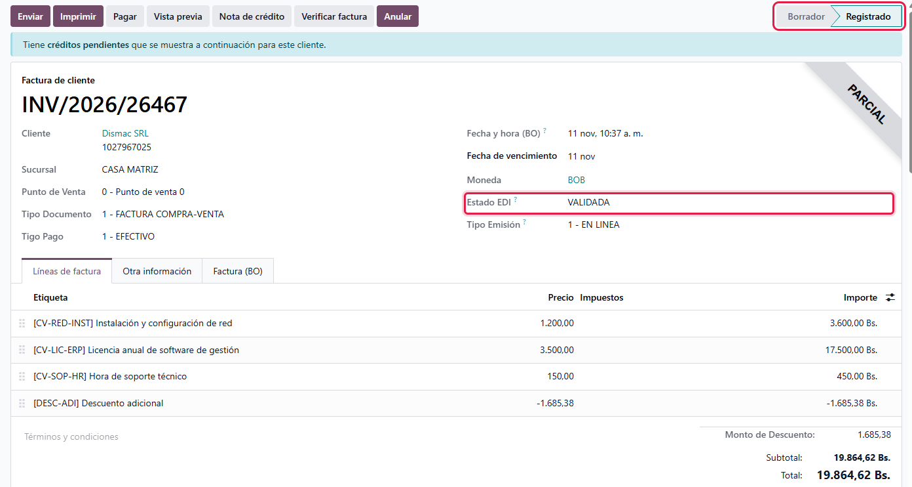

---
hide:
  - navigation
  - toc
---

Manual de usuario · SIAT

# Facturación electrónica en Odoo. Paso a paso, para Bolivia.

Cómo configurar Odoo y emitir, anular y regularizar cada documento fiscal ante el SIN, con capturas de cada pantalla.

[Empezar por la configuración](parte-1/index.md){ .md-button .md-button--primary }
[Ver los tipos de documento](parte-2/index.md){ .md-button }

!!! danger "¿El SIN no responde o está en mantenimiento?"

    No deje de vender: ponga el punto de venta **fuera de línea**, siga facturando y, cuando el SIN vuelva, las facturas se envían solas. [Ver qué hacer paso a paso →](parte-3/02-facturacion-fuera-de-linea-y-eventos-significativo.md#21-si-el-sin-no-responde-que-hacer-paso-a-paso)

## ¿Qué necesita hacer?

-   :material-office-building-cog:{ .lg } **[Configurar la empresa](parte-1/index.md)**

    ---

    Empresa, sucursales, puntos de venta, CUIS y CUFD. Se hace una sola vez y sirve para todos los documentos.

-   :material-receipt-text-check:{ .lg } **[Emitir una factura](parte-2/factura-de-compra-venta.md)**

    ---

    El paso a paso de la factura de compra-venta, el documento base a partir del cual se explican los demás.

-   :material-file-document-multiple:{ .lg } **[Elegir el tipo de documento](parte-2/index.md)**

    ---

    Los 31 documentos fiscales con su código del SIN, si dan crédito fiscal y qué distingue a cada uno.

-   :material-file-undo:{ .lg } **[Anular o revertir](parte-3/01-anulacion-y-reversion.md)**

    ---

    Cuándo anular una factura y cuándo emitir una nota de crédito, y cómo revertir una anulación.

-   :material-wifi-off:{ .lg } **[El SIN no responde](parte-3/02-facturacion-fuera-de-linea-y-eventos-significativo.md#21-si-el-sin-no-responde-que-hacer-paso-a-paso)**

    ---

    Qué hacer si el SIN está en mantenimiento o se corta internet: facturar fuera de línea, eventos significativos y contingencia con CAFC.

-   :material-store-plus:{ .lg } **[Agregar una sucursal](parte-1/02-configuracion-de-sucursales.md#24-agregar-una-sucursal-nueva)**

    ---

    Qué registrar ante Impuestos Nacionales y cómo crear la sucursal y sus puntos de venta en Odoo.

## Antes de empezar

- La facturación se emite bajo dos modalidades: Electrónica y Computarizada. Este manual usa como ejemplo la modalidad Electrónica en línea.
- El tipo de entorno puede ser de prueba o de producción. En el entorno de prueba, la factura lleva de fondo, como marca de agua, la leyenda "sin valor legal".
- La Casa Matriz es la sucursal 0 y trabaja con el punto de venta 0. Las demás sucursales (1, 2, … n) tienen sus propios puntos de venta.
- Cada punto de venta necesita su código, su CUIS y su CUFD; el CUIS dura 365 días y el CUFD solo 24 horas.

## Cómo está organizado

El manual tiene tres partes. La **[Parte I](parte-1/index.md)** es la configuración inicial, que se hace una sola vez. La **[Parte II](parte-2/index.md)** dedica una página a cada tipo de documento, empezando por la factura de compra-venta; cada documento se identifica por su nombre y su código del SIN. La **[Parte III](parte-3/index.md)** reúne las operaciones que no dependen del tipo de documento. A medida que se habiliten otros tipos de documento, cada uno se agrega como una página nueva de la Parte II.

Las Partes I y III numeran sus secciones desde 1: una referencia sin parte apunta a la misma parte, y una referencia a otra parte la nombra, por ejemplo «sección 3.5 de la Parte I». En la Parte II las referencias son enlaces con el nombre de la sección.

## Control de versiones

| Versión | Fecha | Descripción | Elaborado por |
|---|---|---|---|
| 1.0 | 16/11/2026 | Primera versión: configuración inicial, 31 tipos de documento y operaciones comunes. |  |
