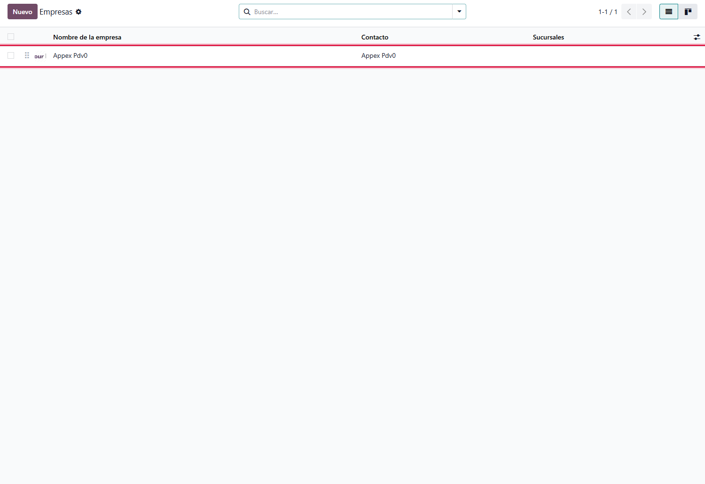
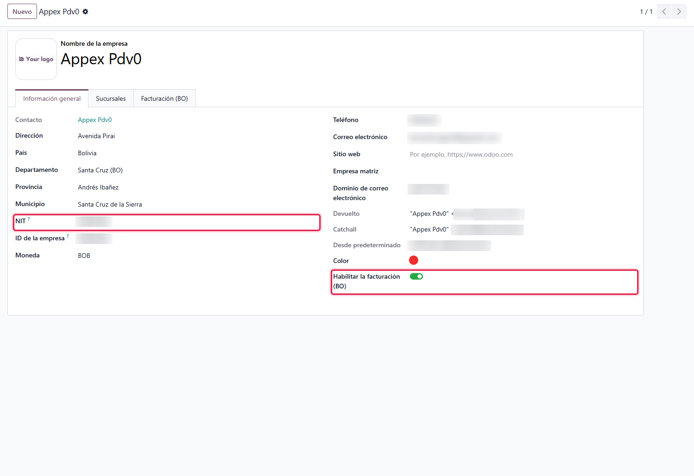
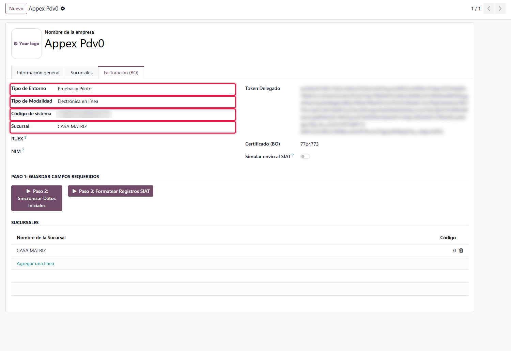

# 1. Configuración de la Empresa

En esta sección se registran los datos de su empresa y la conexión con el SIAT (Sistema Integrado de Administración Tributaria) de Impuestos Nacionales. Conviene configurarla primero porque las sucursales y los puntos de venta heredan esta configuración.

**Antes de empezar**

Tenga a mano estos datos; sin ellos no podrá completar la pantalla de facturación:

1. El NIT de la empresa, activo en Impuestos Nacionales.

1. La modalidad de facturación que el SIN asignó a su empresa. Se asigna según el volumen de operaciones y el perfil del contribuyente. Las dos que usa este manual son la Electrónica en línea y la Computarizada en línea.

1. El código de sistema del sistema de facturación.

1. El token delegado, que se genera en el portal del SIN.

1. El certificado digital, solo si la modalidad es Electrónica en línea.

Además de esos datos, su usuario necesita el permiso del módulo. Sin él no se ve nada, aunque el módulo esté instalado y la empresa bien configurada.

**Permiso Administrador (BO).** Su usuario debe tener el grupo Administrador (BO). Se asigna en Ajustes → Usuarios y empresas → Grupos, buscando ese grupo y agregando el usuario en la pestaña Usuarios, o desde la ficha del usuario en Permisos de acceso. Sin él, el menú Facturación (BO) no aparece en Ajustes y la sección Facturación (BO) del diario tampoco, por más que el usuario sea administrador de Odoo: es un grupo propio del módulo y no se asigna solo. Después de asignarlo, recargue el navegador o vuelva a entrar, porque el menú queda en caché.

## 1.1 Abrir la ficha de la empresa

Entre a Ajustes → Usuarios y empresas → Empresas. Se muestra la lista de empresas de la base de datos; haga clic sobre el nombre de su empresa para abrir su ficha.

{ width="624" loading="lazy" }

En la columna Sucursales de la lista aparecen las sucursales ya creadas. Más adelante, en la sección 2, se explica cómo verlas y administrarlas desde el menú Facturación (BO).

## 1.2 Completar la pestaña Información general

La ficha tiene tres pestañas: Información general, Sucursales y Facturación (BO). Se abre en la primera.

{ width="624" loading="lazy" }

Escriba el nombre y los datos legales tal como figuran en Impuestos Nacionales: Nombre de la empresa, Dirección, País (Bolivia) y Moneda (BOB, boliviano). Los datos de contacto (Teléfono, Móvil y Correo electrónico) son los que saldrán como referencia de la empresa.

Los dos campos más importantes son NIT e ID de la empresa. Ambos llevan el mismo número: el NIT de la empresa. Si el NIT está mal escrito, el SIAT rechazará todas las facturas.

Por último, active el interruptor Habilitar la facturación (BO), abajo a la derecha. Con él activado aparece la pestaña Facturación (BO) con la configuración del SIAT. Los campos Sitio web, Dominio de correo electrónico y Color son datos generales de Odoo y no son necesarios para facturar.

## 1.3 Configurar la pestaña Facturación (BO)

Abra la pestaña Facturación (BO). Aquí se le dice a Odoo cómo conectarse con el SIAT.

{ width="624" loading="lazy" }

**Tipo de entorno.** Elija «Pruebas y Piloto» mientras esté configurando y verificando. Las facturas emitidas en entorno de prueba llevan de fondo, como marca de agua, la leyenda "sin valor legal". Cuando todo esté verificado, cambie el entorno a producción; a partir de ese momento las facturas ya son legales y la leyenda deja de aparecer. No pase a producción hasta haber emitido, anulado y revisado facturas de prueba.

**Tipo de modalidad.** Seleccione la modalidad que le asignó el SIN. En la Electrónica en línea cada factura se firma digitalmente, por eso exige certificado; la Computarizada en línea no requiere firma digital. Si no sabe cuál le corresponde, consulte en su cuenta del SIAT antes de continuar.

**Código de sistema.** Es el código que identifica al sistema de facturación autorizado por Impuestos Nacionales ante el SIAT. Cópielo exactamente como se lo entregaron, sin espacios.

**Sucursal.** Indique la sucursal desde la cual opera la empresa. El ejemplo es CASA MATRIZ, que corresponde a la sucursal 0. Este dato se completa bien después de configurar las sucursales (sección 2), cuando la sucursal ya existe.

**Token delegado.** Es la credencial con la que Odoo se identifica ante el SIAT en nombre de su empresa. Se genera una sola vez por contribuyente, desde la Oficina Virtual del portal de Impuestos Nacionales: ingrese a SIAT → Sistema de Facturación en Línea y Envíos de Información con su NIT, usuario y contraseña, abra la opción Token Delegado, entre al Gestor Token y pulse Generar Nuevo Token. Luego cópielo y péguelo en este campo. Si lo pierde, puede volver a verlo desde el ícono de la lupa en el mismo Gestor Token.

!!! warning "Importante"

    El token delegado es una clave de acceso. No lo publique ni lo envíe por correo; en la captura de arriba está difuminado a propósito.

**Certificado (BO).** Es el certificado digital con el que se firman las facturas. Solo es obligatorio en la modalidad Electrónica en línea. Lo emite una entidad certificadora autorizada; en Bolivia, la ADSIB. En este campo se selecciona el certificado ya cargado en Odoo.

## 1.4 Guardar los cambios

Guarde los cambios de la ficha. Cuando el entorno, la modalidad, el código de sistema, el token y el certificado estén completos, la empresa queda lista y puede continuar con la sección 2: Sucursales.
