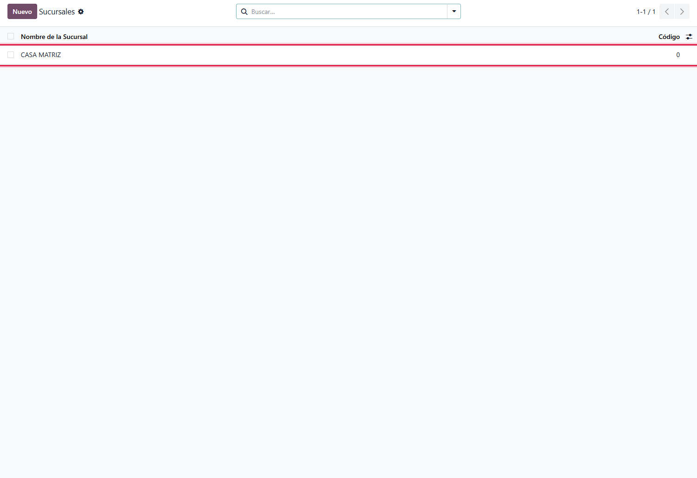

# 2. Configuración de Sucursales

Una sucursal es cada local registrado de la empresa ante Impuestos Nacionales. Cada una tiene un código y sus propios puntos de venta. La Casa Matriz siempre es la sucursal con código 0.

## 2.1 Ver la lista de sucursales

Entre al menú Facturación (BO), en la barra superior, y pulse el botón Sucursales. Se muestra la lista con el nombre y el código de cada sucursal. Puede activar tantas sucursales como necesite (1, 2 … n), cada una con su propio código.

{ width="624" height="428" loading="lazy" }

En el ejemplo solo está la CASA MATRIZ (código 0); cada sucursal nueva aparece como una fila más, con su propio código. La Casa Matriz y su punto de venta 0 ya vienen creados por defecto: no hay que crearlos, solo solicitar su CUIS y su CUFD (ver sección 3).

## 2.2 Datos de la sucursal

Abra una sucursal haciendo clic en su nombre. En la parte de arriba hay cuatro botones y, debajo, los datos generales.

{ width="624" height="428" loading="lazy" }

Los datos generales son Compañía, Código y la ubicación de la sucursal: Dirección, Departamento, Provincia y Municipio. La dirección y la ubicación son obligatorias, así que complételas todas. En la captura, la dirección de la Casa Matriz está vacía y debe llenarse.

Los cuatro botones de arriba son:

- **Actualizar POS(S):** trae desde el SIAT los puntos de venta de la sucursal. En el ejemplo se trajeron 41 puntos de venta con este botón.

- **Actualizar CUIS(S):** actualiza el código CUIS de la sucursal.

- **Actualizar CUFD(S):** actualiza el código CUFD de la sucursal.

- **Registrar POS:** registra ante el SIAT un punto de venta nuevo de la sucursal (ver sección 2.4).

!!! warning "Importante"

    Los códigos CUIS y CUFD no se renuevan solos: hay que pedirlos usted mismo con los botones.

## 2.3 Puntos de venta de la sucursal

Más abajo, la pestaña Puntos de venta lista los puntos de venta de la sucursal con su estado.

{ width="624" height="428" loading="lazy" }

Las columnas son Nombre, En línea, CUIS activo, CUFD activo y Tipo; al final de cada fila hay accesos directos a Cufd y anulaciones manuales. Un interruptor verde significa que la condición está activa. En el ejemplo, el Punto de venta 0 tiene los tres activos; el Punto de venta 1 tiene CUIS pero le falta el CUFD; y los demás aún no tienen ninguno.

Para configurar un punto de venta, haga clic en su nombre. Eso se explica en la sección 3.

## 2.4 Agregar una sucursal nueva

Cuando la empresa abre un local nuevo donde vende y factura, ese local es una sucursal. Primero se registra ante Impuestos Nacionales y recién después se configura en Odoo. El orden importa: Odoo no puede facturar desde una sucursal que el SIN no tiene registrada, y la dirección que se imprime en la factura es la que el SIN tiene registrada para esa sucursal (la devuelve junto con el CUFD).

### Registrar la sucursal en el SIN

- La sucursal se da de alta en el **Registro Nacional de Contribuyentes** (RNC, antes Padrón PBD-11), en línea desde **SIAT en Línea** (www.impuestos.gob.bo) o en forma presencial en una oficina del SIN.
- El SIN puede inspeccionar el local antes de habilitarla: hasta 5 días hábiles si el trámite es en línea y hasta 10 si es presencial (5 días más si el local está fuera de una ciudad capital).
- Ya habilitada, la sucursal queda registrada con su **número de sucursal**: la Casa Matriz es la 0 y las sucursales son 1, 2, … n. Anote ese número: es el **Código** que se carga en Odoo, y tiene que coincidir exactamente.
- El SIN entrega el **Documento de Exhibición NIT** de la sucursal, que debe estar a la vista en el local.

!!! note "Nota"

    Los requisitos y documentos del trámite los define el SIN y pueden cambiar. Consúltelos en www.impuestos.gob.bo o en una oficina del SIN antes de iniciarlo.

### Crear la sucursal en Odoo

1. **Crear la sucursal.** Facturación (BO) → **Sucursales** → botón **Nuevo**.

1. **Completar los datos generales.** En **Código**, el número de sucursal registrado en el SIN. Odoo completa el nombre solo (Sucursal 1, Sucursal 2…). Verifique que la **Compañía** sea la correcta.

1. **Completar la dirección:** Departamento, Provincia, Municipio y Teléfono, igual que en el registro del SIN.

1. **Guardar y crear el punto de venta de inicio.** Pulse **(+) Crear Punto de venta de inicio de sistema**. Odoo crea el punto de venta 0 de la sucursal, que es el que pide los códigos al SIAT, y lo muestra en el campo **POS Inicio de Sistema**.

1. **Configurar el punto de venta 0** como cualquier punto de venta (sección 3): Tipo de Emisión, Tipo de Punto de Venta y Dirección. Después pulse **Solicitar CUIS** y **Solicitar CUFD** (sección 3.3). Si el SIAT rechaza el CUIS, revise que la sucursal ya esté habilitada en el SIN y que el Código sea el mismo.

1. **Agregar los demás puntos de venta**, si la sucursal tiene más de uno:

    - Si ya están registrados en el SIAT, **Actualizar POS(S)** los trae a Odoo.
    - Para registrar uno nuevo, pulse **Registrar POS** y complete Tipo de Punto de Venta, Nombre y Descripción. El SIAT le asigna su código y el punto de venta aparece en la pestaña Puntos de Venta.
    - Al final, **Actualizar CUIS(S)** y **Actualizar CUFD(S)** piden los códigos de todos los puntos de venta de la sucursal.

1. **Cargar las secuencias** de los tipos de documento que se van a emitir en cada punto de venta (sección 3.5).

1. **Comprobar con la primera factura.** Emita la primera factura desde un punto de venta de la sucursal y verifique que quede `VALIDADA` y que la dirección impresa sea la de la sucursal.
