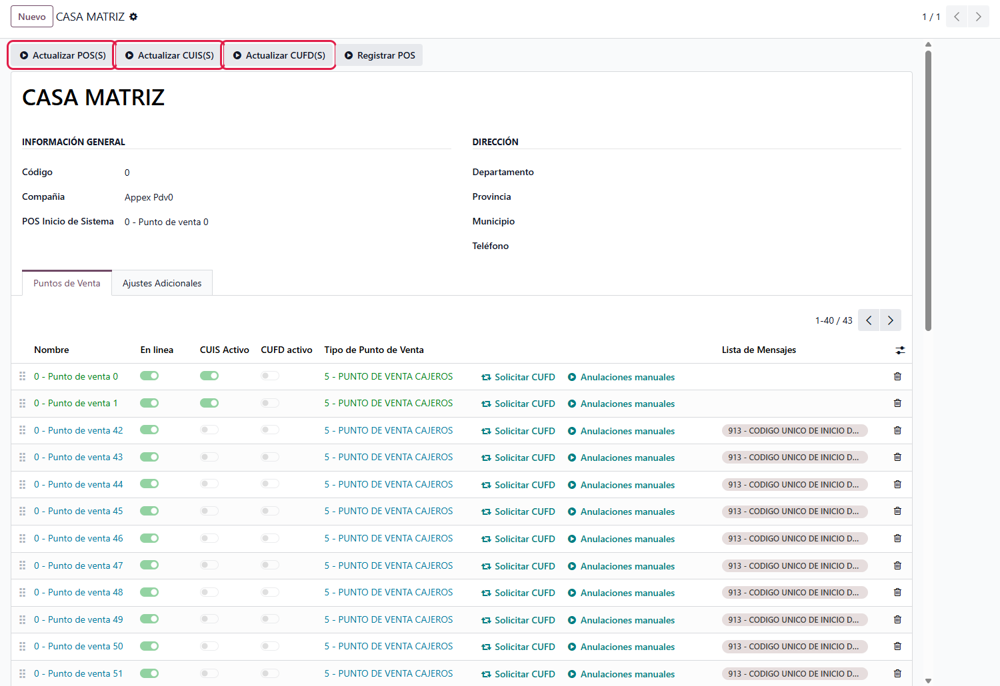
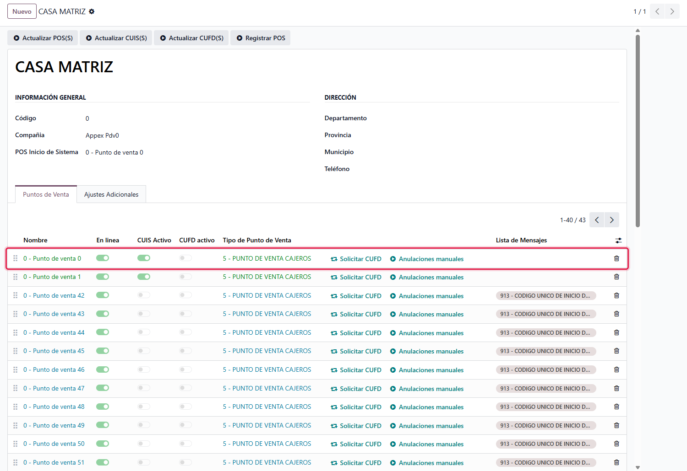

# 2. Configuración de Sucursales

Una sucursal es cada local registrado de la empresa ante Impuestos Nacionales. Cada una tiene un código y sus propios puntos de venta. La Casa Matriz siempre es la sucursal con código 0.

## 2.1 Ver la lista de sucursales

Entre al menú Facturación (BO), en la barra superior, y pulse el botón Sucursales. Se muestra la lista con el nombre y el código de cada sucursal. Puede activar tantas sucursales como necesite (1, 2 … n), cada una con su propio código.

{ width="624" loading="lazy" }

En el ejemplo solo está la CASA MATRIZ (código 0); cada sucursal nueva aparece como una fila más, con su propio código. La Casa Matriz y su punto de venta 0 ya vienen creados por defecto: no hay que crearlos, solo solicitar su CUIS y su CUFD (ver sección 3).

## 2.2 Datos de la sucursal

Abra una sucursal haciendo clic en su nombre. En la parte de arriba hay tres botones y, debajo, los datos generales.

{ width="624" loading="lazy" }

Los datos generales son Compañía, Código y la ubicación de la sucursal: Dirección, Departamento, Provincia y Municipio. La dirección y la ubicación son obligatorias, así que complételas todas. En la captura, la dirección de la Casa Matriz está vacía y debe llenarse.

Los tres botones de arriba son:

- **Actualizar POS(S):** trae desde el SIAT los puntos de venta de la sucursal. En el ejemplo se trajeron 41 puntos de venta con este botón.

- **Actualizar CUIS(S):** actualiza el código CUIS de la sucursal.

- **Actualizar CUFD(S):** actualiza el código CUFD de la sucursal.

!!! warning "Importante"

    Los códigos CUIS y CUFD no se renuevan solos: hay que pedirlos usted mismo con los botones.

## 2.3 Puntos de venta de la sucursal

Más abajo, la pestaña Puntos de venta lista los puntos de venta de la sucursal con su estado.

{ width="624" loading="lazy" }

Las columnas son Nombre, En línea, CUIS activo, CUFD activo y Tipo; al final de cada fila hay accesos directos a Cufd y anulaciones manuales. Un interruptor verde significa que la condición está activa. En el ejemplo, el Punto de venta 0 tiene los tres activos; el Punto de venta 1 tiene CUIS pero le falta el CUFD; y los demás aún no tienen ninguno.

Para configurar un punto de venta, haga clic en su nombre. Eso se explica en la sección 3.
