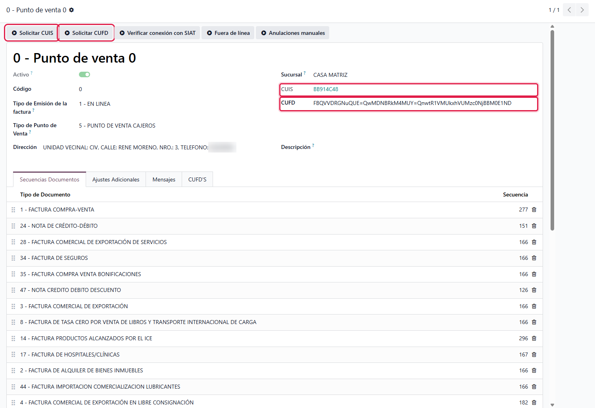
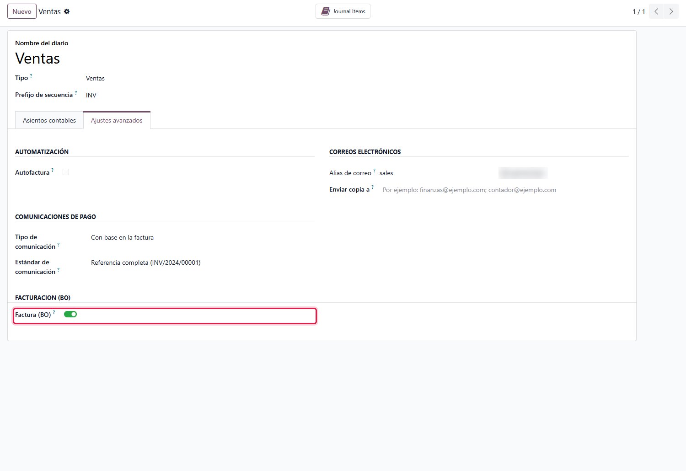

# 3. Configuración de Puntos de venta

El punto de venta es el lugar desde el cual se emiten las facturas. Cada punto de venta necesita dos códigos que entrega el SIAT: el CUIS y el CUFD. Sin ellos no se puede facturar.

## 3.1 Qué son el CUIS y el CUFD

El CUIS (Código Único de Inicio de Sistemas) relaciona su sistema de facturación con su NIT, su sucursal y, opcionalmente, su punto de venta. Tiene una vigencia de 365 días calendario.

El CUFD (Código Único de Facturación Diaria) habilita la emisión de facturas durante 24 horas. Por eso debe renovarse; en Odoo se pide manualmente con el botón correspondiente.

!!! note "Nota"

    Siempre se pide primero el CUIS y después el CUFD: sin un CUIS vigente el SIAT no entrega el CUFD.

Además de estos dos, cada factura lleva su propio CUF (Código Único de Factura), que la identifica de forma única; Odoo lo genera al emitirla.

## 3.2 Abrir el punto de venta

En la pestaña Puntos de venta de la sucursal, haga clic sobre el nombre del punto de venta. Se abre una ventana con sus datos y sus botones.

{ width="624" height="428" loading="lazy" }

Los datos que se muestran son: Código (en el ejemplo, 0), Emisión (1 - EN LINEA), Tipo (5 - PUNTO DE VENTA CAJEROS), Dirección, Descripción, y el CUIS y el CUFD una vez que se solicitan.

## 3.3 Solicitar el CUIS y el CUFD

- Pulse **Solicitar CUIS**. Cuando el SIAT responde, el código aparece en el campo CUIS de la derecha.

- Pulse **Solicitar CUFD**. El código aparece en el campo CUFD.

- Pulse **Verificar conexión con SIAT** para comprobar que Odoo se comunica correctamente con Impuestos Nacionales.

- Vuelva a la lista de la sucursal: el punto de venta debe mostrar activos los interruptores CUIS activo y CUFD activo.

!!! warning "Importante"

    Recuerde que el CUFD solo dura 24 horas: cuando venza, vuelva a solicitarlo antes de emitir.

## 3.4 Otros botones de la ventana

En la parte superior hay además tres botones: Crear Secuencia, Fuera de línea y Anulaciones manuales. El botón Fuera de línea se explica en la sección 2 de la Parte III.

## 3.5 Pestañas inferiores

La ventana tiene cuatro pestañas: Secuencias Documentos, Ajustes Adicionales, Mensajes y CUFD'S. La pestaña Secuencias Documentos indica, para cada tipo de documento (por ejemplo, 1 - FACTURA COMPRA-VENTA), su número de secuencia. La pestaña CUFD'S guarda los códigos CUFD solicitados.

## 3.6 Activar la facturación BO en el diario de ventas

Con las sucursales y los puntos de venta ya configurados, falta habilitar la facturación BO en el diario con el que se emiten las facturas.

**Interruptor Factura (BO) en el diario.** Entre a Contabilidad → Configuración → Diarios, abra el diario Ventas, vaya a la pestaña Ajustes avanzados y, en la sección Facturación (BO), active el interruptor Factura (BO).

{ width="624" height="428" loading="lazy" }

!!! warning "Importante"

    Ese interruptor es el que hace que las facturas emitidas con ese diario se traten como facturas BO. Si está apagado, la factura se crea sin Sucursal, sin Punto de venta, sin Tipo de documento y sin la pestaña Factura (BO), y no hay forma de corregirla desde la propia factura. Las facturas creadas antes de activarlo no se arreglan solas: hay que crear una nueva.
