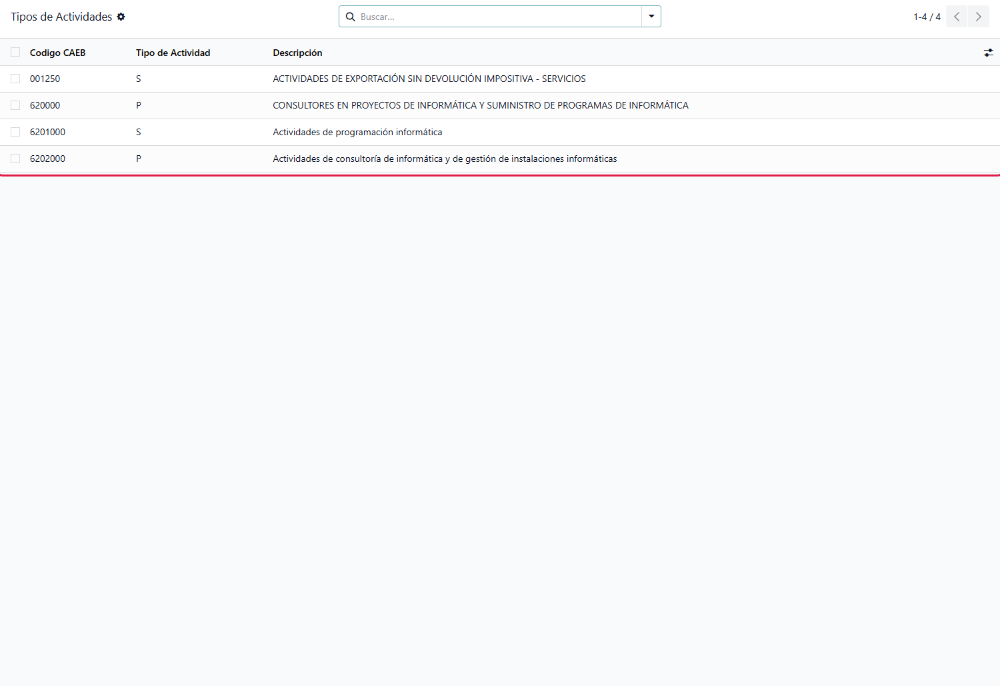
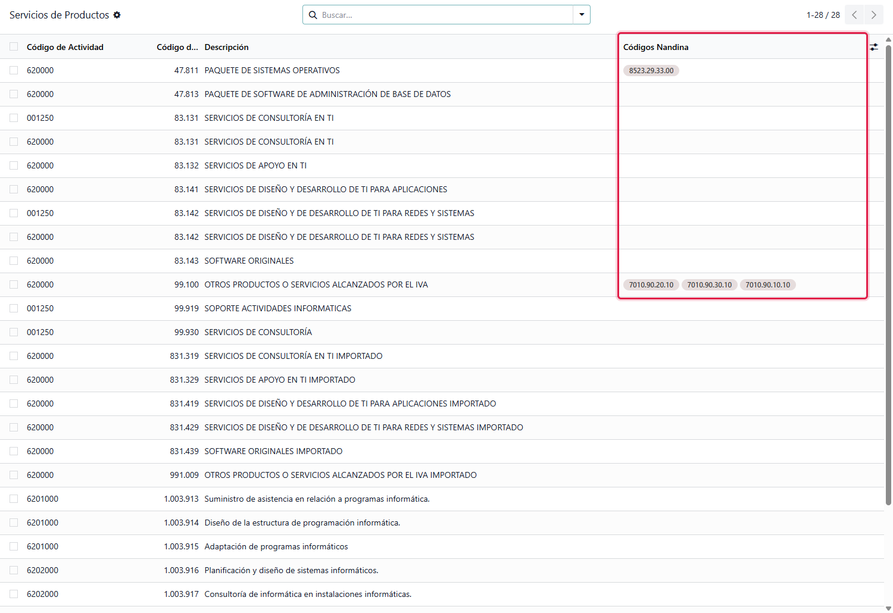

# 4. Catálogos del SIAT, actividades y productos

Los catálogos son las listas oficiales de Impuestos Nacionales. Cada factura usa sus códigos para describir qué se vende, en qué unidad, en qué moneda y cómo se paga. Antes de emitir, conviene revisarlos y asignar los que correspondan a su empresa.

Los catálogos están en el menú Facturación (BO), en el grupo Catálogos SIAT. Entre ellos hay códigos de actividad, de productos, de leyendas, de mensajes, de países, de pago, de moneda, de punto de venta y de tipo de factura. Cada catálogo se muestra como una tabla: el código a la izquierda y su descripción al lado. En Códigos de Tipo Documento cada tipo es una fila que muestra su Tipo Factura, su Documento Sector y el interruptor Activo; para revisar un tipo basta con buscar su fila. Esa lista se edita en la misma fila: al hacer clic en un tipo no se abre una ficha, sus columnas quedan editables, y los cambios se guardan con el botón Guardar de arriba (o se descartan con Descartar).

## 4.1 Códigos de actividad

La actividad económica identifica a qué se dedica su empresa. Está asociada al NIT y se registra con su código.

{ width="624" height="428" loading="lazy" }

La lista muestra tres datos: el código CAEB (Clasificador de Actividades Económicas de Bolivia), el tipo de actividad (la letra P o S) y la descripción. En el ejemplo hay cuatro actividades, como 6201000 – Actividades de programación informática y 620000 – Consultores en proyectos de informática y suministro de programas de informática.

## 4.2 Códigos de productos

Cada producto o servicio que factura debe corresponder a un código de producto del SIAT, y ese código depende de la actividad.

{ width="624" height="428" loading="lazy" }

La tabla tiene cuatro columnas: Código de actividad, Código de producto, Descripción y Códigos nandina. Un mismo producto puede aparecer bajo más de una actividad: por ejemplo, el código 83.131 – Servicios de consultoría en TI está con la actividad 620000 y también con la 001250. La columna Códigos nandina solo trae valores en algunos productos, como el 47.811 (paquete de sistemas operativos).
