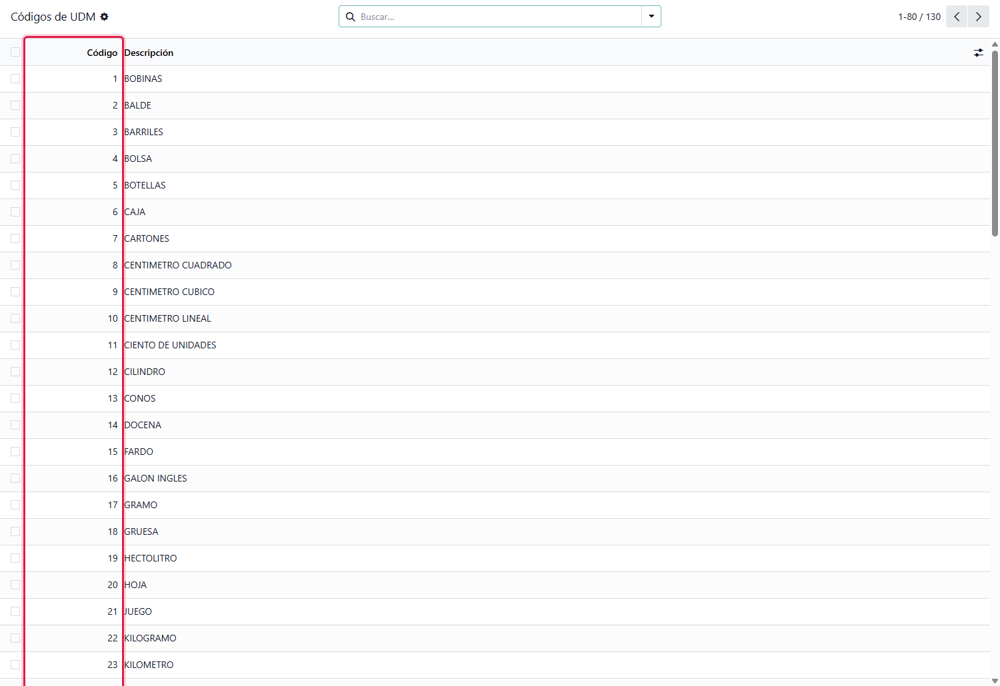
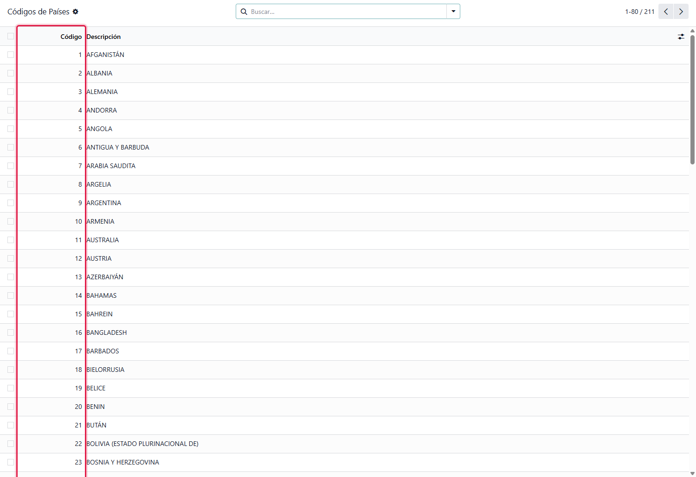
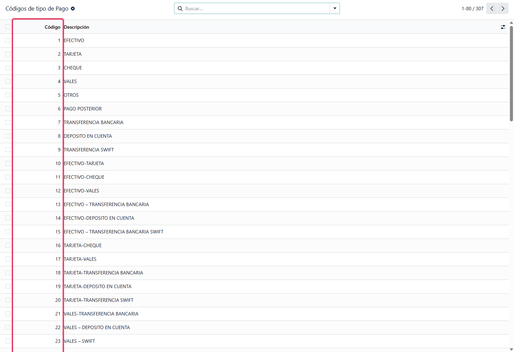

# 5. Homologación de datos con el SIAT

Homologar es asignar a cada dato de Odoo el código que le corresponde en el SIAT. Así, Impuestos Nacionales reconoce lo que aparece en la factura. Se homologan cinco tipos de datos: productos, unidades de medida, moneda, países y formas de pago. Los catálogos de cada uno están en el menú Facturación (BO).

## 5.1 Unidades de medida

El catálogo Códigos de UDM tiene 130 unidades. Cada una muestra su código y su descripción.

{ width="624" loading="lazy" }

Para los casos más comunes se usan dos códigos:

- **57 – UNIDAD (BIENES):** para productos físicos. La cantidad puede ser de 1 a n.

- **58 – UNIDAD (SERVICIOS):** para servicios. La cantidad es 1.

## 5.2 Países

El catálogo Códigos de países tiene 211 países, cada uno con su código (por ejemplo, 1 es Afganistán y 3 es Alemania).

{ width="624" loading="lazy" }

## 5.3 Formas de pago

El catálogo Códigos de tipo de pago tiene 307 opciones. Incluye las formas simples, como 1 – Efectivo, 2 – Tarjeta, 3 – Cheque, 7 – Transferencia bancaria o 6 – Pago posterior, y combinaciones como 10 – Efectivo-Tarjeta, 11 – Efectivo-Cheque o 12 – Efectivo-Vales. Si el cliente paga con dos medios, se elige el código combinado.

{ width="624" loading="lazy" }
