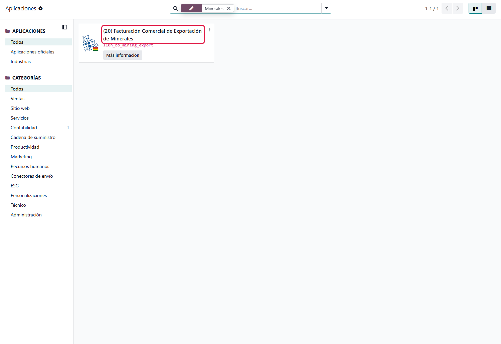
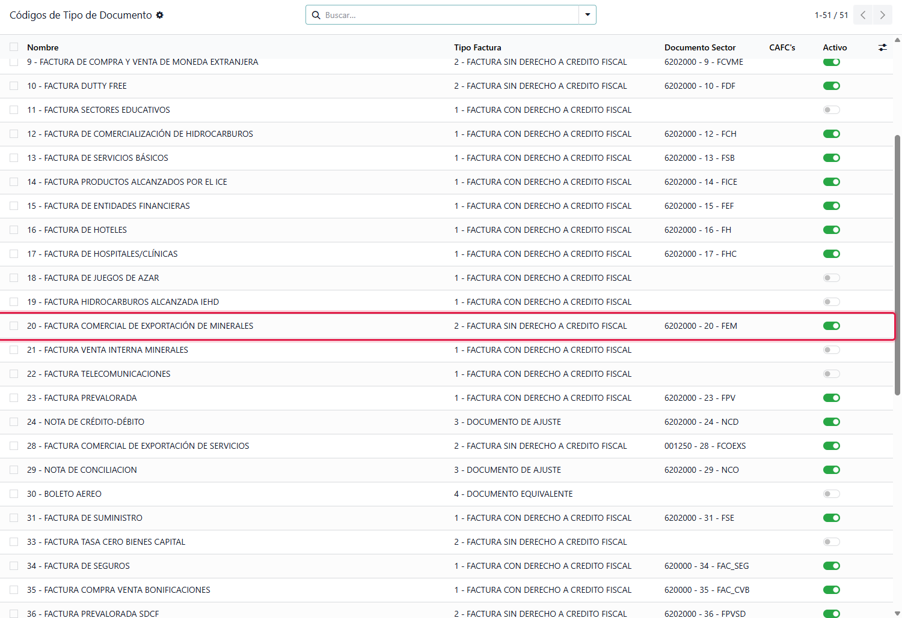
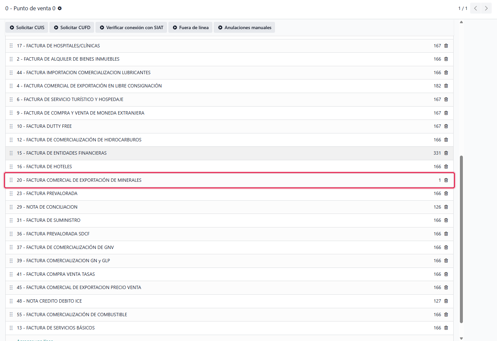
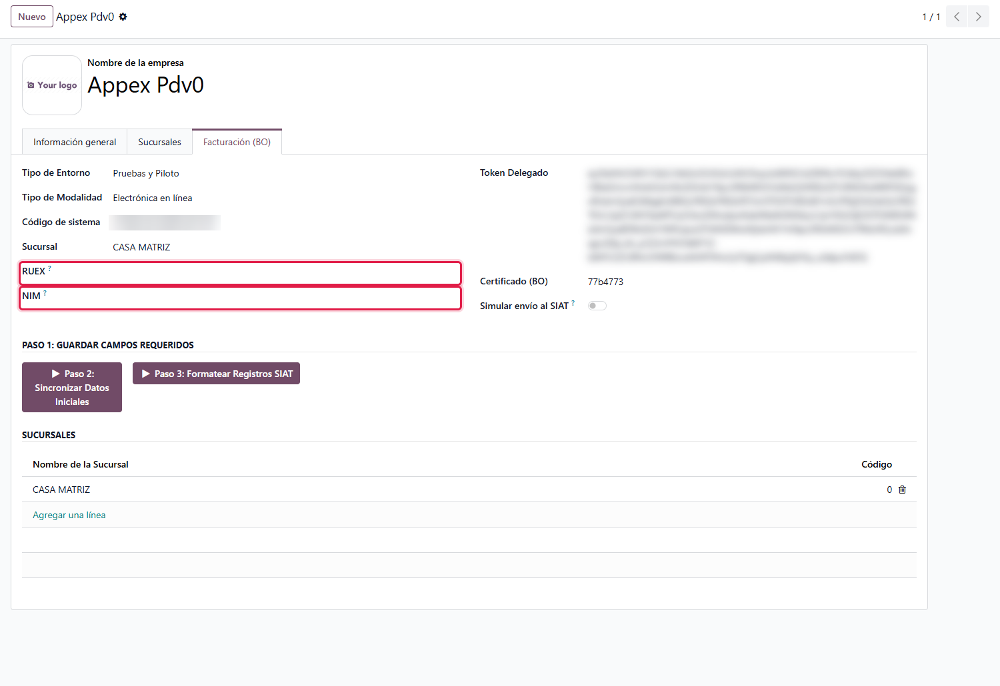
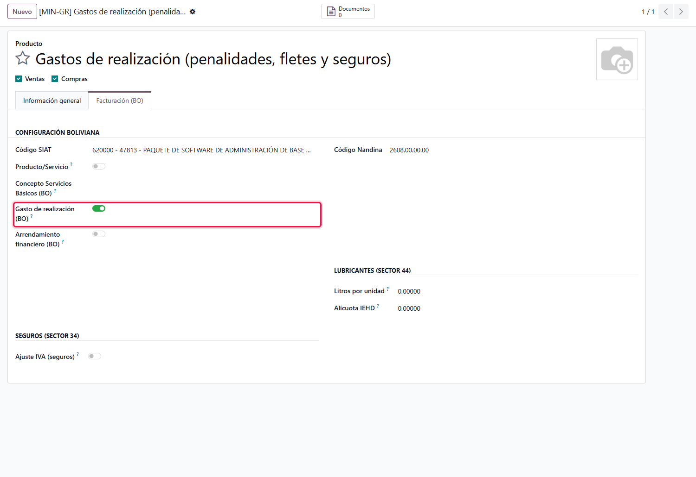
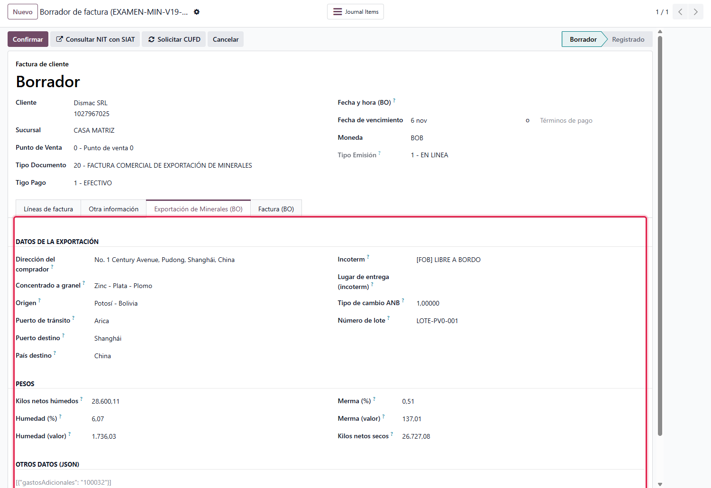
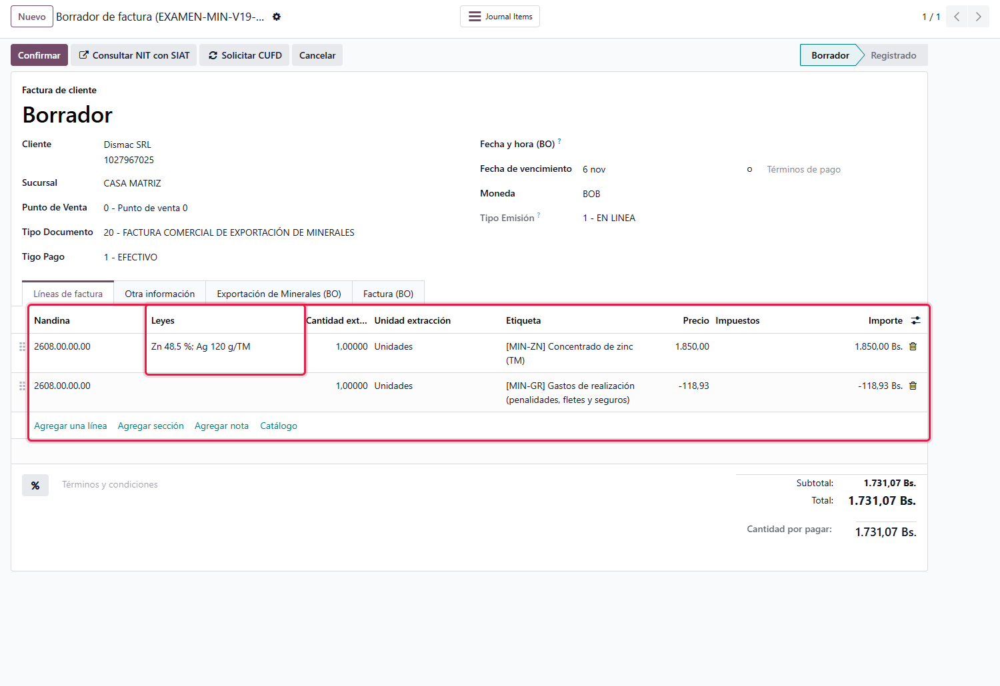

# Factura comercial de exportación de minerales

Es la factura que emiten las empresas mineras al exportar concentrados de minerales, por ejemplo de zinc, plata o plomo. En Odoo aparece como tipo de documento **20 - FACTURA COMERCIAL DE EXPORTACIÓN DE MINERALES**; ante el SIAT es el documento sector 20. Como toda exportación, no da derecho a crédito fiscal. Lo que la distingue son los datos de la exportación (comprador, concentrado, origen, puertos, país, incoterm y lote), los pesos del embarque (kilos húmedos y secos, humedad y merma) y, en cada línea, la **Nandina** y las **leyes** del mineral. Los gastos de realización se restan del valor. Queda emitida cuando el SIN la devuelve como **VALIDADA (código 908)**.

!!! warning "Importante"

    El documento sector 20 tiene que estar habilitado para el NIT de la empresa en el SIAT, además de en Odoo. Si no lo está, al confirmar la factura el SIN responde «EL NIT NO TIENE HABILITADO EL DOCUMENTO SECTOR» y la factura queda en borrador. La habilitación se solicita en Impuestos Nacionales.

## Qué debe estar configurado

Además de la configuración general de la Parte I, la factura de exportación de minerales necesita estos puntos:

- **Módulo activado.** Aplicaciones → buscar «Minerales» → «(20) Facturación Comercial de Exportación de Minerales» → Activar.

    { width="624" height="428" loading="lazy" }

- **Tipo de documento 20 activo y con su documento sector.** Ajustes → Facturación (BO) → Catálogos SIAT → Códigos de Tipo Documento, fila «20 - FACTURA COMERCIAL DE EXPORTACIÓN DE MINERALES»: el interruptor Activo debe estar encendido, el campo Documento Sector completo (por ejemplo, «6202000 - 20 - FEM»; depende de la actividad económica registrada en el SIN) y el Tipo de factura en «2 - FACTURA SIN DERECHO A CREDITO FISCAL».

    { width="624" height="428" loading="lazy" }

- **Secuencia en el punto de venta.** En la pestaña Secuencias Documentos del punto de venta (sección 3.5 de la Parte I) debe figurar el tipo 20. Si falta, se agrega una línea a mano, como se explica en la sección [Nota de crédito-débito › Qué debe saber antes de emitirla](nota-de-credito-debito.md#que-debe-saber-antes-de-emitirla).

    { width="624" height="428" loading="lazy" }

- **RUEX y NIM de la empresa.** Ajustes → Usuarios y empresas → Empresas → abrir la empresa → pestaña Facturación (BO): el **RUEX** (Registro Único de Exportadores) y el **NIM** (Número de Identificación Minera) se informan al SIN en cada factura.

    { width="624" height="428" loading="lazy" }

- **Productos minerales con Código SIAT y Código Nandina.** Cada concentrado es un producto con su Código SIAT y su Código Nandina en la pestaña Facturación (BO); por ejemplo, 2608 para el concentrado de zinc, 2616 para el de plata y 2607 para el de plomo.

- **Producto para los gastos de realización.** Un producto de tipo servicio con la casilla **Gasto de realización (BO)** marcada, en la pestaña Facturación (BO). Se usa para restar las penalidades, los fletes y los seguros.

    { width="624" height="428" loading="lazy" }

- **País destino homologado.** El país al que se exporta debe tener cargado su País (SIAT) (sección 5.2 de la Parte I).

## La pestaña Exportación de Minerales (BO)

Al elegir el tipo de documento 20, la factura muestra la pestaña Exportación de Minerales (BO), antes de la pestaña Factura (BO). Los campos marcados como obligatorios se exigen al guardar:

- **Datos de la Exportación:** Dirección del comprador, Concentrado a granel (por ejemplo «Zinc - Plata - Plomo»), Origen (por ejemplo «Potosí - Bolivia»), Puerto destino, País destino, Incoterm, Tipo de cambio ANB y Número de lote son obligatorios; Puerto de tránsito y Lugar de entrega (incoterm) son opcionales.

- **Pesos:** Kilos netos húmedos y Kilos netos secos son obligatorios; Humedad y Merma se cargan en porcentaje o en valor.

- **Otros datos (JSON):** datos adicionales que pida el SIN, en formato JSON. Es opcional.

    { width="624" height="428" loading="lazy" }

## Las líneas de la factura

Con el tipo de documento 20, las líneas muestran cuatro columnas más, junto al producto: **Nandina**, **Leyes** (la ley del mineral, por ejemplo «Zn 48,5 %; Ag 120 g/TM»; es obligatoria), **Cantidad extracción** y **Unidad extracción**. Este documento no admite descuentos, ni por línea ni adicional.

Los gastos de realización van como una línea más, con el producto marcado como Gasto de realización (BO) y **precio negativo**: no salen en el detalle y su importe se informa aparte.

{ width="624" height="428" loading="lazy" }

## Paso a paso: crear y emitir la factura

1. **Abrir una factura nueva:** Contabilidad → Clientes → Facturas → botón Nuevo, y elegir el comprador del exterior en el campo Contacto.

1. **Completar la cabecera:** Sucursal, Punto de Venta, Tigo Pago (sin gift card) y, en Tipo Documento, **20 - FACTURA COMERCIAL DE EXPORTACIÓN DE MINERALES**.

1. **Cargar las líneas:** cada concentrado con su cantidad, precio, Nandina y leyes; y, si corresponde, la línea de gastos de realización con precio negativo (sección [Las líneas de la factura](#las-lineas-de-la-factura)).

1. **Completar la pestaña Exportación de Minerales (BO)** (sección [La pestaña Exportación de Minerales (BO)](#la-pestana-exportacion-de-minerales-bo)).

1. **Revisar la pestaña Factura (BO)** (sección [Factura de compra-venta › Paso a paso: crear y emitir la factura](factura-de-compra-venta.md#paso-a-paso-crear-y-emitir-la-factura), paso 7) y **pulsar Confirmar.** Debe quedar en Registrado, con Estado EDI **VALIDADA**.

Igual que en la compra-venta (sección [Factura de compra-venta › Cómo saber si la factura llegó al SIN](factura-de-compra-venta.md#como-saber-si-la-factura-llego-al-sin)), la factura está emitida solo si **Estado EDI** dice **VALIDADA**. Tiene su propia numeración por punto de venta (la secuencia 20). Se anula y se revierte igual que las demás facturas (sección 1 de la Parte III).

## Errores frecuentes

Los errores de la sección [Factura de compra-venta › Errores frecuentes y cómo resolverlos](factura-de-compra-venta.md#errores-frecuentes-y-como-resolverlos) también se aplican a esta factura. Además, estos son propios de este documento:

| Lo que ve el usuario | Por qué pasa | Cómo se resuelve |
|---|---|---|
| «EL NIT NO TIENE HABILITADO EL DOCUMENTO SECTOR» | El SIN no tiene habilitado el sector 20 para el NIT de la empresa. | Solicitar la habilitación en Impuestos Nacionales y volver a confirmar. |
| En Tipo Documento no aparece 20 - FACTURA COMERCIAL DE EXPORTACIÓN DE MINERALES | Falta el módulo, el tipo 20 no está activo o el punto de venta no tiene la secuencia. | Revisar los puntos de la sección [Qué debe estar configurado](#que-debe-estar-configurado). |
| «Nota: Debe registrar el campo "..." para la Factura de Exportación de Minerales.» o «Debe registrar la Dirección del comprador…» | Falta un dato obligatorio de la pestaña Exportación de Minerales (BO). | Completar el campo indicado (sección [La pestaña Exportación de Minerales (BO)](#la-pestana-exportacion-de-minerales-bo)). |
| «Nota: Debe establecer el País destino de la exportación.» | Falta el País destino, o el país no tiene su País (SIAT). | Elegir el país y revisar su homologación (sección 5.2 de la Parte I). |
| «Nota: El tipo de cambio y el tipo de cambio ANB deben ser mayores a cero.» | El Tipo de cambio ANB quedó en cero. | Cargar el tipo de cambio ANB. |
| «Nota: Los kilos netos húmedos y los kilos netos secos deben ser mayores a cero.» | Faltan los pesos del embarque. | Completar los kilos netos húmedos y secos. |
| «Nota: Debe registrar las Leyes del mineral en la línea \[producto\].» | Una línea de mineral no tiene leyes. | Completar la columna Leyes. |
| «Nota: El producto \[producto\] tiene descuento. Este sector no admite descuentos (montoDescuento = 0).» | Se cargó un descuento en una línea o un descuento adicional. | Quitar el descuento. |
