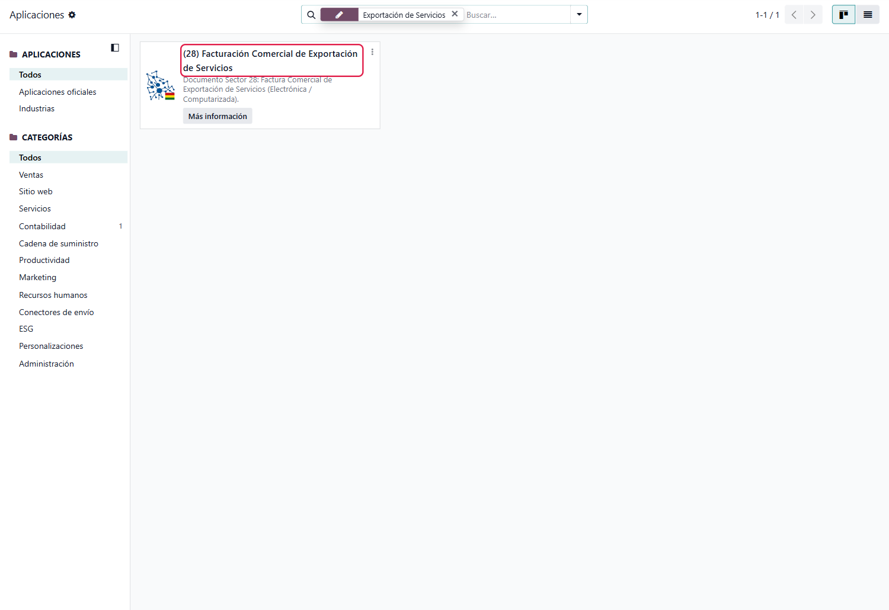
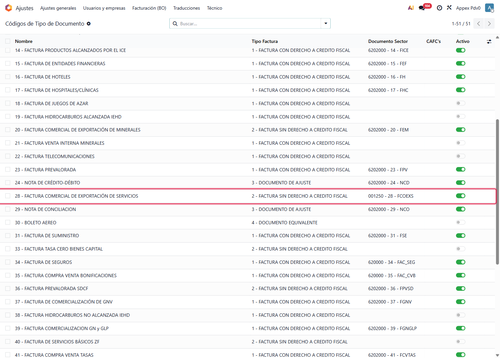
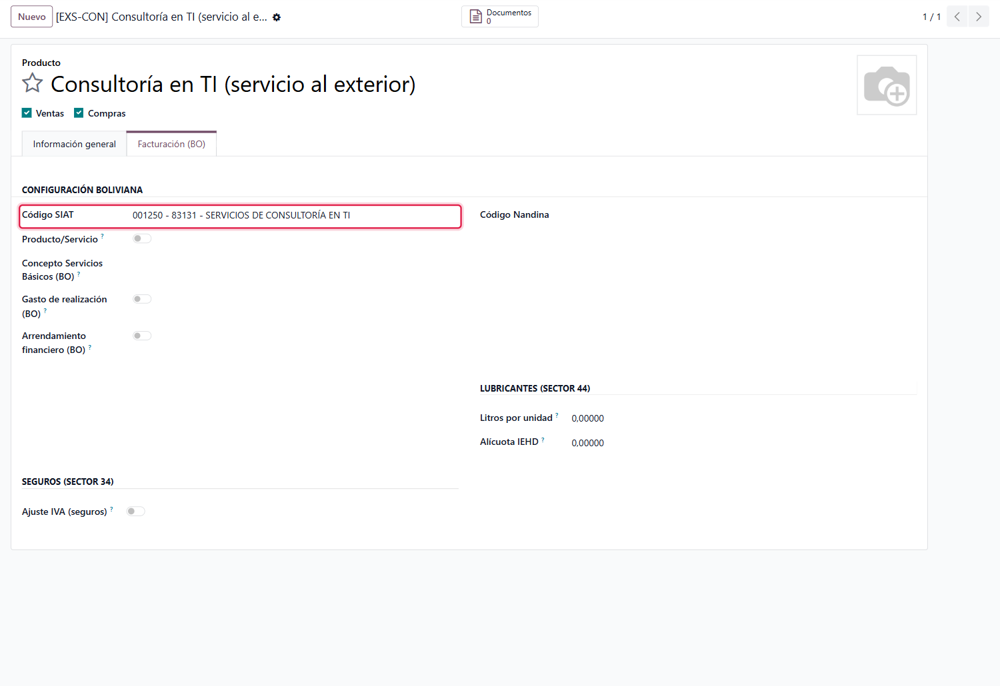
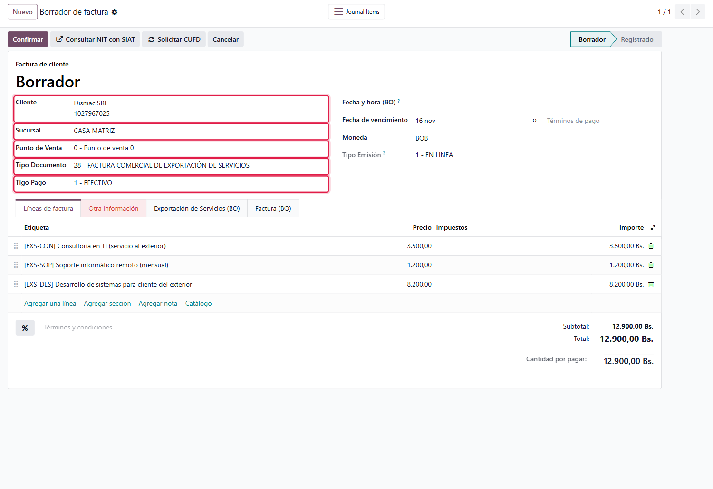
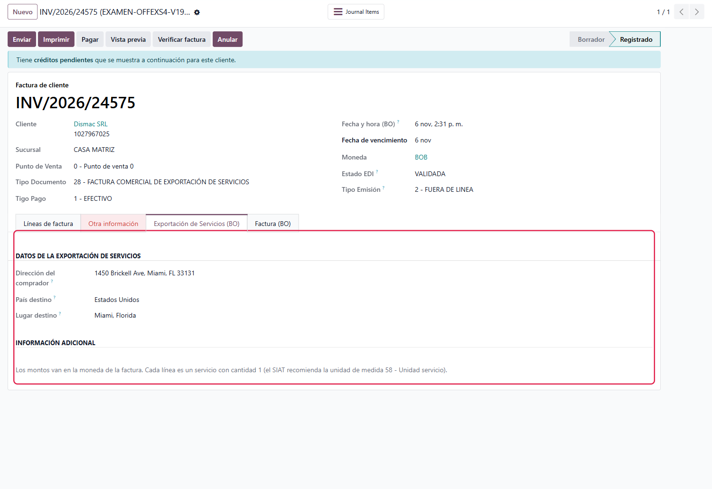
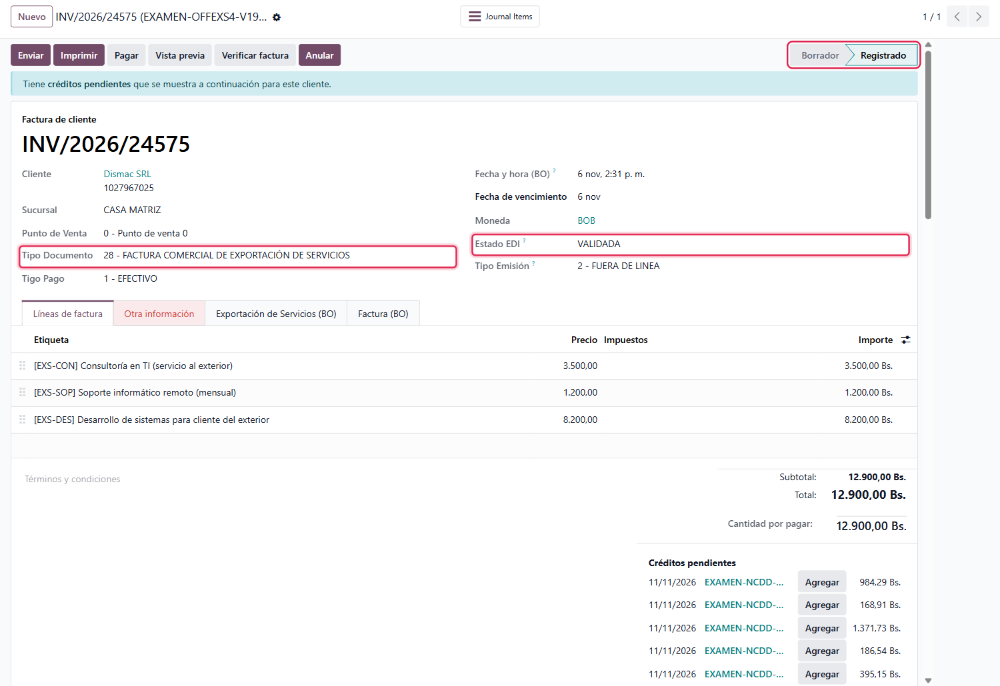
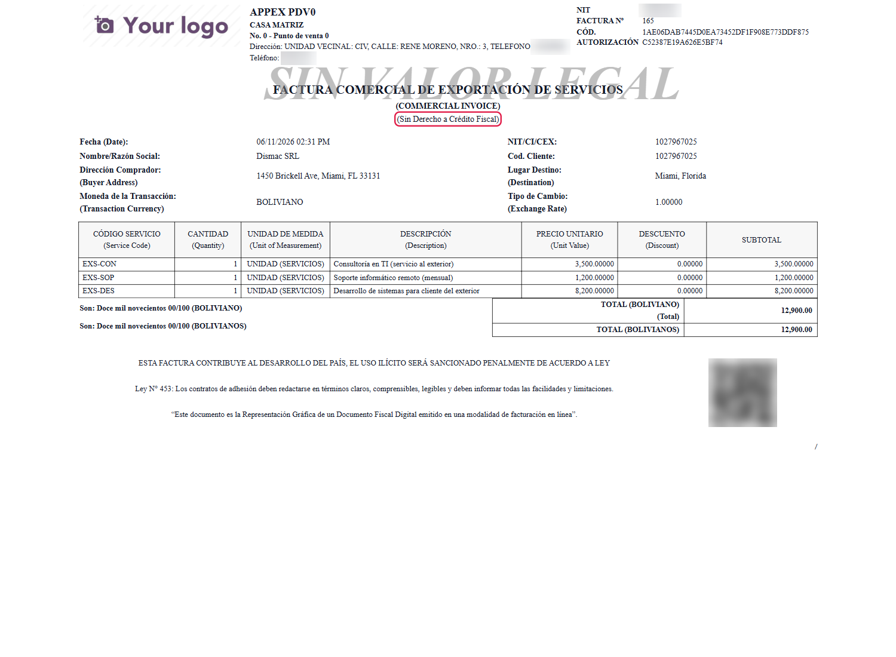

# Factura comercial de exportación de servicios

Es la factura de los servicios que se prestan desde Bolivia a clientes del exterior, por ejemplo consultoría, desarrollo de sistemas o soporte informático remoto. Es un documento distinto de la factura comercial de exportación de bienes (sección [Factura comercial de exportación](factura-comercial-de-exportacion.md)). En Odoo aparece como tipo de documento **28 - FACTURA COMERCIAL DE EXPORTACIÓN DE SERVICIOS**; ante el SIAT es el documento sector 28. Como toda exportación, **no da derecho a crédito fiscal**: el SIN la recibe con el monto sujeto a IVA en cero. Pide los datos del comprador en el exterior y **cada línea va con cantidad 1**. Queda emitida cuando el SIN la devuelve como **VALIDADA (código 908)**.

## Qué debe estar configurado

Además de la configuración general de la Parte I, la factura de exportación de servicios necesita estos cuatro puntos:

- **Módulo de exportación de servicios activado.** Aplicaciones → buscar «Exportación de Servicios» → «(28) Facturación Comercial de Exportación de Servicios» → Activar.

    { width="624" height="428" loading="lazy" }

- **Tipo de documento 28 activo y con su documento sector.** Ajustes → Facturación (BO) → Catálogos SIAT → Códigos de Tipo Documento, fila «28 - FACTURA COMERCIAL DE EXPORTACIÓN DE SERVICIOS»: el interruptor Activo debe estar encendido y el campo Documento Sector completo. El documento sector lo trae la sincronización con el SIN y puede corresponder a una actividad distinta de la de los demás documentos (por ejemplo, «001250 - 28 - FCOEXS», de la actividad 001250).

    { width="624" height="448" loading="lazy" }

- **Secuencia en el punto de venta.** En la pestaña Secuencias Documentos del punto de venta (sección 3.5 de la Parte I) debe figurar el tipo 28. Si falta, se agrega una línea a mano, como se explica en la sección [Nota de crédito-débito › Qué debe saber antes de emitirla](nota-de-credito-debito.md#que-debe-saber-antes-de-emitirla).

- **Productos con un Código SIAT de la misma actividad.** En la pestaña Facturación (BO) del producto, el Código SIAT tiene que ser de la misma actividad que el documento sector (por ejemplo, si el documento sector es de la actividad 001250, el código también: 001250 - 83131).

    { width="624" height="428" loading="lazy" }

## Paso a paso: crear y emitir la factura

1. **Abrir una factura nueva:** Contabilidad → Clientes → Facturas → botón Nuevo, y elegir el cliente en el campo Contacto. Si el cliente tiene cargados su dirección y su país, Odoo los propone en la pestaña de exportación.

1. **Completar la cabecera:** Sucursal, Punto de Venta, Tigo Pago y, en Tipo Documento, **28 - FACTURA COMERCIAL DE EXPORTACIÓN DE SERVICIOS**. Este documento **no admite pago con gift card** ni descuento adicional; el descuento, si lo hay, va en la línea.

    { width="624" height="428" loading="lazy" }

1. **Cargar las líneas** en la pestaña Líneas de factura: un servicio por línea, con **cantidad 1** y el precio del servicio.

1. **Completar la pestaña Exportación de Servicios (BO):** en el grupo Datos de la Exportación de Servicios, la **Dirección del comprador**, el **País destino** y el **Lugar destino** (los tres obligatorios). La Información adicional es opcional; sirve, por ejemplo, para la cuenta bancaria del pago.

    { width="624" height="428" loading="lazy" }

1. **Revisar la pestaña Factura (BO):** la casilla Factura (BO) debe estar marcada y la Leyenda asignada, igual que en la factura de compra-venta (sección [Factura de compra-venta › Paso a paso: crear y emitir la factura](factura-de-compra-venta.md#paso-a-paso-crear-y-emitir-la-factura), paso 7).

1. **Pulsar Confirmar.** Odoo envía la factura al SIN; suele tardar unos segundos, y hasta un minuto si el SIN está lento. Debe quedar en Registrado, con Estado EDI **VALIDADA**.

    { width="624" height="428" loading="lazy" }

## Cómo se ve la factura impresa y cómo saber si llegó al SIN

La factura impresa es bilingüe, en castellano e inglés. Lleva el título **FACTURA COMERCIAL DE EXPORTACIÓN DE SERVICIOS** (COMMERCIAL INVOICE) con la leyenda (Sin Derecho a Crédito Fiscal). En la cabecera salen la Dirección Comprador, el Lugar Destino, la Moneda de la Transacción y el Tipo de Cambio. Al pie salen el total en la moneda de la transacción, el total en bolivianos y la información adicional.

Igual que en la compra-venta (sección [Factura de compra-venta › Cómo saber si la factura llegó al SIN](factura-de-compra-venta.md#como-saber-si-la-factura-llego-al-sin)), la factura está emitida solo si **Estado EDI** dice **VALIDADA**. La factura de exportación de servicios tiene su propia numeración por punto de venta (la secuencia 28), separada de la de compra-venta. Por ejemplo, una factura con un servicio de consultoría en TI a 3.500 Bs y uno de soporte remoto a 1.200 Bs, para un cliente en Miami, Estados Unidos. Suma 4.700,00 Bs; el SIN la recibió con monto sujeto a IVA 0.

Se anula y se revierte igual que las demás facturas (sección 1 de la Parte III), y también se puede emitir fuera de línea (sección 2 de la Parte III).

{ width="624" height="458" loading="lazy" }

## Errores frecuentes

Los errores de la sección [Factura de compra-venta › Errores frecuentes y cómo resolverlos](factura-de-compra-venta.md#errores-frecuentes-y-como-resolverlos) también se aplican a la factura de exportación de servicios. Además, estos son propios de este documento:

| Lo que ve el usuario | Por qué pasa | Cómo se resuelve |
|---|---|---|
| En Tipo Documento no aparece 28 - FACTURA COMERCIAL DE EXPORTACIÓN DE SERVICIOS | Falta el módulo, el tipo 28 no está activo o el punto de venta no tiene la secuencia. | Revisar los puntos de la sección [Qué debe estar configurado](#que-debe-estar-configurado). |
| «Nota: La cantidad del servicio \[...\] debe ser 1 (el SIAT fija cantidad = 1 en la Factura de Exportación de Servicios).» | Una línea tiene una cantidad distinta de 1. | Poner cantidad 1 y cargar en el precio el valor total del servicio. |
| «Nota: Debe registrar el campo "Dirección del comprador" para la Factura de Exportación de Servicios.» (o «Lugar destino») | Falta la dirección o el lugar de destino en la pestaña Exportación de Servicios (BO). | Completar el campo y volver a confirmar. |
| «Nota: Debe establecer el País destino de la exportación del servicio.» | El País destino quedó vacío. | Elegirlo en la pestaña. Si el país no aparece, homologarlo con su País (SIAT) (sección 5.2 de la Parte I). |
| «Nota: La Factura Comercial de Exportación de Servicios no admite descuento adicional \[...\]» | Se cargó un descuento global en la factura. | Quitar el descuento global y aplicarlo en la línea del servicio. |
| «Nota: El pago con GiftCard no es válido para el documento: \[...\]» | En Tigo Pago se eligió un método con gift card. | Elegir otro Tigo Pago, por ejemplo 1 - EFECTIVO. |
