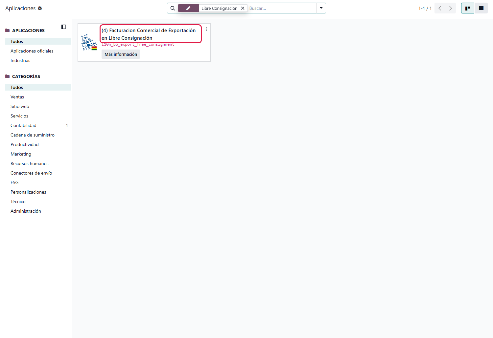
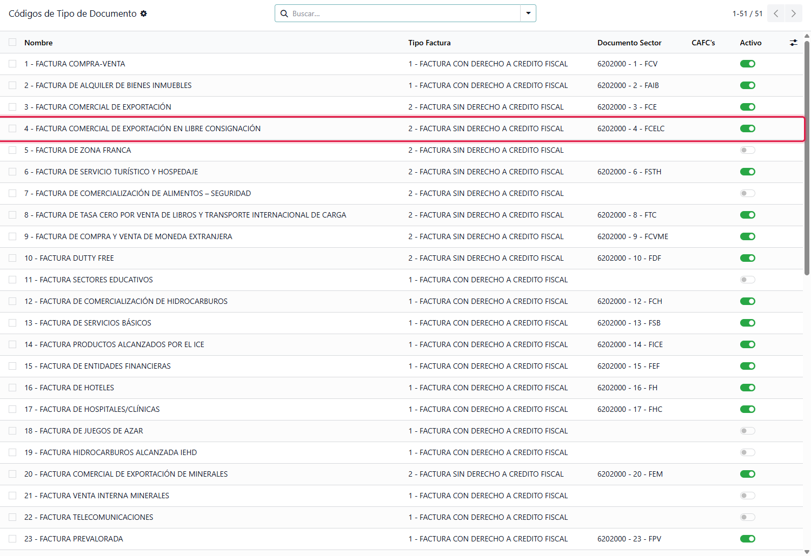
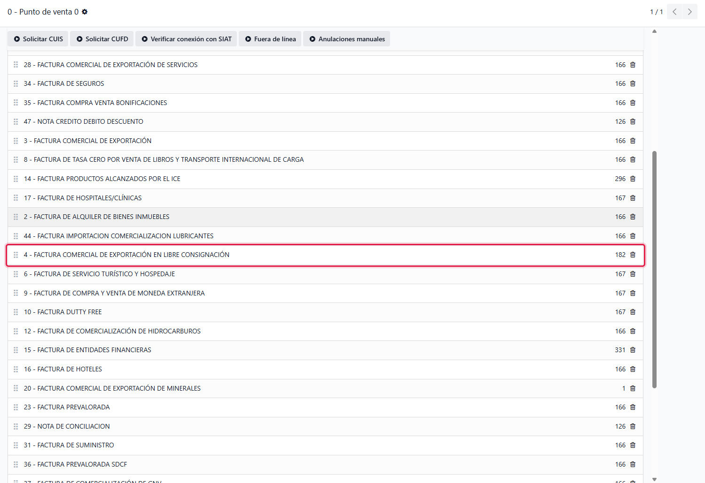
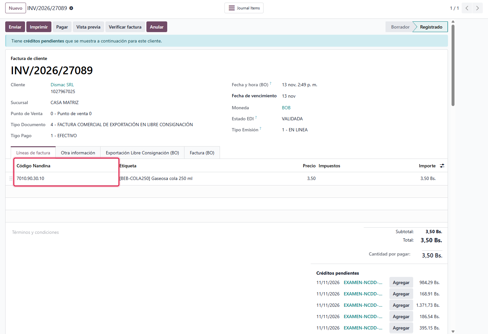
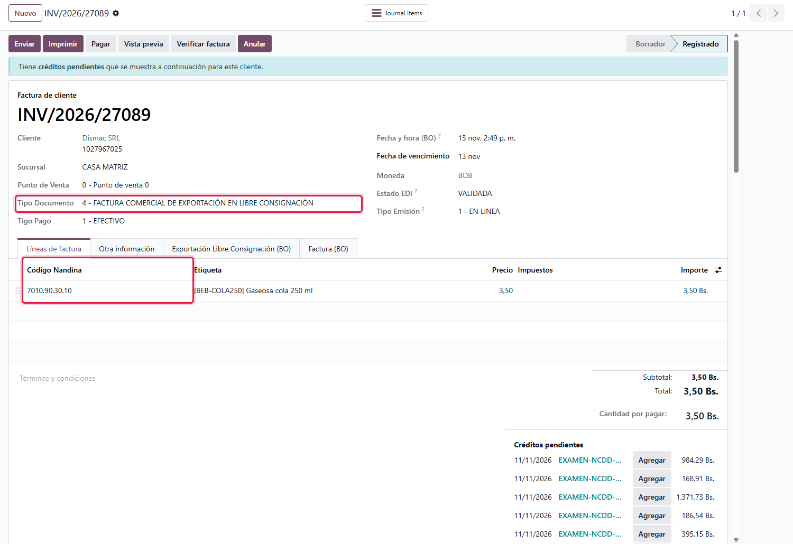
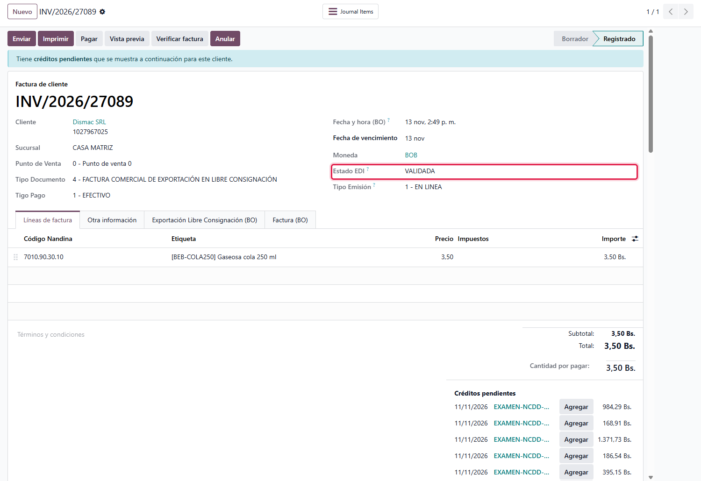
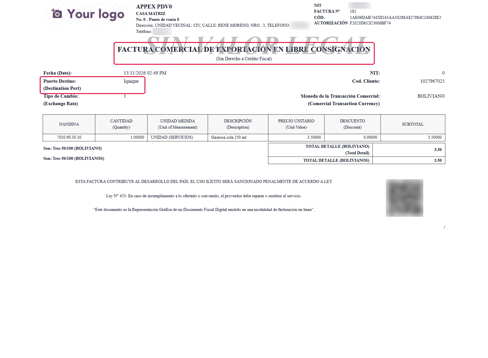

# Factura comercial de exportación en libre consignación

Es la factura de exportación que se usa cuando la mercadería sale del país en libre consignación. En Odoo aparece como tipo de documento **4 - FACTURA COMERCIAL DE EXPORTACIÓN EN LIBRE CONSIGNACIÓN**; ante el SIAT es el documento sector 4 y **no da derecho a crédito fiscal**: el SIN la recibe con el monto sujeto a IVA en cero. A diferencia de la exportación común (sección [Factura comercial de exportación](factura-comercial-de-exportacion.md)), el comprador no se identifica: aunque en Odoo se elija un contacto, al SIN se informa como «SIN RAZON SOCIAL» con NIT 0. Queda emitida cuando el SIN la devuelve como **VALIDADA (código 908)**.

## Qué debe estar configurado

Además de la configuración general de la Parte I, la factura en libre consignación necesita estos cinco puntos:

- **Módulo de libre consignación activado.** Aplicaciones → buscar «Libre Consignación» → «(4) Facturacion Comercial de Exportación en Libre Consignación» → Activar.

    { width="624" loading="lazy" }

- **Tipo de documento 4 activo y con su documento sector.** Ajustes → Facturación (BO) → Catálogos SIAT → Códigos de Tipo Documento, fila «4 - FACTURA COMERCIAL DE EXPORTACIÓN EN LIBRE CONSIGNACIÓN»: el interruptor Activo debe estar encendido y el campo Documento Sector completo (por ejemplo, «6202000 - 4 - FCELC»; depende de la actividad económica registrada en el SIN).

    { width="624" loading="lazy" }

- **Secuencia en el punto de venta.** En la pestaña Secuencias Documentos del punto de venta (sección 3.5 de la Parte I) debe figurar el tipo 4. Si falta, se agrega una línea a mano, como se explica en la sección [Nota de crédito-débito › Qué debe saber antes de emitirla](nota-de-credito-debito.md#que-debe-saber-antes-de-emitirla).

    { width="624" loading="lazy" }

- **Productos con Código Nandina.** Igual que en la exportación común (sección [Factura comercial de exportación › Qué debe estar configurado](factura-comercial-de-exportacion.md#que-debe-estar-configurado)), todos los productos de la factura deben ser bienes con Código Nandina.

- **País destino homologado.** El país al que se exporta debe tener cargado su País (SIAT) (sección 5.2 de la Parte I); los que no lo tienen no aparecen en la lista. Por ejemplo, Perú figura como 139 - PERÚ.

## La pestaña Exportación Libre Consignación (BO)

Al elegir el tipo de documento 4, la factura muestra la pestaña **Exportación Libre Consignación (BO)**, antes de la pestaña Factura (BO). Sus dos campos son obligatorios y Odoo no deja guardar sin ellos:

- **País destino:** el país al que se exporta. Se completa solo con el país del cliente si tiene su País (SIAT); si no, se elige a mano.

- **Puerto destino:** texto libre, por ejemplo «CALLAO» o «IQUIQUE».

La misma pestaña recuerda tres reglas de este documento: el comprador va al SIN como «SIN RAZON SOCIAL» (NIT 0), los montos van en la moneda de la factura y no se admiten descuentos. El total en bolivianos es el total en la moneda de la factura por el tipo de cambio; si la factura es en bolivianos, los dos coinciden.

Además, las líneas de la factura muestran la columna **Código Nandina**, junto al producto. Se toma del producto y no se edita en la línea.

{ width="624" loading="lazy" }

## Paso a paso: crear y emitir la factura

1. **Abrir una factura nueva:** Contabilidad → Clientes → Facturas → botón Nuevo, y elegir el cliente en el campo Contacto.

1. **Completar la cabecera:** Sucursal, Punto de Venta, Tigo Pago y, en Tipo Documento, **4 - FACTURA COMERCIAL DE EXPORTACIÓN EN LIBRE CONSIGNACIÓN**. Tigo Pago no puede ser un pago con gift card (sección [Errores frecuentes](#errores-frecuentes)).

1. **Completar la pestaña Exportación Libre Consignación (BO):** País destino y Puerto destino (sección [La pestaña Exportación Libre Consignación (BO)](#la-pestana-exportacion-libre-consignacion-bo)).

1. **Cargar las líneas** en la pestaña Líneas de factura: solo bienes con Código Nandina, con cantidad y precio mayores a cero y sin descuento.

    { width="624" loading="lazy" }

1. **Revisar la pestaña Factura (BO):** la casilla Factura (BO) debe estar marcada y la Leyenda asignada, igual que en la factura de compra-venta (sección [Factura de compra-venta › Paso a paso: crear y emitir la factura](factura-de-compra-venta.md#paso-a-paso-crear-y-emitir-la-factura), paso 7).

1. **Pulsar Confirmar.** Odoo envía la factura al SIN; suele tardar unos segundos, y hasta un minuto si el SIN está lento. Debe quedar en Registrado, con Estado EDI **VALIDADA**.

    { width="624" loading="lazy" }

## Cómo se ve la factura impresa y cómo saber si llegó al SIN

La factura impresa tiene el mismo logo y datos de la empresa que la de compra-venta (sección [Factura de compra-venta › Cómo se ve la factura impresa](factura-de-compra-venta.md#como-se-ve-la-factura-impresa)) y el título **FACTURA COMERCIAL DE EXPORTACIÓN EN LIBRE CONSIGNACIÓN**, con la leyenda (Sin Derecho a Crédito Fiscal). Los rótulos van en castellano y en inglés. En la cabecera no sale el nombre del cliente: salen el NIT 0, el puerto destino, el código de cliente, el tipo de cambio y la moneda. El detalle empieza por la columna NANDINA y el descuento siempre es 0. Al pie salen dos totales, en la moneda de la factura y en bolivianos, cada uno con su monto en letras.

Igual que en la compra-venta (sección [Factura de compra-venta › Cómo saber si la factura llegó al SIN](factura-de-compra-venta.md#como-saber-si-la-factura-llego-al-sin)), la factura está emitida solo si **Estado EDI** dice **VALIDADA**. La factura en libre consignación tiene su propia numeración por punto de venta (la secuencia 4), separada de la de compra-venta. Por ejemplo, una factura con 5 licencias de software de base de datos a 2.500 Bs, con destino Perú y puerto CALLAO. Suma 12.500,00 Bs, el SIN la recibió con monto sujeto a IVA 0.

Se anula y se revierte igual que las demás facturas (sección 1 de la Parte III), y también se puede emitir fuera de línea (sección 2 de la Parte III).

{ width="624" loading="lazy" }

## Errores frecuentes

Los errores de la sección [Factura de compra-venta › Errores frecuentes y cómo resolverlos](factura-de-compra-venta.md#errores-frecuentes-y-como-resolverlos) también se aplican a la factura en libre consignación. Además, estos son propios de este documento:

| Lo que ve el usuario | Por qué pasa | Cómo se resuelve |
|---|---|---|
| «Nota: El producto \[producto\] no tiene un Código Nandina del SIAT» | Un producto de la factura no tiene Código Nandina. | Asignarle el Código Nandina en la pestaña Facturación (BO) del producto (sección [Factura comercial de exportación › Qué debe estar configurado](factura-comercial-de-exportacion.md#que-debe-estar-configurado)) y volver a confirmar. |
| «Nota: El producto \[producto\] tiene descuento. La Factura en Libre Consignación no admite descuentos (montoDescuento = 0).» | Una línea tiene descuento. | Quitar el descuento de la línea y volver a confirmar. |
| «Nota: Los descuentos globales están inhabilitados para este Sector» | La factura tiene un descuento global. | Quitar el descuento global y volver a confirmar. |
| «Nota: La cantidad y el precio del producto \[producto\] deben ser mayores a cero.» | Una línea tiene cantidad o precio en cero. | Corregir la cantidad o el precio de la línea, o borrarla. |
| «Nota: El pago con GiftCard no es válido para el documento: \[4 - FACTURA COMERCIAL DE EXPORTACIÓN EN LIBRE CONSIGNACIÓN\]» | En Tigo Pago se eligió un pago con gift card, que el documento 4 no admite. | Elegir otro Tigo Pago, por ejemplo 1 - EFECTIVO, y volver a confirmar. |
| El país al que se exporta no aparece en País destino | Ese país no tiene cargado su País (SIAT). | Homologar el país (sección 5.2 de la Parte I) y volver a elegirlo. |
| En Tipo Documento no aparece 4 - FACTURA COMERCIAL DE EXPORTACIÓN EN LIBRE CONSIGNACIÓN | Falta el módulo, el tipo 4 no está activo o el punto de venta no tiene la secuencia. | Revisar los puntos de la sección [Qué debe estar configurado](#que-debe-estar-configurado). |
