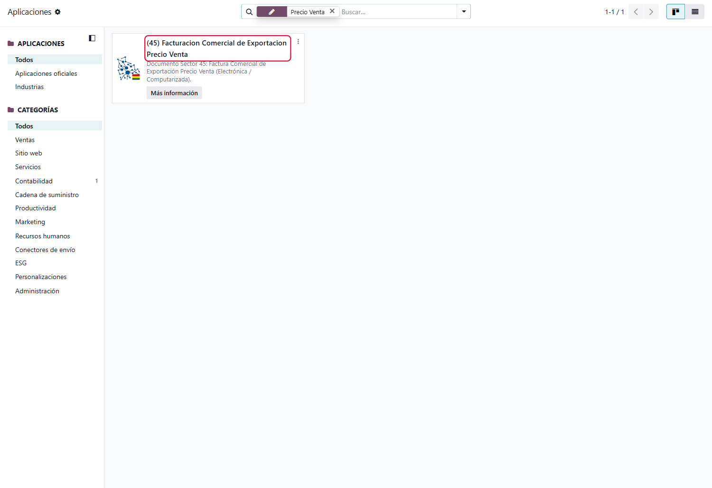
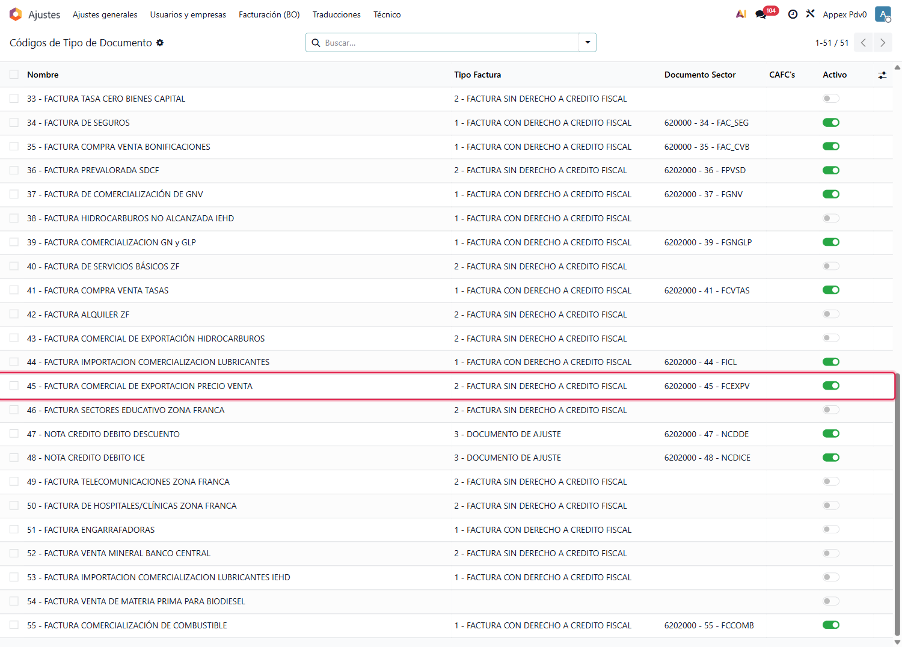
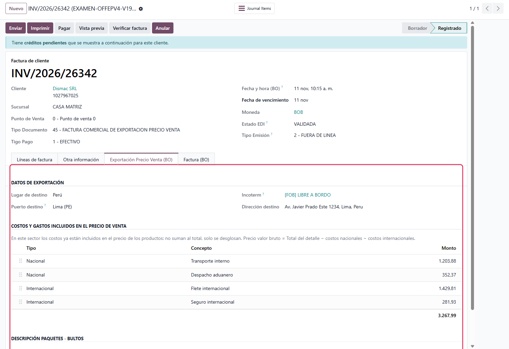
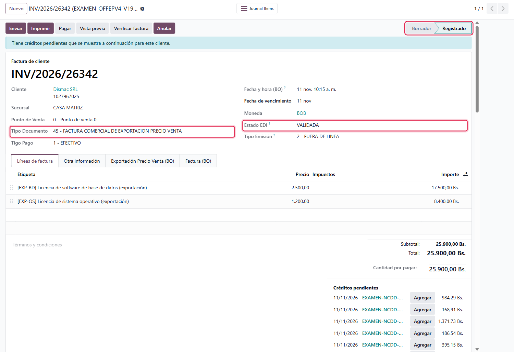
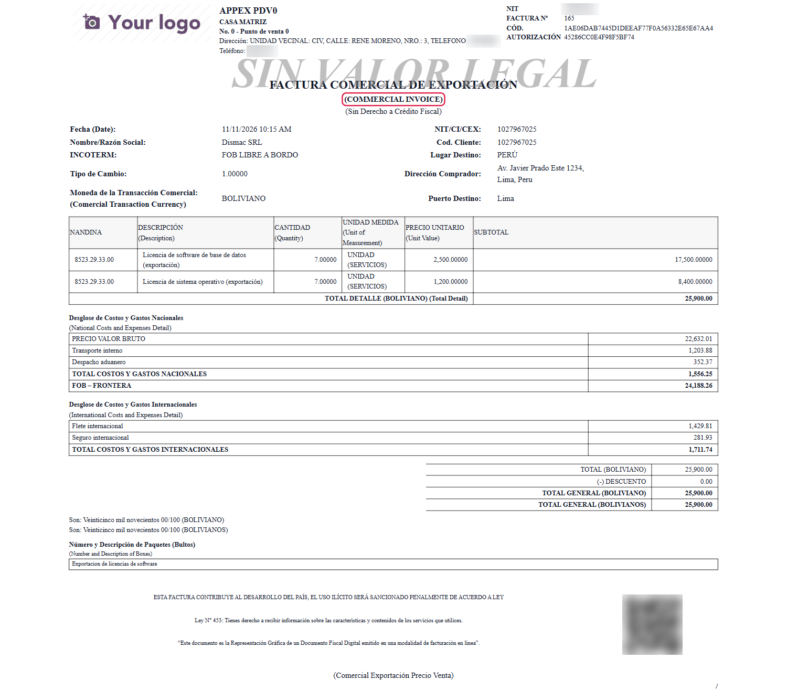

# Factura comercial de exportación precio venta

Es la factura de exportación de bienes en la que el precio de venta ya incluye los costos y gastos de la exportación (transporte, despacho, flete, seguro). En Odoo aparece como tipo de documento `45 - FACTURA COMERCIAL DE EXPORTACION PRECIO VENTA`; ante el SIAT es el documento sector 45. Usa los mismos datos de exportación que la factura comercial de exportación del tipo 3 (país, puerto de destino, incoterm y dirección del comprador) y agrega un **desglose de costos y gastos nacionales e internacionales**. Ese desglose **no suma al total**: solo informa qué parte del precio son costos. Precio valor bruto = Total del detalle − costos nacionales − costos internacionales. Es **sin derecho a crédito fiscal** (monto sujeto a IVA 0), **no admite pago con gift card** y cada producto debe tener Código Nandina. Queda emitida cuando el SIN la devuelve como **`VALIDADA` (código `908`)**.

## Qué debe estar configurado

Además de la configuración general de la Parte I, la factura comercial de exportación precio venta necesita estos cinco puntos:

- **Módulo activado.** Aplicaciones → buscar «Precio Venta» → «(45) Facturacion Comercial de Exportacion Precio Venta» → Activar. Instala también el módulo de exportación comercial si falta. Si no aparece, primero hay que pulsar Actualizar lista de aplicaciones (sección [Factura de suministro de energía › Qué debe estar configurado](factura-de-suministro-de-energia.md#que-debe-estar-configurado)).

    { width="624" height="428" loading="lazy" }

- **Tipo de documento 45 activo y con su documento sector.** Ajustes → Facturación (BO) → Catálogos SIAT → Códigos de Tipo Documento, fila `45 - FACTURA COMERCIAL DE EXPORTACION PRECIO VENTA`: el interruptor Activo debe estar encendido, el campo Documento Sector completo (por ejemplo, `6202000 - 45 - FCEXPV`; depende de la actividad económica registrada en el SIN) y el Tipo de factura en `2 - FACTURA SIN DERECHO A CREDITO FISCAL`.

    { width="624" height="448" loading="lazy" }

- **Secuencia en el punto de venta.** En la pestaña Secuencias Documentos del punto de venta (sección 3.5 de la Parte I) debe figurar el tipo 45. Si falta, se agrega una línea a mano, como se explica en la sección [Nota de crédito-débito › Qué debe saber antes de emitirla](nota-de-credito-debito.md#que-debe-saber-antes-de-emitirla).

- **Productos con Código SIAT y Código Nandina.** En la pestaña Facturación (BO) del producto. Son los mismos requisitos que en la exportación del tipo 3 (sección [Factura comercial de exportación › Qué debe estar configurado](factura-comercial-de-exportacion.md#que-debe-estar-configurado)).

- **País de destino con código SIAT.** Contactos → Configuración → Países → abrir el país: el campo de país SIAT debe estar completo (por ejemplo, Perú con `139 - PERÚ`). Si falta, la factura no se confirma.

## Paso a paso: crear y emitir la factura

1. **Abrir una factura nueva:** Contabilidad → Clientes → Facturas → botón Nuevo, y elegir el cliente (el comprador del exterior) en el campo Contacto.

1. **Completar la cabecera:** Sucursal, Punto de Venta, Tigo Pago (sin gift card) y, en Tipo Documento, `45 - FACTURA COMERCIAL DE EXPORTACION PRECIO VENTA`.

1. **Cargar las líneas** en la pestaña Líneas de factura: el producto, la cantidad (hasta 5 decimales) y el precio de venta, que ya incluye los costos.

1. **Completar la pestaña Exportación Precio Venta (BO),** grupo Datos de Exportación: **Lugar de destino** (país), **Puerto destino**, **Incoterm** y **Dirección destino**, los cuatro obligatorios.

1. **Cargar el desglose de costos** en la tabla Costos y gastos incluidos en el precio de venta: una línea por concepto, con Tipo (Nacional o Internacional), concepto y monto. La suma de los costos no puede superar el total del detalle. Opcionalmente, completar Descripción Paquetes - Bultos e Información Adicional.

    { width="624" height="428" loading="lazy" }

1. **Revisar la pestaña Factura (BO)** (sección [Factura de compra-venta › Paso a paso: crear y emitir la factura](factura-de-compra-venta.md#paso-a-paso-crear-y-emitir-la-factura), paso 7) y **pulsar Confirmar.** Debe quedar en Registrado, con Estado EDI `VALIDADA`.

    { width="624" height="428" loading="lazy" }

## Cómo se ve la factura impresa y cómo saber si llegó al SIN

La factura impresa lleva el título **FACTURA COMERCIAL DE EXPORTACIÓN (COMMERCIAL INVOICE)** con la leyenda (Sin Derecho a Crédito Fiscal) y, al pie, la aclaración (Comercial Exportación Precio Venta). El detalle muestra el Código Nandina de cada producto. Al pie salen el total del detalle, el **precio valor bruto**, el total de costos y gastos nacionales, el valor FOB frontera, el total de costos y gastos internacionales y el total general en la moneda de la factura y en bolivianos.

Igual que en la compra-venta (sección [Factura de compra-venta › Cómo saber si la factura llegó al SIN](factura-de-compra-venta.md#como-saber-si-la-factura-llego-al-sin)), la factura está emitida solo si **Estado EDI** dice `VALIDADA`. Tiene su propia numeración por punto de venta (la secuencia 45). Por ejemplo, una factura con una licencia de base de datos a 2.500 y una de sistema operativo a 1.200, con destino Lima (Perú) e incoterm FOB. Suma 3.700; de eso, 219,44 son costos nacionales (transporte interno y despacho aduanero) y 40,24 costos internacionales (seguro), así que el precio valor bruto es 3.440,32. El SIN la recibió con monto sujeto a IVA 0.

Se anula y se revierte igual que las demás facturas (sección 1 de la Parte III), y también se puede emitir fuera de línea (sección 2 de la Parte III).

{ width="624" height="548" loading="lazy" }

## Errores frecuentes

Los errores de la sección [Factura de compra-venta › Errores frecuentes y cómo resolverlos](factura-de-compra-venta.md#errores-frecuentes-y-como-resolverlos) también se aplican a esta factura. Además, estos son propios de este documento:

| Lo que ve el usuario | Por qué pasa | Cómo se resuelve |
|---|---|---|
| En Tipo Documento no aparece `45 - FACTURA COMERCIAL DE EXPORTACION PRECIO VENTA` | Falta el módulo, el tipo 45 no está activo o el punto de venta no tiene la secuencia. | Revisar los puntos de la sección [Qué debe estar configurado](#que-debe-estar-configurado). |
| «El país: \[...\] no tiene un código SIAT establecido» | El país de destino no tiene asignado su país SIAT. | Completar el país SIAT en Contactos → Configuración → Países (sección [Qué debe estar configurado](#que-debe-estar-configurado)). |
| «Nota: El producto \[...\] no tiene un Código Nandina del SIAT» | Un producto de la factura no tiene Código Nandina. | Completar el Código Nandina en la pestaña Facturación (BO) del producto. |
| «Nota: Los costos y gastos nacionales e internacionales (\[...\]) no pueden ser mayores al total del detalle (\[...\])» | La suma del desglose de costos supera lo que se vende en la factura. | Corregir los montos: los costos son parte del precio, no un cargo aparte. |
| «Nota: Todos los costos y gastos de exportación deben tener un concepto.» o «Nota: El monto del costo \[...\] debe ser mayor a cero.» | Una línea del desglose quedó sin concepto o con monto cero. | Completar la línea o borrarla. |
| «Nota: El pago con GiftCard no es válido para el documento: \[...\]» | En Tigo Pago se eligió un método con gift card; el formato del sector 45 no lo contempla. | Elegir otro Tigo Pago, por ejemplo `1 - EFECTIVO`. |
