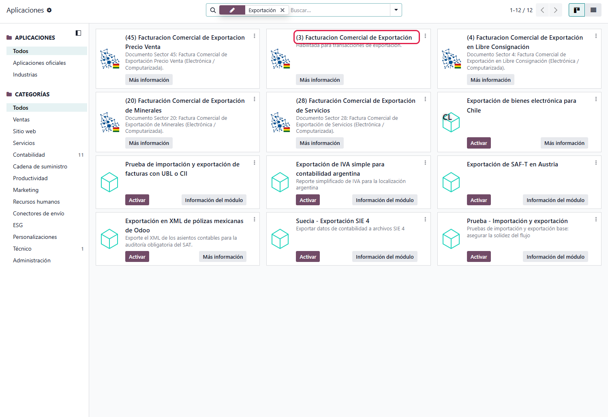
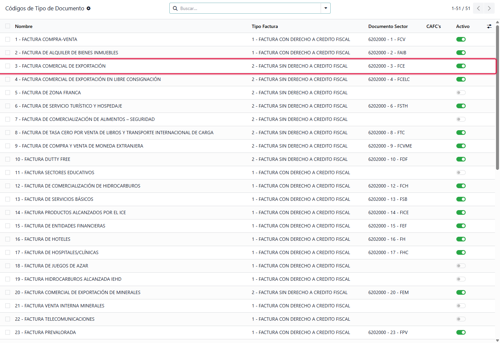
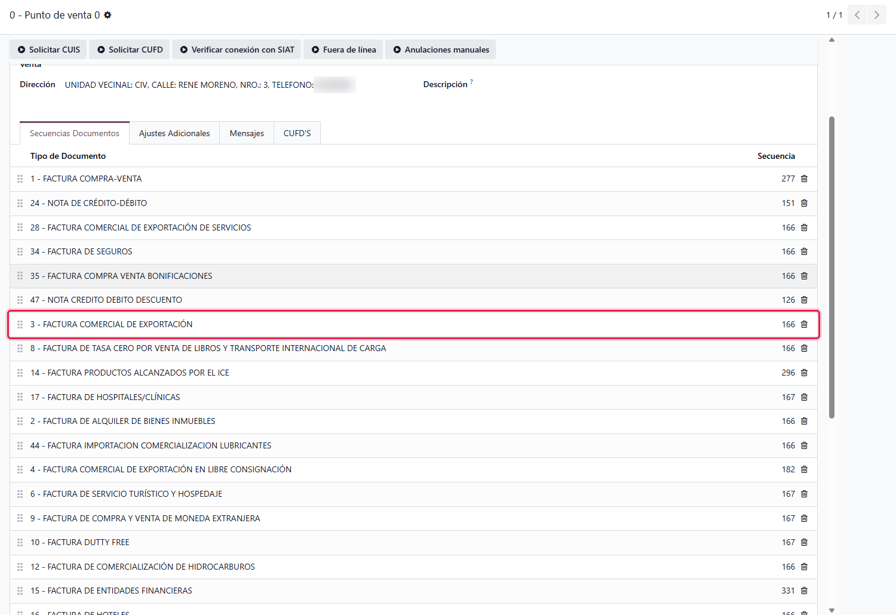
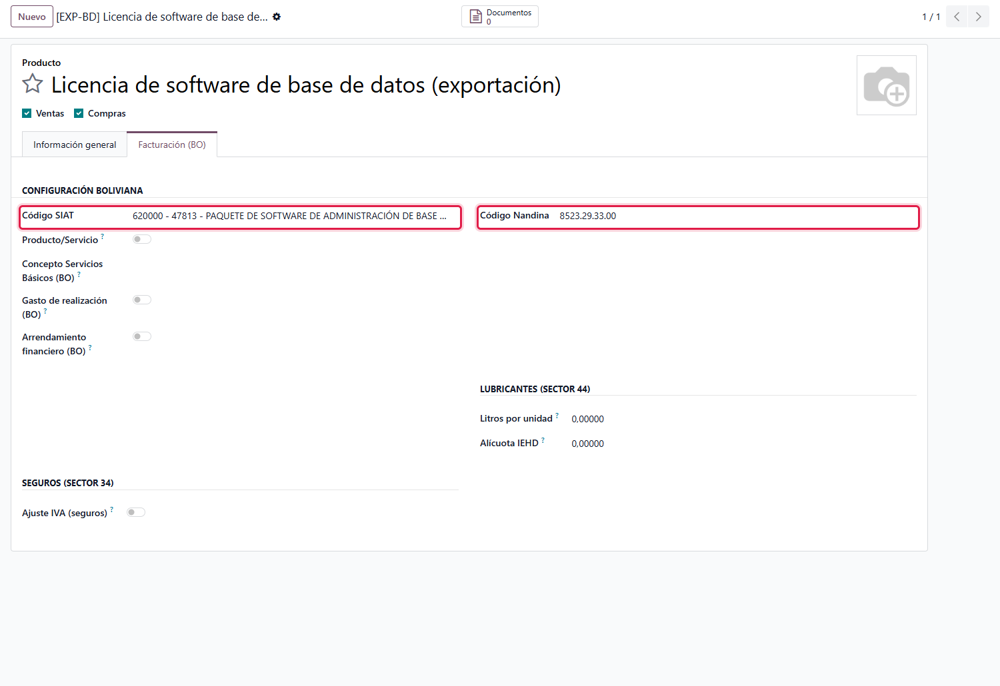
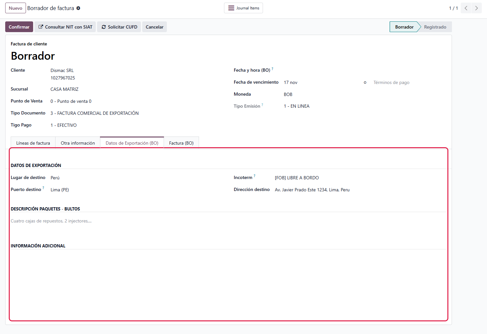
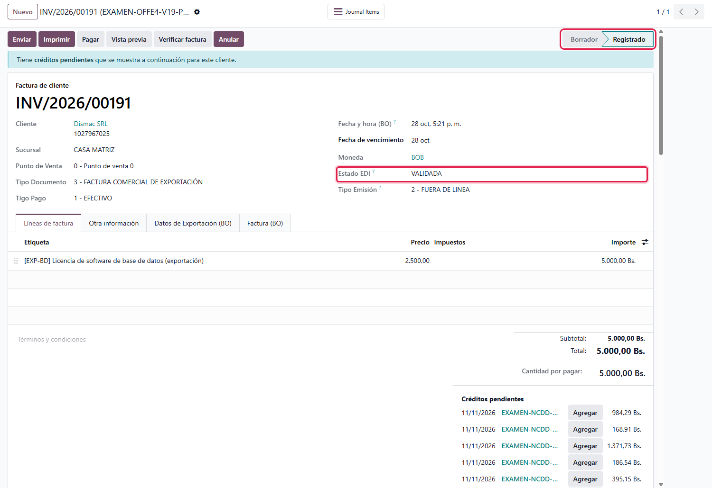
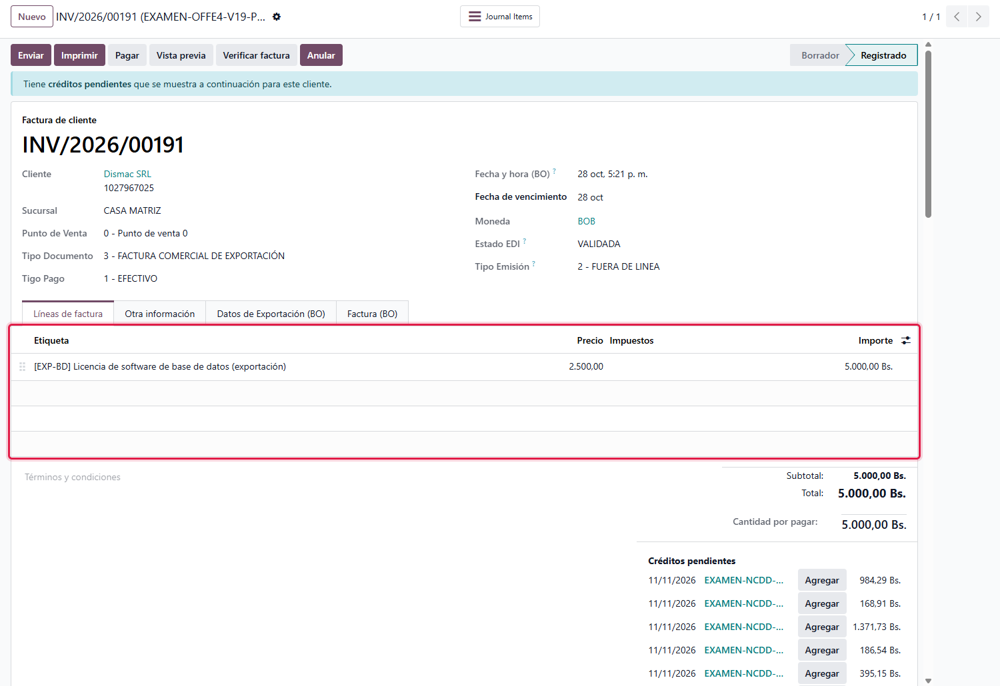

# Factura comercial de exportación

Es la factura que se emite cuando la empresa vende bienes a un comprador del exterior. En Odoo aparece como tipo de documento `3 - FACTURA COMERCIAL DE EXPORTACIÓN`; ante el SIAT es el documento sector 3 y es una factura sin derecho a crédito fiscal. Queda emitida cuando, al confirmarla, el SIN la devuelve como **`VALIDADA` (código `908`)**.

La exportación de servicios no usa este documento, sino el tipo `28 - FACTURA COMERCIAL DE EXPORTACIÓN DE SERVICIOS`.

## Qué debe estar configurado

Además de la configuración general de la Parte I, la exportación necesita estos cuatro puntos:

- **Módulo de exportación activado.** Aplicaciones → buscar «Exportación» → «(3) Facturacion Comercial de Exportación» → Activar. Sin él, Odoo no muestra la pestaña Datos de Exportación (BO) ni arma el XML de exportación.

    { width="624" height="428" loading="lazy" }

- **Tipo de documento 3 activo y con su documento sector.** Ajustes → Facturación (BO) → Catálogos SIAT → Códigos de Tipo Documento, fila `3 - FACTURA COMERCIAL DE EXPORTACIÓN`: el interruptor Activo debe estar encendido y el campo Documento Sector completo (por ejemplo, `6202000 - 3 - FCE`; depende de la actividad económica registrada en el SIN). Los documentos sector habilitados se consultan en Ajustes → Facturación (BO) → Catálogos SIAT → Códigos de Documento Sector.

    { width="624" height="428" loading="lazy" }

- **Secuencia en cada punto de venta.** En la pestaña Secuencias Documentos del punto de venta (sección 3.5 de la Parte I) debe figurar `3 - FACTURA COMERCIAL DE EXPORTACIÓN`. Si falta, se agrega una línea a mano, como se explica en la sección [Nota de crédito-débito › Qué debe saber antes de emitirla](nota-de-credito-debito.md#que-debe-saber-antes-de-emitirla).

    { width="624" height="428" loading="lazy" }

- **Productos con Código Nandina.** Todos los productos de la factura deben ser bienes con Código Nandina, en la pestaña Facturación (BO) del producto. Sin él, Odoo no deja confirmar. El Nandina depende del Código SIAT: por ejemplo, el código 47811 - Paquete de sistemas operativos lleva el Nandina 8523.29.33.00, mientras que otros códigos no tienen ninguno y no sirven para exportar.

    { width="624" height="428" loading="lazy" }

## La pestaña Datos de Exportación (BO)

Al elegir el tipo de documento 3, la factura muestra la pestaña **Datos de Exportación (BO)**. Estos son sus campos; los cuatro primeros son obligatorios y Odoo no deja confirmar sin ellos:

- **Lugar de destino:** el país al que se exporta, por ejemplo Perú.

- **Puerto destino:** el estado o departamento de destino, por ejemplo Lima. Si falta, Odoo muestra el mensaje `Debe establecer un Estado/Departamento destino`.

- **Incoterm:** la condición de entrega pactada con el comprador, por ejemplo FOB.

- **Dirección destino:** la dirección del comprador en el exterior.

- **Descripción adicional:** información libre que acompaña a la exportación. Es opcional.

La ubicación del Incoterm, por ejemplo Puerto de Arica, se completa aparte: pestaña Otra información → campo Ubicación del Incoterm.

{ width="624" height="428" loading="lazy" }

## Paso a paso: crear y emitir la factura

1. **Abrir una factura nueva:** Contabilidad → Clientes → Facturas → botón Nuevo, y elegir el cliente en el campo Contacto.

1. **Completar la cabecera:** Sucursal, Punto de Venta, Tigo Pago y, en Tipo Documento, `3 - FACTURA COMERCIAL DE EXPORTACIÓN`.

1. **Cargar las líneas** en la pestaña Líneas de factura: solo bienes con Código Nandina, con su cantidad y precio.

    { width="624" height="428" loading="lazy" }

1. **Completar la pestaña Datos de Exportación (BO)** (sección [La pestaña Datos de Exportación (BO)](#la-pestana-datos-de-exportacion-bo)) y, si corresponde, la Ubicación del Incoterm en Otra información.

1. **Revisar la pestaña Factura (BO):** la casilla Factura (BO) debe estar marcada y la Leyenda asignada, igual que en la factura de compra-venta (sección [Factura de compra-venta › Paso a paso: crear y emitir la factura](factura-de-compra-venta.md#paso-a-paso-crear-y-emitir-la-factura), paso 7).

1. **Pulsar Confirmar.** Odoo envía la factura al SIN; suele tardar unos segundos, y hasta un minuto si el SIN está lento. Debe quedar en Registrado, con Estado EDI `VALIDADA`.

    { width="624" height="428" loading="lazy" }

## Cómo saber si llegó al SIN

Igual que en la compra-venta (sección [Factura de compra-venta › Cómo saber si la factura llegó al SIN](factura-de-compra-venta.md#como-saber-si-la-factura-llego-al-sin)), la factura está emitida solo si **Estado EDI** dice `VALIDADA`. En la pestaña Factura (BO) aparecen el Nro. Factura, el CUF y la URL SIAT, que abre la consulta pública de la factura.

**Numeración.** La exportación tiene su propia numeración por punto de venta (la secuencia 3), separada de la de compra-venta. Por eso la primera factura de exportación de un punto de venta sale con el Nro. Factura 1, aunque la compra-venta vaya por un número mayor.

## Errores frecuentes

Los errores de la sección [Factura de compra-venta › Errores frecuentes y cómo resolverlos](factura-de-compra-venta.md#errores-frecuentes-y-como-resolverlos) también se aplican a la exportación. Además, estos son propios de este documento:

| Lo que ve el usuario | Por qué pasa | Cómo se resuelve |
|---|---|---|
| «El producto \[nombre\] no tiene un Código Nandina del SIAT» | Un producto de la factura no tiene Código Nandina. | Asignarle el Código Nandina en la pestaña Facturación (BO) del producto. Si su Código SIAT no tiene ningún Nandina en el catálogo, ese producto no se puede facturar como exportación. |
| «Debe establecer un Estado/Departamento destino» | Falta el Puerto destino en la pestaña Datos de Exportación (BO). | Completar Puerto destino (por ejemplo, Lima) y volver a confirmar. |
| En Tipo Documento no aparece `3 - FACTURA COMERCIAL DE EXPORTACIÓN` | Falta el módulo de exportación, el tipo 3 no está activo o el punto de venta no tiene la secuencia. | Revisar los cuatro puntos de la sección [Qué debe estar configurado](#que-debe-estar-configurado). |
| No aparecen los campos de la pestaña Datos de Exportación (BO) | El Tipo Documento elegido no es el 3, o el módulo de exportación no está activado. | Elegir `3 - FACTURA COMERCIAL DE EXPORTACIÓN` en Tipo Documento y revisar el módulo (sección [Qué debe estar configurado](#que-debe-estar-configurado)). |
