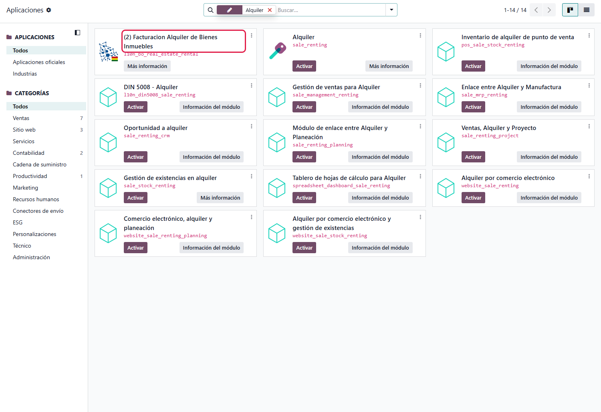
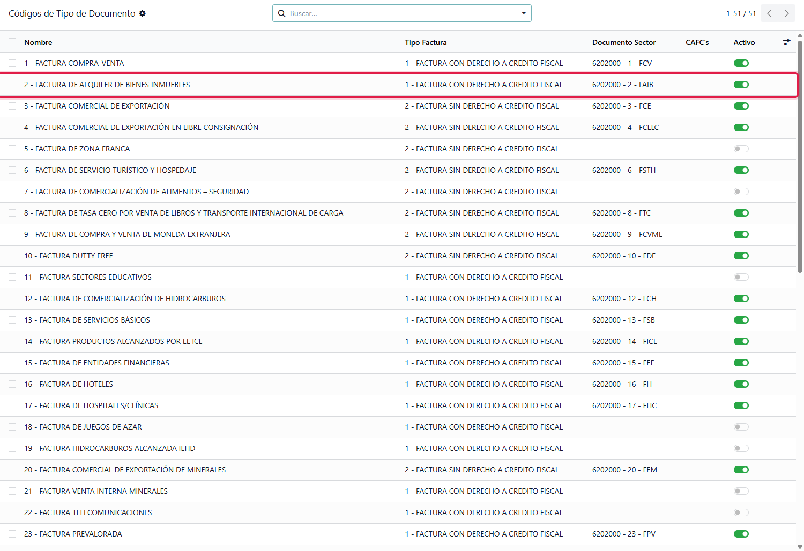
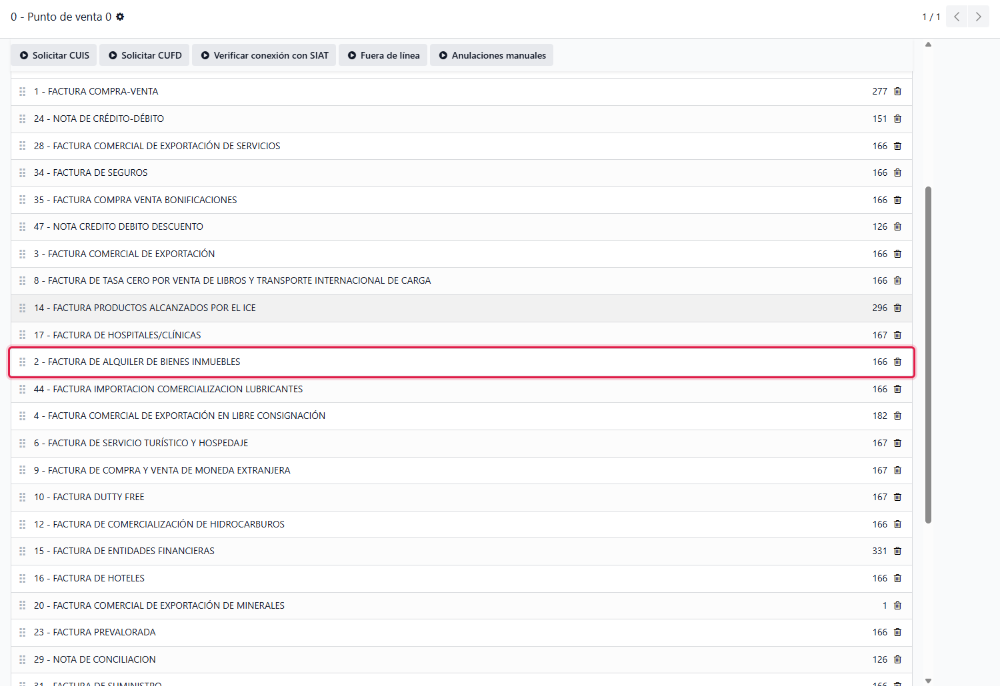
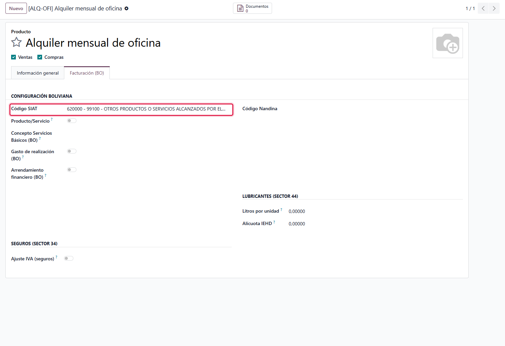
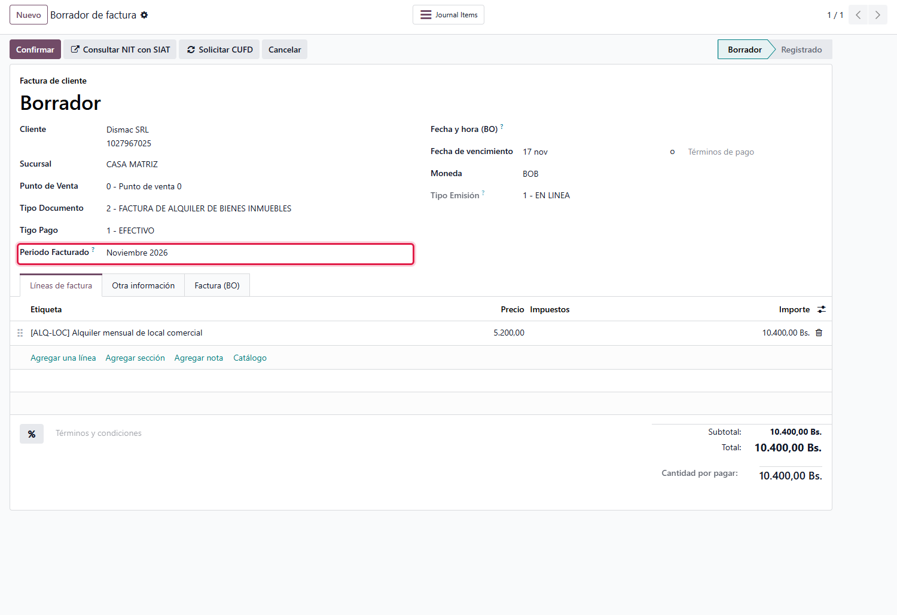
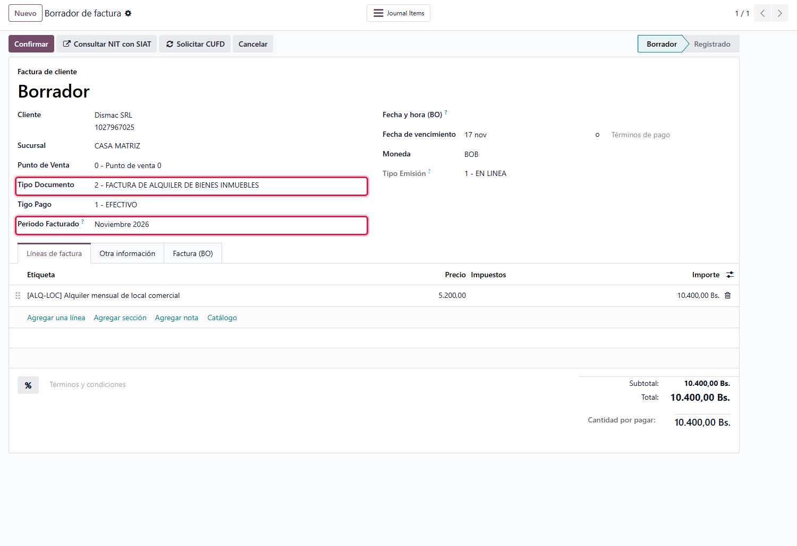
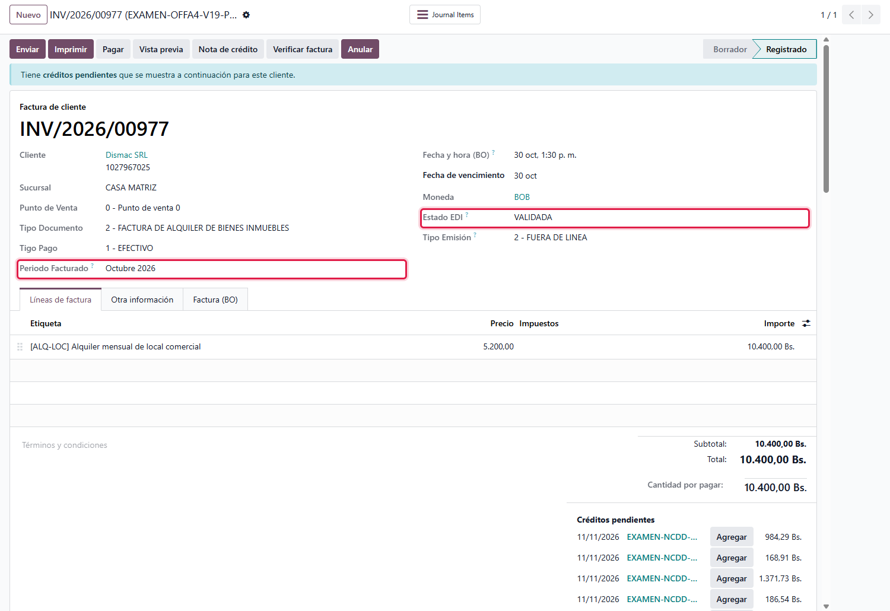
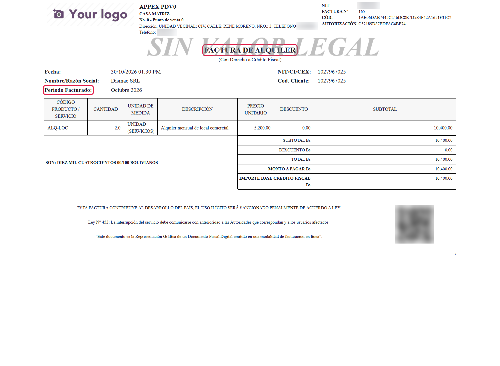

# Factura de alquiler de bienes inmuebles

Es la factura que se emite por el alquiler de inmuebles, como oficinas, locales comerciales, depósitos o parqueos. En Odoo aparece como tipo de documento **2 - FACTURA DE ALQUILER DE BIENES INMUEBLES**; ante el SIAT es el documento sector 2 y **da derecho a crédito fiscal**. Lo que la distingue es el **Periodo Facturado**: el periodo que se cobra, que se informa al SIN y se imprime en la factura. Queda emitida cuando el SIN la devuelve como **VALIDADA (código 908)**.

## Qué debe estar configurado

Además de la configuración general de la Parte I, la factura de alquiler necesita estos cuatro puntos:

- **Módulo de alquiler activado.** Aplicaciones → buscar «Alquiler» → «(2) Facturacion Alquiler de Bienes Inmuebles» → Activar.

    { width="624" loading="lazy" }

- **Tipo de documento 2 activo y con su documento sector.** Ajustes → Facturación (BO) → Catálogos SIAT → Códigos de Tipo Documento, fila «2 - FACTURA DE ALQUILER DE BIENES INMUEBLES»: el interruptor Activo debe estar encendido y el campo Documento Sector completo (por ejemplo, «6202000 - 2 - FAIB»; depende de la actividad económica registrada en el SIN).

    { width="624" loading="lazy" }

- **Secuencia en el punto de venta.** En la pestaña Secuencias Documentos del punto de venta (sección 3.5 de la Parte I) debe figurar el tipo 2. Si falta, se agrega una línea a mano, como se explica en la sección [Nota de crédito-débito › Qué debe saber antes de emitirla](nota-de-credito-debito.md#que-debe-saber-antes-de-emitirla).

    { width="624" loading="lazy" }

- **Servicios de alquiler con Código SIAT.** En la pestaña Facturación (BO) del producto, con el Código SIAT del catálogo que corresponda a la actividad de la empresa (sección 4.2 de la Parte I). Se crea un servicio por cada tipo de inmueble que se alquila (por ejemplo, alquiler mensual de oficina, de local comercial, de depósito o de parqueo); al SIN salen con la unidad de medida 58 - UNIDAD (SERVICIOS) (sección 5.1 de la Parte I).

    { width="624" loading="lazy" }

## El periodo facturado

Al elegir el tipo de documento 2, la cabecera de la factura muestra el campo **Periodo Facturado**, debajo de Tigo Pago. Es el periodo que se cobra, escrito como texto, por ejemplo «Octubre 2026».

- **Se completa solo:** Odoo pone el mes y el año de la Fecha de factura, o los de hoy si esa fecha está vacía.

- **Es obligatorio:** sin él, Odoo no deja guardar la factura. Admite hasta 50 caracteres.

- **Se informa al SIN y se imprime** en la factura, debajo de los datos del cliente (sección [Cómo se ve la factura impresa y cómo saber si llegó al SIN](#como-se-ve-la-factura-impresa-y-como-saber-si-llego-al-sin)). Después de confirmar ya no se puede cambiar.

**Por ahora, el periodo que llega al SIN es siempre el mes de la emisión.** Al confirmar, Odoo vuelve a calcular el campo con la fecha de emisión, aunque se haya escrito otro periodo a mano. Por ejemplo, si en noviembre se factura el alquiler de octubre y se escribe «Octubre 2026», la factura sale con «Noviembre 2026». Si hace falta facturar otro periodo, avisar al equipo técnico: es un comportamiento del módulo.

{ width="624" loading="lazy" }

## Paso a paso: crear y emitir la factura

1. **Abrir una factura nueva:** Contabilidad → Clientes → Facturas → botón Nuevo, y elegir en el campo Contacto al inquilino.

1. **Completar la cabecera:** Sucursal, Punto de Venta, Tigo Pago y, en Tipo Documento, **2 - FACTURA DE ALQUILER DE BIENES INMUEBLES**. Tigo Pago no puede ser un pago con gift card (sección [Errores frecuentes](#errores-frecuentes)).

1. **Revisar el Periodo Facturado:** debe decir el periodo que se cobra (sección [El periodo facturado](#el-periodo-facturado)).

    { width="624" loading="lazy" }

1. **Cargar las líneas** en la pestaña Líneas de factura: el servicio de alquiler, la cantidad y el precio.

1. **Revisar la pestaña Factura (BO):** la casilla Factura (BO) debe estar marcada y la Leyenda asignada, igual que en la factura de compra-venta (sección [Factura de compra-venta › Paso a paso: crear y emitir la factura](factura-de-compra-venta.md#paso-a-paso-crear-y-emitir-la-factura), paso 7).

1. **Pulsar Confirmar.** Odoo envía la factura al SIN; suele tardar unos segundos, y hasta un minuto si el SIN está lento. Debe quedar en Registrado, con Estado EDI **VALIDADA**.

    { width="624" loading="lazy" }

## Cómo se ve la factura impresa y cómo saber si llegó al SIN

La factura impresa tiene el mismo encabezado que la de compra-venta (sección [Factura de compra-venta › Cómo se ve la factura impresa](factura-de-compra-venta.md#como-se-ve-la-factura-impresa)) y el título **FACTURA DE ALQUILER**, con la leyenda (Con Derecho a Crédito Fiscal). Debajo de los datos del cliente agrega la fila **Periodo Facturado**. Al pie, los totales son el subtotal, el descuento, el total, el monto a pagar y el importe base para crédito fiscal; no tiene la fila de gift card.

Igual que en la compra-venta (sección [Factura de compra-venta › Cómo saber si la factura llegó al SIN](factura-de-compra-venta.md#como-saber-si-la-factura-llego-al-sin)), la factura está emitida solo si **Estado EDI** dice **VALIDADA**. La factura de alquiler tiene su propia numeración por punto de venta (la secuencia 2), separada de la de compra-venta. Por ejemplo, una factura con 2 depósitos a 2.800 Bs, 1 oficina a 3.500 Bs y 2 parqueos a 450 Bs, suma 10.000,00 Bs con el periodo «Octubre 2026».

Se anula y se revierte igual que las demás facturas (sección 1 de la Parte III), y también se puede emitir fuera de línea (sección 2 de la Parte III).

{ width="624" loading="lazy" }

## Errores frecuentes

Los errores de la sección [Factura de compra-venta › Errores frecuentes y cómo resolverlos](factura-de-compra-venta.md#errores-frecuentes-y-como-resolverlos) también se aplican a la factura de alquiler. Además, estos son propios de este documento:

| Lo que ve el usuario | Por qué pasa | Cómo se resuelve |
|---|---|---|
| «El pago con GiftCard no es valido para el documento: 2 - FACTURA DE ALQUILER DE BIENES INMUEBLES» | En Tigo Pago se eligió un pago con gift card, que el documento 2 no admite. | Elegir otro Tigo Pago, por ejemplo 1 - EFECTIVO. La factura queda en borrador; se vuelve a confirmar. |
| La factura salió con el mes de la emisión y no con el periodo que se escribió | Al confirmar, el módulo vuelve a calcular el Periodo Facturado con la fecha de emisión (sección [El periodo facturado](#el-periodo-facturado)). | Por ahora no se puede corregir desde la pantalla. Avisar al equipo técnico. |
| «El Periodo Facturado no puede superar los 50 caracteres.» | El texto del periodo es más largo de lo que admite el SIN. | Escribir un periodo más corto, por ejemplo «Octubre 2026». |
| En Tipo Documento no aparece 2 - FACTURA DE ALQUILER DE BIENES INMUEBLES | Falta el módulo, el tipo 2 no está activo o el punto de venta no tiene la secuencia. | Revisar los puntos de la sección [Qué debe estar configurado](#que-debe-estar-configurado). |
