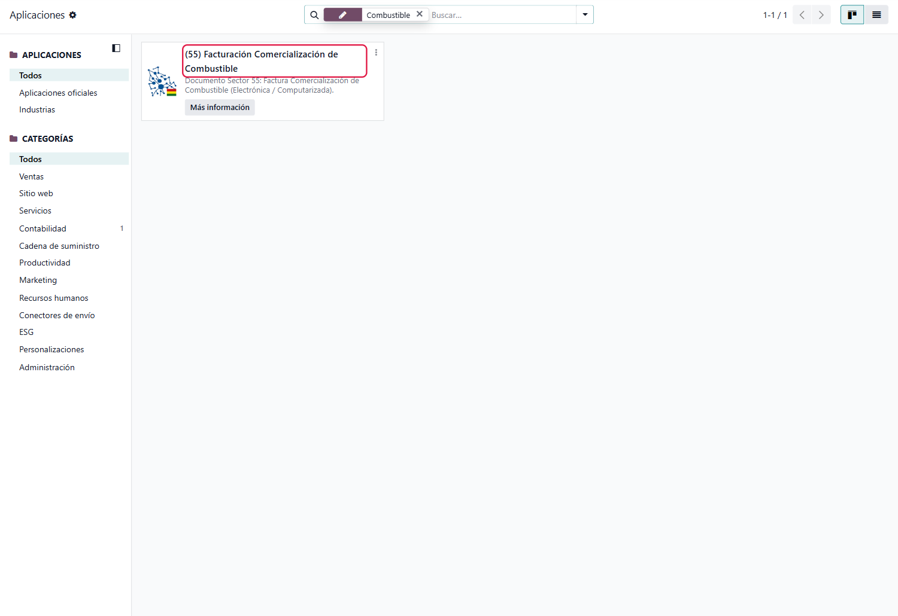
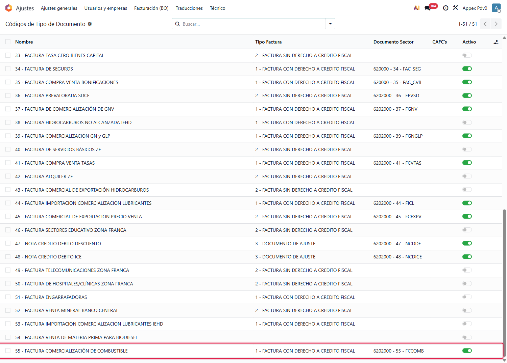
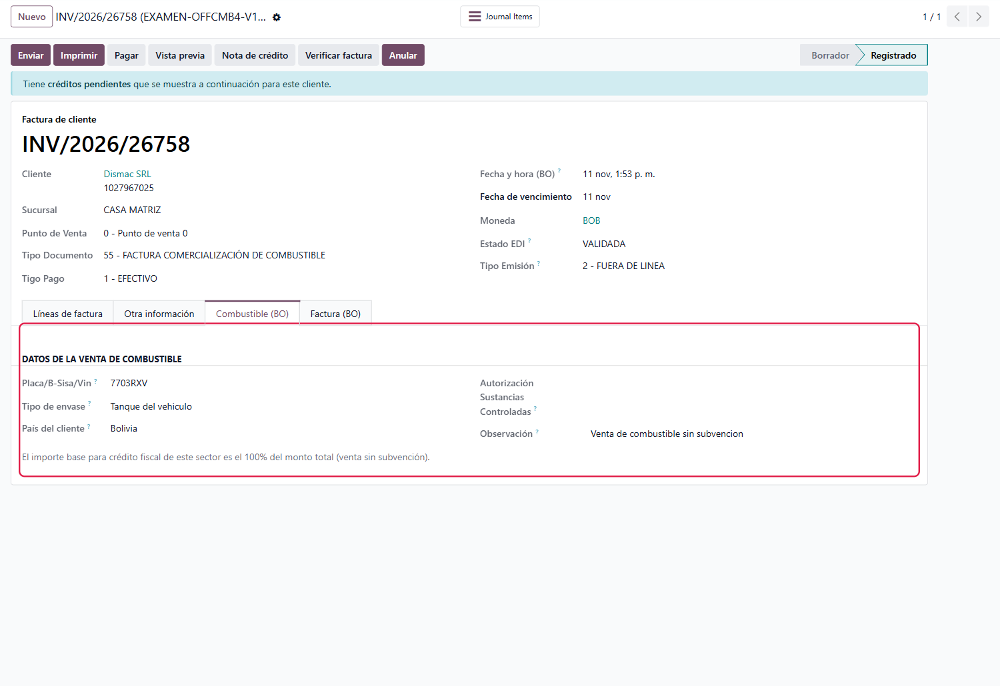
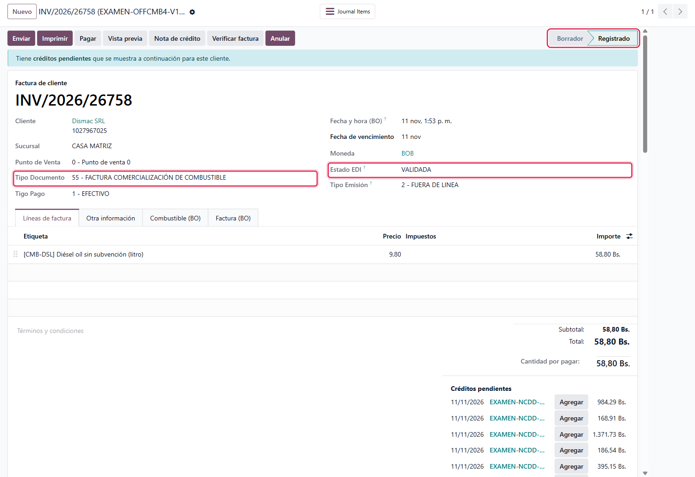
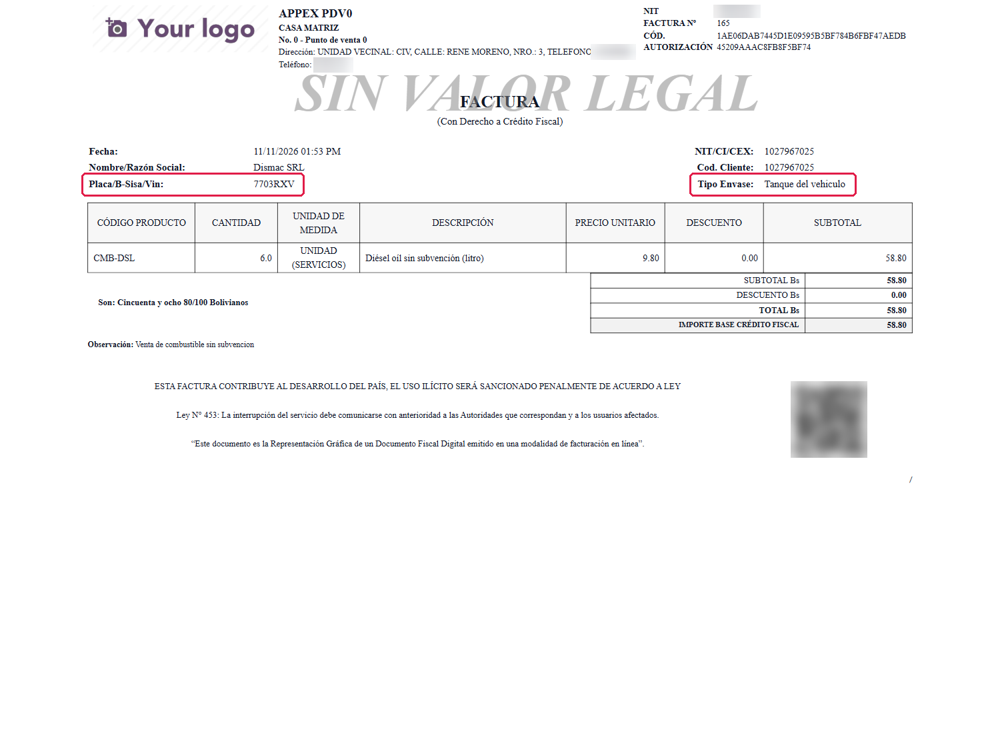

# Factura de comercialización de combustible

Es la factura de la venta de combustible para automotores sin subvención (gasolina, diésel). En Odoo aparece como tipo de documento `55 - FACTURA COMERCIALIZACIÓN DE COMBUSTIBLE`; ante el SIAT es el documento sector 55. Se parece a la factura de hidrocarburos (sección [Factura de comercialización de hidrocarburos](factura-de-comercializacion-de-hidrocarburos.md)) y a la de GNV (sección [Factura de comercialización de GNV](factura-de-comercializacion-de-gnv.md)): **la placa del vehículo es obligatoria**, y el tipo de envase, el país del cliente, la autorización de sustancias controladas y la observación son opcionales. Como es una venta sin subvención, **el crédito fiscal es sobre el total**, y **no admite pago con gift card**. Las cantidades y los precios admiten hasta 5 decimales. Queda emitida cuando el SIN la devuelve como **`VALIDADA` (código `908`)**.

## Qué debe estar configurado

Además de la configuración general de la Parte I, la factura de comercialización de combustible necesita estos cuatro puntos:

- **Módulo activado.** Aplicaciones → buscar «Combustible» → «(55) Facturación Comercialización de Combustible» → Activar. Si no aparece, primero hay que pulsar Actualizar lista de aplicaciones (sección [Factura de suministro de energía › Qué debe estar configurado](factura-de-suministro-de-energia.md#que-debe-estar-configurado)).

    { width="624" height="428" loading="lazy" }

- **Tipo de documento 55 activo y con su documento sector.** Ajustes → Facturación (BO) → Catálogos SIAT → Códigos de Tipo Documento, fila `55 - FACTURA COMERCIALIZACIÓN DE COMBUSTIBLE`: el interruptor Activo debe estar encendido, el campo Documento Sector completo (por ejemplo, `6202000 - 55 - FCCOMB`; depende de la actividad económica registrada en el SIN) y el Tipo de factura en `1 - FACTURA CON DERECHO A CREDITO FISCAL`.

    { width="624" height="448" loading="lazy" }

- **Secuencia en el punto de venta.** En la pestaña Secuencias Documentos del punto de venta (sección 3.5 de la Parte I) debe figurar el tipo 55. Si falta, se agrega una línea a mano, como se explica en la sección [Nota de crédito-débito › Qué debe saber antes de emitirla](nota-de-credito-debito.md#que-debe-saber-antes-de-emitirla).

- **Productos con Código SIAT.** En la pestaña Facturación (BO) del producto, con el Código SIAT del catálogo que corresponda a la actividad de la empresa (sección 4.2 de la Parte I). Se crea un producto por cada combustible, por litro (por ejemplo, gasolina especial, gasolina premium o diésel oíl).

Si se va a informar el país del cliente, el país de Odoo tiene que tener cargado su **país SIAT** (Contactos → Configuración → Países → abrir el país). Por ejemplo, Bolivia es `22 - BOLIVIA (ESTADO PLURINACIONAL DE)`. Sin ese dato, la factura se emite sin código de país.

## Paso a paso: crear y emitir la factura

1. **Abrir una factura nueva:** Contabilidad → Clientes → Facturas → botón Nuevo, y elegir el cliente en el campo Contacto.

1. **Completar la cabecera:** Sucursal, Punto de Venta, Tigo Pago (sin gift card) y, en Tipo Documento, `55 - FACTURA COMERCIALIZACIÓN DE COMBUSTIBLE`.

1. **Cargar las líneas** en la pestaña Líneas de factura: el combustible, la cantidad de litros (hasta 5 decimales) y el precio.

1. **Completar la pestaña Combustible (BO),** grupo Datos de la Venta de Combustible: la **Placa/B-Sisa/Vin** (obligatoria, hasta 12 caracteres) y, si corresponde, el Tipo de envase (por ejemplo «Bidón»), el País del cliente (se propone desde el cliente), la Autorización Sustancias Controladas y la Observación (por ejemplo «Uso de tickets»).

    { width="624" height="428" loading="lazy" }

1. **Revisar la pestaña Factura (BO)** (sección [Factura de compra-venta › Paso a paso: crear y emitir la factura](factura-de-compra-venta.md#paso-a-paso-crear-y-emitir-la-factura), paso 7) y **pulsar Confirmar.** Debe quedar en Registrado, con Estado EDI `VALIDADA`.

    { width="624" height="428" loading="lazy" }

## Cómo se ve la factura impresa y cómo saber si llegó al SIN

La factura impresa lleva el título **FACTURA** con la leyenda (Con Derecho a Crédito Fiscal). En la cabecera salen **Placa/B-Sisa/Vin** y **Tipo Envase**. Al pie salen el total, el **importe base crédito fiscal**, que es igual al total, y la observación.

Igual que en la compra-venta (sección [Factura de compra-venta › Cómo saber si la factura llegó al SIN](factura-de-compra-venta.md#como-saber-si-la-factura-llego-al-sin)), la factura está emitida solo si **Estado EDI** dice `VALIDADA`. Tiene su propia numeración por punto de venta (la secuencia 55). Por ejemplo, una factura con 1 litro de diésel a 9,80 Bs y 4 litros de gasolina especial a 8,68 Bs, para el vehículo de placa 2692SZY, con país 22 (Bolivia). Suma 44,52 Bs; el SIN la recibió con monto sujeto a IVA 44,52 Bs.

Se anula y se revierte igual que las demás facturas (sección 1 de la Parte III), y también se puede emitir fuera de línea (sección 2 de la Parte III).

{ width="624" height="458" loading="lazy" }

## Errores frecuentes

Los errores de la sección [Factura de compra-venta › Errores frecuentes y cómo resolverlos](factura-de-compra-venta.md#errores-frecuentes-y-como-resolverlos) también se aplican a esta factura. Además, estos son propios de este documento:

| Lo que ve el usuario | Por qué pasa | Cómo se resuelve |
|---|---|---|
| En Tipo Documento no aparece `55 - FACTURA COMERCIALIZACIÓN DE COMBUSTIBLE` | Falta el módulo, el tipo 55 no está activo o el punto de venta no tiene la secuencia. | Revisar los puntos de la sección [Qué debe estar configurado](#que-debe-estar-configurado). |
| «Nota: Debe registrar la Placa/B-Sisa/Vin para la Factura de Comercialización de Combustible.» | La pestaña Combustible (BO) quedó sin placa. | Completar la placa y volver a confirmar. |
| «Nota: La Placa/B-Sisa/Vin no puede superar los 12 caracteres.» | La placa tiene más de 12 caracteres. | Escribir la placa sin espacios ni guiones. |
| «Nota: Tipo de envase no puede superar los 50 caracteres.» (o Autorización Sustancias Controladas, 100; Observación, 500) | El texto supera el largo que admite el SIN. | Acortar el texto. |
| «Nota: El pago con GiftCard no es válido para el documento: \[...\]» | En Tigo Pago se eligió un método con gift card; el formato del sector 55 no lo contempla. | Elegir otro Tigo Pago, por ejemplo `1 - EFECTIVO`. |
| «Nota: El subtotal de \[producto\] debe ser mayor a cero.» | Una línea tiene un descuento igual a su importe, o cantidad o precio en cero. | Corregir la línea o quitarla. |
| La factura sale sin código de país aunque el cliente tiene país. | El país de Odoo no tiene cargado su país SIAT. | Cargarlo en Contactos → Configuración → Países (ver sección [Qué debe estar configurado](#que-debe-estar-configurado)). |
