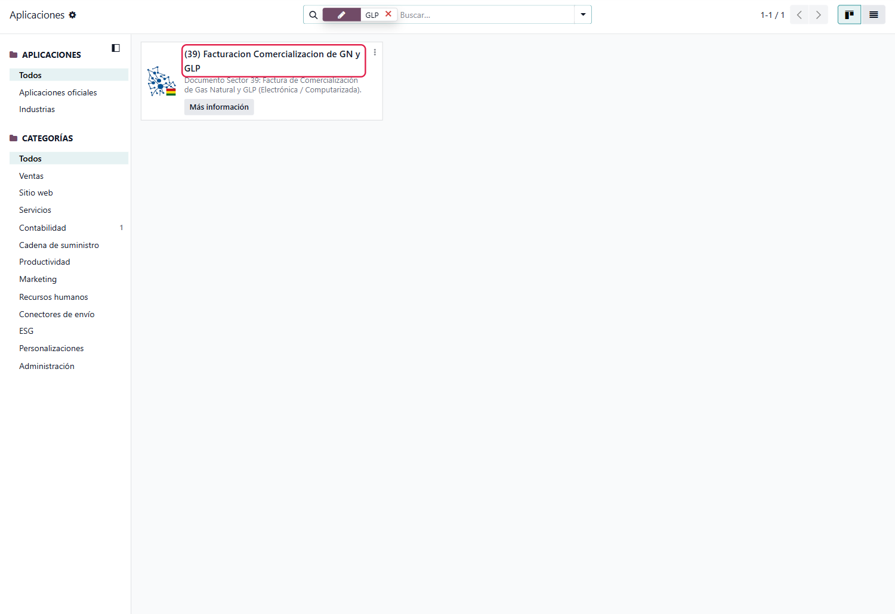
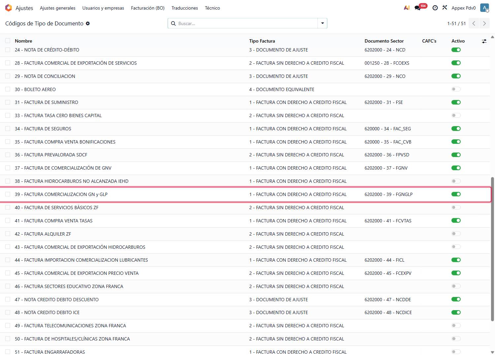
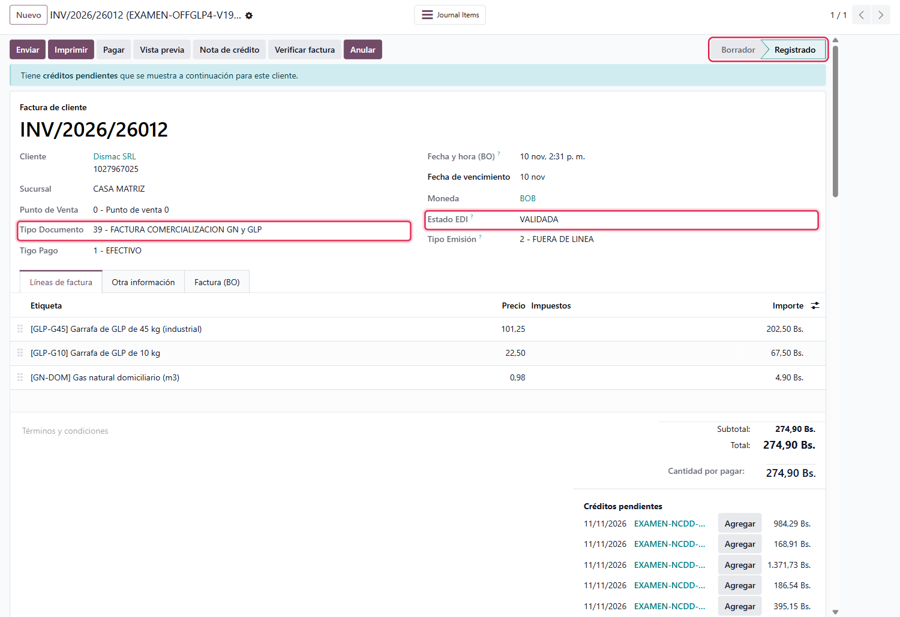
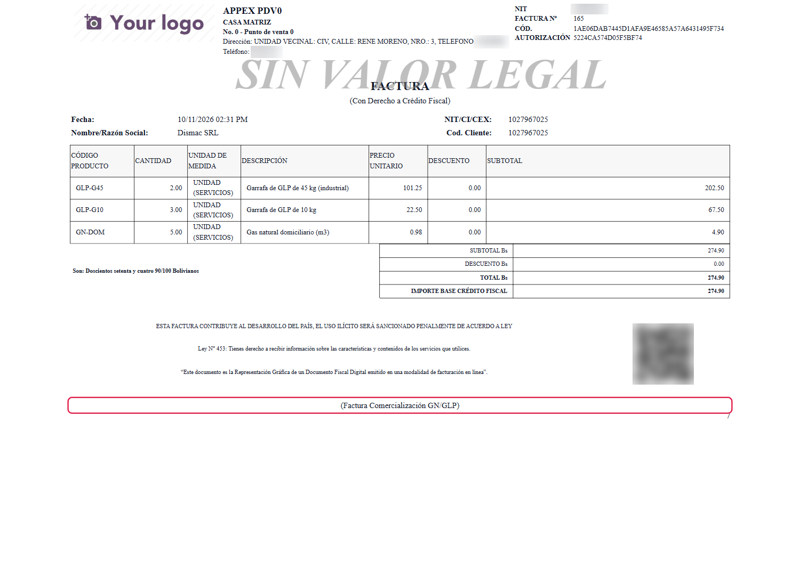

# Factura de comercialización de GN y GLP

Es la factura de la venta de gas natural (GN) y de gas licuado de petróleo (GLP), por ejemplo garrafas de GLP o gas natural domiciliario. En Odoo aparece como tipo de documento **39 - FACTURA COMERCIALIZACION GN y GLP**; ante el SIAT es el documento sector 39. Es la más simple de las facturas de hidrocarburos: **no tiene campos propios** (no pide placa, envase ni país), **el crédito fiscal es sobre el total** y **no admite pago con gift card**. La cantidad admite hasta 5 decimales. Queda emitida cuando el SIN la devuelve como **VALIDADA (código 908)**.

## Qué debe estar configurado

Además de la configuración general de la Parte I, la factura de comercialización de GN y GLP necesita estos cuatro puntos:

- **Módulo activado.** Aplicaciones → buscar «GLP» → «(39) Facturacion Comercializacion de GN y GLP» → Activar. Si no aparece, primero hay que pulsar Actualizar lista de aplicaciones (sección [Factura de suministro de energía › Qué debe estar configurado](factura-de-suministro-de-energia.md#que-debe-estar-configurado)).

    { width="624" loading="lazy" }

- **Tipo de documento 39 activo y con su documento sector.** Ajustes → Facturación (BO) → Catálogos SIAT → Códigos de Tipo Documento, fila «39 - FACTURA COMERCIALIZACION GN y GLP»: el interruptor Activo debe estar encendido, el campo Documento Sector completo (por ejemplo, «6202000 - 39 - FGNGLP»; depende de la actividad económica registrada en el SIN) y el Tipo de factura en «1 - FACTURA CON DERECHO A CREDITO FISCAL».

    { width="624" loading="lazy" }

- **Secuencia en el punto de venta.** En la pestaña Secuencias Documentos del punto de venta (sección 3.5 de la Parte I) debe figurar el tipo 39. Si falta, se agrega una línea a mano, como se explica en la sección [Nota de crédito-débito › Qué debe saber antes de emitirla](nota-de-credito-debito.md#que-debe-saber-antes-de-emitirla).

- **Productos con Código SIAT.** En la pestaña Facturación (BO) del producto, con el Código SIAT del catálogo que corresponda a la actividad de la empresa (sección 4.2 de la Parte I). Se crea un producto por cada presentación que se vende (por ejemplo, garrafa de GLP de 10 kg o gas natural domiciliario por metro cúbico).

## Paso a paso: crear y emitir la factura

1. **Abrir una factura nueva:** Contabilidad → Clientes → Facturas → botón Nuevo, y elegir el cliente en el campo Contacto.

1. **Completar la cabecera:** Sucursal, Punto de Venta, Tigo Pago (sin gift card) y, en Tipo Documento, **39 - FACTURA COMERCIALIZACION GN y GLP**.

1. **Cargar las líneas** en la pestaña Líneas de factura: el producto, la cantidad (garrafas o metros cúbicos, hasta 5 decimales) y el precio. Cada línea debe tener cantidad, precio y subtotal mayores a cero.

1. **Revisar la pestaña Factura (BO)** (sección [Factura de compra-venta › Paso a paso: crear y emitir la factura](factura-de-compra-venta.md#paso-a-paso-crear-y-emitir-la-factura), paso 7) y **pulsar Confirmar.** No hay otra pestaña que completar. Debe quedar en Registrado, con Estado EDI **VALIDADA**.

    { width="624" loading="lazy" }

## Cómo se ve la factura impresa y cómo saber si llegó al SIN

La factura impresa lleva el título **FACTURA** con la leyenda (Con Derecho a Crédito Fiscal) y la aclaración (Factura Comercialización GN/GLP). Al pie salen el subtotal, el descuento, el total en bolivianos y en la moneda de la factura, y el importe base de crédito fiscal, que es igual al total.

Igual que en la compra-venta (sección [Factura de compra-venta › Cómo saber si la factura llegó al SIN](factura-de-compra-venta.md#como-saber-si-la-factura-llego-al-sin)), la factura está emitida solo si **Estado EDI** dice **VALIDADA**. Tiene su propia numeración por punto de venta (la secuencia 39). Por ejemplo, una factura con 4 m³ de gas natural domiciliario a 0,98 Bs, 6 garrafas de 45 kg a 101,25 Bs y 5 garrafas de 10 kg a 22,50 Bs. Suma 723,92 Bs; el SIN la recibió con monto sujeto a IVA 723,92 Bs.

Se anula y se revierte igual que las demás facturas (sección 1 de la Parte III), y también se puede emitir fuera de línea (sección 2 de la Parte III).

{ width="624" loading="lazy" }

## Errores frecuentes

Los errores de la sección [Factura de compra-venta › Errores frecuentes y cómo resolverlos](factura-de-compra-venta.md#errores-frecuentes-y-como-resolverlos) también se aplican a esta factura. Además, estos son propios de este documento:

| Lo que ve el usuario | Por qué pasa | Cómo se resuelve |
|---|---|---|
| En Tipo Documento no aparece 39 - FACTURA COMERCIALIZACION GN y GLP | Falta el módulo, el tipo 39 no está activo o el punto de venta no tiene la secuencia. | Revisar los puntos de la sección [Qué debe estar configurado](#que-debe-estar-configurado). |
| «Nota: El pago con GiftCard no es válido para el documento: \[...\]» | En Tigo Pago se eligió un método con gift card; el formato del sector 39 no lo contempla. | Elegir otro Tigo Pago, por ejemplo 1 - EFECTIVO. |
| «Nota: La cantidad de \[producto\] debe ser mayor a cero.» o «Nota: El precio unitario de \[producto\] debe ser mayor a cero.» | Una línea quedó con cantidad o precio en cero. | Corregir la línea o quitarla. |
| «Nota: El subtotal de \[producto\] debe ser mayor a cero: el descuento no puede cubrir toda la línea.» | Una línea tiene un descuento igual a su importe. | Bajar el descuento o quitar la línea. |
| «Nota: El monto total de la factura debe ser mayor a cero: el descuento adicional no puede cubrir todo el subtotal.» | El descuento adicional de la factura es igual o mayor que la suma de las líneas. | Bajar el descuento adicional. |
