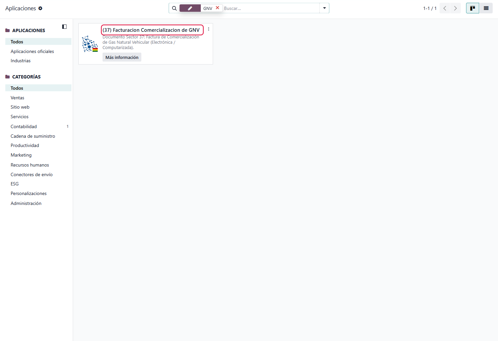
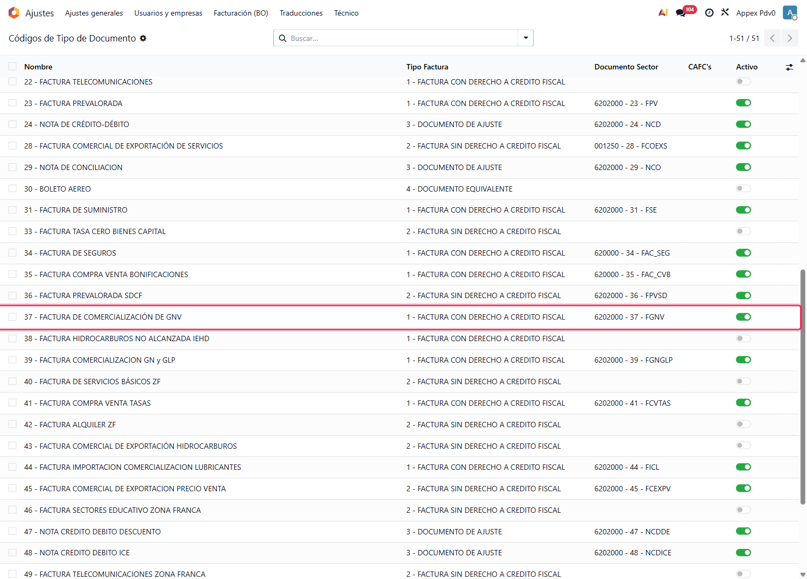
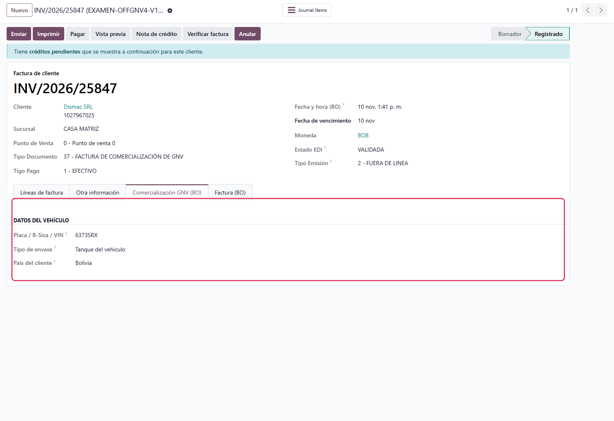
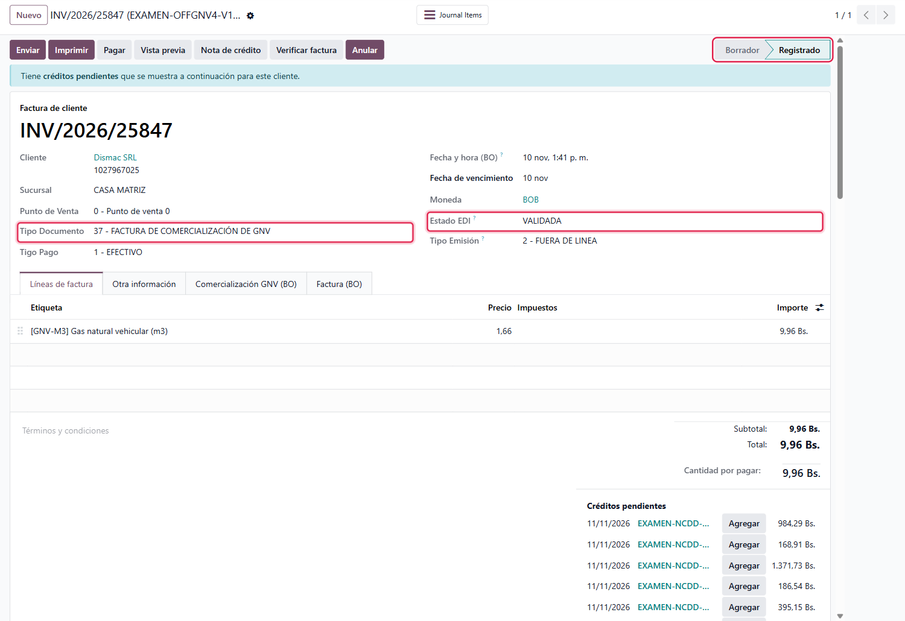
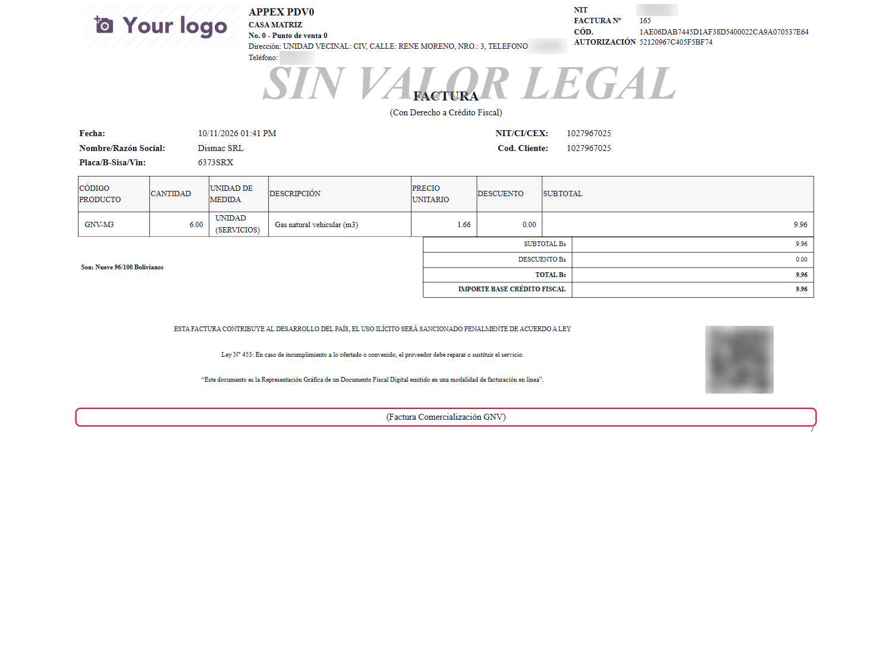

# Factura de comercialización de GNV

Es la factura de la venta de gas natural vehicular (GNV) en surtidores. En Odoo aparece como tipo de documento `37 - FACTURA DE COMERCIALIZACIÓN DE GNV`; ante el SIAT es el documento sector 37. Se parece a la factura de hidrocarburos (sección [Factura de comercialización de hidrocarburos](factura-de-comercializacion-de-hidrocarburos.md)): **la placa del vehículo es obligatoria** y el tipo de envase y el país del cliente son opcionales. A diferencia de aquella, **el crédito fiscal es sobre el total** y **no admite pago con gift card**. La cantidad admite hasta 5 decimales. Queda emitida cuando el SIN la devuelve como **`VALIDADA` (código `908`)**.

## Qué debe estar configurado

Además de la configuración general de la Parte I, la factura de comercialización de GNV necesita estos cuatro puntos:

- **Módulo activado.** Aplicaciones → buscar «GNV» → «(37) Facturacion Comercializacion de GNV» → Activar. Si no aparece, primero hay que pulsar Actualizar lista de aplicaciones (sección [Factura de suministro de energía › Qué debe estar configurado](factura-de-suministro-de-energia.md#que-debe-estar-configurado)).

    { width="624" height="428" loading="lazy" }

- **Tipo de documento 37 activo y con su documento sector.** Ajustes → Facturación (BO) → Catálogos SIAT → Códigos de Tipo Documento, fila `37 - FACTURA DE COMERCIALIZACIÓN DE GNV`: el interruptor Activo debe estar encendido, el campo Documento Sector completo (por ejemplo, `6202000 - 37 - FGNV`; depende de la actividad económica registrada en el SIN) y el Tipo de factura en `1 - FACTURA CON DERECHO A CREDITO FISCAL`.

    { width="624" height="448" loading="lazy" }

- **Secuencia en el punto de venta.** En la pestaña Secuencias Documentos del punto de venta (sección 3.5 de la Parte I) debe figurar el tipo 37. Si falta, se agrega una línea a mano, como se explica en la sección [Nota de crédito-débito › Qué debe saber antes de emitirla](nota-de-credito-debito.md#que-debe-saber-antes-de-emitirla).

- **Productos con Código SIAT.** En la pestaña Facturación (BO) del producto, con el Código SIAT del catálogo que corresponda a la actividad de la empresa (sección 4.2 de la Parte I). Se crea un producto por cada surtidor o tarifa, por metro cúbico.

## Paso a paso: crear y emitir la factura

1. **Abrir una factura nueva:** Contabilidad → Clientes → Facturas → botón Nuevo, y elegir el cliente en el campo Contacto.

1. **Completar la cabecera:** Sucursal, Punto de Venta, Tigo Pago (sin gift card) y, en Tipo Documento, `37 - FACTURA DE COMERCIALIZACIÓN DE GNV`.

1. **Cargar las líneas** en la pestaña Líneas de factura: el GNV, la cantidad de metros cúbicos (hasta 5 decimales) y el precio.

1. **Completar la pestaña Comercialización GNV (BO),** grupo Datos del Vehículo: la **Placa / B-Sisa / VIN** (obligatoria, hasta 12 caracteres), el Tipo de envase (opcional, por ejemplo «Tanque del vehículo») y el País del cliente (opcional, se propone desde el cliente).

    { width="624" height="428" loading="lazy" }

1. **Revisar la pestaña Factura (BO)** (sección [Factura de compra-venta › Paso a paso: crear y emitir la factura](factura-de-compra-venta.md#paso-a-paso-crear-y-emitir-la-factura), paso 7) y **pulsar Confirmar.** Debe quedar en Registrado, con Estado EDI `VALIDADA`.

    { width="624" height="428" loading="lazy" }

## Cómo se ve la factura impresa y cómo saber si llegó al SIN

La factura impresa lleva el título **FACTURA** con la leyenda (Con Derecho a Crédito Fiscal) y la aclaración (Factura Comercialización GNV). En la cabecera sale **Placa/B-Sisa/Vin**. Al pie salen el subtotal, el descuento, el total en bolivianos y en la moneda de la factura, y el importe base de crédito fiscal, que es igual al total.

Igual que en la compra-venta (sección [Factura de compra-venta › Cómo saber si la factura llegó al SIN](factura-de-compra-venta.md#como-saber-si-la-factura-llego-al-sin)), la factura está emitida solo si **Estado EDI** dice `VALIDADA`. Tiene su propia numeración por punto de venta (la secuencia 37). Por ejemplo, una factura con 19 m³ de surtidor express a 1,75 Bs y 40 m³ de GNV a 1,66 Bs, para el vehículo de placa 3349YBV. Suma 99,65 Bs; el SIN la recibió con monto sujeto a IVA 99,65 Bs.

Se anula y se revierte igual que las demás facturas (sección 1 de la Parte III), y también se puede emitir fuera de línea (sección 2 de la Parte III).

{ width="624" height="458" loading="lazy" }

## Errores frecuentes

Los errores de la sección [Factura de compra-venta › Errores frecuentes y cómo resolverlos](factura-de-compra-venta.md#errores-frecuentes-y-como-resolverlos) también se aplican a esta factura. Además, estos son propios de este documento:

| Lo que ve el usuario | Por qué pasa | Cómo se resuelve |
|---|---|---|
| En Tipo Documento no aparece `37 - FACTURA DE COMERCIALIZACIÓN DE GNV` | Falta el módulo, el tipo 37 no está activo o el punto de venta no tiene la secuencia. | Revisar los puntos de la sección [Qué debe estar configurado](#que-debe-estar-configurado). |
| «Nota: Debe registrar la Placa / B-Sisa / VIN del vehículo para la Factura de Comercialización de GNV.» | La pestaña Comercialización GNV (BO) quedó sin placa. | Completar la placa y volver a confirmar. |
| «Nota: La Placa / B-Sisa / VIN no puede superar los 12 caracteres \[...\]» | La placa tiene más de 12 caracteres. | Escribir la placa sin espacios ni guiones. |
| «Nota: El pago con GiftCard no es válido para el documento: \[...\]» | En Tigo Pago se eligió un método con gift card; el formato del sector 37 no lo contempla. | Elegir otro Tigo Pago, por ejemplo `1 - EFECTIVO`. |
| «Nota: El subtotal de \[producto\] debe ser mayor a cero: el descuento no puede cubrir toda la línea.» | Una línea tiene un descuento igual a su importe. | Bajar el descuento o quitar la línea. |
