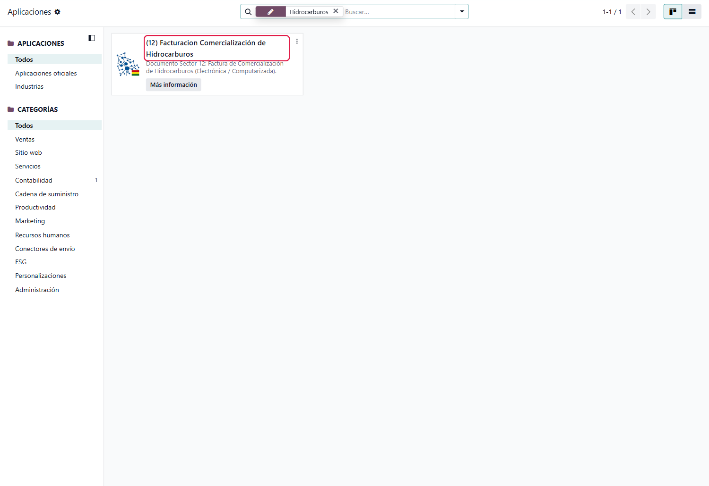
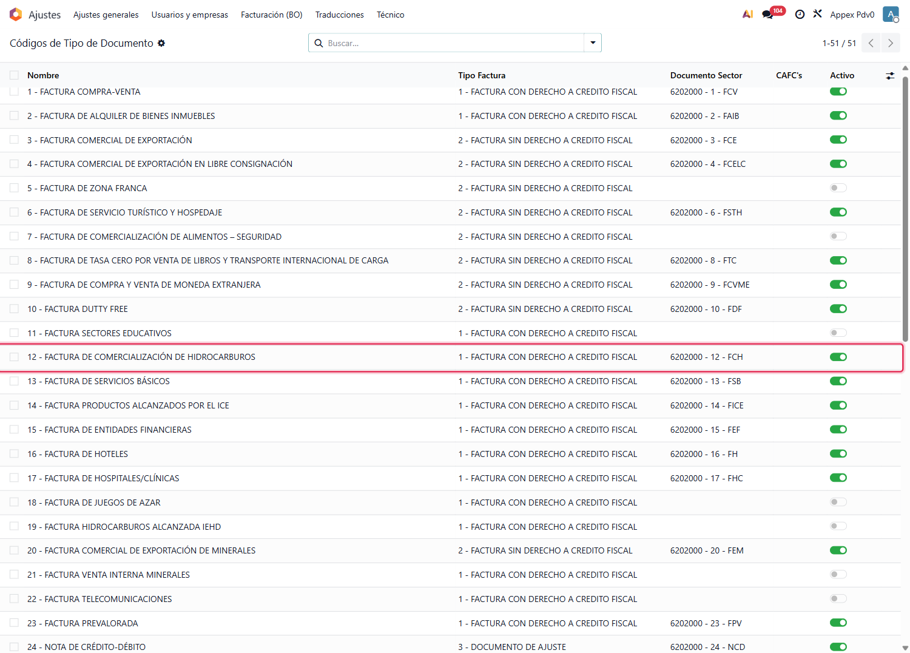
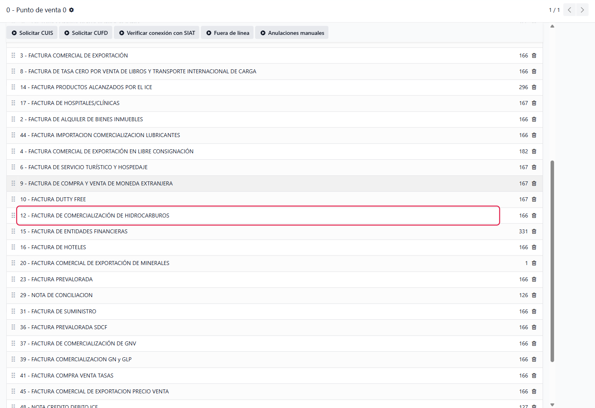
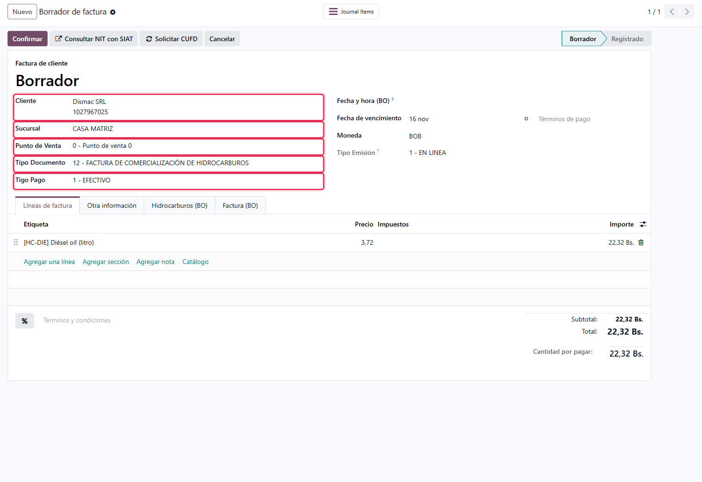
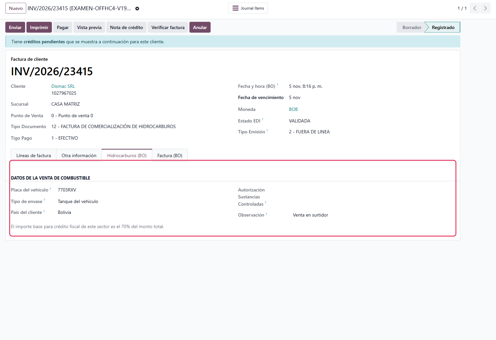
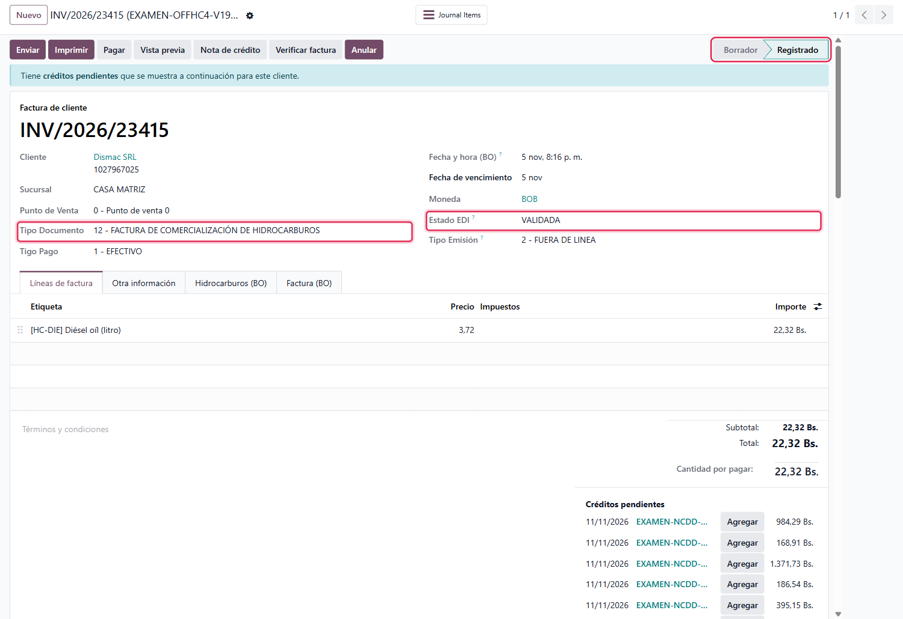
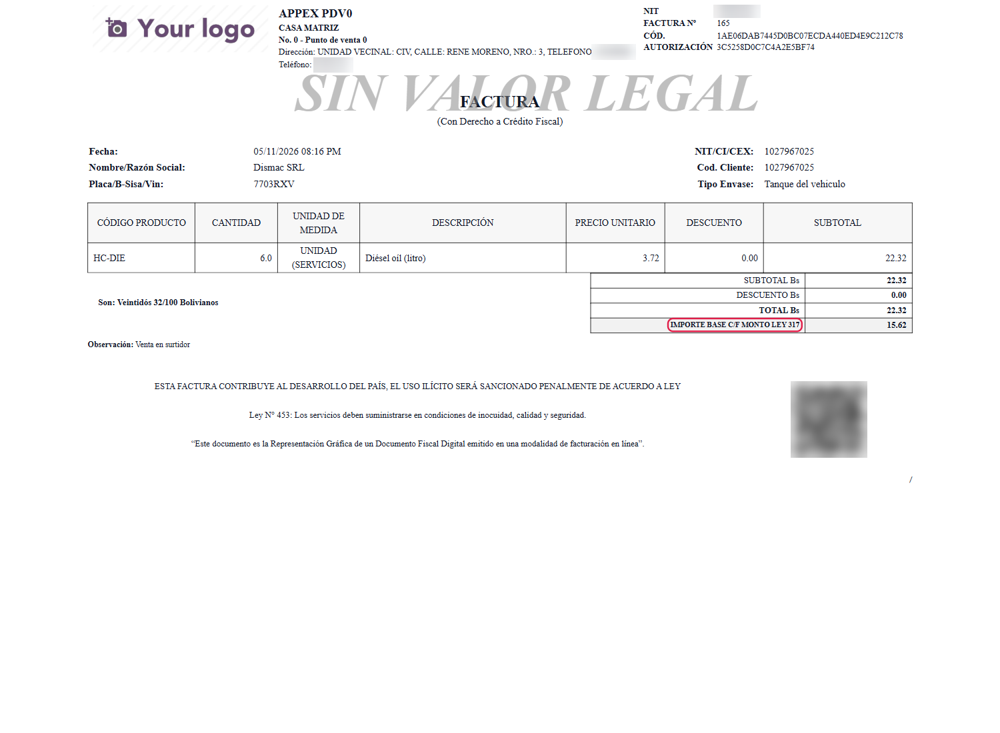

# Factura de comercialización de hidrocarburos

Es la factura de la venta de combustibles al consumidor: gasolina, diésel, gas natural vehicular y otros derivados. En Odoo aparece como tipo de documento **12 - FACTURA DE COMERCIALIZACIÓN DE HIDROCARBUROS**; ante el SIAT es el documento sector 12. Tiene dos particularidades: **la placa del vehículo es obligatoria**, y **el crédito fiscal se calcula sobre el 70 % del total** (el SIN la recibe con el monto sujeto a IVA igual al 70 % del monto total). Queda emitida cuando el SIN la devuelve como **VALIDADA (código 908)**.

## Qué debe estar configurado

Además de la configuración general de la Parte I, la factura de hidrocarburos necesita estos cuatro puntos:

- **Módulo de hidrocarburos activado.** Aplicaciones → buscar «Hidrocarburos» → «(12) Facturacion Comercialización de Hidrocarburos» → Activar.

    { width="624" height="428" loading="lazy" }

- **Tipo de documento 12 activo y con su documento sector.** Ajustes → Facturación (BO) → Catálogos SIAT → Códigos de Tipo Documento, fila «12 - FACTURA DE COMERCIALIZACIÓN DE HIDROCARBUROS»: el interruptor Activo debe estar encendido y el campo Documento Sector completo (por ejemplo, «6202000 - 12 - FCH»; depende de la actividad económica registrada en el SIN).

    { width="624" height="448" loading="lazy" }

- **Secuencia en el punto de venta.** En la pestaña Secuencias Documentos del punto de venta (sección 3.5 de la Parte I) debe figurar el tipo 12. Si falta, se agrega una línea a mano, como se explica en la sección [Nota de crédito-débito › Qué debe saber antes de emitirla](nota-de-credito-debito.md#que-debe-saber-antes-de-emitirla).

    { width="624" height="428" loading="lazy" }

- **Productos con Código SIAT.** En la pestaña Facturación (BO) del producto, con el Código SIAT del catálogo que corresponda a la actividad de la empresa (sección 4.2 de la Parte I). Se crea un producto por cada combustible y unidad que se vende (por ejemplo, gasolina especial por litro o gas natural vehicular por metro cúbico).

## Paso a paso: crear y emitir la factura

1. **Abrir una factura nueva:** Contabilidad → Clientes → Facturas → botón Nuevo, y elegir el cliente en el campo Contacto.

1. **Completar la cabecera:** Sucursal, Punto de Venta, Tigo Pago y, en Tipo Documento, **12 - FACTURA DE COMERCIALIZACIÓN DE HIDROCARBUROS**. Este documento **no admite pago con gift card**.

    { width="624" height="428" loading="lazy" }

1. **Cargar las líneas** en la pestaña Líneas de factura: el combustible, la cantidad (en litros o metros cúbicos; admite hasta 5 decimales) y el precio.

1. **Completar la pestaña Hidrocarburos (BO),** grupo Datos de la Venta de Combustible: **Placa del vehículo** (obligatoria, hasta 12 caracteres; Odoo la pasa a mayúsculas), Tipo de envase (opcional, por ejemplo «Tanque del vehículo» o «Bidón»), País del cliente (se completa desde el cliente), Autorización Sustancias Controladas (solo si corresponde) y Observación. La pestaña recuerda que el importe base para crédito fiscal es el 70 % del total.

    { width="624" height="428" loading="lazy" }

1. **Revisar la pestaña Factura (BO):** la casilla Factura (BO) debe estar marcada y la Leyenda asignada, igual que en la factura de compra-venta (sección [Factura de compra-venta › Paso a paso: crear y emitir la factura](factura-de-compra-venta.md#paso-a-paso-crear-y-emitir-la-factura), paso 7).

1. **Pulsar Confirmar.** Odoo envía la factura al SIN; suele tardar unos segundos, y hasta un minuto si el SIN está lento. Debe quedar en Registrado, con Estado EDI **VALIDADA**.

    { width="624" height="428" loading="lazy" }

## Cómo se ve la factura impresa y cómo saber si llegó al SIN

La factura impresa lleva el título **FACTURA** con la leyenda (Con Derecho a Crédito Fiscal). En la cabecera, además de la fecha, el NIT y el nombre del cliente, salen **Placa/B-Sisa/Vin** y **Tipo Envase**. Al pie salen el subtotal, el descuento, el total en bolivianos y en la moneda de la factura, el **IMPORTE BASE C/F MONTO LEY 317** (el 70 % del total) y la observación.

Igual que en la compra-venta (sección [Factura de compra-venta › Cómo saber si la factura llegó al SIN](factura-de-compra-venta.md#como-saber-si-la-factura-llego-al-sin)), la factura está emitida solo si **Estado EDI** dice **VALIDADA**. La factura de hidrocarburos tiene su propia numeración por punto de venta (la secuencia 12), separada de la de compra-venta. Por ejemplo, una factura con 76 m³ de gas natural vehicular a 1,66 Bs, para el vehículo de placa 8576DNJ. Suma 126,16 Bs, el SIN la recibió con monto sujeto a IVA 88,31 Bs (el 70 %).

Se anula y se revierte igual que las demás facturas (sección 1 de la Parte III), y también se puede emitir fuera de línea (sección 2 de la Parte III).

{ width="624" height="458" loading="lazy" }

## Errores frecuentes

Los errores de la sección [Factura de compra-venta › Errores frecuentes y cómo resolverlos](factura-de-compra-venta.md#errores-frecuentes-y-como-resolverlos) también se aplican a la factura de hidrocarburos. Además, estos son propios de este documento:

| Lo que ve el usuario | Por qué pasa | Cómo se resuelve |
|---|---|---|
| En Tipo Documento no aparece 12 - FACTURA DE COMERCIALIZACIÓN DE HIDROCARBUROS | Falta el módulo, el tipo 12 no está activo o el punto de venta no tiene la secuencia. | Revisar los puntos de la sección [Qué debe estar configurado](#que-debe-estar-configurado). |
| «Nota: Debe registrar la Placa del vehículo para la Factura de Comercialización de Hidrocarburos.» | La pestaña Hidrocarburos (BO) quedó sin placa. | Completar la Placa del vehículo y volver a confirmar. |
| «Nota: La Placa del vehículo no puede superar los 12 caracteres.» | La placa tiene más de 12 caracteres (a veces por espacios o guiones de más). | Escribir la placa sin espacios ni guiones. |
| «Nota: El pago con GiftCard no es válido para el documento: \[...\]» | En Tigo Pago se eligió un método con gift card. | Elegir otro método de pago (efectivo, tarjeta, transferencia, etc.). |
| «Nota: El subtotal de \[producto\] debe ser mayor a cero.» | Una línea tiene precio cero o un descuento igual a su importe. | Corregir el precio o el descuento de esa línea, o quitarla. |
