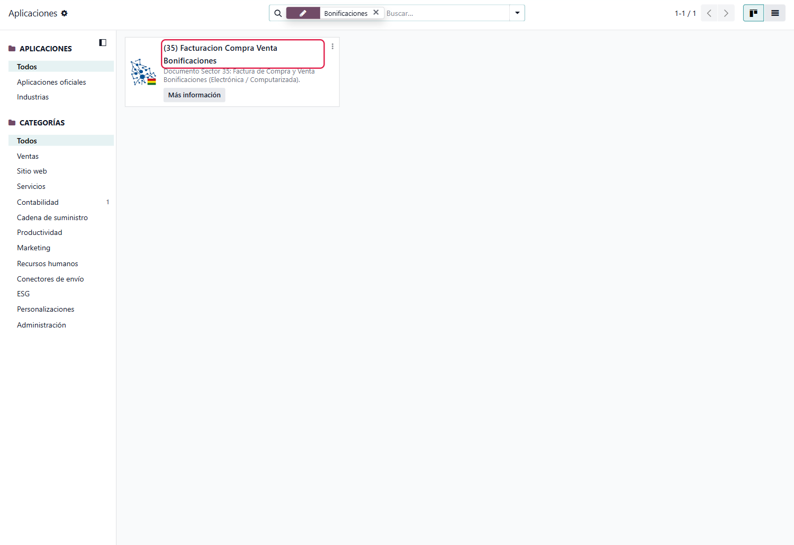
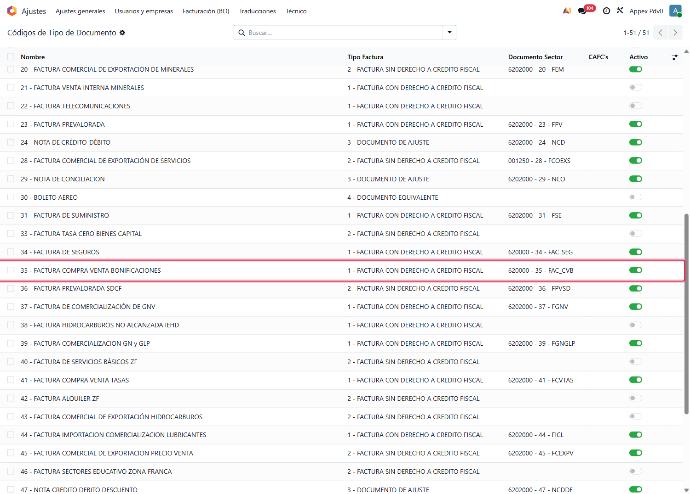
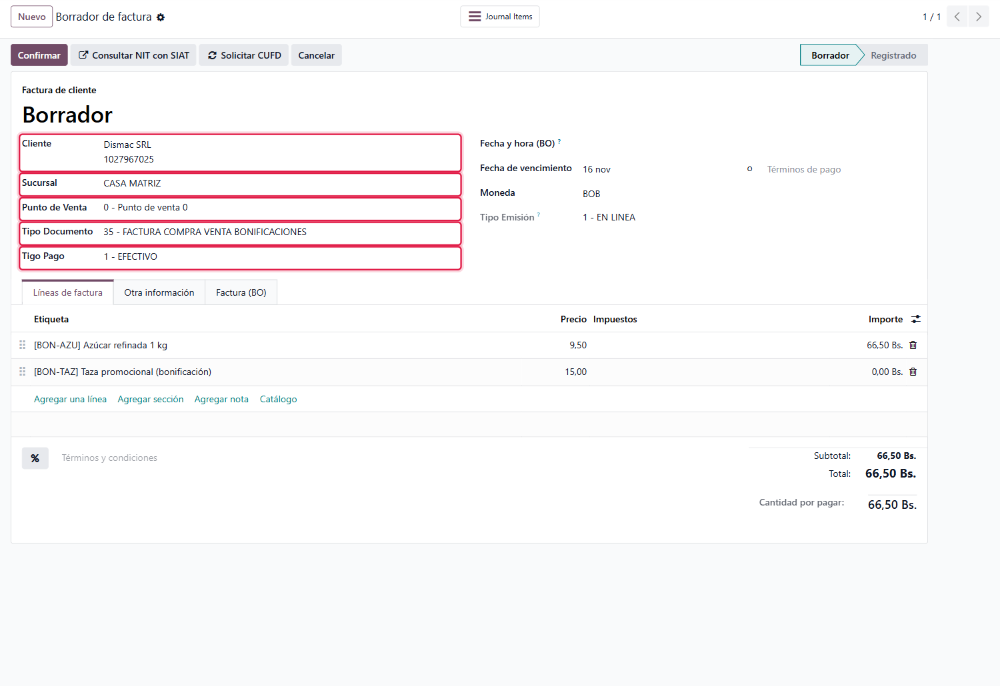
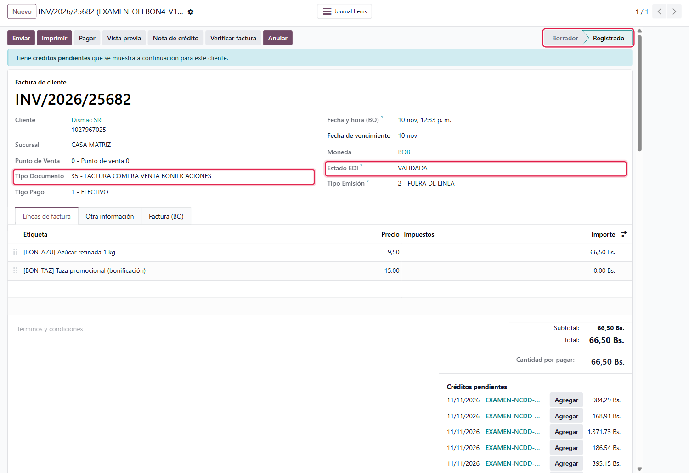
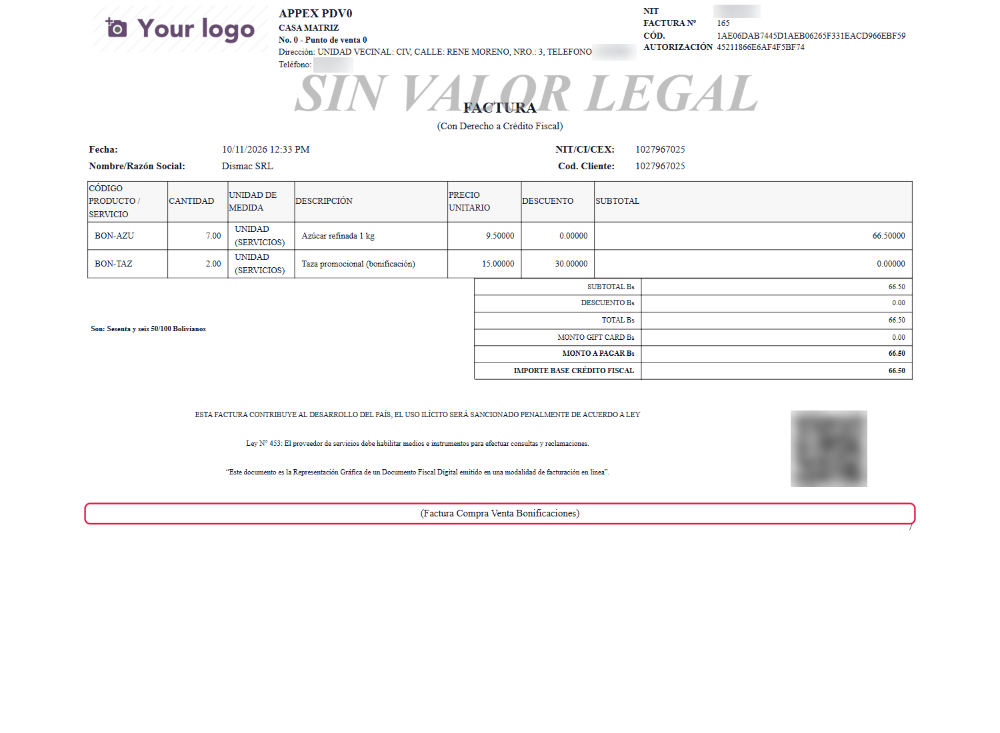

# Factura de compra-venta con bonificaciones

Es la factura de compra-venta que permite **regalar productos** dentro de la misma venta: una línea puede llevar descuento del 100 % y quedar con subtotal cero (por ejemplo, una taza de regalo por la compra de café). En Odoo aparece como tipo de documento `35 - FACTURA COMPRA VENTA BONIFICACIONES`; ante el SIAT es el documento sector 35 y viaja por el mismo servicio que la factura de compra-venta. El resto funciona igual que la compra-venta (sección [Factura de compra-venta](factura-de-compra-venta.md)): crédito fiscal sobre el total menos la gift card, y el detalle admite hasta 5 decimales. Queda emitida cuando el SIN la devuelve como **`VALIDADA` (código `908`)**.

## Qué debe estar configurado

Además de la configuración general de la Parte I, la factura de compra-venta con bonificaciones necesita estos cuatro puntos:

- **Módulo activado.** Aplicaciones → buscar «Bonificaciones» → «(35) Facturacion Compra Venta Bonificaciones» → Activar. Si no aparece, primero hay que pulsar Actualizar lista de aplicaciones (sección [Factura de suministro de energía › Qué debe estar configurado](factura-de-suministro-de-energia.md#que-debe-estar-configurado)). El módulo tiene que estar en una versión que envíe este documento por el servicio de compra-venta (ServicioFacturacionCompraVenta).

    { width="624" height="428" loading="lazy" }

- **Tipo de documento 35 activo y con su documento sector.** Ajustes → Facturación (BO) → Catálogos SIAT → Códigos de Tipo Documento, fila `35 - FACTURA COMPRA VENTA BONIFICACIONES`: el interruptor Activo debe estar encendido, el campo Documento Sector completo (por ejemplo, `620000 - 35 - FAC_CVB`; lo trae la sincronización con el SIN y depende de la actividad económica registrada) y el Tipo de factura en `1 - FACTURA CON DERECHO A CREDITO FISCAL`.

    { width="624" height="448" loading="lazy" }

- **Secuencia en el punto de venta.** En la pestaña Secuencias Documentos del punto de venta (sección 3.5 de la Parte I) debe figurar el tipo 35. Si falta, se agrega una línea a mano, como se explica en la sección [Nota de crédito-débito › Qué debe saber antes de emitirla](nota-de-credito-debito.md#que-debe-saber-antes-de-emitirla).

- **Productos con Código SIAT.** En la pestaña Facturación (BO) del producto, con el Código SIAT del catálogo que corresponda a la actividad de la empresa (sección 4.2 de la Parte I). Los productos que se regalan como bonificación también deben existir como productos, con su precio normal.

## Paso a paso: crear y emitir la factura

1. **Abrir una factura nueva:** Contabilidad → Clientes → Facturas → botón Nuevo, y elegir el cliente en el campo Contacto.

1. **Completar la cabecera:** Sucursal, Punto de Venta, Tigo Pago y, en Tipo Documento, `35 - FACTURA COMPRA VENTA BONIFICACIONES`. Admite pago con gift card y descuento adicional.

    { width="624" height="428" loading="lazy" }

1. **Cargar los productos vendidos** en la pestaña Líneas de factura: el producto, la cantidad y el precio.

1. **Agregar el producto regalado** como una línea más, con su precio normal y **descuento 100 %**. La línea queda con subtotal cero y aparece en el detalle de la factura como bonificación. Al menos una línea tiene que tener importe: no se puede regalar toda la factura.

1. **Revisar la pestaña Factura (BO):** la casilla Factura (BO) debe estar marcada y la Leyenda asignada, igual que en la factura de compra-venta (sección [Factura de compra-venta › Paso a paso: crear y emitir la factura](factura-de-compra-venta.md#paso-a-paso-crear-y-emitir-la-factura), paso 7).

1. **Pulsar Confirmar.** Odoo envía la factura al SIN; debe quedar en Registrado, con Estado EDI `VALIDADA`.

    { width="624" height="428" loading="lazy" }

## Cómo se ve la factura impresa y cómo saber si llegó al SIN

La factura impresa lleva el título **FACTURA** con la leyenda (Con Derecho a Crédito Fiscal) y la aclaración (Factura Compra Venta Bonificaciones). La línea regalada aparece en el detalle con su precio, el descuento por el mismo monto y subtotal 0,00. Al pie salen el subtotal, el descuento, el total, el monto gift card, el monto a pagar y el importe base de crédito fiscal.

Igual que en la compra-venta (sección [Factura de compra-venta › Cómo saber si la factura llegó al SIN](factura-de-compra-venta.md#como-saber-si-la-factura-llego-al-sin)), la factura está emitida solo si **Estado EDI** dice `VALIDADA`. Tiene su propia numeración por punto de venta (la secuencia 35). Por ejemplo, una factura con 4 kilos de azúcar a 9,50 Bs (38 Bs), 5 litros de aceite a 18 Bs (90 Bs) y una taza promocional de 15 Bs con descuento de 15 Bs. Suma 128,00 Bs; el SIN la recibió con la taza en subtotal 0 y monto sujeto a IVA 128 Bs.

Se anula y se revierte igual que las demás facturas (sección 1 de la Parte III), y también se puede emitir fuera de línea (sección 2 de la Parte III).

{ width="624" height="458" loading="lazy" }

## Errores frecuentes

Los errores de la sección [Factura de compra-venta › Errores frecuentes y cómo resolverlos](factura-de-compra-venta.md#errores-frecuentes-y-como-resolverlos) también se aplican a esta factura. Además, estos son propios de este documento:

| Lo que ve el usuario | Por qué pasa | Cómo se resuelve |
|---|---|---|
| En Tipo Documento no aparece `35 - FACTURA COMPRA VENTA BONIFICACIONES` | Falta el módulo, el tipo 35 no está activo o el punto de venta no tiene la secuencia. | Revisar los puntos de la sección [Qué debe estar configurado](#que-debe-estar-configurado). |
| «SERVICIO NO DISPONIBLE: Para la modalidad 1 y/o sector 35» | El módulo instalado envía la factura por el servicio de facturación electrónica general en lugar del de compra-venta. | Actualizar el módulo «(35) Facturacion Compra Venta Bonificaciones» a la versión que envía por ServicioFacturacionCompraVenta y volver a confirmar. |
| «Servicio: None no encontrado» | El tipo de documento no tiene asignado su Tipo de factura (pasa en una base nueva, después de sincronizar los catálogos). | Completar el Tipo de factura en el tipo de documento (sección [Qué debe estar configurado](#que-debe-estar-configurado)). |
| «Nota: El monto total de la factura debe ser mayor a cero: no todas las líneas pueden ser bonificadas.» | Todas las líneas tienen descuento del 100 %. | Dejar al menos un producto con importe. |
| «Nota: El descuento de \[producto\] no puede ser mayor al importe de la línea.» | Se cargó un descuento mayor que el importe de la línea. | Bajar el descuento al importe de la línea como máximo (100 %). |
