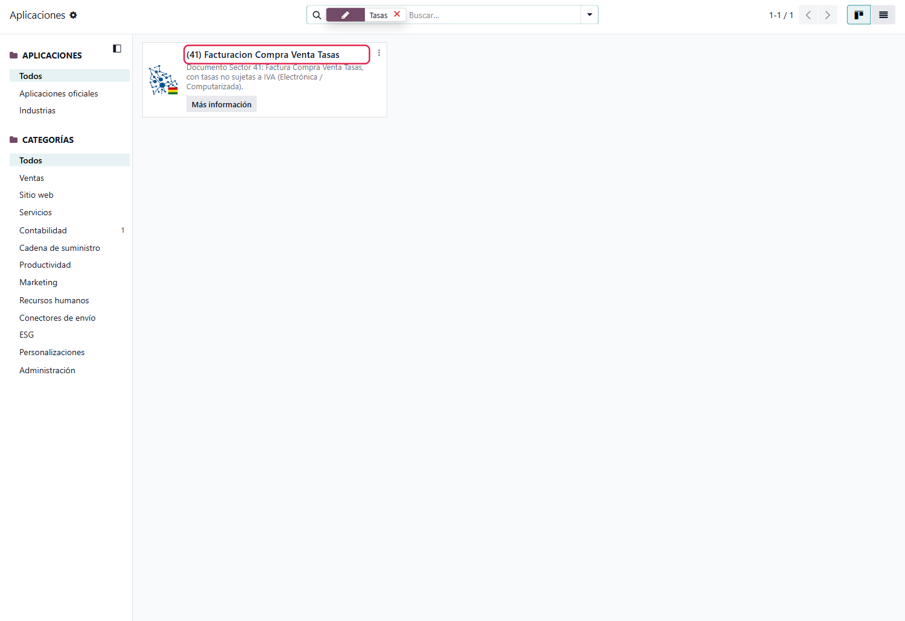
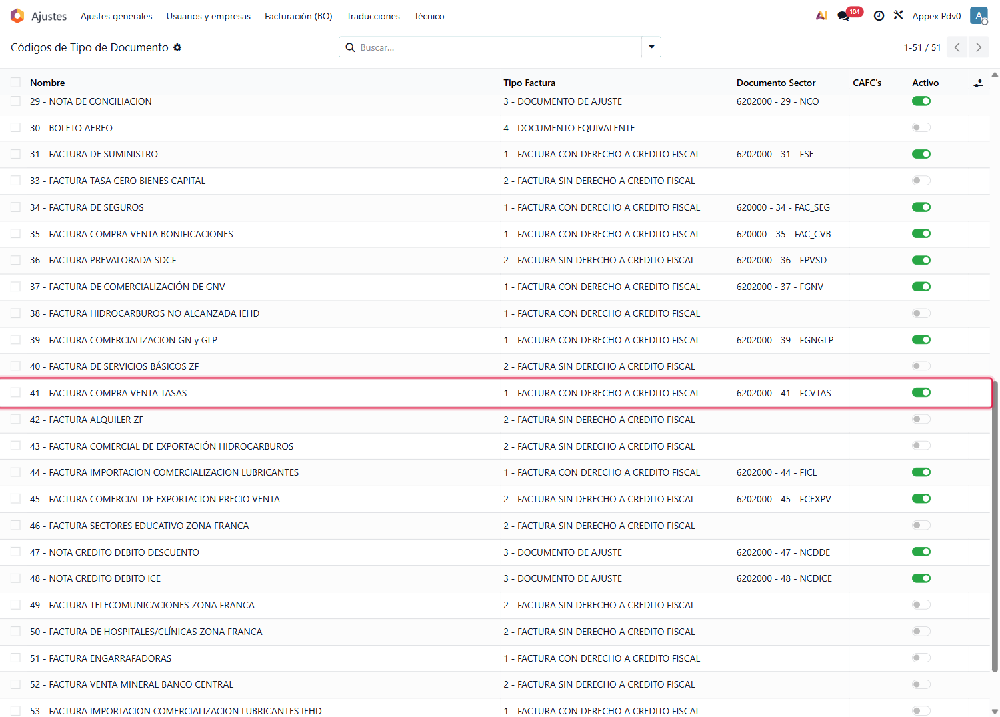
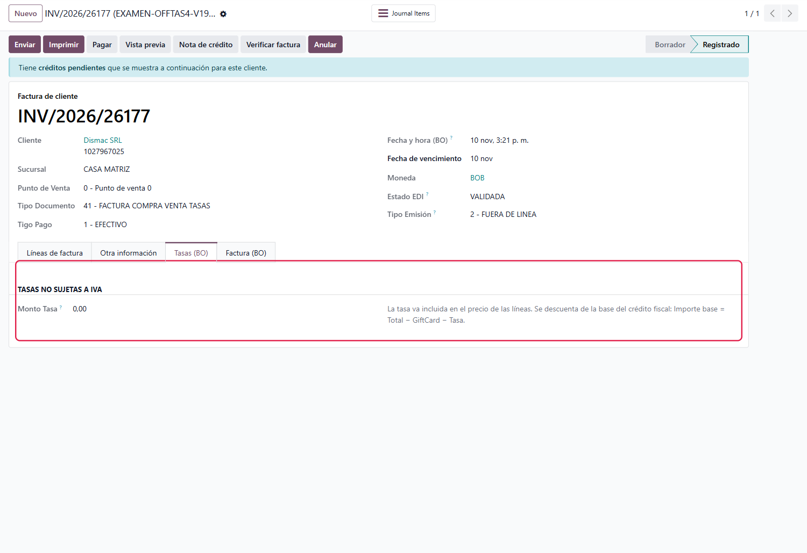
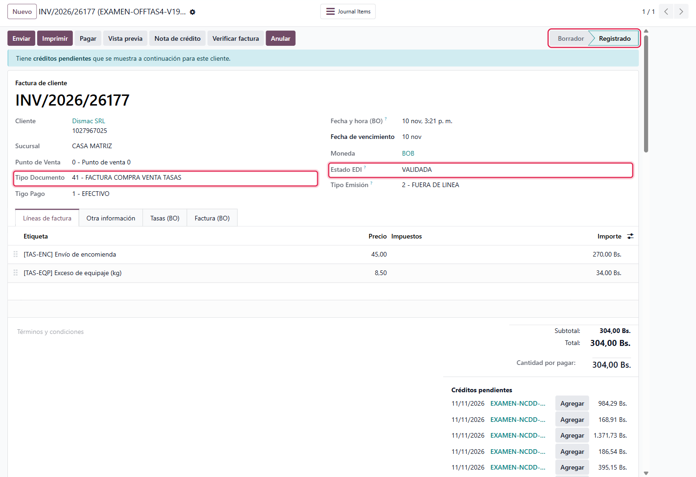
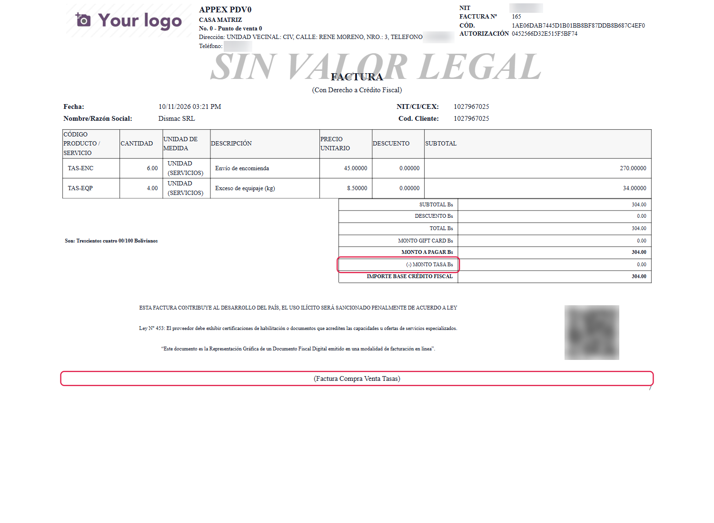

# Factura de compra-venta tasas

Es la factura de compra-venta que incluye tasas no sujetas a IVA, por ejemplo una tasa de terminal o un cargo municipal cobrado junto con el servicio. En Odoo aparece como tipo de documento `41 - FACTURA COMPRA VENTA TASAS`; ante el SIAT es el documento sector 41. Se emite igual que la compra-venta (sección [Factura de compra-venta](factura-de-compra-venta.md)), con un dato más: el **Monto Tasa**. La tasa ya va incluida en el precio de las líneas y en el total; el Monto Tasa solo indica qué parte del total no lleva IVA, y **se descuenta del importe base de crédito fiscal** (Importe base = Total − GiftCard − Tasa). Si la factura no tiene tasa, el campo queda en cero. La cantidad admite hasta 5 decimales. Queda emitida cuando el SIN la devuelve como **`VALIDADA` (código `908`)**.

## Qué debe estar configurado

Además de la configuración general de la Parte I, la factura de compra-venta tasas necesita estos cuatro puntos:

- **Módulo activado.** Aplicaciones → buscar «Tasas» → «(41) Facturacion Compra Venta Tasas» → Activar. Si no aparece, primero hay que pulsar Actualizar lista de aplicaciones (sección [Factura de suministro de energía › Qué debe estar configurado](factura-de-suministro-de-energia.md#que-debe-estar-configurado)).

    { width="624" height="428" loading="lazy" }

- **Tipo de documento 41 activo y con su documento sector.** Ajustes → Facturación (BO) → Catálogos SIAT → Códigos de Tipo Documento, fila `41 - FACTURA COMPRA VENTA TASAS`: el interruptor Activo debe estar encendido, el campo Documento Sector completo (por ejemplo, `6202000 - 41 - FCVTAS`; depende de la actividad económica registrada en el SIN) y el Tipo de factura en `1 - FACTURA CON DERECHO A CREDITO FISCAL`.

    { width="624" height="448" loading="lazy" }

- **Secuencia en el punto de venta.** En la pestaña Secuencias Documentos del punto de venta (sección 3.5 de la Parte I) debe figurar el tipo 41. Si falta, se agrega una línea a mano, como se explica en la sección [Nota de crédito-débito › Qué debe saber antes de emitirla](nota-de-credito-debito.md#que-debe-saber-antes-de-emitirla).

- **Productos con Código SIAT.** En la pestaña Facturación (BO) del producto, con el Código SIAT del catálogo que corresponda a la actividad de la empresa (sección 4.2 de la Parte I). Se crea un producto por cada servicio que se cobra (por ejemplo, pasaje, envío de encomienda o exceso de equipaje por kilo).

## Paso a paso: crear y emitir la factura

1. **Abrir una factura nueva:** Contabilidad → Clientes → Facturas → botón Nuevo, y elegir el cliente en el campo Contacto.

1. **Completar la cabecera:** Sucursal, Punto de Venta, Tigo Pago y, en Tipo Documento, `41 - FACTURA COMPRA VENTA TASAS`.

1. **Cargar las líneas** en la pestaña Líneas de factura: el producto, la cantidad y el precio, con la tasa ya incluida en el precio.

1. **Completar la pestaña Tasas (BO),** grupo Tasas no sujetas a IVA: en **Monto Tasa** se escribe el importe de las tasas incluidas en el total. Si no hay tasa, se deja en cero. No puede ser mayor que el total menos la gift card.

    { width="624" height="428" loading="lazy" }

1. **Revisar la pestaña Factura (BO)** (sección [Factura de compra-venta › Paso a paso: crear y emitir la factura](factura-de-compra-venta.md#paso-a-paso-crear-y-emitir-la-factura), paso 7) y **pulsar Confirmar.** Debe quedar en Registrado, con Estado EDI `VALIDADA`.

    { width="624" height="428" loading="lazy" }

## Cómo se ve la factura impresa y cómo saber si llegó al SIN

La factura impresa lleva el título **FACTURA** con la leyenda (Con Derecho a Crédito Fiscal) y la aclaración (Factura Compra Venta Tasas). Al pie salen el subtotal, el descuento, el total, el monto gift card, el **monto a pagar**, el total en la moneda de la factura, la línea **(-) MONTO TASA Bs** y el importe base de crédito fiscal, que es el total menos la gift card y la tasa.

Igual que en la compra-venta (sección [Factura de compra-venta › Cómo saber si la factura llegó al SIN](factura-de-compra-venta.md#como-saber-si-la-factura-llego-al-sin)), la factura está emitida solo si **Estado EDI** dice `VALIDADA`. Tiene su propia numeración por punto de venta (la secuencia 41). Por ejemplo, una factura con 4 pasajes a 120 Bs, 3 encomiendas a 45 Bs y 1 kg de exceso de equipaje a 8,50 Bs. Suma 623,50 Bs, con un Monto Tasa de 62,35 Bs; el SIN la recibió con monto sujeto a IVA 561,15 Bs.

Se anula y se revierte igual que las demás facturas (sección 1 de la Parte III), y también se puede emitir fuera de línea (sección 2 de la Parte III).

{ width="624" height="458" loading="lazy" }

## Errores frecuentes

Los errores de la sección [Factura de compra-venta › Errores frecuentes y cómo resolverlos](factura-de-compra-venta.md#errores-frecuentes-y-como-resolverlos) también se aplican a esta factura. Además, estos son propios de este documento:

| Lo que ve el usuario | Por qué pasa | Cómo se resuelve |
|---|---|---|
| En Tipo Documento no aparece `41 - FACTURA COMPRA VENTA TASAS` | Falta el módulo, el tipo 41 no está activo o el punto de venta no tiene la secuencia. | Revisar los puntos de la sección [Qué debe estar configurado](#que-debe-estar-configurado). |
| «Nota: El Monto Tasa (\[...\]) no puede ser mayor al total menos la GiftCard (\[...\]): la tasa va incluida en el total de la factura.» | Se escribió en Monto Tasa un importe mayor que lo que se cobra en la factura. | Corregir el Monto Tasa: es la parte del total que corresponde a tasas, no un cargo aparte. |
| «Nota: El Monto Tasa no puede ser negativo.» | Se escribió un Monto Tasa menor a cero. | Escribir el monto en positivo, o dejarlo en cero si no hay tasa. |
| «Nota: El monto GiftCard (\[...\]) no puede ser mayor al monto total de la factura (\[...\]).» | La gift card cubre más que el total de la factura. | Bajar el monto de la gift card. |
| «Nota: El subtotal de \[producto\] debe ser mayor a cero: el descuento no puede cubrir toda la línea.» | Una línea tiene un descuento igual a su importe. | Bajar el descuento o quitar la línea. |
