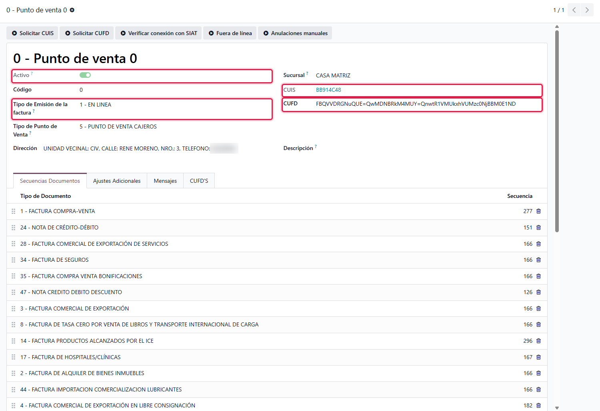
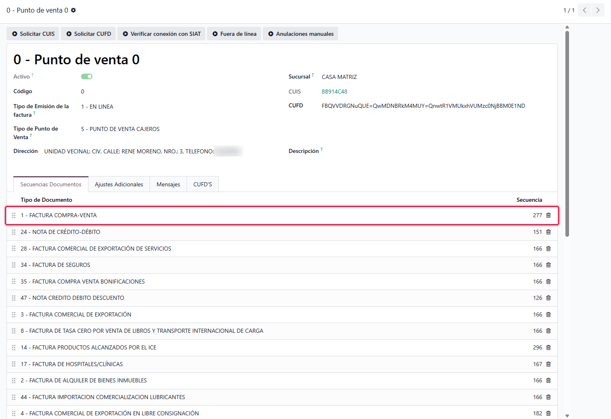
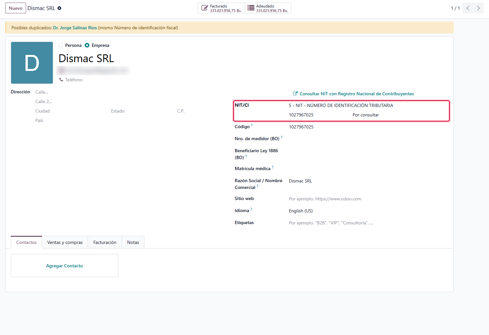
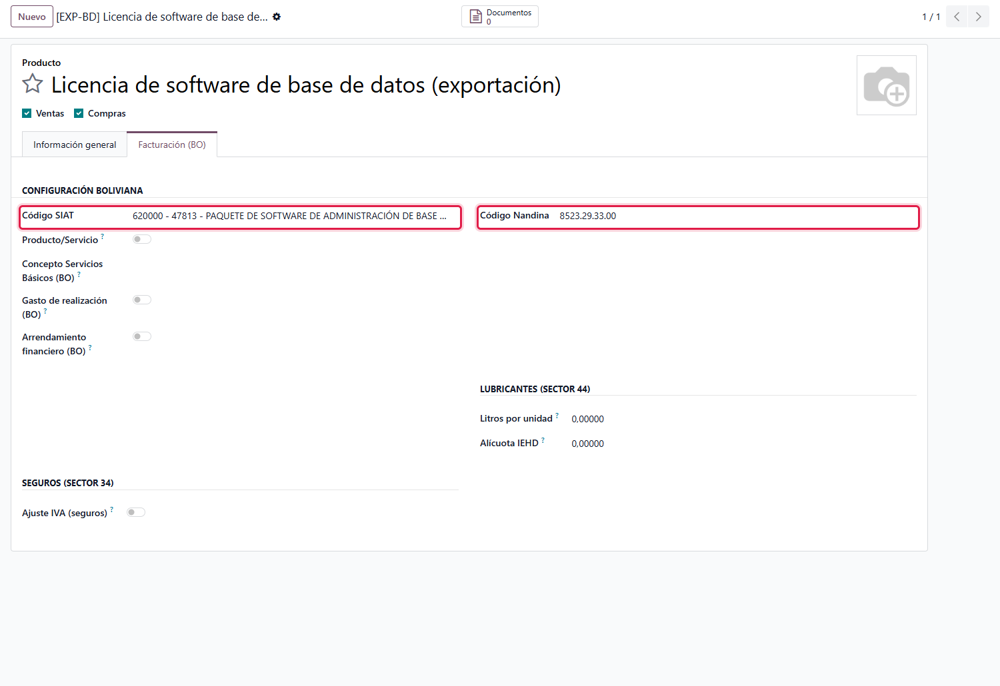
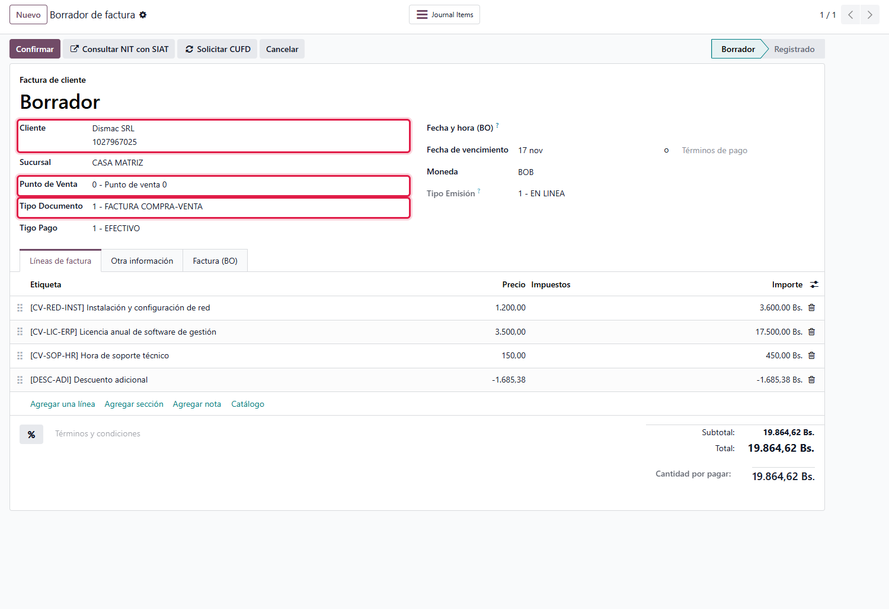
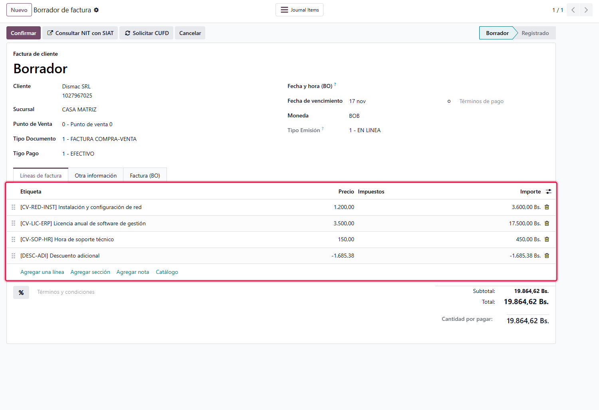
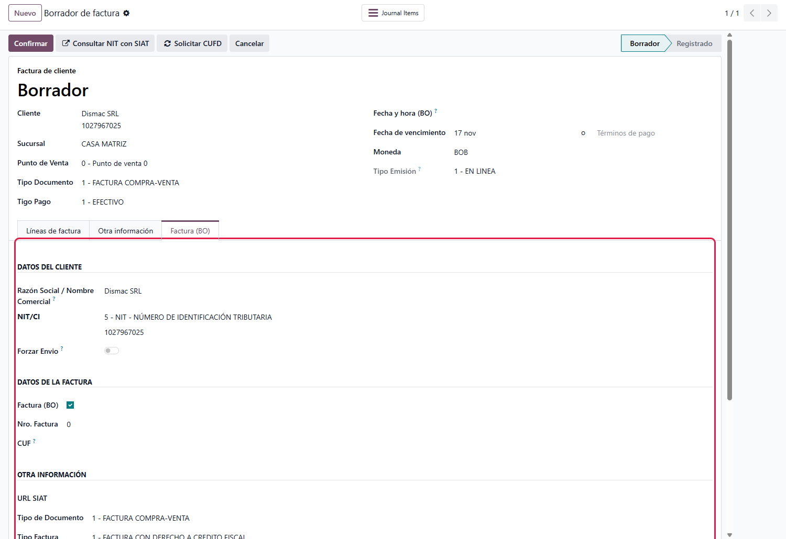
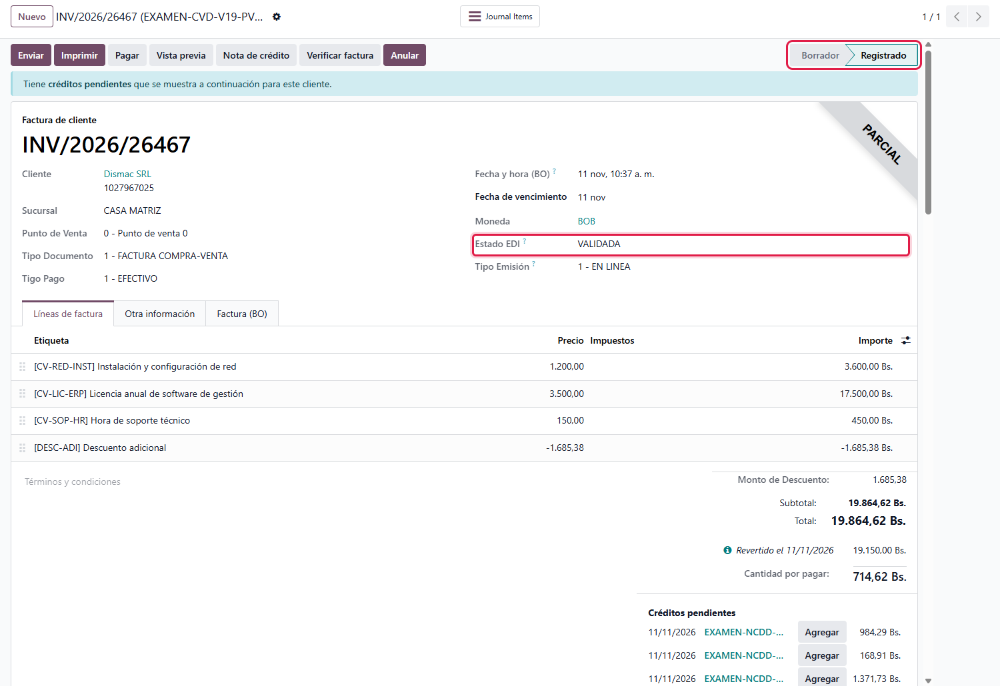
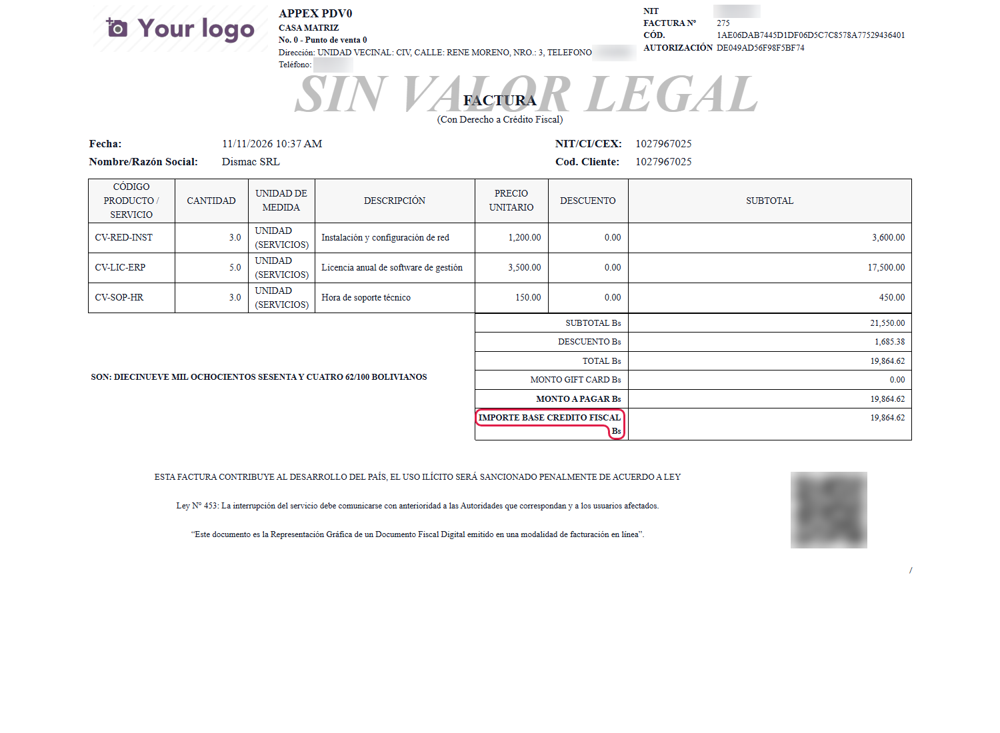

# Factura de compra-venta

Es el documento fiscal más usado. En Odoo aparece como tipo de documento `1 - FACTURA COMPRA-VENTA` y tiene su propia secuencia en cada punto de venta (sección 3.5 de la Parte I). Queda emitida cuando, al confirmarla, el SIN la devuelve como **`VALIDADA` (código `908`)**.

## Antes de emitir: revisar la configuración

Antes de la primera factura, confirme que estos nueve puntos estén listos. Si falta uno, la factura no se emite o el SIN la rechaza. Cada punto remite a la sección de la Parte I donde se configura.

| Qué | Dónde está | Qué revisar |
|---|---|---|
| 1\. Empresa | Ajustes → Usuarios y empresas → Empresas (sección 1 de la Parte I) | NIT, interruptor **Habilitar la facturación (BO)** y, en la pestaña Facturación (BO), entorno, modalidad, código de sistema, token delegado y certificado. |
| 2\. Sucursal | Ajustes → Facturación (BO) → Compañia → Sucursales (sección 2 de la Parte I) | **Código** (0 = casa matriz), dirección y ubicación completas. |
| 3\. Punto de venta: datos | Ajustes → Facturación (BO) → Compañia → Puntos de Venta (sección 3.2 de la Parte I) | **Código**, **Sucursal**, **Tipo de Emisión de la factura** = `1 - EN LÍNEA`, **Dirección** y **Tipo de Punto de Venta**. Sin tipo de emisión o sin dirección, el SIN no entrega el CUFD. |
| 4\. Punto de venta: códigos | Mismo formulario del punto de venta (sección 3.3 de la Parte I) | **CUIS** y **CUFD**, con la casilla **CUFD activo** marcada. **Verificar conexión con SIAT** confirma la comunicación. |
| 5\. Punto de venta: secuencias | Pestaña **Secuencias Documentos** del punto de venta (sección 3.5 de la Parte I) | Debe figurar `1 - FACTURA COMPRA-VENTA`. Si falta, botón **Crear Secuencia**, que solo aparece con el CUFD activo. Cada punto de venta necesita la suya. |
| 6\. Diario de ventas | Contabilidad → Configuración → Diarios → Ventas → pestaña Ajustes avanzados (sección 3.6 de la Parte I) | Interruptor **Factura (BO)** activado. Sin él, la factura se registra pero no se envía al SIN. |
| 7\. Catálogos del SIAT | Ajustes → Facturación (BO) → Compañia → Sincronización de Catálogos (sección 4 de la Parte I) | Sincronizados: actividades, leyendas, productos y servicios, tipos de documento de identidad. |
| 8\. Cliente | Contabilidad → Clientes → Clientes | **Tipo de Identificación** (por ejemplo `5 - NIT` o `1 - CI`), **NIT/CI**, **Complemento** solo si es carnet con complemento, y la casilla **Habilitado facturación EDI** marcada. **Estado del NIT** muestra si el SIN lo reconoce (NIT ACTIVO). |
| 9\. Producto | Contabilidad → Clientes → Productos | Pestaña Información general: **Tipo de producto**, **Precio de venta**, **Impuestos de venta**. Pestaña **Facturación (BO)**: **Habilitado Facturación EDI** (viene marcada), **Código SIAT** y, para bienes, **Código Nandina**. Unidad de medida homologada (sección 5.1 de la Parte I). |

- **El CUFD vence a las 24 horas.** Si al confirmar aparece el error de CUFD inválido, pida uno nuevo con **Solicitar CUFD** (sección 3.3 de la Parte I) y vuelva a confirmar (ver [Errores frecuentes y cómo resolverlos](#errores-frecuentes-y-como-resolverlos)).

- **El Código SIAT del producto debe ser de la actividad económica de la empresa.** El catálogo muestra cada código con su actividad delante, por ejemplo `620000 - 83131 - SERVICIOS DE CONSULTORÍA EN TI`. Un código de otra actividad puede hacer que el SIN rechace la factura.

- **El entorno se define en la empresa** (sección 1.3 de la Parte I). El punto de venta lo muestra en el campo **Tipo Entorno**: 2 = pruebas (piloto del SIN), 1 = producción.

*Puntos 3 y 4 de la tabla. Punto de venta: datos, CUIS y CUFD.*

{ width="624" height="428" loading="lazy" }

*Punto 5 de la tabla. Secuencias del punto de venta.*

{ width="624" height="428" loading="lazy" }

*Punto 8 de la tabla. Cliente: tipo de identificación y NIT/CI.*

{ width="624" height="428" loading="lazy" }

*Punto 9 de la tabla. Producto: Código SIAT y Código Nandina en la pestaña Facturación (BO).*

{ width="624" height="428" loading="lazy" }

## Paso a paso: crear y emitir la factura

La factura se arma en borrador y se emite al presionar **Confirmar**. Solo en ese momento viaja al SIN. Mientras está en borrador se puede corregir todo.

1. **Abrir una factura nueva.** Contabilidad → Clientes → Facturas → botón **Nuevo**.

1. **Elegir el cliente** en el campo **Contacto**. Odoo copia su tipo de identificación y su NIT/CI a la pestaña **Factura (BO)**.

1. **Comprobar que es una factura boliviana.** En la pestaña **Factura (BO)**, la casilla **Factura (BO)** debe estar marcada. Se marca sola cuando el diario de ventas tiene activado el interruptor Factura (BO) (sección 3.6 de la Parte I). Con ella aparecen en la cabecera los campos del paso 4; sin ella, la factura se registra como factura contable común y **nunca se envía al SIN**.

1. **Completar los datos de emisión** en la cabecera:

    - **Sucursal:** por ejemplo CASA MATRIZ.

    - **Punto de Venta:** desde dónde se emite, por ejemplo «0 - Punto de venta 1».

    - **Tipo Documento:** `1 - FACTURA COMPRA-VENTA`. Solo se listan los tipos que tienen secuencia en el punto de venta elegido.

    - **Tigo Pago:** el método de pago, por ejemplo `1 - EFECTIVO` (catálogo de la sección 5.3 de la Parte I). La etiqueta dice «Tigo» por un error de escritura del módulo; significa «Tipo de pago». Si el pago es con tarjeta aparece el campo **Tarjeta**.

    - **Tipo Emisión:** se completa solo según el punto de venta (`1 - EN LÍNEA`).

        { width="624" height="428" loading="lazy" }

1. **Revisar las fechas.** **Fecha de la factura** suele ser hoy. **Fecha y hora (BO)** queda vacía: se llena sola al emitir, con la hora exacta registrada en el SIN.

1. **Cargar las líneas** en la pestaña **Líneas de factura** con **Agregar una línea**: Producto, Cantidad, Precio e Impuestos. La descripción se toma del producto y puede editarse. El descuento se carga en la columna de descuento de la línea.

    { width="624" height="428" loading="lazy" }

1. **Revisar la pestaña Factura (BO)** antes de confirmar:

    - **Tipo de Identificación**, **NIT/CI** y **Complemento:** son los que se imprimirán. El botón **Consultar NIT con SIAT** (barra superior, solo en borrador) verifica el NIT.

    - **Leyenda:** frase de la Ley 453 asociada a la actividad económica. Se asigna sola.

    - **Actividad Económica:** la que corresponde a los productos.

    - **Forzar Envio:** dejar desmarcado. Solo se marca cuando el NIT es inválido y aun así se quiere que el SIN registre la factura.

        { width="624" height="428" loading="lazy" }

1. **Presionar Confirmar.** Odoo envía la factura al SIN y espera la respuesta; suele tardar unos segundos, y hasta un minuto si el SIN está lento. **No presione el botón dos veces ni cierre la pantalla.**

1. **Verificar el resultado.** La factura pasa a **Registrado** y toma su número (por ejemplo INV/2026/00003). En la cabecera, **Estado EDI** debe decir `VALIDADA`. En la pestaña Factura (BO) aparecen **Nro. Factura**, **CUF** y **URL SIAT**, y a la derecha se ve la representación gráfica con el código QR.

    { width="624" height="428" loading="lazy" }

1. **Entregar la factura al cliente** con el botón **Enviar** (PDF por correo) o descargando el PDF.

!!! warning "Importante"

    Una factura emitida en línea **no se puede volver a borrador**: el botón Restablecer a borrador desaparece. Para corregirla se usa **Nota de crédito** o **Anular**, ambos en la barra superior.

## Cómo se ve la factura impresa

Cuando la configuración está completa, la factura de compra-venta se imprime con los datos que se cargaron en las secciones anteriores. Esta es una factura de ejemplo emitida en entorno de prueba, desde la Sucursal 1, punto de venta 0.

{ width="624" height="458" loading="lazy" }

**Encabezado.** A la izquierda salen el logo y el nombre de la empresa, la sucursal, el número de punto de venta, la dirección, el teléfono y la ciudad: son los datos de las secciones 1 a 3 de la Parte I. A la derecha salen el NIT de la empresa, el número de factura y el código de autorización.

**Título y cliente.** Dice FACTURA (Con Derecho a Crédito Fiscal). Debajo van la fecha y hora, el nombre o razón social del cliente, su NIT/CI/CEX y su código de cliente.

**Detalle.** Cada línea muestra el código de producto o servicio, la cantidad, la unidad de medida, la descripción, el precio unitario, el descuento y el subtotal.

**Totales.** Al pie del detalle salen el subtotal, el descuento, el total, el monto gift card, el monto a pagar y el importe base para crédito fiscal, más el monto en letras.

**Leyendas y código QR.** Al final aparecen las leyendas obligatorias de Impuestos Nacionales (como la de la Ley N° 453) y el código QR, con el que el cliente valida la factura en el SIN.

**Marca de agua.** El texto SIN VALOR LEGAL atraviesa toda la hoja porque el entorno está en prueba. En producción desaparece.

## Cómo saber si la factura llegó al SIN

La factura está emitida solo si **Estado EDI** dice `VALIDADA`. Que Odoo muestre `Registrado` no alcanza: una factura sin la casilla Factura (BO) también queda registrada, pero el SIN no la conoce.

- **Dónde se ve:** el campo **Estado EDI** está en la cabecera de la factura y se muestra solo cuando la factura ya fue enviada. El detalle de un rechazo aparece en el campo **Error** de la pestaña Factura (BO) y en el mensaje que se abre al confirmar.

- **Comprobación con el SIN:** el enlace **URL SIAT** de la pestaña Factura (BO), o el código QR del PDF, abre la consulta pública de la factura en el SIAT.

| Estado EDI | Código | Qué significa | Qué hacer |
|---|---|---|---|
| `VALIDADA` | 908 | El SIN la aceptó. Es una factura válida. | Nada; entregarla al cliente. |
| `OBSERVADA` | 904 | El SIN la recibió pero con observaciones. | Revisar el mensaje del SIN y corregir el dato en las próximas facturas. |
| `ANULACIÓN CONFIRMADA` | 905 | Se anuló con el botón Anular y el SIN lo aceptó. La factura queda cancelada. | Nada; ya no tiene validez. |
| REVERSION DE `ANULACIÓN CONFIRMADA` | 907 | Se revirtió una anulación y el SIN lo aceptó. La factura vuelve a ser válida. | Nada. |
| REVERSIÓN DE ANULACIÓN `RECHAZADA` | 909 | Se intentó revertir una anulación y el SIN no lo aceptó. Sigue anulada. | Consultar con soporte antes de reintentar. |
| (vacío) con la factura Registrada | — | La factura nunca se envió al SIN: le falta la casilla Factura (BO). | Ver «Factura registrada que no llegó al SIN» en Errores frecuentes. |
| (vacío) con la factura en Borrador | — | El SIN la rechazó o no respondió. No consume número de factura ante el SIN. | Leer el mensaje, corregir y volver a presionar Confirmar. |

!!! note "Nota"

    Un rechazo nunca consume la factura: vuelve a Borrador para corregirla. Si la casilla Factura (BO) está desmarcada, la factura no entra en este circuito y se registra sin pasar por el SIN.

## Errores frecuentes y cómo resolverlos

Casi todos los rechazos dejan la factura en borrador y se resuelven corrigiendo el dato y volviendo a presionar **Confirmar**. Estos son los más frecuentes, con el texto tal como lo muestra Odoo.

| Lo que ve el usuario | Por qué pasa | Cómo se resuelve |
|---|---|---|
| `EL CÓDIGO ÚNICO DE FACTURACIÓN DIARIA (CUFD) ENVIADO EN EL XML ES INVALIDO`, junto con `EL CÓDIGO ÚNICO DE FACTURA (CUF) … ES INVALIDO` y la recomendación `Pulse el botón 'Solicitar CUFD'` | El CUFD del punto de venta venció (dura 24 horas) o **otro sistema pidió un CUFD nuevo** para el mismo NIT, sucursal y punto de venta, y eso invalida el anterior. | En la factura en borrador, botón **Solicitar CUFD** de la barra superior (o el mismo botón en el punto de venta) y otra vez **Confirmar**. Para que no se repita: un solo sistema por NIT y punto de venta. |
| El botón **Solicitar CUFD** del punto de venta falla o no entrega código | Al punto de venta le falta **Tipo de Emisión de la factura** o **Dirección**, o no tiene CUIS. | Completar esos campos, usar **Solicitar CUIS** si falta y después **Solicitar CUFD**. Si la pantalla se queda cargando, recargar y revisar la pestaña **CUFD'S**: el código puede haberse obtenido igual. |
| En **Tipo Documento** no aparece `1 - FACTURA COMPRA-VENTA` | El punto de venta elegido no tiene esa secuencia. | Punto de venta › botón **Crear Secuencia** (requiere CUFD activo). Revisar la pestaña Secuencias Documentos. |
| La factura no muestra Sucursal, Punto de Venta ni Tipo Documento | La casilla **Factura (BO)** está desmarcada. | Pestaña Factura (BO) › marcar **Factura (BO)**. |
| La factura queda **registrada** pero **Estado EDI** vacío y sin Nro. Factura ni CUF | Se confirmó sin la casilla Factura (BO): el diario de ventas no tiene activado el interruptor Factura (BO) (sección 3.6 de la Parte I), o la factura se creó por importación o integración. El SIN no la recibió. | **Restablecer a borrador**, marcar **Factura (BO)**, revisar que tenga **Leyenda** y volver a **Confirmar**. Debe quedar `VALIDADA`. Si la pestaña Factura (BO) no aparece, active el interruptor del diario (sección 3.6 de la Parte I) y cree una factura nueva. |
| «El cliente … no tiene un tipo de identificación fiscal» | Al cliente le falta **Tipo de Identificación**. | En la ficha del cliente, completar **Tipo de Identificación** y **NIT/CI**, y volver a confirmar. |
| El NIT del cliente no es reconocido por el SIN | NIT mal escrito o inactivo. | Botón **Consultar NIT con SIAT** en el borrador. Si el NIT es correcto y aun así se debe emitir, marcar **Forzar Envio** en la pestaña Factura (BO). |
| «503 Server Error: Service Unavailable» o «504 Gateway Time-out» | El servicio del SIN no está disponible en ese momento. | La factura queda en borrador. Reintentar **Confirmar** unos minutos después. |
| La pantalla tarda demasiado o muestra un error de tiempo de espera al confirmar | El SIN respondió lento; la emisión pudo terminar igual. | **Recargar la factura antes de reintentar.** Si ya dice `VALIDADA`, está emitida. El mensaje `El asiento … debe ser un borrador` también indica que ya se confirmó. |
| «current transaction is aborted, commands ignored until end of transaction block» | Se confirmaron dos facturas en el mismo instante en la misma base (varios usuarios o una carga masiva en paralelo). | Volver a confirmar esa factura. En cargas masivas, emitir una factura a la vez. |
| El documento sale con número **RINV/…** en lugar de INV/… | Se creó desde el menú **Notas de crédito** y no desde Facturas. | Crear las facturas siempre desde Contabilidad › Clientes › **Facturas**. |
| Al anular: `ERROR EN LA EJECUCION DEL SERVICIO (RCV)` | Error del servicio del SIN al procesar la anulación. La factura sigue `VALIDADA`. | Reintentar más tarde. Si persiste, reportarlo al SIN o al proveedor del módulo. |

## Recomendaciones para el cliente

La mayoría de los problemas se evitan con cinco hábitos.

- **Un solo sistema por NIT y punto de venta.** Si dos bases de Odoo (por ejemplo, una de pruebas y la de producción, o dos copias) usan las mismas credenciales y el mismo punto de venta, cada una invalida el CUFD de la otra y las facturas se rechazan.

- **Mirar Estado EDI, no solo «Registrado».** Una factura está emitida únicamente si dice `VALIDADA` y tiene CUF y Nro. Factura (Se puede verificar en el link que se encuentra en “Factura(BO)”).

- **Confirmar una vez y esperar.** La emisión suele tardar unos segundos, y hasta un minuto si el SIN está lento. Ante una demora, recargar la factura antes de volver a confirmar.

- **Datos maestros completos antes de facturar.** Clientes con Tipo de Identificación y NIT/CI correctos; productos con un Código SIAT de la actividad de la empresa y un nombre claro, porque es lo que el cliente final lee en su factura.

- **Corregir con los documentos correctos.** Una factura emitida no vuelve a borrador: un error de monto o cantidad se corrige con **Nota de crédito**, y una factura mal emitida se **Anula**. Las facturas se crean siempre desde Clientes › Facturas, nunca desde Notas de crédito. Ver la sección [Nota de crédito-débito](nota-de-credito-debito.md) y la sección 1 de la Parte III.
