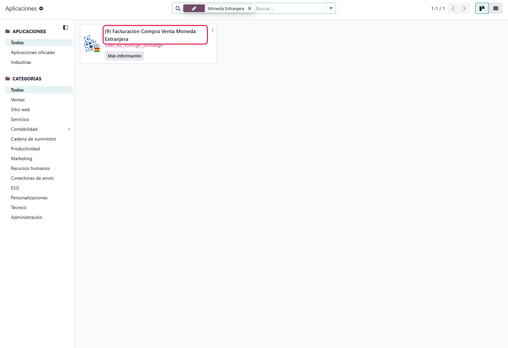
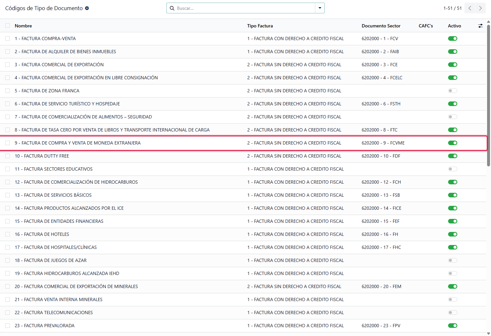
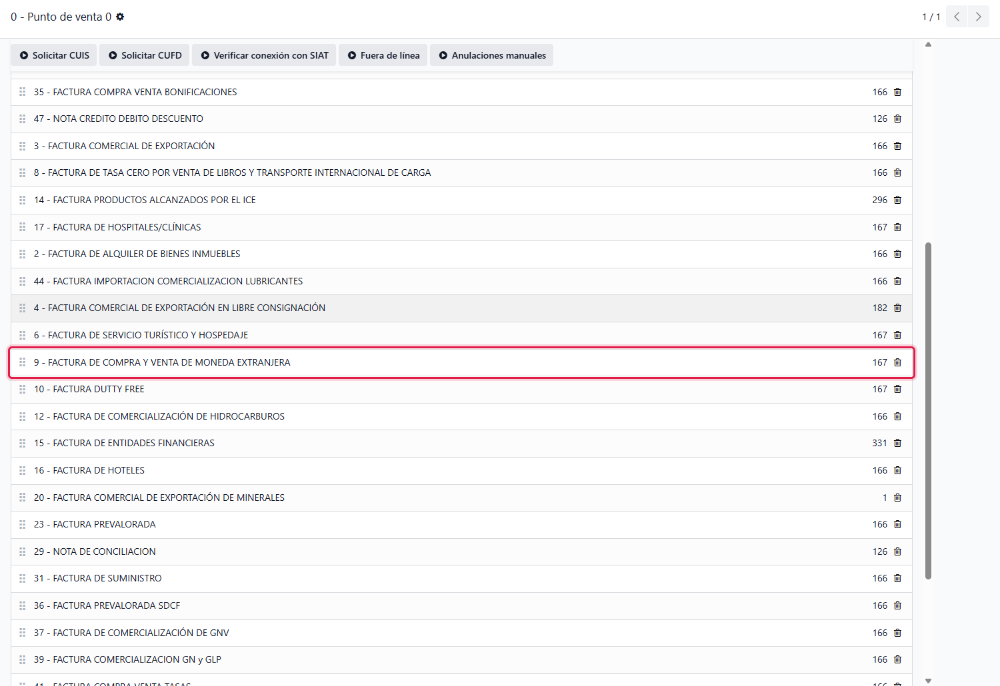
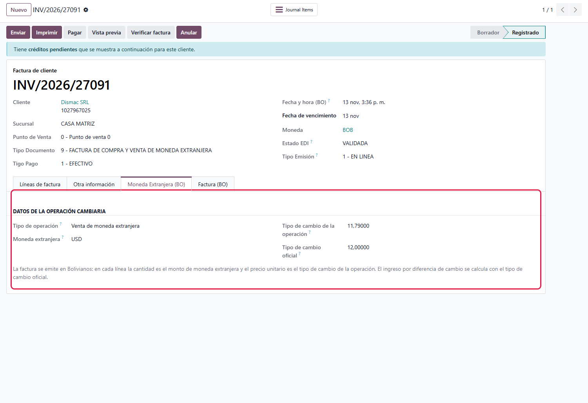
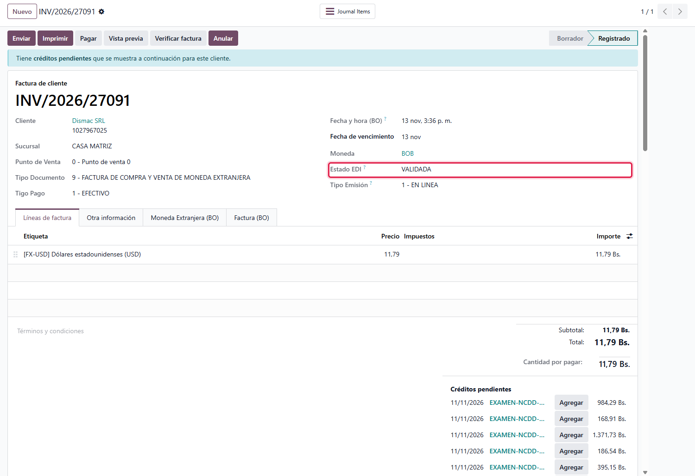
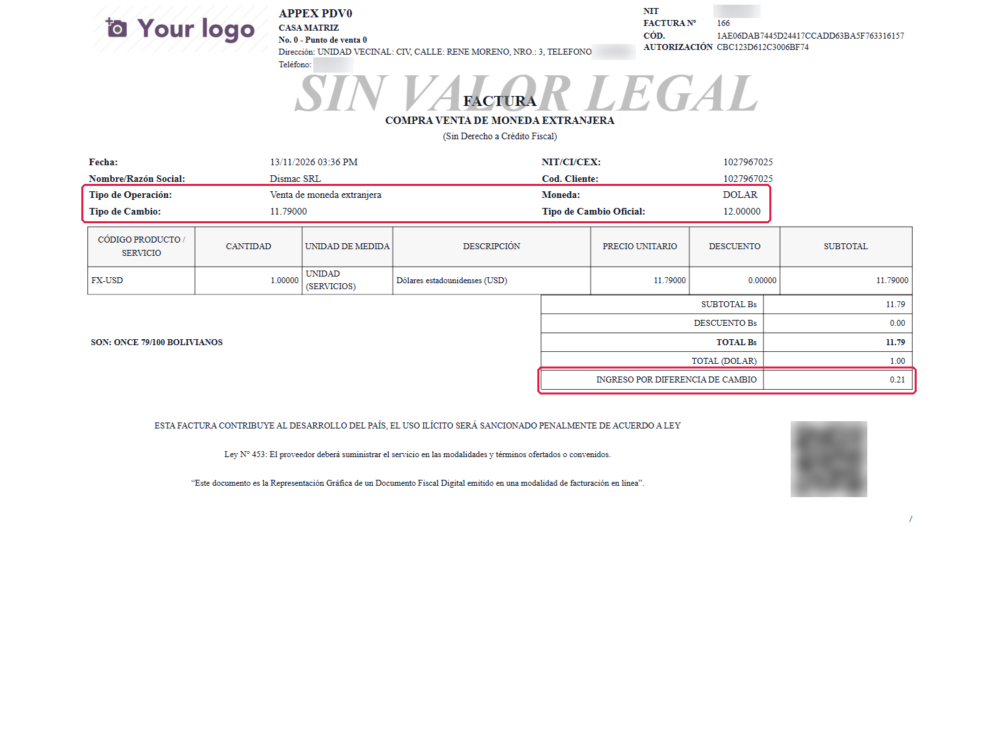

# Factura de compra y venta de moneda extranjera

Es la factura que se emite al vender o comprar moneda extranjera, por ejemplo dólares. En Odoo aparece como tipo de documento **9 - FACTURA DE COMPRA Y VENTA DE MONEDA EXTRANJERA**; ante el SIAT es el documento sector 9 y **no da derecho a crédito fiscal**: el SIN la recibe con el monto sujeto a IVA en cero. Lo que la distingue es que se emite en bolivianos con dos tipos de cambio, el de la operación y el oficial, y que informa el ingreso por diferencia de cambio. Queda emitida cuando el SIN la devuelve como **VALIDADA (código 908)**.

## Qué debe estar configurado

Además de la configuración general de la Parte I, la factura de moneda extranjera necesita estos cuatro puntos:

- **Módulo de moneda extranjera activado.** Aplicaciones → buscar «Moneda Extranjera» → «(9) Facturacion Compra Venta Moneda Extranjera» → Activar.

    { width="624" loading="lazy" }

- **Tipo de documento 9 activo y con su documento sector.** Ajustes → Facturación (BO) → Catálogos SIAT → Códigos de Tipo Documento, fila «9 - FACTURA DE COMPRA Y VENTA DE MONEDA EXTRANJERA»: el interruptor Activo debe estar encendido y el campo Documento Sector completo (por ejemplo, «6202000 - 9 - FCVME»; depende de la actividad económica registrada en el SIN).

    { width="624" loading="lazy" }

- **Secuencia en el punto de venta.** En la pestaña Secuencias Documentos del punto de venta (sección 3.5 de la Parte I) debe figurar el tipo 9. Si falta, se agrega una línea a mano, como se explica en la sección [Nota de crédito-débito › Qué debe saber antes de emitirla](nota-de-credito-debito.md#que-debe-saber-antes-de-emitirla).

    { width="624" loading="lazy" }

- **Moneda homologada y producto de la moneda.** La moneda que se compra o vende debe tener su Moneda SIAT (Contabilidad → Configuración → Monedas); las que no la tienen no aparecen en la lista. Por ejemplo, USD figura como 2 - DOLAR. Además hace falta un producto por cada moneda: un servicio, sin impuestos, con el Código SIAT del catálogo que corresponda a la actividad de la empresa (sección 4.2 de la Parte I), por ejemplo «Dólares estadounidenses (USD)». Su precio no importa, porque la factura lo reemplaza por el tipo de cambio de la operación.

## La pestaña Moneda Extranjera (BO)

Al elegir el tipo de documento 9, la factura muestra la pestaña **Moneda Extranjera (BO)**, antes de la pestaña Factura (BO). Sus cuatro campos son obligatorios y Odoo no deja guardar sin ellos:

- **Tipo de operación:** Venta de moneda extranjera o Compra de moneda extranjera.

- **Moneda extranjera:** la moneda que se vende o se compra, por ejemplo USD. No puede ser el boliviano.

- **Tipo de cambio de la operación:** el precio en bolivianos de cada unidad de moneda. Al escribirlo, Odoo lo copia como precio unitario en las líneas.

- **Tipo de cambio oficial:** se propone desde la tasa de la moneda en Odoo y se puede corregir.

En las líneas, la **cantidad** es el monto de moneda extranjera y el **precio unitario** tiene que ser igual al tipo de cambio de la operación. La factura queda en bolivianos: el total es cantidad × tipo de cambio.

Con los dos tipos de cambio Odoo calcula el **ingreso por diferencia de cambio**: en una venta es el tipo de cambio de la operación menos el oficial, y en una compra, el oficial menos el de la operación. En cada factura se usan los tipos de cambio del día.

{ width="624" loading="lazy" }

## Paso a paso: crear y emitir la factura

1. **Abrir una factura nueva:** Contabilidad → Clientes → Facturas → botón Nuevo, y elegir el cliente en el campo Contacto. La factura debe estar en bolivianos.

1. **Completar la cabecera:** Sucursal, Punto de Venta, Tigo Pago y, en Tipo Documento, **9 - FACTURA DE COMPRA Y VENTA DE MONEDA EXTRANJERA**. Tigo Pago no puede ser un pago con gift card (sección [Errores frecuentes](#errores-frecuentes)).

1. **Cargar las líneas** en la pestaña Líneas de factura: el producto de la moneda y, en cantidad, el monto de moneda extranjera.

1. **Completar la pestaña Moneda Extranjera (BO):** tipo de operación, moneda y los dos tipos de cambio (sección [La pestaña Moneda Extranjera (BO)](#la-pestana-moneda-extranjera-bo)). Revisar que el precio unitario de las líneas haya quedado igual al tipo de cambio de la operación.

1. **Revisar la pestaña Factura (BO):** la casilla Factura (BO) debe estar marcada y la Leyenda asignada, igual que en la factura de compra-venta (sección [Factura de compra-venta › Paso a paso: crear y emitir la factura](factura-de-compra-venta.md#paso-a-paso-crear-y-emitir-la-factura), paso 7).

1. **Pulsar Confirmar.** Odoo envía la factura al SIN; suele tardar unos segundos, y hasta un minuto si el SIN está lento. Debe quedar en Registrado, con Estado EDI **VALIDADA**.

    { width="624" loading="lazy" }

## Cómo se ve la factura impresa y cómo saber si llegó al SIN

La factura impresa tiene el mismo encabezado que la de compra-venta (sección [Factura de compra-venta › Cómo se ve la factura impresa](factura-de-compra-venta.md#como-se-ve-la-factura-impresa)) y el título **FACTURA**, con el subtítulo COMPRA VENTA DE MONEDA EXTRANJERA y la leyenda (Sin Derecho a Crédito Fiscal). Debajo de los datos del cliente salen el tipo de operación, la moneda y los dos tipos de cambio. El detalle muestra la cantidad, el precio unitario y el subtotal con 5 decimales. Al pie salen el subtotal, el descuento y el total en bolivianos, el total en la moneda extranjera y el ingreso por diferencia de cambio.

Igual que en la compra-venta (sección [Factura de compra-venta › Cómo saber si la factura llegó al SIN](factura-de-compra-venta.md#como-saber-si-la-factura-llego-al-sin)), la factura está emitida solo si **Estado EDI** dice **VALIDADA**. La factura de moneda extranjera tiene su propia numeración por punto de venta (la secuencia 9), separada de la de compra-venta. Por ejemplo, una factura de una compra de 600 USD a 6,86 con un tipo de cambio oficial de 6,96. Suma 4.116,00 Bs, con un ingreso por diferencia de cambio de 0,10; el SIN la recibió con monto sujeto a IVA 0.

Se anula y se revierte igual que las demás facturas (sección 1 de la Parte III), y también se puede emitir fuera de línea (sección 2 de la Parte III).

{ width="624" loading="lazy" }

## Errores frecuentes

Los errores de la sección [Factura de compra-venta › Errores frecuentes y cómo resolverlos](factura-de-compra-venta.md#errores-frecuentes-y-como-resolverlos) también se aplican a la factura de moneda extranjera. Además, estos son propios de este documento:

| Lo que ve el usuario | Por qué pasa | Cómo se resuelve |
|---|---|---|
| «Nota: El precio unitario de \[producto\] (…) debe ser igual al tipo de cambio de la operación (…).» | Se cambió el precio de la línea, o el tipo de cambio después de cargar la línea. | Poner en la línea el mismo precio que el tipo de cambio de la operación y volver a confirmar. |
| «Nota: La factura de Compra Venta de Moneda Extranjera se emite en Bolivianos. Registre la moneda que se compra o vende en el campo "Moneda extranjera".» | La moneda de la factura no es el boliviano. | Dejar la factura en bolivianos y elegir la moneda en la pestaña Moneda Extranjera (BO). |
| «Nota: La Moneda extranjera no puede ser el Boliviano.» | En Moneda extranjera se eligió el boliviano. | Elegir la moneda que realmente se compra o vende, por ejemplo USD. |
| «Nota: El pago con GiftCard no es válido para el documento: \[9 - FACTURA DE COMPRA Y VENTA DE MONEDA EXTRANJERA\]» | En Tigo Pago se eligió un pago con gift card, que el documento 9 no admite. | Elegir otro Tigo Pago, por ejemplo 1 - EFECTIVO, y volver a confirmar. |
| La moneda no aparece en Moneda extranjera | Esa moneda no tiene su Moneda SIAT o está inactiva. | Activar la moneda y cargarle su Moneda SIAT. |
| En Tipo Documento no aparece 9 - FACTURA DE COMPRA Y VENTA DE MONEDA EXTRANJERA | Falta el módulo, el tipo 9 no está activo o el punto de venta no tiene la secuencia. | Revisar los puntos de la sección [Qué debe estar configurado](#que-debe-estar-configurado). |
