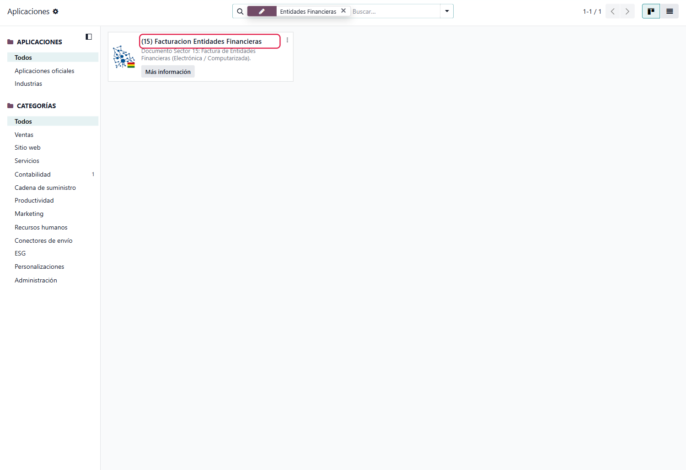
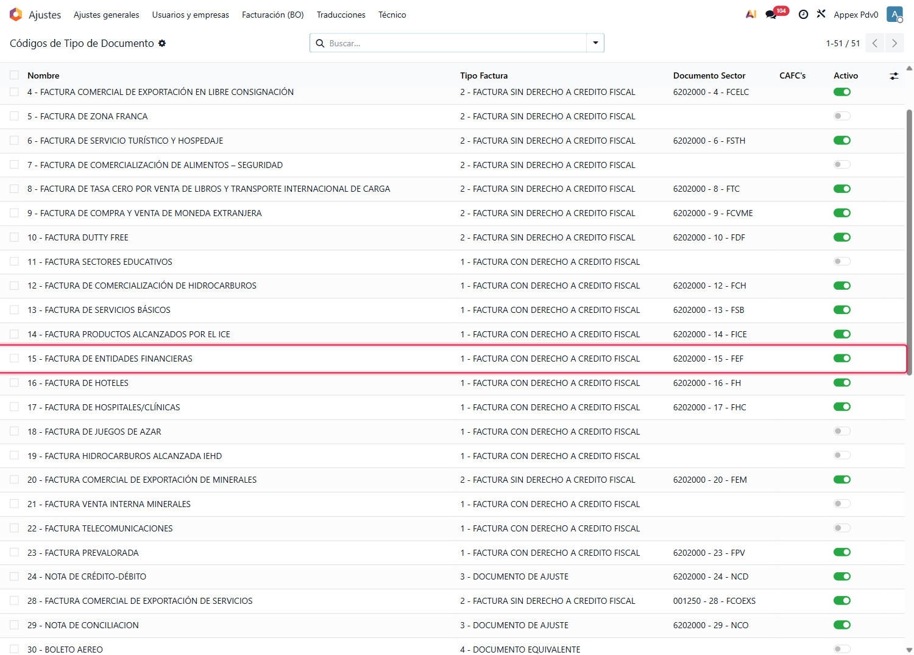
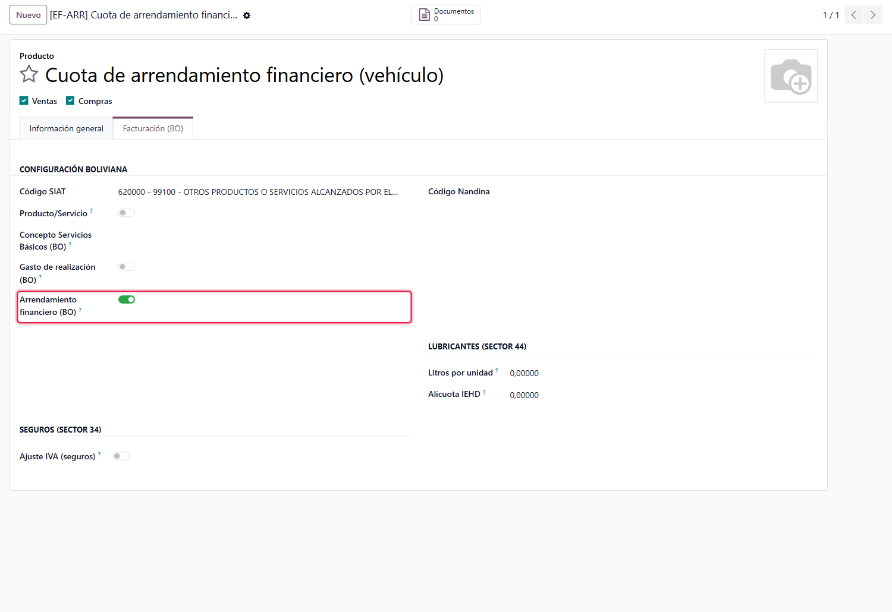
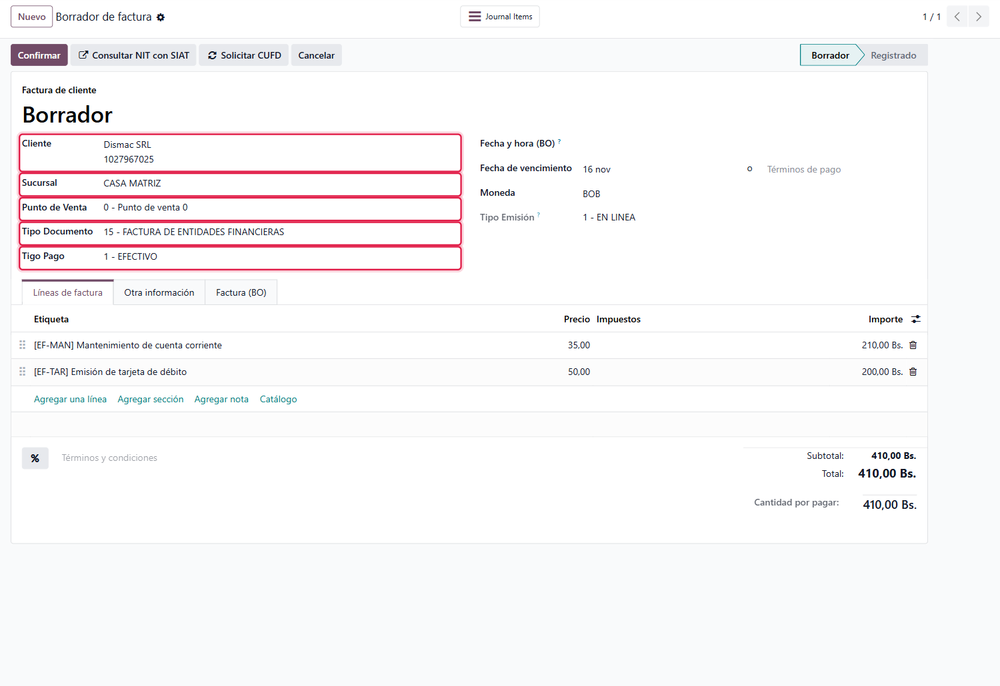
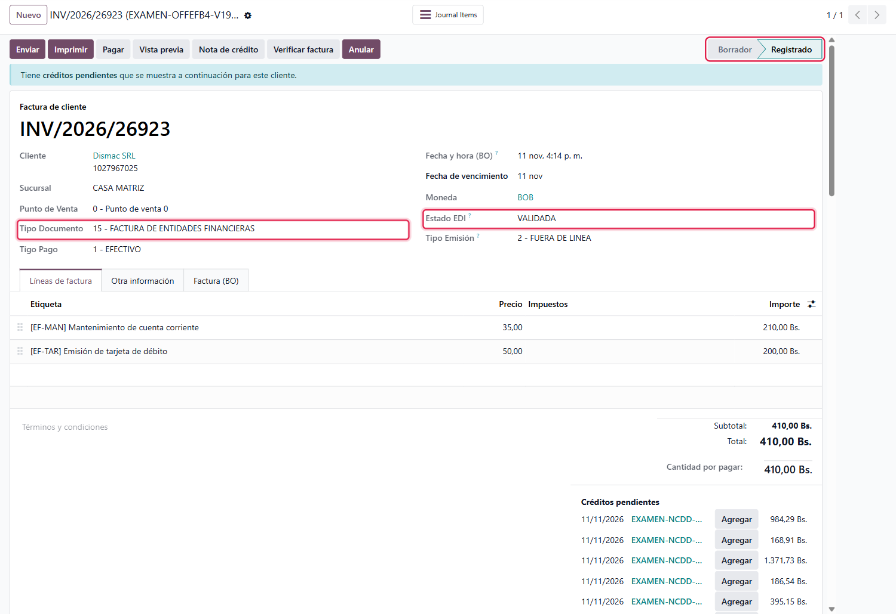
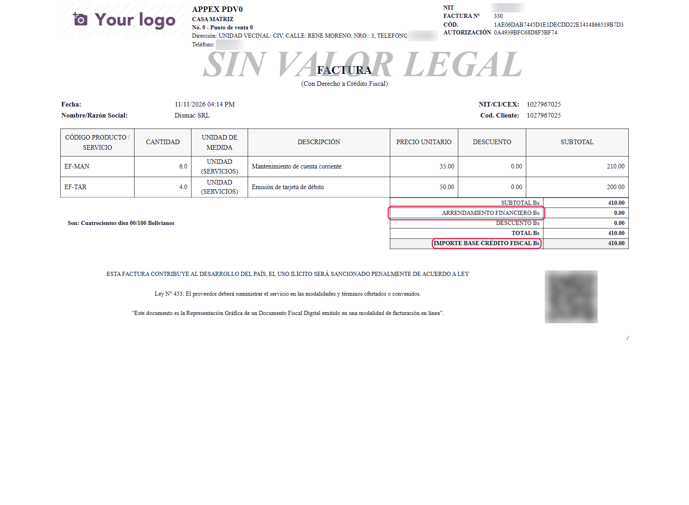

# Factura de entidades financieras

Es la factura que emiten los bancos, las cooperativas y las demás entidades financieras por sus servicios: comisiones, mantenimiento de cuentas, emisión de tarjetas y cuotas de arrendamiento financiero (leasing). No la usan las casas de cambio, que emiten la factura de compra y venta de moneda extranjera (sección [Factura de compra y venta de moneda extranjera](factura-de-compra-y-venta-de-moneda-extranjera.md)). En Odoo aparece como tipo de documento `15 - FACTURA DE ENTIDADES FINANCIERAS`; ante el SIAT es el documento sector 15. Su particularidad es el **arrendamiento financiero**: esas cuotas no van en el detalle, se informan aparte en la cabecera y **no forman parte del importe sujeto a IVA**. Queda emitida cuando el SIN la devuelve como **`VALIDADA` (código `908`)**.

## Qué debe estar configurado

Además de la configuración general de la Parte I, la factura de entidades financieras necesita estos cinco puntos:

- **Módulo de entidades financieras activado.** Aplicaciones → buscar «Entidades Financieras» → «(15) Facturacion Entidades Financieras» → Activar. Odoo envía esta factura por el servicio del SIN propio de las entidades financieras (ServicioFacturacionEntidadFinanciera), no por el de facturación electrónica general; el módulo debe estar en una versión que ya lo incluya.

    { width="624" height="428" loading="lazy" }

- **Tipo de documento 15 activo y con su documento sector.** Ajustes → Facturación (BO) → Catálogos SIAT → Códigos de Tipo Documento, fila `15 - FACTURA DE ENTIDADES FINANCIERAS`: el interruptor Activo debe estar encendido y el campo Documento Sector completo (por ejemplo, `6202000 - 15 - FEF`; depende de la actividad económica registrada en el SIN).

    { width="624" height="448" loading="lazy" }

- **Secuencia en el punto de venta.** En la pestaña Secuencias Documentos del punto de venta (sección 3.5 de la Parte I) debe figurar el tipo 15. Si falta, se agrega una línea a mano, como se explica en la sección [Nota de crédito-débito › Qué debe saber antes de emitirla](nota-de-credito-debito.md#que-debe-saber-antes-de-emitirla).

- **Productos con Código SIAT.** En la pestaña Facturación (BO) del producto, con el Código SIAT del catálogo que corresponda a la actividad de la empresa (sección 4.2 de la Parte I). Se crea un servicio por cada comisión o cargo que cobra la entidad (por ejemplo, comisión por transferencia o mantenimiento de cuenta).

- **Productos de arrendamiento financiero marcados.** En la ficha del producto, pestaña Facturación (BO), se activa la casilla **Arrendamiento financiero (BO) en los productos que son cuotas de arrendamiento financiero**.

    { width="624" height="428" loading="lazy" }

## Paso a paso: crear y emitir la factura

1. **Abrir una factura nueva:** Contabilidad → Clientes → Facturas → botón Nuevo, y elegir el cliente en el campo Contacto.

1. **Completar la cabecera:** Sucursal, Punto de Venta, Tigo Pago y, en Tipo Documento, `15 - FACTURA DE ENTIDADES FINANCIERAS`. Este documento **no admite pago con gift card**.

    { width="624" height="428" loading="lazy" }

1. **Cargar las líneas** en la pestaña Líneas de factura: los servicios, con su cantidad y precio, y, si corresponde, la cuota de arrendamiento financiero como una línea más. La factura debe tener **al menos un servicio que no sea de arrendamiento**: el SIAT exige al menos una línea en el detalle.

1. **Revisar la pestaña Factura (BO):** la casilla Factura (BO) debe estar marcada y la Leyenda asignada, igual que en la factura de compra-venta (sección [Factura de compra-venta › Paso a paso: crear y emitir la factura](factura-de-compra-venta.md#paso-a-paso-crear-y-emitir-la-factura), paso 7).

1. **Pulsar Confirmar.** Odoo envía la factura al SIN; suele tardar unos segundos, y hasta un minuto si el SIN está lento. Debe quedar en Registrado, con Estado EDI `VALIDADA`.

    { width="624" height="428" loading="lazy" }

## Cómo se ve la factura impresa y cómo saber si llegó al SIN

La factura impresa lleva el título **FACTURA** con la leyenda (Con Derecho a Crédito Fiscal). El detalle muestra solo los servicios; la cuota de arrendamiento no aparece como línea. Al pie salen, en este orden: **SUBTOTAL Bs** (los servicios), **ARRENDAMIENTO FINANCIERO Bs**, DESCUENTO Bs, TOTAL Bs, el total en la moneda de la factura e **IMPORTE BASE CRÉDITO FISCAL Bs** (el total menos el arrendamiento).

Igual que en la compra-venta (sección [Factura de compra-venta › Cómo saber si la factura llegó al SIN](factura-de-compra-venta.md#como-saber-si-la-factura-llego-al-sin)), la factura está emitida solo si **Estado EDI** dice `VALIDADA`. La factura de entidades financieras tiene su propia numeración por punto de venta (la secuencia 15), separada de la de compra-venta. Por ejemplo, una factura con 5 mantenimientos de cuenta a 35 Bs (175 Bs), 8 comisiones por transferencia a 15 Bs (120 Bs) y una cuota de arrendamiento de 1.250 Bs. Suma 1.545,00 Bs; el SIN la recibió con arrendamiento financiero 1.250 Bs y monto sujeto a IVA 295 Bs.

Se anula y se revierte igual que las demás facturas (sección 1 de la Parte III), y también se puede emitir fuera de línea (sección 2 de la Parte III).

{ width="624" height="458" loading="lazy" }

## Errores frecuentes

Los errores de la sección [Factura de compra-venta › Errores frecuentes y cómo resolverlos](factura-de-compra-venta.md#errores-frecuentes-y-como-resolverlos) también se aplican a la factura de entidades financieras. Además, estos son propios de este documento:

| Lo que ve el usuario | Por qué pasa | Cómo se resuelve |
|---|---|---|
| En Tipo Documento no aparece `15 - FACTURA DE ENTIDADES FINANCIERAS` | Falta el módulo, el tipo 15 no está activo o el punto de venta no tiene la secuencia. | Revisar los puntos de la sección [Qué debe estar configurado](#que-debe-estar-configurado). |
| «SERVICIO NO DISPONIBLE: Para la modalidad 1 y/o sector 15» | La factura se envió por el servicio de facturación electrónica general; el módulo instalado no usa todavía el servicio de entidades financieras. | Actualizar el módulo «(15) Facturacion Entidades Financieras» a la versión que envía por ServicioFacturacionEntidadFinanciera y volver a confirmar. |
| «Nota: La factura debe tener al menos una línea que no sea de arrendamiento financiero (el SIAT exige al menos un detalle).» | Todas las líneas son de productos marcados como arrendamiento financiero. | Agregar al menos un servicio que no sea de arrendamiento. |
| «Nota: El importe sujeto a IVA (monto total menos arrendamiento financiero) debe ser mayor a cero.» | Los servicios suman cero o el descuento los anula, y solo queda el arrendamiento. | Revisar los precios y el descuento de los servicios. |
| «Nota: El pago con GiftCard no es válido para el documento: \[...\]» | En Tigo Pago se eligió un método con gift card. | Elegir otro Tigo Pago, por ejemplo `1 - EFECTIVO`. |
