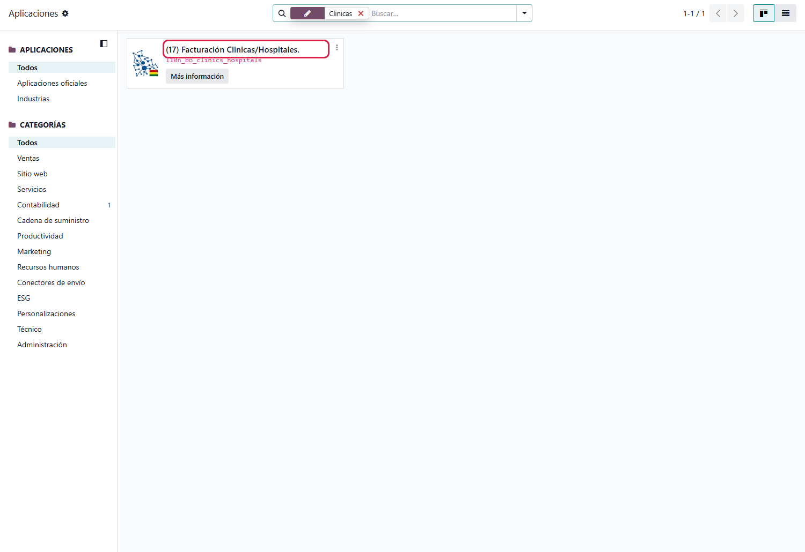
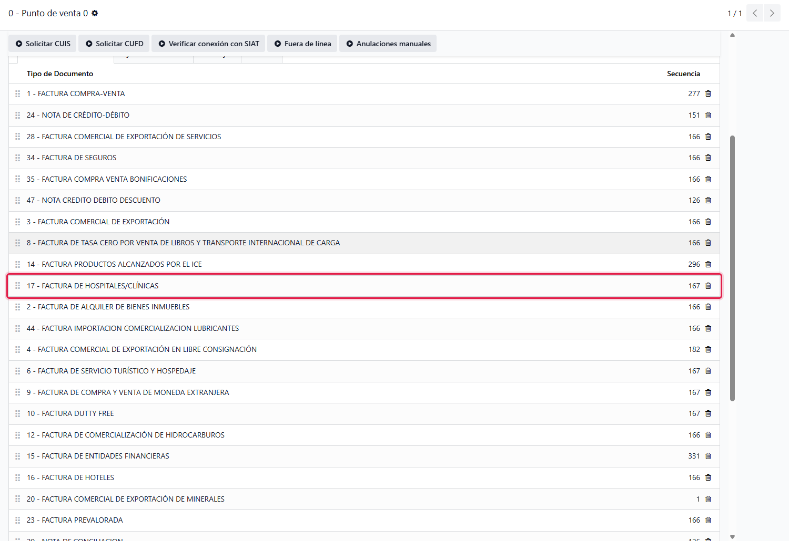
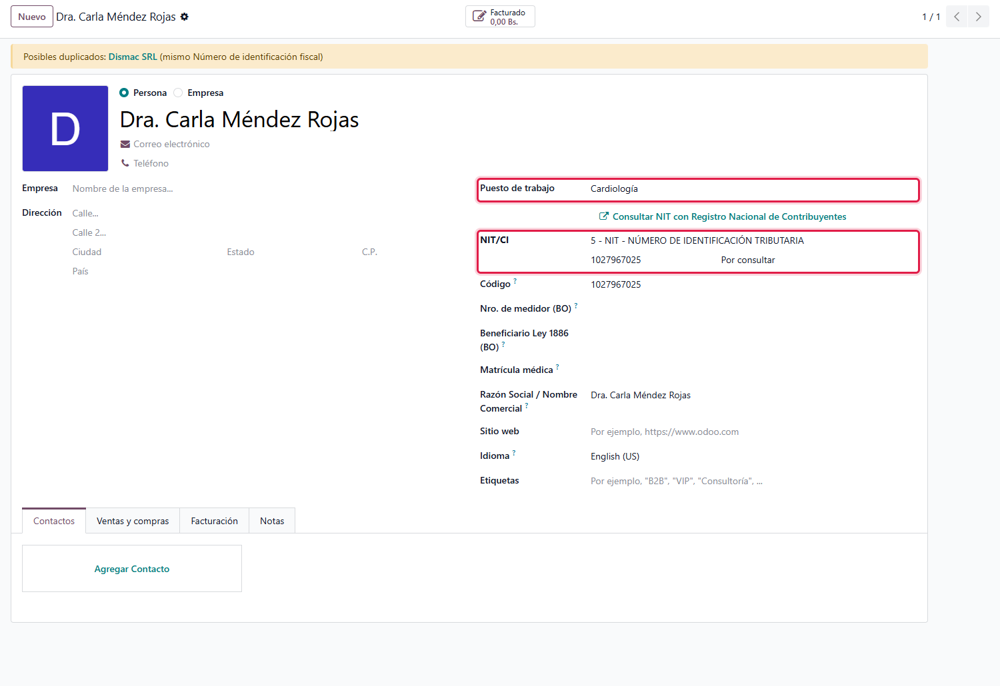
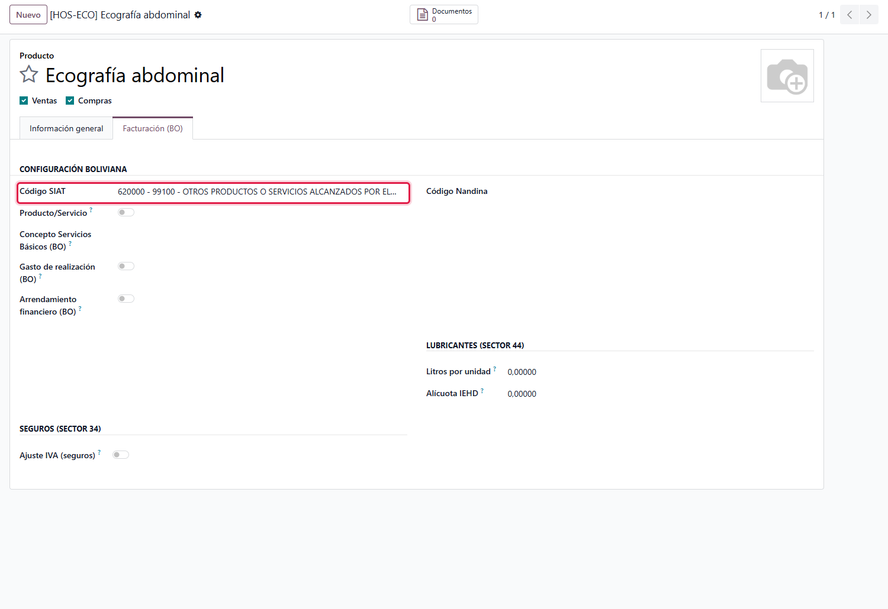
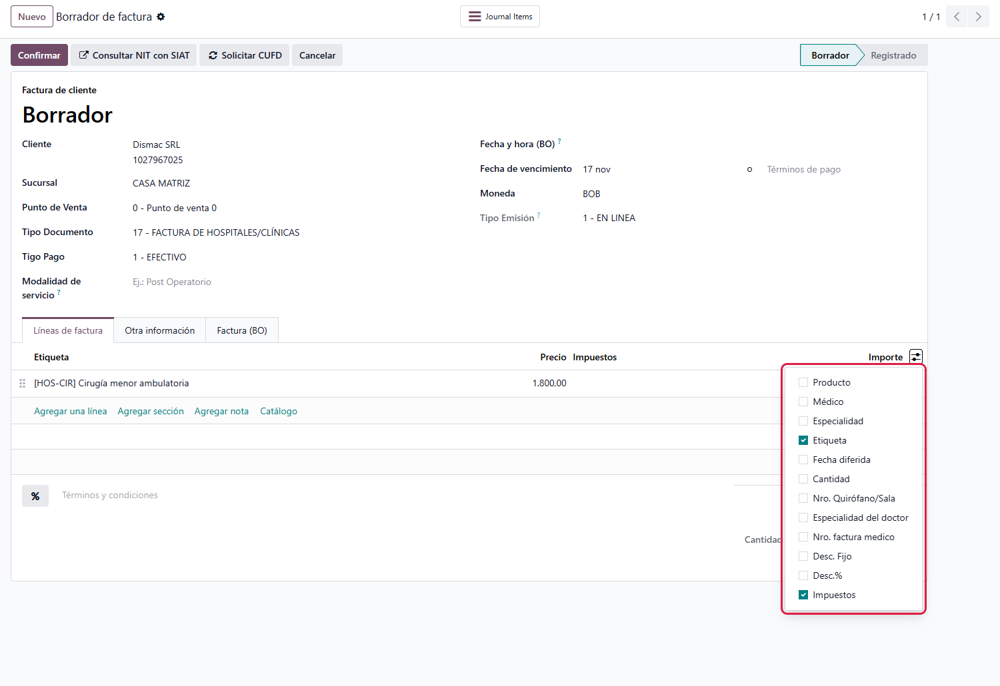
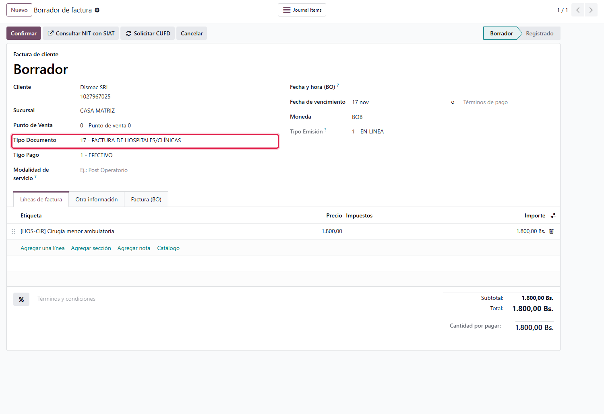
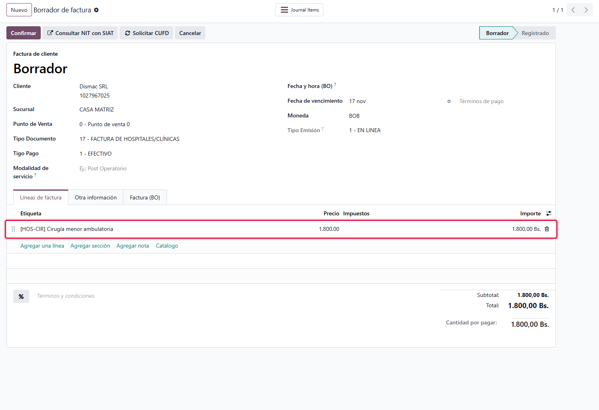
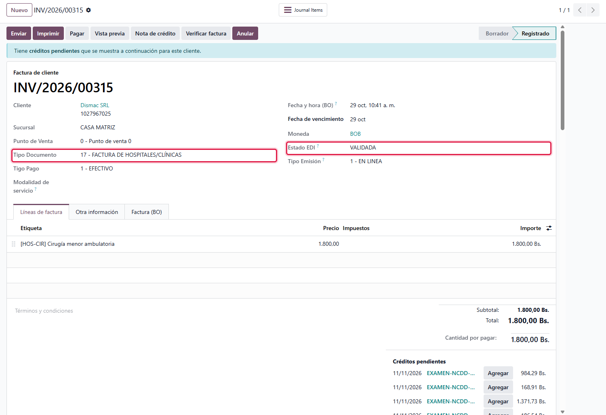
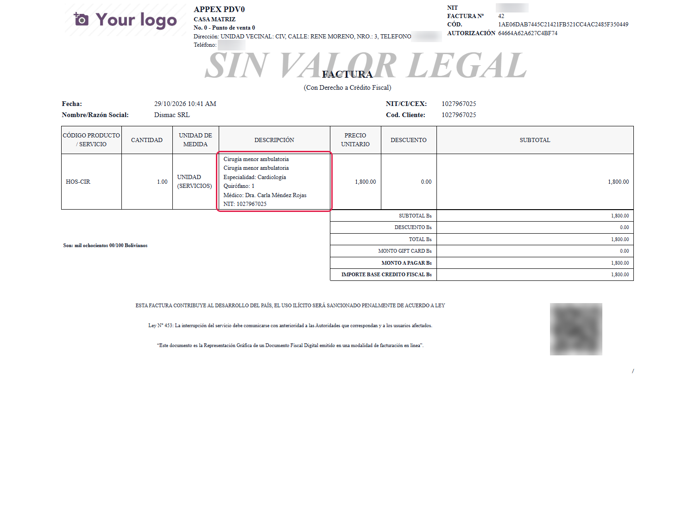

# Factura de hospitales y clínicas

Es la factura que emiten los hospitales y las clínicas por sus servicios médicos: consultas, estudios, internación y cirugías. En Odoo aparece como tipo de documento **17 - FACTURA DE HOSPITALES/CLÍNICAS**; ante el SIAT es el documento sector 17 y **da derecho a crédito fiscal**. Lo que la distingue es que cada línea lleva los datos del médico que prestó el servicio. Queda emitida cuando el SIN la devuelve como **VALIDADA (código 908)**.

## Qué debe estar configurado

Además de la configuración general de la Parte I, la factura de hospitales necesita estos cinco puntos:

- **Módulo de hospitales activado.** Aplicaciones → buscar «Clinicas» → «(17) Facturacion Clinicas/Hospitales.» → Activar.

    { width="624" height="428" loading="lazy" }

- **Tipo de documento 17 activo y con su documento sector.** Ajustes → Facturación (BO) → Catálogos SIAT → Códigos de Tipo Documento, fila «17 - FACTURA DE HOSPITALES/CLÍNICAS»: el interruptor Activo debe estar encendido y el campo Documento Sector completo (por ejemplo, «6202000 - 17 - FHC»; depende de la actividad económica registrada en el SIN).

- **Secuencia en el punto de venta.** En la pestaña Secuencias Documentos del punto de venta (sección 3.5 de la Parte I) debe figurar el tipo 17. Si falta, se agrega una línea a mano, como se explica en la sección [Nota de crédito-débito › Qué debe saber antes de emitirla](nota-de-credito-debito.md#que-debe-saber-antes-de-emitirla).

    { width="624" height="428" loading="lazy" }

- **Médicos cargados como contactos, con un NIT válido.** Contabilidad → Clientes → Clientes → Nuevo: nombre del médico, Tipo de Identificación y NIT/CI real de cada médico. El SIN verifica que ese NIT exista en su padrón: con un número inventado rechaza la factura (sección [Errores frecuentes](#errores-frecuentes)).

    { width="624" height="428" loading="lazy" }

- **Servicios con Código SIAT.** En la pestaña Facturación (BO) del producto, con el Código SIAT del catálogo que corresponda a la actividad de la empresa (sección 4.2 de la Parte I).

    { width="624" height="428" loading="lazy" }

## Los datos del médico en cada línea

El módulo agrega cinco campos a las líneas de la factura. **Vienen ocultos**: para verlos, en la pestaña Líneas de factura hay que hacer clic en el ícono de columnas opcionales, a la derecha de los títulos de las columnas, y marcarlos.

- **Médico:** el contacto del médico que prestó el servicio. Es obligatorio en cada línea: sin él, Odoo no deja confirmar. Del contacto salen el nombre y el NIT que se informan al SIN.

- **Especialidad:** la especialidad del servicio, por ejemplo Cardiología.

- **Nro. Quirófano/Sala:** el número del quirófano o de la sala donde se atendió al paciente.

- **Especialidad del doctor:** la especialidad del médico.

- **Nro. factura médico:** el número de la factura que emitió el propio médico, si factura por su cuenta. Si queda en 0, no se imprime.

Conviene completar Médico, Especialidad, Especialidad del doctor y Nro. Quirófano/Sala en todas las líneas.

{ width="624" height="428" loading="lazy" }

## Paso a paso: crear y emitir la factura

1. **Abrir una factura nueva:** Contabilidad → Clientes → Facturas → botón Nuevo, y elegir en el campo Contacto al cliente: el paciente o la empresa que paga.

1. **Completar la cabecera:** Sucursal, Punto de Venta, Tigo Pago y, en Tipo Documento, **17 - FACTURA DE HOSPITALES/CLÍNICAS**.

    { width="624" height="428" loading="lazy" }

1. **Cargar las líneas** en la pestaña Líneas de factura: el servicio, la cantidad y el precio, y en cada línea los datos del médico (sección [Los datos del médico en cada línea](#los-datos-del-medico-en-cada-linea)).

    { width="624" height="428" loading="lazy" }

1. **Revisar la pestaña Factura (BO):** la casilla Factura (BO) debe estar marcada y la Leyenda asignada, igual que en la factura de compra-venta (sección [Factura de compra-venta › Paso a paso: crear y emitir la factura](factura-de-compra-venta.md#paso-a-paso-crear-y-emitir-la-factura), paso 7).

1. **Pulsar Confirmar.** Odoo envía la factura al SIN; suele tardar unos segundos, y hasta un minuto si el SIN está lento. Debe quedar en Registrado, con Estado EDI **VALIDADA**.

    { width="624" height="428" loading="lazy" }

## Cómo se ve la factura impresa y cómo saber si llegó al SIN

La factura impresa tiene el mismo encabezado que la de compra-venta (sección [Factura de compra-venta › Cómo se ve la factura impresa](factura-de-compra-venta.md#como-se-ve-la-factura-impresa)) y el título **FACTURA (Con Derecho a Crédito Fiscal)**. La diferencia está en la columna Descripción: debajo de cada servicio aparecen la especialidad, el quirófano, el nombre del médico, su especialidad y su NIT, y el número de factura del médico si se cargó.

Igual que en la compra-venta (sección [Factura de compra-venta › Cómo saber si la factura llegó al SIN](factura-de-compra-venta.md#como-saber-si-la-factura-llego-al-sin)), la factura está emitida solo si **Estado EDI** dice **VALIDADA**. La factura de hospitales tiene su propia numeración por punto de venta (la secuencia 17), separada de la de compra-venta. Por ejemplo, una factura con 2 ecografías abdominales a 350 Bs con la Dra. Ana Gutiérrez Vaca (sala 2) y 1 radiografía de tórax a 180 Bs con el Dr. Luis Fernández Paz (sala 7), y suma 880,00 Bs.

{ width="624" height="458" loading="lazy" }

## Errores frecuentes

Los errores de la sección [Factura de compra-venta › Errores frecuentes y cómo resolverlos](factura-de-compra-venta.md#errores-frecuentes-y-como-resolverlos) también se aplican a la factura de hospitales. Además, estos son propios de este documento:

| Lo que ve el usuario | Por qué pasa | Cómo se resuelve |
|---|---|---|
| «Nota: Necesita un médico en la linea de producto» | Alguna línea no tiene cargado el campo Médico. | Mostrar la columna Médico (sección [Los datos del médico en cada línea](#los-datos-del-medico-en-cada-linea)), completarla en todas las líneas y volver a confirmar. |
| «EL NIT DEL MEDICO ENVIADO NO ES VALIDO Nit medico enviado …» | El NIT del médico no existe en el padrón del SIN, por ejemplo un número mal escrito o un CI cargado como NIT. | Corregir el NIT/CI en la ficha del médico con su NIT real. La factura queda en borrador; se vuelve a confirmar. |
| En Tipo Documento no aparece 17 - FACTURA DE HOSPITALES/CLÍNICAS | Falta el módulo, el tipo 17 no está activo o el punto de venta no tiene la secuencia. | Revisar los puntos de la sección [Qué debe estar configurado](#que-debe-estar-configurado). |
