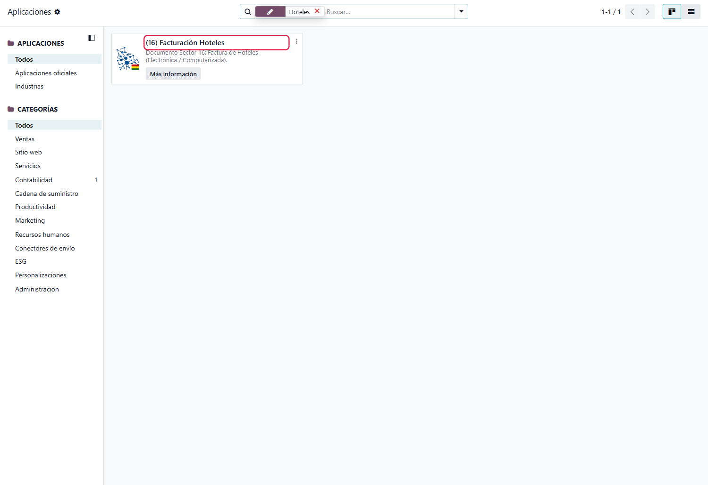
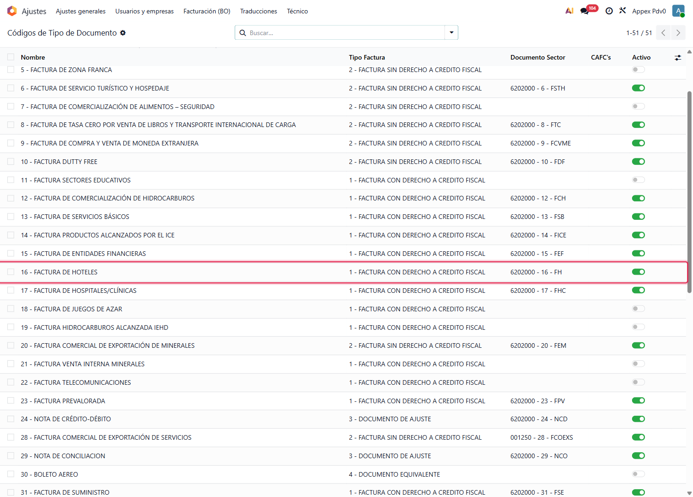
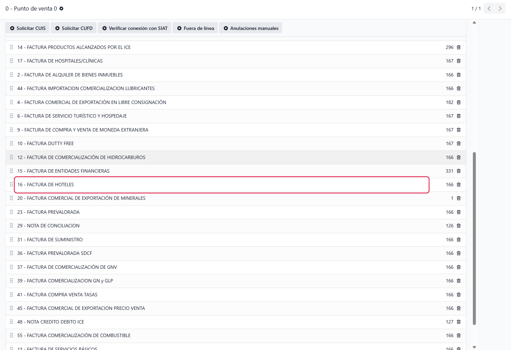
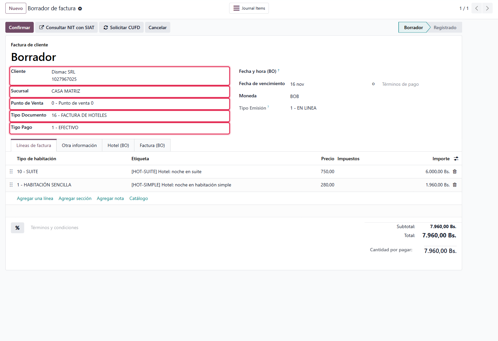
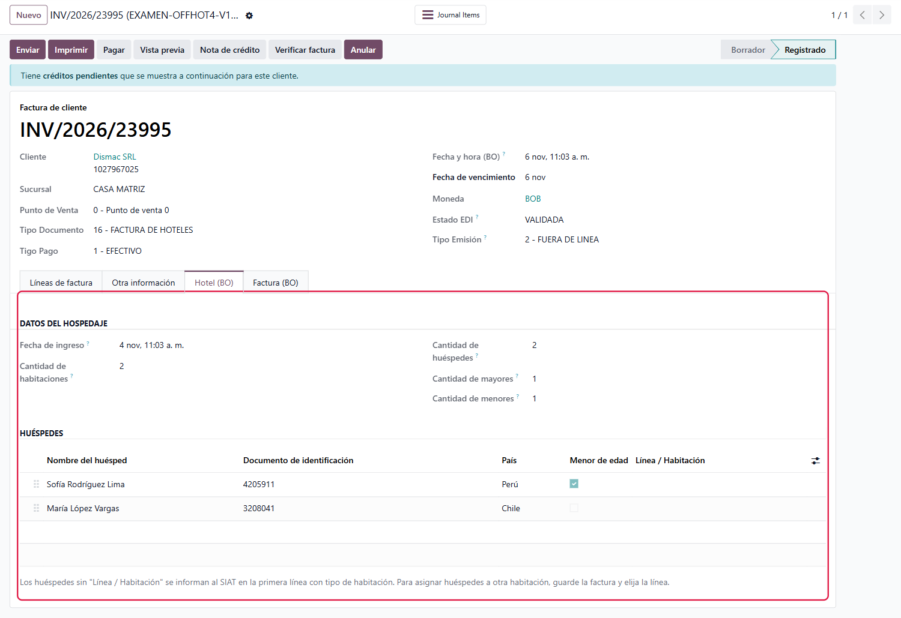
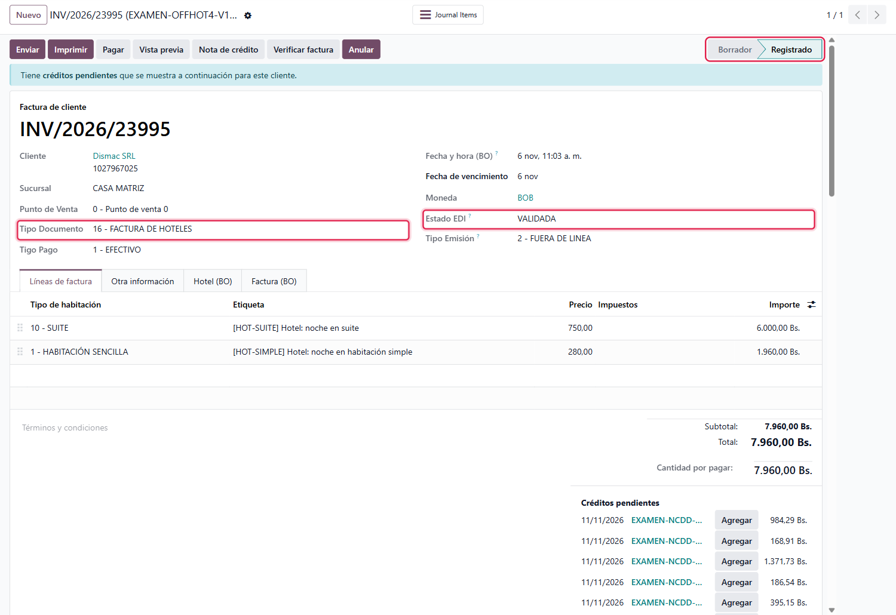
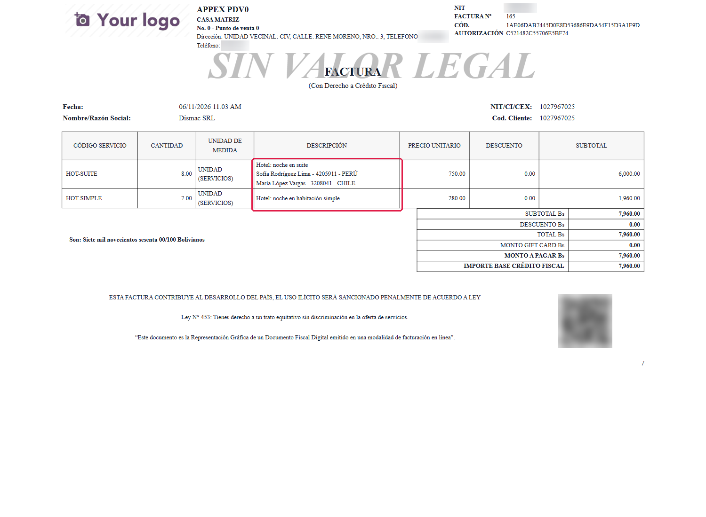

# Factura de hoteles

Es la factura de hoteles, hostales y demás alojamientos por el hospedaje de huéspedes nacionales o residentes en Bolivia. Es un documento distinto de la factura de servicios turísticos y hospedaje (sección [Factura de servicios turísticos y hospedaje](factura-de-servicios-turisticos-y-hospedaje.md)). En Odoo aparece como tipo de documento **16 - FACTURA DE HOTELES**; ante el SIAT es el documento sector 16. Además de las líneas, informa la **fecha de ingreso** (obligatoria), el **tipo de habitación** de cada línea y la **lista de huéspedes**, con su documento y país. Queda emitida cuando el SIN la devuelve como **VALIDADA (código 908)**.

## Qué debe estar configurado

Además de la configuración general de la Parte I, la factura de hoteles necesita estos cuatro puntos:

- **Módulo de hoteles activado.** Aplicaciones → buscar «Hoteles» → «(16) Facturación Hoteles» → Activar.

    { width="624" height="428" loading="lazy" }

- **Tipo de documento 16 activo y con su documento sector.** Ajustes → Facturación (BO) → Catálogos SIAT → Códigos de Tipo Documento, fila «16 - FACTURA DE HOTELES»: el interruptor Activo debe estar encendido y el campo Documento Sector completo (por ejemplo, «6202000 - 16 - FH»; depende de la actividad económica registrada en el SIN).

    { width="624" height="448" loading="lazy" }

- **Secuencia en el punto de venta.** En la pestaña Secuencias Documentos del punto de venta (sección 3.5 de la Parte I) debe figurar el tipo 16. Si falta, se agrega una línea a mano, como se explica en la sección [Nota de crédito-débito › Qué debe saber antes de emitirla](nota-de-credito-debito.md#que-debe-saber-antes-de-emitirla).

    { width="624" height="428" loading="lazy" }

- **Productos con Código SIAT y una unidad de medida válida.** En la pestaña Facturación (BO) del producto, con el Código SIAT del catálogo que corresponda a la actividad de la empresa (sección 4.2 de la Parte I). El SIAT solo acepta en este sector unidades de medida con código hasta 69. Se crea un producto por cada tipo de habitación, por noche de alojamiento.

## Paso a paso: crear y emitir la factura

1. **Abrir una factura nueva:** Contabilidad → Clientes → Facturas → botón Nuevo, y elegir el cliente en el campo Contacto.

1. **Completar la cabecera:** Sucursal, Punto de Venta, Tigo Pago y, en Tipo Documento, **16 - FACTURA DE HOTELES**. Este documento admite pago con gift card: el monto de la gift card se resta del importe sujeto a IVA.

    { width="624" height="428" loading="lazy" }

1. **Cargar las líneas** en la pestaña Líneas de factura: el producto (la noche de alojamiento), la cantidad de noches, el precio y, en la columna **Tipo de habitación**, el tipo según el catálogo del SIAT (por ejemplo 1 - HABITACIÓN SENCILLA, 2 - HABITACIÓN DOBLE o 10 - SUITE). Cada línea con tipo de habitación cuenta como una habitación.

1. **Completar la pestaña Hotel (BO):** en el grupo Datos del Hospedaje, la **Fecha de ingreso** (obligatoria). En la tabla **Huéspedes**, una fila por persona con su nombre, documento de identificación, país y, si corresponde, la casilla Menor de edad. Las cantidades de huéspedes, mayores, menores y habitaciones se calculan solas.

    { width="624" height="428" loading="lazy" }

1. **Asignar los huéspedes a su habitación (opcional):** la columna Línea / Habitación indica en qué línea se informa cada huésped. Si se deja vacía, el huésped se informa en la primera línea con tipo de habitación. Para elegir la línea, primero hay que guardar la factura.

1. **Revisar la pestaña Factura (BO):** la casilla Factura (BO) debe estar marcada y la Leyenda asignada, igual que en la factura de compra-venta (sección [Factura de compra-venta › Paso a paso: crear y emitir la factura](factura-de-compra-venta.md#paso-a-paso-crear-y-emitir-la-factura), paso 7).

1. **Pulsar Confirmar.** Odoo envía la factura al SIN; suele tardar unos segundos, y hasta un minuto si el SIN está lento. Debe quedar en Registrado, con Estado EDI **VALIDADA**.

    { width="624" height="428" loading="lazy" }

## Cómo se ve la factura impresa y cómo saber si llegó al SIN

La factura impresa lleva el título **FACTURA** con la leyenda (Con Derecho a Crédito Fiscal), y el mismo detalle que la de compra-venta. Al pie salen el subtotal, el descuento, el total, el monto gift card, el monto a pagar y el importe base de crédito fiscal. **La fecha de ingreso, los tipos de habitación y los huéspedes no se imprimen**: viajan solo en el XML que recibe el SIN.

Igual que en la compra-venta (sección [Factura de compra-venta › Cómo saber si la factura llegó al SIN](factura-de-compra-venta.md#como-saber-si-la-factura-llego-al-sin)), la factura está emitida solo si **Estado EDI** dice **VALIDADA**. La factura de hoteles tiene su propia numeración por punto de venta (la secuencia 16), separada de la de compra-venta. Por ejemplo, una factura con 10 noches en habitación sencilla a 280 Bs, 9 en habitación doble a 420 Bs y 6 en suite a 750 Bs, con ingreso el 04/11/2026 y dos huéspedes mayores de edad. Suma 11.080,00 Bs; el SIN la recibió con 3 habitaciones, 2 huéspedes y monto sujeto a IVA 11.080 Bs.

Se anula y se revierte igual que las demás facturas (sección 1 de la Parte III), y también se puede emitir fuera de línea (sección 2 de la Parte III).

{ width="624" height="458" loading="lazy" }

## Errores frecuentes

Los errores de la sección [Factura de compra-venta › Errores frecuentes y cómo resolverlos](factura-de-compra-venta.md#errores-frecuentes-y-como-resolverlos) también se aplican a la factura de hoteles. Además, estos son propios de este documento:

| Lo que ve el usuario | Por qué pasa | Cómo se resuelve |
|---|---|---|
| En Tipo Documento no aparece 16 - FACTURA DE HOTELES | Falta el módulo, el tipo 16 no está activo o el punto de venta no tiene la secuencia. | Revisar los puntos de la sección [Qué debe estar configurado](#que-debe-estar-configurado). |
| «Nota: Debe registrar la Fecha de ingreso al hospedaje (obligatoria en la Factura de Hoteles).» | La pestaña Hotel (BO) quedó sin Fecha de ingreso. | Completar la Fecha de ingreso y volver a confirmar. |
| «Nota: La cantidad de huéspedes debe ser igual a la suma de mayores y menores.» | Se modificaron a mano las cantidades del grupo Datos del Hospedaje. | Corregir las cantidades o volver a cargar los huéspedes en la tabla para que se calculen solas. |
| «Nota: Todos los huéspedes deben tener nombre y documento de identificación.» | Una fila de la tabla Huéspedes no tiene nombre o documento. | Completar la fila o borrarla. |
| «Nota: La unidad de medida del producto \[...\] (código N) no es válida para este sector (máximo 69).» | La unidad de medida del producto tiene en el SIAT un código mayor a 69. | Usar una unidad con código de 69 o menos, por ejemplo Unidades. |
| «Nota: El detalle de huéspedes de \[...\] supera los 5000 caracteres permitidos por el SIAT.» | Hay demasiados huéspedes informados en una sola línea. | Asignar parte de los huéspedes a otras líneas con la columna Línea / Habitación. |
