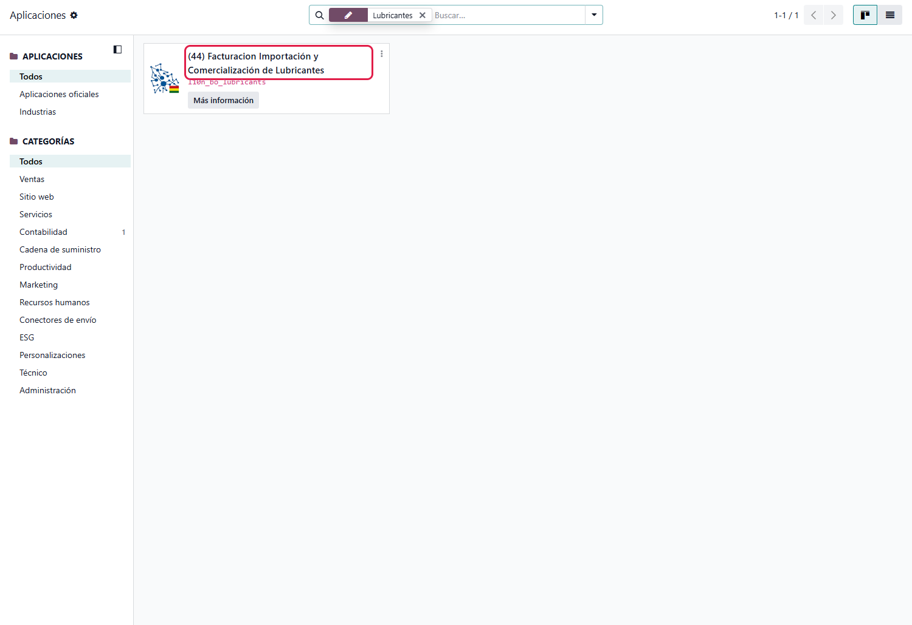
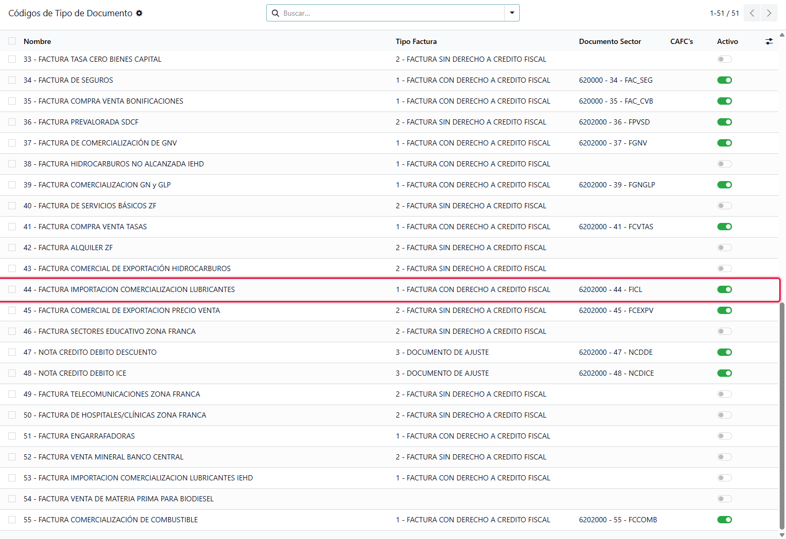
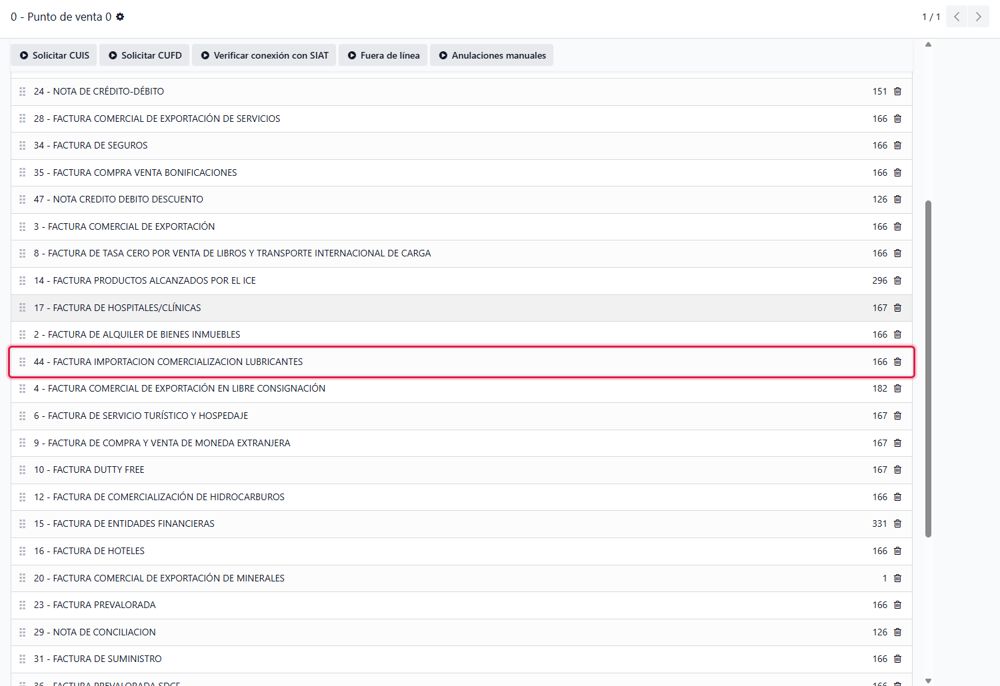
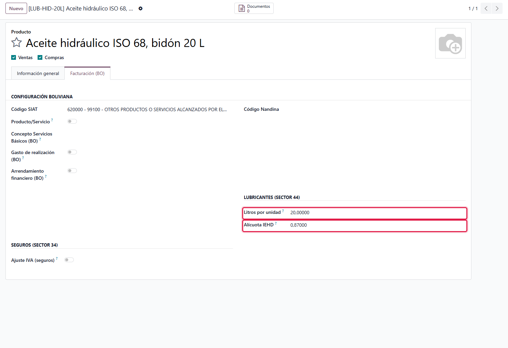
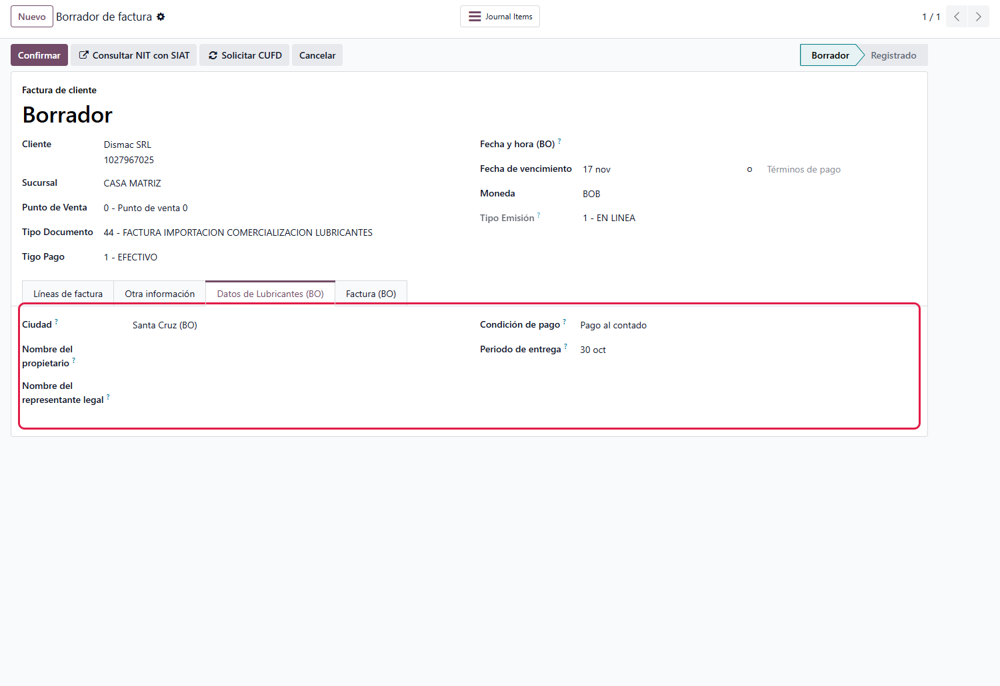
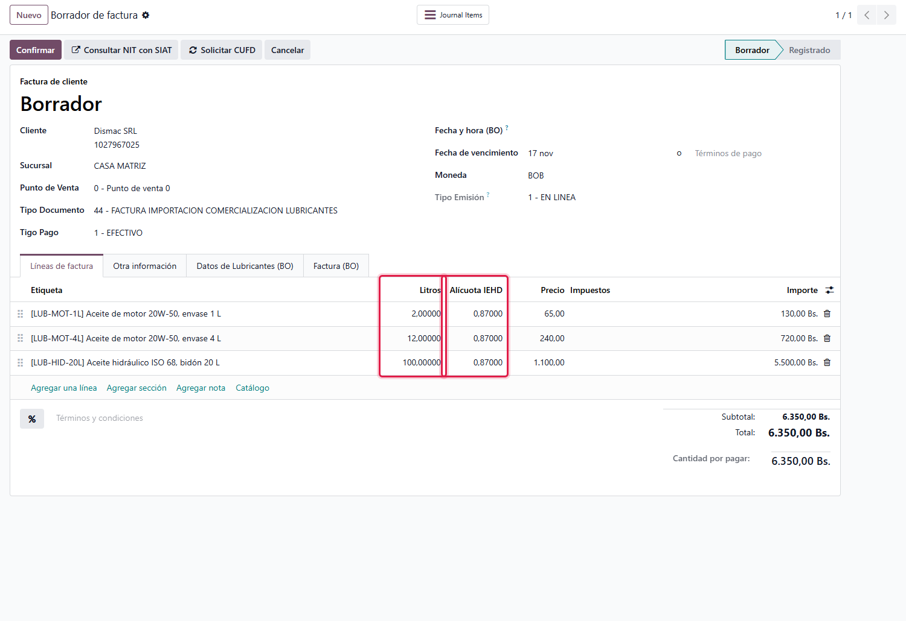
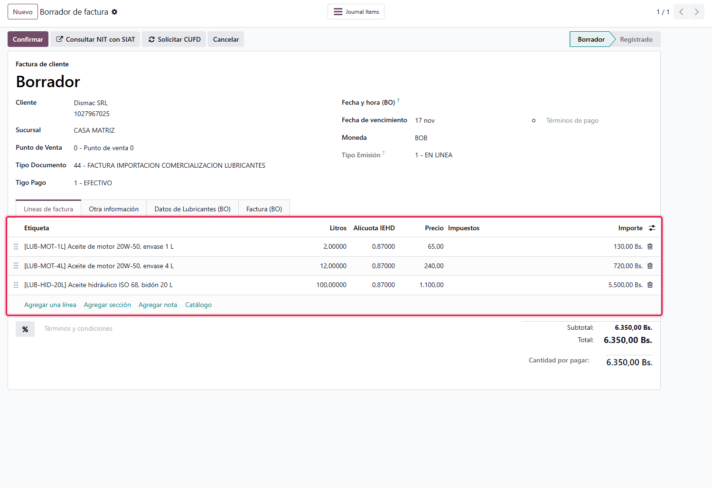
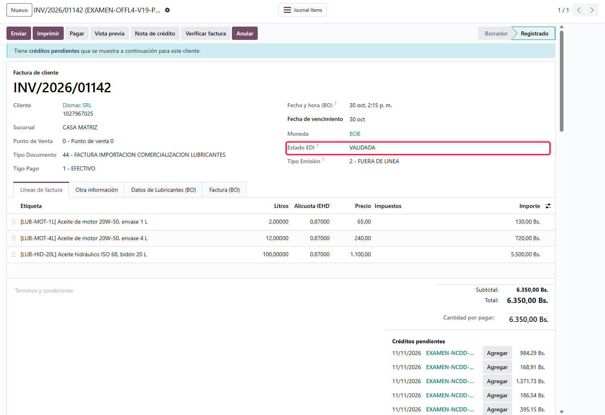
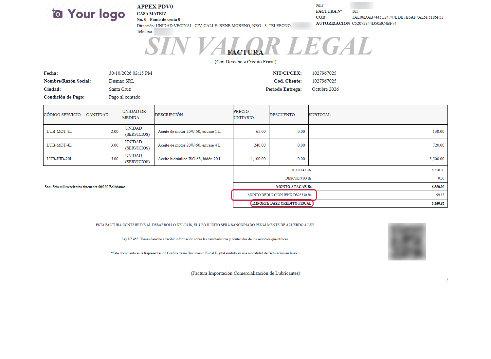

# Factura de importación y comercialización de lubricantes

Es la factura que emiten las empresas que importan lubricantes de forma directa y los venden al consumidor final o a distribuidores. Sirve solo para venta de productos, no de servicios. En Odoo aparece como tipo de documento `44 - FACTURA IMPORTACION COMERCIALIZACION LUBRICANTES`; ante el SIAT es el documento sector 44 y **da derecho a crédito fiscal**. Lo que la distingue es que informa los litros vendidos y la deducción del IEHD (Impuesto Especial a los Hidrocarburos y sus Derivados, DS 25530): el importe base para crédito fiscal es el total menos esa deducción. Queda emitida cuando el SIN la devuelve como **`VALIDADA` (código `908`)**.

## Qué debe estar configurado

Además de la configuración general de la Parte I, la factura de lubricantes necesita estos cuatro puntos:

- **Módulo de lubricantes activado.** Aplicaciones → buscar «Lubricantes» → «(44) Facturacion Importación y Comercialización de Lubricantes» → Activar.

    { width="624" height="428" loading="lazy" }

- **Tipo de documento 44 activo y con su documento sector.** Ajustes → Facturación (BO) → Catálogos SIAT → Códigos de Tipo Documento, fila `44 - FACTURA IMPORTACION COMERCIALIZACION LUBRICANTES`: el interruptor Activo debe estar encendido y el campo Documento Sector completo (por ejemplo, `6202000 - 44 - FICL`; depende de la actividad económica registrada en el SIN).

    { width="624" height="428" loading="lazy" }

- **Secuencia en el punto de venta.** En la pestaña Secuencias Documentos del punto de venta (sección 3.5 de la Parte I) debe figurar el tipo 44. Si falta, se agrega una línea a mano, como se explica en la sección [Nota de crédito-débito › Qué debe saber antes de emitirla](nota-de-credito-debito.md#que-debe-saber-antes-de-emitirla).

    { width="624" height="428" loading="lazy" }

- **Productos con Código SIAT, litros y alícuota IEHD.** Deben ser productos, no servicios. En la pestaña Facturación (BO) del producto, además del Código SIAT, el grupo Lubricantes (sector 44) tiene dos campos: **Litros por unidad** (por ejemplo, 20 para un bidón de 20 L) y **Alícuota IEHD.**

    { width="624" height="428" loading="lazy" }

## La pestaña Datos de Lubricantes (BO)

Al elegir el tipo de documento 44, la factura muestra la pestaña **Datos de Lubricantes (BO)**, antes de la pestaña Factura (BO). Estos son sus campos; los tres primeros son obligatorios y Odoo no deja guardar sin ellos:

- **Ciudad:** el departamento de destino. Se completa solo al elegir el cliente, con su departamento o con su ciudad si es el nombre de un departamento; si no, se elige a mano.

- **Condición de pago:** texto libre, por ejemplo «Pago al contado» o «Pago post contrato».

- **Periodo de entrega:** el mes y el año de la entrega. Se elige en un calendario por meses y en la factura se escribe como «Octubre 2026».

- **Nombre del propietario y Nombre del representante legal:** opcionales. Se informan al SIN, pero no salen en la factura impresa.

Estos datos se pueden cambiar mientras la factura está en borrador; al confirmarla quedan fijos.

{ width="624" height="428" loading="lazy" }

## Litros y deducción del IEHD

El módulo agrega dos columnas a las líneas de la factura, antes del precio: **Litros** y **Alícuota IEHD**. Solo aparecen con el tipo de documento 44.

- **Litros:** se calcula solo, como cantidad × Litros por unidad del producto. Por ejemplo, 4 bidones de 20 L dan 80 litros.

- **Alícuota IEHD:** se copia del producto.

Las dos se pueden corregir a mano en la línea. Con ellas Odoo calcula la **deducción IEHD**, que es la suma de litros × alícuota de cada línea, y el **importe base para crédito fiscal**, que es el total menos la deducción. Por ejemplo, 86 litros con una alícuota de 0,87 dan una deducción de 74,82 Bs.

La alícuota IEHD la fija el SIN. En cada producto debe cargarse el valor vigente.

{ width="624" height="428" loading="lazy" }

## Paso a paso: crear y emitir la factura

1. **Abrir una factura nueva:** Contabilidad → Clientes → Facturas → botón Nuevo, y elegir el cliente en el campo Contacto.

1. **Completar la cabecera:** Sucursal, Punto de Venta, Tigo Pago y, en Tipo Documento, `44 - FACTURA IMPORTACION COMERCIALIZACION LUBRICANTES`. Tigo Pago no puede ser un pago con gift card (sección [Errores frecuentes](#errores-frecuentes)).

1. **Completar la pestaña Datos de Lubricantes (BO):** Ciudad, Condición de pago y Periodo de entrega (sección [La pestaña Datos de Lubricantes (BO)](#la-pestana-datos-de-lubricantes-bo)).

1. **Cargar las líneas** en la pestaña Líneas de factura: los productos, la cantidad y el precio. Revisar las columnas Litros y Alícuota IEHD (sección [Litros y deducción del IEHD](#litros-y-deduccion-del-iehd)).

    { width="624" height="428" loading="lazy" }

1. **Revisar la pestaña Factura (BO):** la casilla Factura (BO) debe estar marcada y la Leyenda asignada, igual que en la factura de compra-venta (sección [Factura de compra-venta › Paso a paso: crear y emitir la factura](factura-de-compra-venta.md#paso-a-paso-crear-y-emitir-la-factura), paso 7).

1. **Pulsar Confirmar.** Odoo envía la factura al SIN; suele tardar unos segundos, y hasta un minuto si el SIN está lento. Debe quedar en Registrado, con Estado EDI `VALIDADA`.

    { width="624" height="428" loading="lazy" }

## Cómo se ve la factura impresa y cómo saber si llegó al SIN

La factura impresa tiene el mismo encabezado que la de compra-venta (sección [Factura de compra-venta › Cómo se ve la factura impresa](factura-de-compra-venta.md#como-se-ve-la-factura-impresa)) y el título **FACTURA**, con la leyenda (Con Derecho a Crédito Fiscal). Debajo de los datos del cliente agrega **Ciudad**, **Periodo Entrega** y **Condición de Pago**. Al pie, los totales son el subtotal, el descuento, el monto a pagar, el monto de deducción IEHD DS25530 y el importe base para crédito fiscal. Al final lleva la leyenda (Factura Importación Comercialización de Lubricantes).

Igual que en la compra-venta (sección [Factura de compra-venta › Cómo saber si la factura llegó al SIN](factura-de-compra-venta.md#como-saber-si-la-factura-llego-al-sin)), la factura está emitida solo si **Estado EDI** dice `VALIDADA`. La factura de lubricantes tiene su propia numeración por punto de venta (la secuencia 44), separada de la de compra-venta. Por ejemplo, una factura con 4 bidones de aceite hidráulico de 20 L a 1.100 Bs, 5 aceites de transmisión de 1 L a 80 Bs y 1 aceite de motor de 1 L a 65 Bs. Suma 4.865,00 Bs, con 86 litros, una deducción IEHD de 74,82 Bs y un importe base para crédito fiscal de 4.790,18 Bs.

Se anula y se revierte igual que las demás facturas (sección 1 de la Parte III), y también se puede emitir fuera de línea (sección 2 de la Parte III).

{ width="624" height="458" loading="lazy" }

## Errores frecuentes

Los errores de la sección [Factura de compra-venta › Errores frecuentes y cómo resolverlos](factura-de-compra-venta.md#errores-frecuentes-y-como-resolverlos) también se aplican a la factura de lubricantes. Además, estos son propios de este documento:

| Lo que ve el usuario | Por qué pasa | Cómo se resuelve |
|---|---|---|
| «Nota: La factura de lubricantes es solo para venta de productos, \[producto\] es un servicio.» | Una línea tiene un producto de tipo servicio. | Usar un producto que no sea servicio. La factura queda en borrador; se vuelve a confirmar. |
| «Nota: El pago con GiftCard no es válido para el documento \[`44 - FACTURA IMPORTACION COMERCIALIZACION LUBRICANTES`\]» | En Tigo Pago se eligió un pago con gift card, que el documento 44 no admite. | Elegir otro Tigo Pago, por ejemplo `1 - EFECTIVO`, y volver a confirmar. |
| «Nota: La deducción IEHD no puede ser mayor al monto total de la factura.» | Los litros o la alícuota IEHD de alguna línea son demasiado altos para su precio. | Revisar las columnas Litros y Alícuota IEHD (sección [Litros y deducción del IEHD](#litros-y-deduccion-del-iehd)) y los datos del producto. |
| «Nota: Los litros de \[producto\] no pueden ser negativos.» o «Nota: La alícuota IEHD de \[producto\] no puede ser negativa.» | Se cargó un valor negativo en la línea o en el producto. | Corregir el valor en la línea o en la ficha del producto y volver a confirmar. |
| La deducción IEHD sale en cero | El producto no tiene cargados Litros por unidad o Alícuota IEHD. | Cargarlos en la pestaña Facturación (BO) del producto (sección [Qué debe estar configurado](#que-debe-estar-configurado)) antes de emitir. |
| En Tipo Documento no aparece `44 - FACTURA IMPORTACION COMERCIALIZACION LUBRICANTES` | Falta el módulo, el tipo 44 no está activo o el punto de venta no tiene la secuencia. | Revisar los puntos de la sección [Qué debe estar configurado](#que-debe-estar-configurado). |
