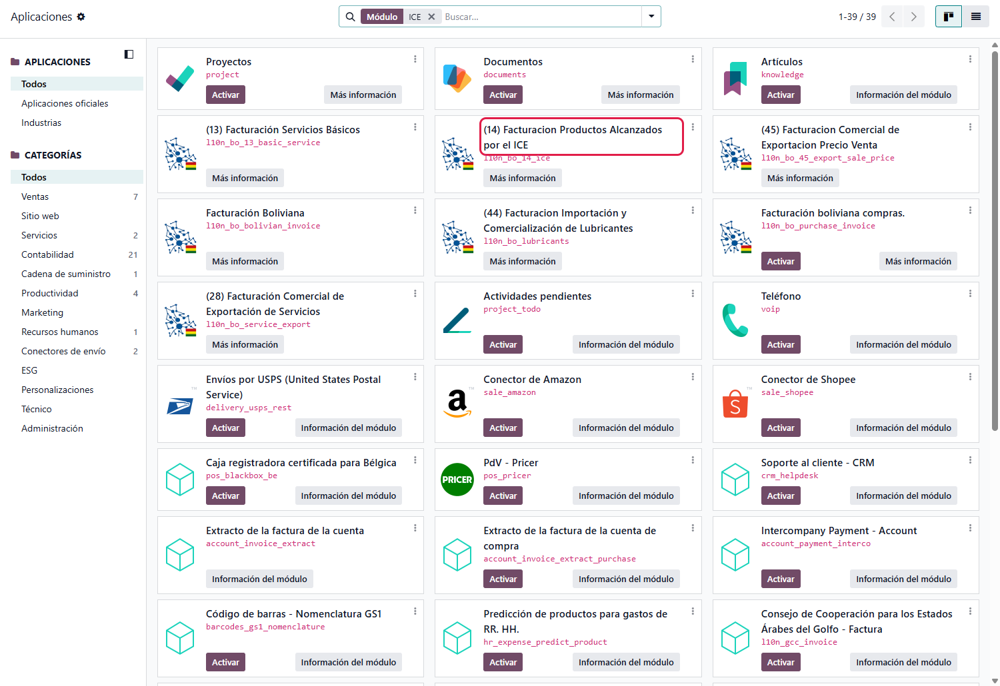
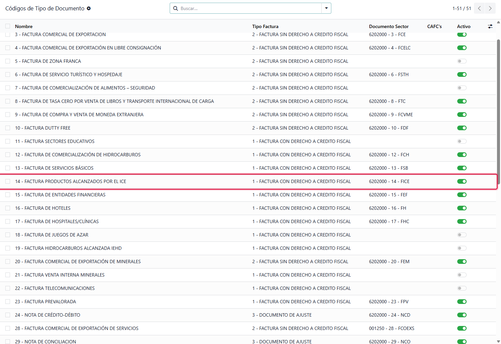
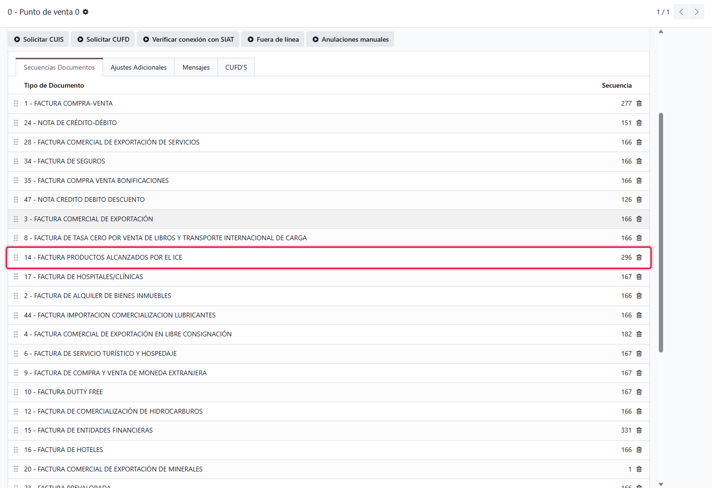
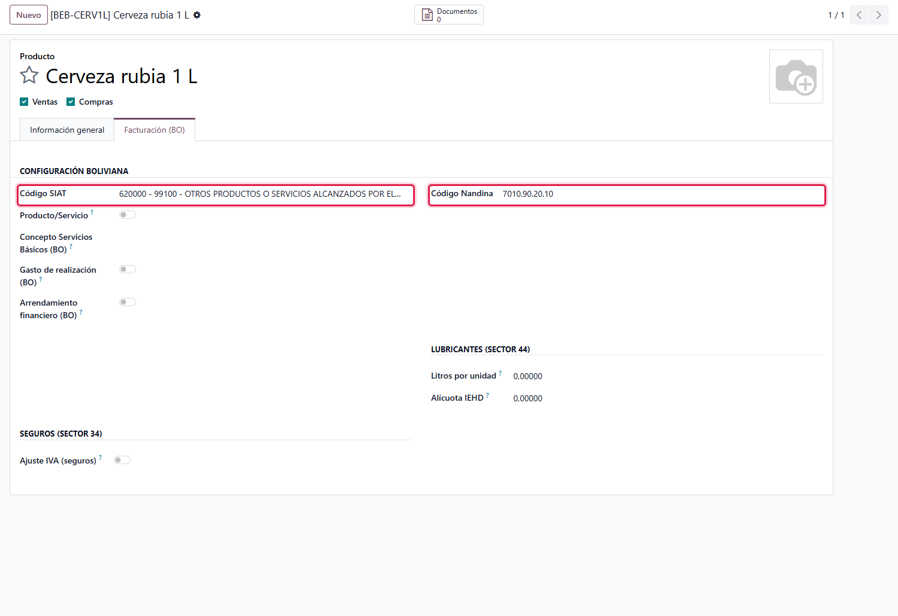
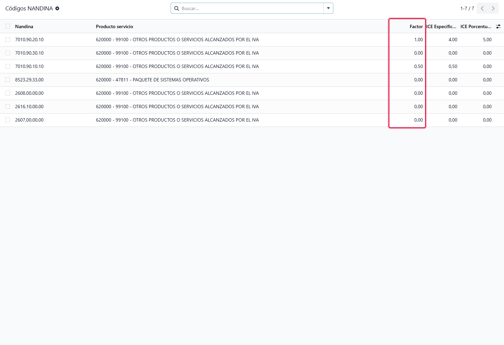
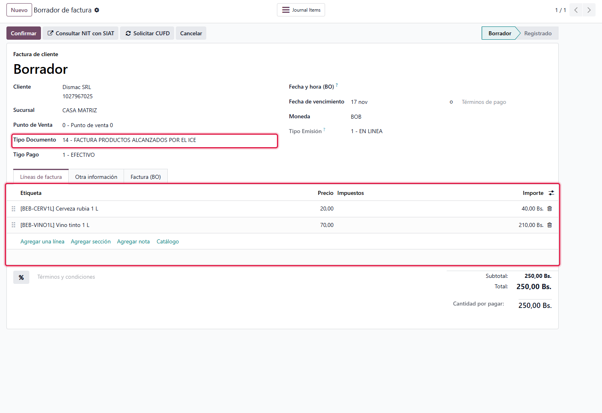
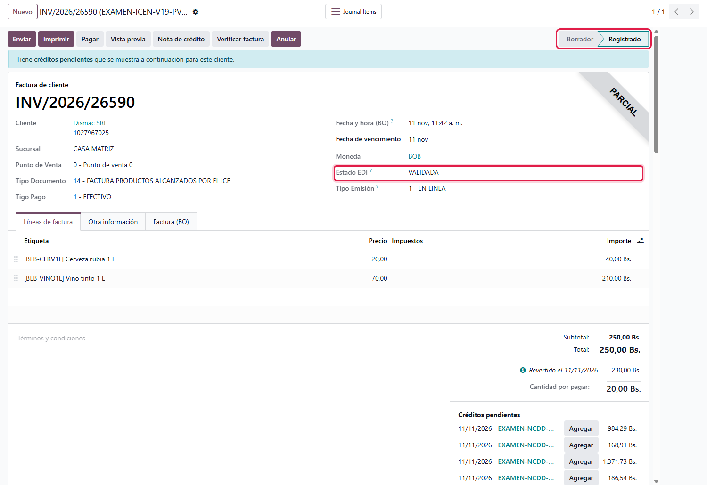

# Factura de productos alcanzados por el ICE

Es la factura que se emite al vender productos alcanzados por el Impuesto a los Consumos Específicos (ICE), como gaseosas, cervezas, vinos y singanis. En Odoo aparece como tipo de documento `14 - FACTURA PRODUCTOS ALCANZADOS POR EL ICE`; ante el SIAT es el documento sector 14 y da derecho a crédito fiscal. Además del precio, cada línea informa al SIN el ICE que le corresponde. Queda emitida cuando el SIN la devuelve como **`VALIDADA` (código `908`)**.

## Qué debe estar configurado

Además de la configuración general de la Parte I, la factura ICE necesita estos cinco puntos:

- **Módulo ICE activado.** Aplicaciones → buscar «ICE» → «(14) Facturacion Productos Alcanzados por el ICE» → Activar.

    { width="624" height="428" loading="lazy" }

- **Tipo de documento 14 activo y con su documento sector.** Ajustes → Facturación (BO) → Catálogos SIAT → Códigos de Tipo Documento, fila `14 - FACTURA PRODUCTOS ALCANZADOS POR EL ICE`: el interruptor Activo debe estar encendido y el campo Documento Sector completo (por ejemplo, `6202000 - 14 - FICE`; depende de la actividad económica registrada en el SIN).

    { width="624" height="428" loading="lazy" }

- **Secuencia en cada punto de venta.** En la pestaña Secuencias Documentos del punto de venta (sección 3.5 de la Parte I) debe figurar `14 - FACTURA PRODUCTOS ALCANZADOS POR EL ICE`. Si falta, se agrega una línea a mano, como se explica en la sección [Nota de crédito-débito › Qué debe saber antes de emitirla](nota-de-credito-debito.md#que-debe-saber-antes-de-emitirla).

    { width="624" height="428" loading="lazy" }

- **Tasas ICE en los Códigos Nandina.** Ajustes → Facturación (BO) → Catálogos SIAT → Productos y/o Servicios → Códigos Nandina: cada Nandina usada por productos ICE debe tener cargados el ICE Específico, el ICE Porcentual y el Factor (sección [Cómo se calcula el ICE](#como-se-calcula-el-ice)).

- **Productos con Código SIAT y Código Nandina.** En la pestaña Facturación (BO) del producto. El ICE de cada línea se calcula con las tasas de esa Nandina.

    { width="624" height="428" loading="lazy" }

## Cómo se calcula el ICE

El ICE no se escribe a mano: Odoo lo calcula al confirmar, con tres datos del Código Nandina del producto. Se cargan en Ajustes → Facturación (BO) → Catálogos SIAT → Productos y/o Servicios → Códigos Nandina:

- **ICE Específico (Bs):** la alícuota específica, un monto fijo en bolivianos por litro.

- **ICE Porcentual (%):** la alícuota porcentual, un porcentaje sobre el precio de venta neto de IVA.

- **Factor:** las unidades por litro. Odoo calcula los litros de la línea como cantidad ÷ Factor. Por ejemplo, botella de 2 L → Factor 0,5; de 1 L → Factor 1; de 250 ml → Factor 4.

Con esos datos, ICE específico = litros × alícuota específica, e ICE porcentual = precio neto de IVA × alícuota porcentual. Por ejemplo, 29 cervezas de 1 L a 20 Bs con alícuotas de 4,00 Bs/L y 5 % dan un ICE específico de 116,00 Bs y un ICE porcentual de 25,23 Bs.

- **Las alícuotas las fija el SIN y cambian con el tiempo. En cada producto debe cargarse la alícuota vigente (por ejemplo, 0,50 Bs/L para gaseosas, o 4,00 Bs/L y 5 % para bebidas alcohólicas)**.

- **El Factor es uno por Nandina.** Todos los productos que comparten una Nandina deben tener el mismo tamaño de envase.

- **Los litros deben ser exactos.** Envases como 2 L, 1 L, 500 ml o 250 ml dan litros exactos. Con 750 ml o 330 ml el resultado tiene infinitos decimales y el SIN rechaza la factura por redondeo (ver [Errores frecuentes](#errores-frecuentes)).

- **Sin tasas no hay ICE.** Si la Nandina tiene las tasas en cero, la factura se emite igual, pero el SIN recibe las líneas como no alcanzadas por el ICE.

    { width="624" height="428" loading="lazy" }

## Paso a paso: crear y emitir la factura

1. **Abrir una factura nueva:** Contabilidad → Clientes → Facturas → botón Nuevo, y elegir el cliente en el campo Contacto.

1. **Completar la cabecera:** Sucursal, Punto de Venta, Tigo Pago y, en Tipo Documento, `14 - FACTURA PRODUCTOS ALCANZADOS POR EL ICE`.

1. **Cargar las líneas** en la pestaña Líneas de factura: productos con su Nandina, cantidad y precio. El precio se carga sin ICE; el ICE se agrega al enviar la factura al SIN.

    { width="624" height="428" loading="lazy" }

1. **Revisar la pestaña Factura (BO):** la casilla Factura (BO) debe estar marcada y la Leyenda asignada, igual que en la factura de compra-venta (sección [Factura de compra-venta › Paso a paso: crear y emitir la factura](factura-de-compra-venta.md#paso-a-paso-crear-y-emitir-la-factura), paso 7).

1. **Pulsar Confirmar.** Odoo envía la factura al SIN; suele tardar unos segundos, y hasta un minuto si el SIN está lento. Debe quedar en Registrado, con Estado EDI `VALIDADA`.

    { width="624" height="428" loading="lazy" }

## Cómo saber si llegó al SIN

Igual que en la compra-venta (sección [Factura de compra-venta › Cómo saber si la factura llegó al SIN](factura-de-compra-venta.md#como-saber-si-la-factura-llego-al-sin)), la factura está emitida solo si **Estado EDI** dice `VALIDADA`. La factura ICE tiene su propia numeración por punto de venta (la secuencia 14), separada de la de compra-venta.

**El total para el SIN incluye el ICE.** El total de la factura en Odoo no lo suma, pero el que se informa al SIN sí. Por ejemplo, una factura que en Odoo muestra 1.670,00 Bs se registra en el SIN por 1.906,65 Bs: el total más 164,00 Bs de ICE específico y 72,65 Bs de ICE porcentual.

## Errores frecuentes

Los errores de la sección [Factura de compra-venta › Errores frecuentes y cómo resolverlos](factura-de-compra-venta.md#errores-frecuentes-y-como-resolverlos) también se aplican a la factura ICE. Además, estos son propios de este documento:

| Lo que ve el usuario | Por qué pasa | Cómo se resuelve |
|---|---|---|
| «EL CALCULO DE ICE ESPECIFICO ES ERRONEO Monto ice especifico esperado … enviado …» | Los litros de la línea (cantidad ÷ Factor) tienen más de cinco decimales, por ejemplo con envases de 750 ml o 330 ml, y el SIN redondea distinto que Odoo. | Usar envases que den litros exactos (2 L, 1 L, 500 ml, 250 ml) y su Factor correspondiente en la Nandina. La factura queda en borrador y se vuelve a confirmar. |
| «EL CALCULO DEL MONTO TOTAL ES ERRONEO Monto total esperado … enviado …» o «EL MONTO ICE PORCENTUAL ES ERRONEO Monto Ice porcentual esperado … enviado …» (diferencia de un centavo) | El ICE de alguna línea termina en medio centavo (por ejemplo, 11 gaseosas de 250 ml dan 1,375 Bs de ICE específico; cada vino de 70 Bs, 3,045 Bs de ICE porcentual) y Odoo redondea para un lado y el SIN para el otro. | Cambiar la cantidad de esa línea para que el ICE no termine en medio centavo (por ejemplo, 12 en lugar de 11) y volver a confirmar; la factura queda en borrador. Si se repite, avisar al equipo técnico: es un redondeo del módulo. |
| Las líneas salen sin ICE (montos en cero) | La Nandina del producto tiene en cero el ICE Específico y el ICE Porcentual. | Cargar las tasas y el Factor en Códigos Nandina (sección [Cómo se calcula el ICE](#como-se-calcula-el-ice)) antes de emitir. |
| En Tipo Documento no aparece `14 - FACTURA PRODUCTOS ALCANZADOS POR EL ICE` | Falta el módulo ICE, el tipo 14 no está activo o el punto de venta no tiene la secuencia. | Revisar los puntos de la sección [Qué debe estar configurado](#que-debe-estar-configurado). |
