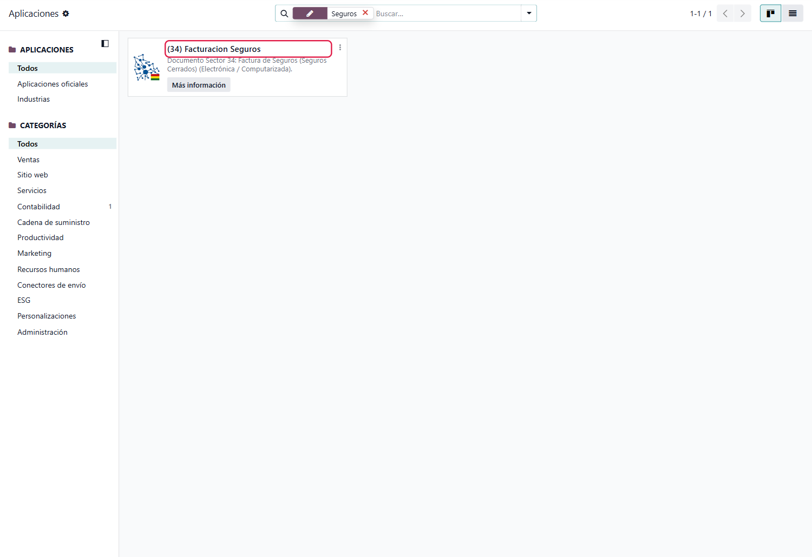
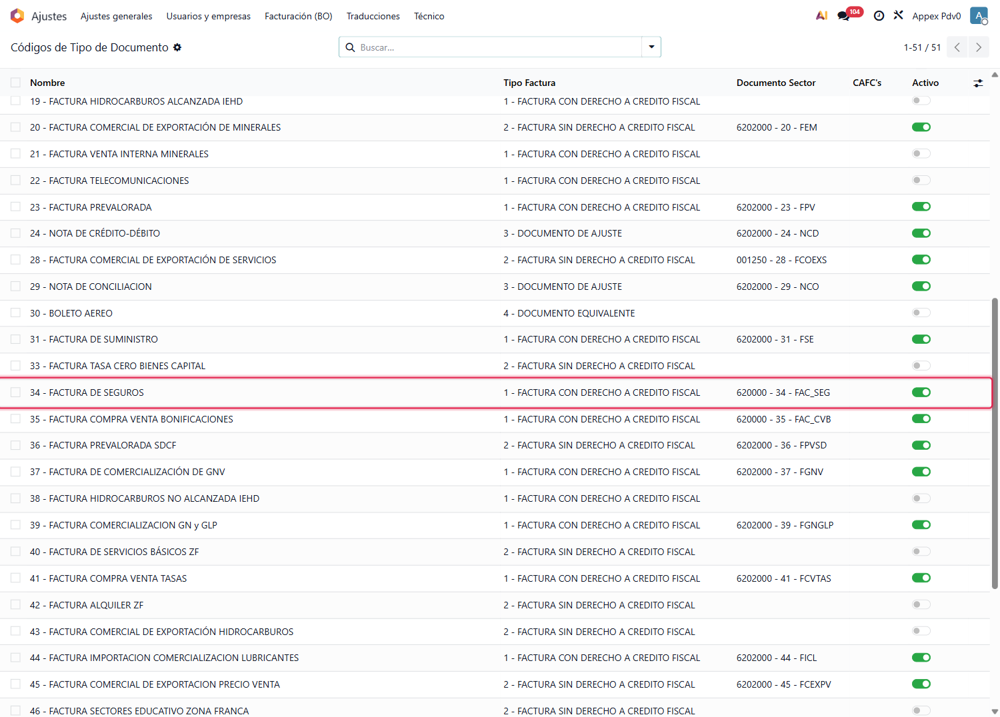
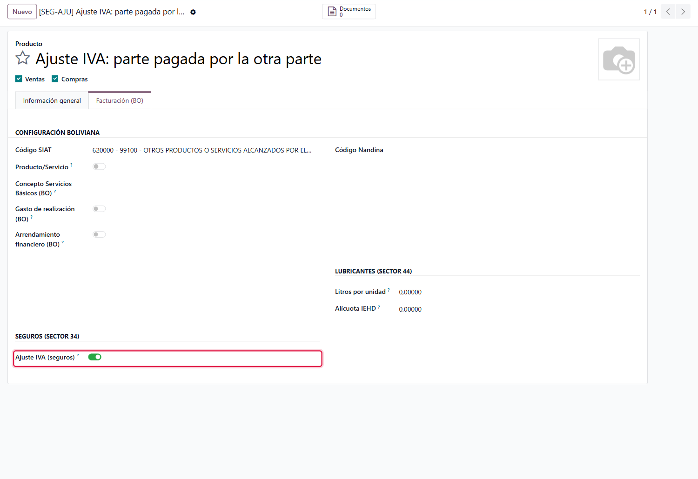
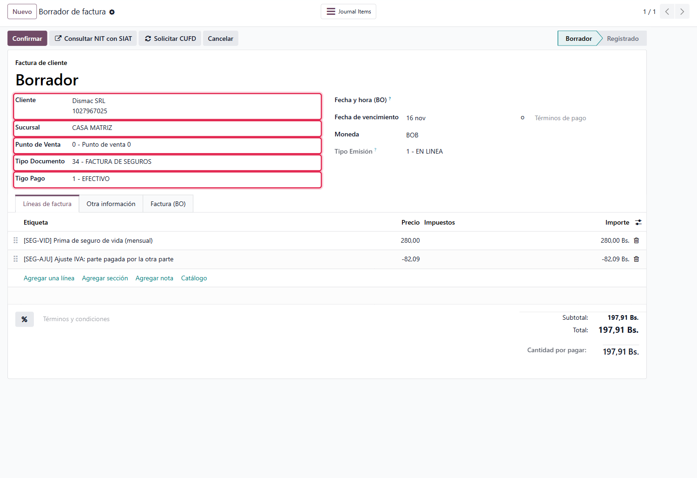
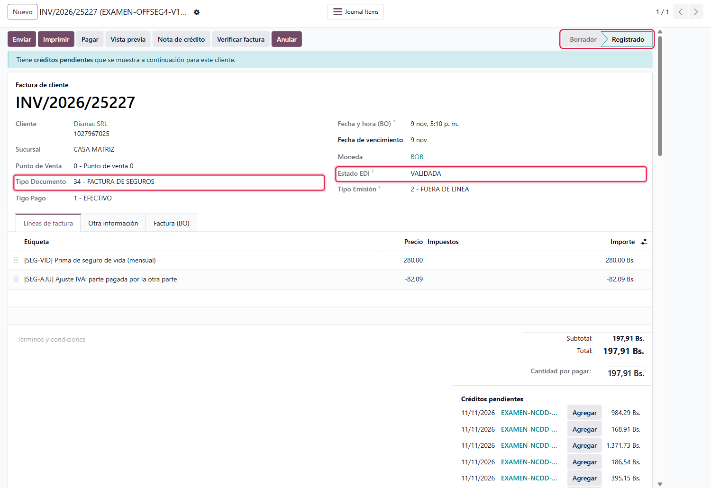
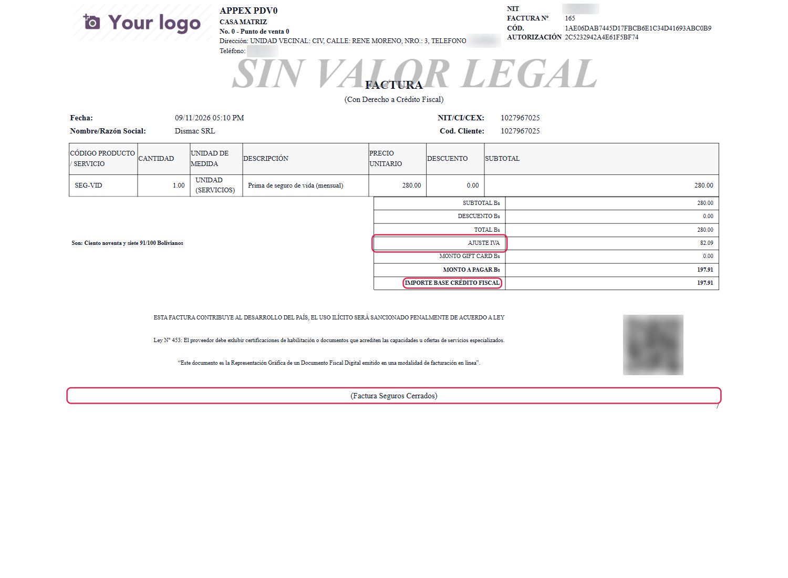

# Factura de seguros

Es la factura de las primas de seguros cerrados: automotor, salud, vida y otros. En Odoo aparece como tipo de documento **34 - FACTURA DE SEGUROS**; ante el SIAT es el documento sector 34. Su particularidad es el **ajuste de afectación del IVA**: cuando una parte de la prima la paga otra persona (la aseguradora o el asegurado), esa parte se informa aparte y **se resta del importe sujeto a IVA**. Queda emitida cuando el SIN la devuelve como **VALIDADA (código 908)**.

## Qué debe estar configurado

Además de la configuración general de la Parte I, la factura de seguros necesita estos cinco puntos:

- **Módulo de seguros activado.** Aplicaciones → buscar «Seguros» → «(34) Facturacion Seguros» → Activar. Si no aparece, primero hay que pulsar Actualizar lista de aplicaciones (sección [Factura de suministro de energía › Qué debe estar configurado](factura-de-suministro-de-energia.md#que-debe-estar-configurado)).

    { width="624" loading="lazy" }

- **Tipo de documento 34 activo y con su documento sector.** Ajustes → Facturación (BO) → Catálogos SIAT → Códigos de Tipo Documento, fila «34 - FACTURA DE SEGUROS»: el interruptor Activo debe estar encendido y el campo Documento Sector completo (por ejemplo, «620000 - 34 - FAC\_SEG»; lo trae la sincronización con el SIN y depende de la actividad económica registrada).

    { width="624" loading="lazy" }

- **Secuencia en el punto de venta.** En la pestaña Secuencias Documentos del punto de venta (sección 3.5 de la Parte I) debe figurar el tipo 34. Si falta, se agrega una línea a mano, como se explica en la sección [Nota de crédito-débito › Qué debe saber antes de emitirla](nota-de-credito-debito.md#que-debe-saber-antes-de-emitirla).

- **Productos con Código SIAT.** En la pestaña Facturación (BO) del producto, con el Código SIAT del catálogo que corresponda a la actividad de la empresa (sección 4.2 de la Parte I). Se crea un producto por cada prima que se cobra (por ejemplo, seguro automotor, de salud o de vida).

- **Un producto de ajuste.** En la ficha del producto, pestaña Facturación (BO), grupo Seguros (sector 34), se activa la casilla **Ajuste IVA (seguros)**. Por ejemplo, «Ajuste IVA: parte pagada por la otra parte», con precio 0.

    { width="624" loading="lazy" }

## Paso a paso: crear y emitir la factura

1. **Abrir una factura nueva:** Contabilidad → Clientes → Facturas → botón Nuevo, y elegir el cliente en el campo Contacto.

1. **Completar la cabecera:** Sucursal, Punto de Venta, Tigo Pago y, en Tipo Documento, **34 - FACTURA DE SEGUROS**. Este documento admite pago con gift card y descuento adicional.

    { width="624" loading="lazy" }

1. **Cargar las primas** en la pestaña Líneas de factura: el seguro, la cantidad y el precio.

1. **Si otra parte paga una porción de la prima, agregar una línea de ajuste** con el producto de ajuste, cantidad 1 y **precio negativo** por el monto que paga la otra parte. Esa línea no aparece en el detalle de la factura: se informa en la cabecera como ajuste de afectación del IVA.

1. **Revisar la pestaña Factura (BO):** la casilla Factura (BO) debe estar marcada y la Leyenda asignada, igual que en la factura de compra-venta (sección [Factura de compra-venta › Paso a paso: crear y emitir la factura](factura-de-compra-venta.md#paso-a-paso-crear-y-emitir-la-factura), paso 7).

1. **Pulsar Confirmar.** Odoo envía la factura al SIN; suele tardar unos segundos, y hasta un minuto si el SIN está lento. Debe quedar en Registrado, con Estado EDI **VALIDADA**.

    { width="624" loading="lazy" }

## Cómo se ve la factura impresa y cómo saber si llegó al SIN

La factura impresa lleva el título **FACTURA** con la leyenda (Con Derecho a Crédito Fiscal) y la aclaración (Factura Seguros Cerrados). El detalle muestra solo las primas. Al pie salen SUBTOTAL Bs, DESCUENTO Bs, TOTAL Bs, **AJUSTE IVA**, MONTO GIFT CARD Bs, MONTO A PAGAR Bs, el total en la moneda de la factura y el **IMPORTE BASE CRÉDITO FISCAL** (el total menos el ajuste y la gift card).

Igual que en la compra-venta (sección [Factura de compra-venta › Cómo saber si la factura llegó al SIN](factura-de-compra-venta.md#como-saber-si-la-factura-llego-al-sin)), la factura está emitida solo si **Estado EDI** dice **VALIDADA**. La factura de seguros tiene su propia numeración por punto de venta (la secuencia 34), separada de la de compra-venta. Por ejemplo, una factura con 3 primas de seguro automotor a 450 Bs, 2 de vida a 280 Bs y 3 de salud a 620 Bs, más un ajuste de 1.181,64 Bs que paga la otra parte. Suma 3.770,00 Bs; el SIN la recibió con ajuste de afectación del IVA 1.181,64 Bs y monto sujeto a IVA 2.588,36 Bs.

Se anula y se revierte igual que las demás facturas (sección 1 de la Parte III), y también se puede emitir fuera de línea (sección 2 de la Parte III).

{ width="624" loading="lazy" }

## Errores frecuentes

Los errores de la sección [Factura de compra-venta › Errores frecuentes y cómo resolverlos](factura-de-compra-venta.md#errores-frecuentes-y-como-resolverlos) también se aplican a la factura de seguros. Además, estos son propios de este documento:

| Lo que ve el usuario | Por qué pasa | Cómo se resuelve |
|---|---|---|
| En Tipo Documento no aparece 34 - FACTURA DE SEGUROS | Falta el módulo, el tipo 34 no está activo o el punto de venta no tiene la secuencia. | Revisar los puntos de la sección [Qué debe estar configurado](#que-debe-estar-configurado). |
| «Nota: La línea de ajuste \[...\] debe ser negativa: es la parte que paga la otra parte.» | La línea con el producto de ajuste tiene precio positivo. | Poner el precio en negativo (por ejemplo, −500). |
| «Nota: El ajuste IVA más la GiftCard no puede superar el monto total de la factura.» | El ajuste y la gift card juntos superan el total de las primas. | Revisar el monto del ajuste o de la gift card. |
| «Nota: La factura de seguros debe tener al menos una línea de servicio.» | La factura solo tiene la línea de ajuste. | Agregar al menos una prima. |
| «Nota: El subtotal de \[producto\] debe ser mayor a cero.» | Una prima tiene precio cero o un descuento igual a su importe. | Corregir el precio o el descuento de esa línea, o quitarla. |
