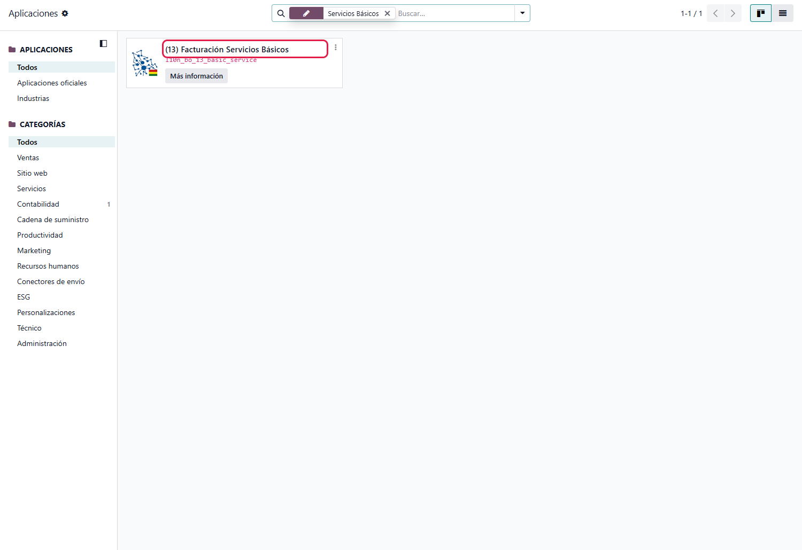
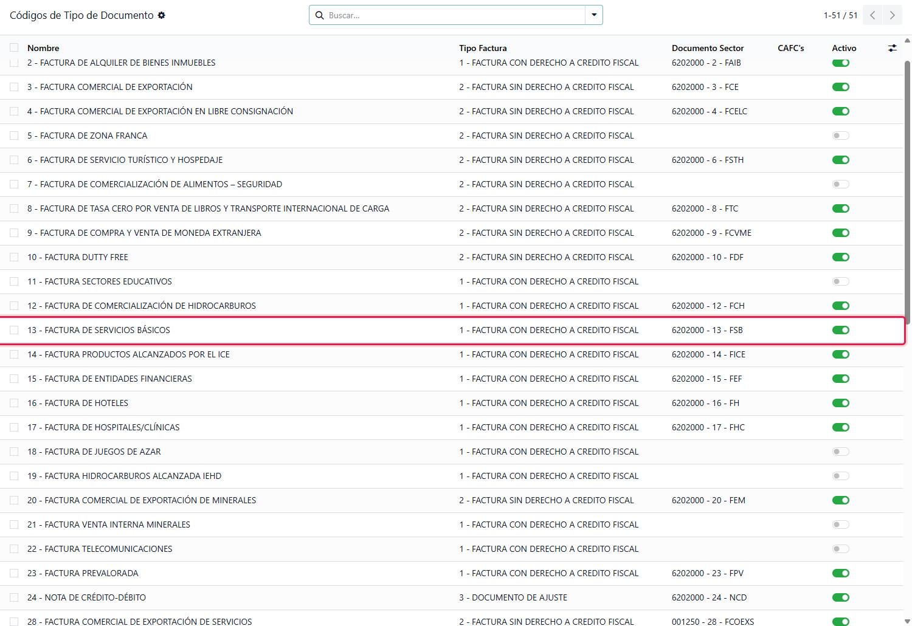
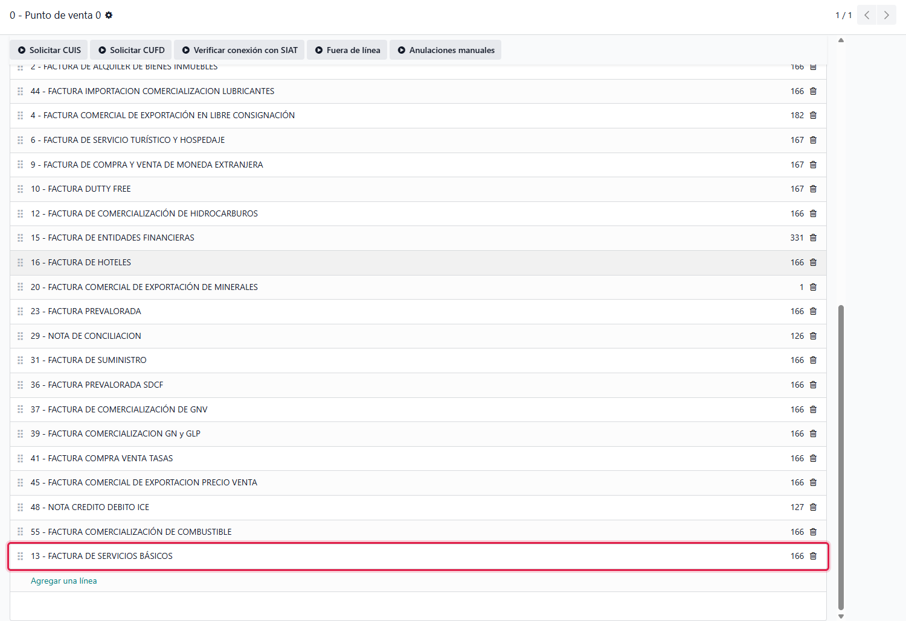
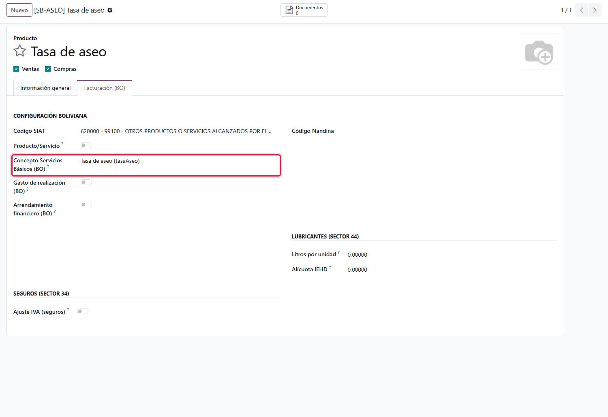
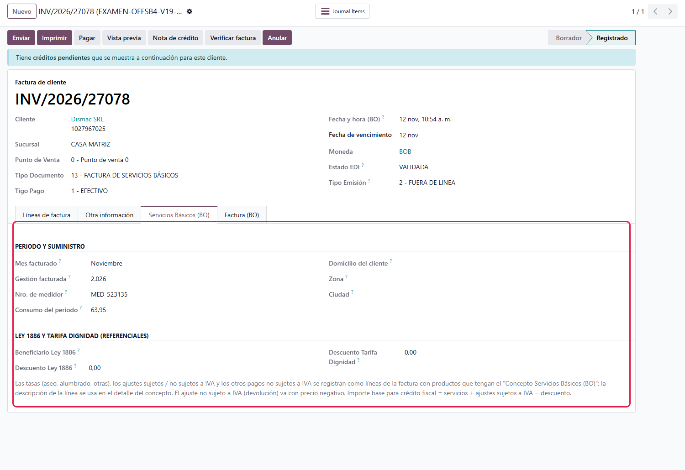
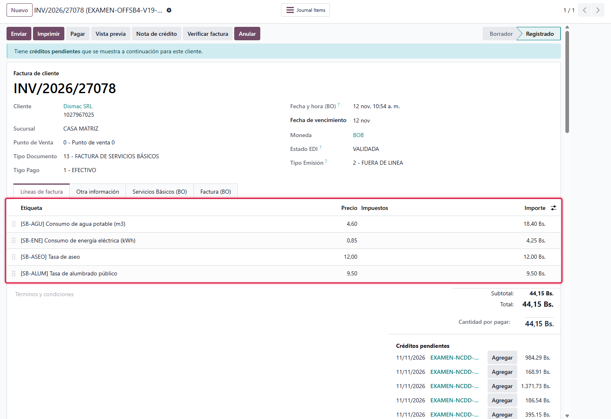
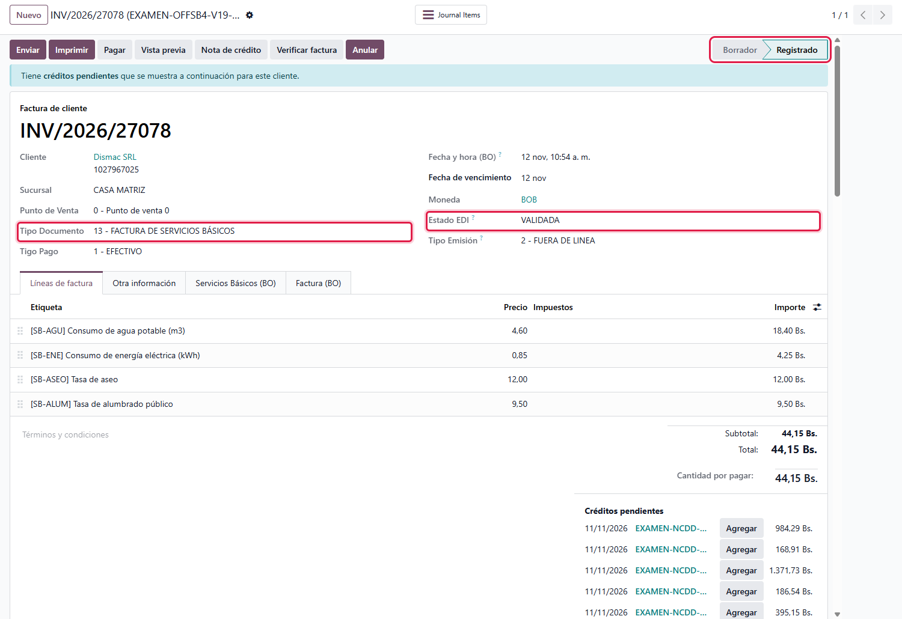
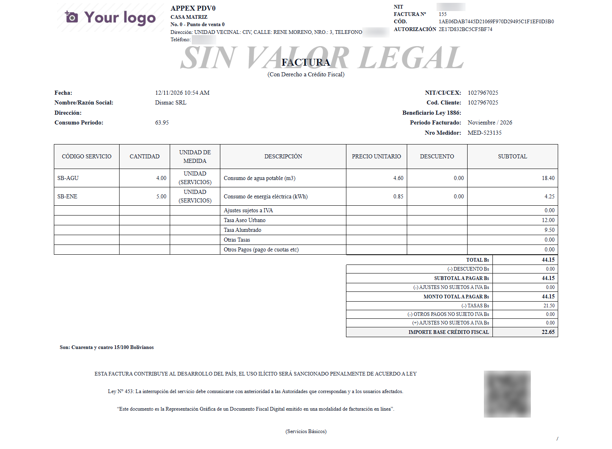

# Factura de servicios básicos

Es la factura que emiten las empresas de servicios básicos (energía eléctrica, agua potable, gas domiciliario y similares) por el consumo de un periodo. En Odoo aparece como tipo de documento **13 - FACTURA DE SERVICIOS BÁSICOS**; ante el SIAT es el documento sector 13 y da derecho a crédito fiscal. Lo que la distingue es que informa el **mes y la gestión facturados** y el **número de medidor**, y que las tasas (aseo, alumbrado público y otras), los ajustes y otros pagos no van en el detalle sino en la cabecera de la factura. Queda emitida cuando el SIN la devuelve como **VALIDADA (código 908)**.

## Qué debe estar configurado

Además de la configuración general de la Parte I, la factura de servicios básicos necesita estos puntos:

- **Módulo activado.** Aplicaciones → buscar «Servicios Básicos» → «(13) Facturación Servicios Básicos» → Activar.

    { width="624" loading="lazy" }

- **Tipo de documento 13 activo y con su documento sector.** Ajustes → Facturación (BO) → Catálogos SIAT → Códigos de Tipo Documento, fila «13 - FACTURA DE SERVICIOS BÁSICOS»: el interruptor Activo debe estar encendido, el campo Documento Sector completo (por ejemplo, «6202000 - 13 - FSB»; depende de la actividad económica registrada en el SIN) y el Tipo de factura en «1 - FACTURA CON DERECHO A CREDITO FISCAL».

    { width="624" loading="lazy" }

- **Secuencia en el punto de venta.** En la pestaña Secuencias Documentos del punto de venta (sección 3.5 de la Parte I) debe figurar el tipo 13. Si falta, se agrega una línea a mano, como se explica en la sección [Nota de crédito-débito › Qué debe saber antes de emitirla](nota-de-credito-debito.md#que-debe-saber-antes-de-emitirla).

    { width="624" loading="lazy" }

- **Productos del servicio con Código SIAT.** Los servicios que se cobran por consumo (por ejemplo, energía eléctrica por kWh o agua potable por m³) son productos de tipo servicio con su Código SIAT en la pestaña Facturación (BO), y con el campo Concepto Servicios Básicos (BO) vacío: esos van en el detalle de la factura.

- **Productos para tasas, ajustes y otros pagos.** Cada tasa o ajuste es un producto con el campo **Concepto Servicios Básicos (BO)** completo, en la pestaña Facturación (BO). Los conceptos son: Ajuste sujeto a IVA, Ajuste no sujeto a IVA (devolución, se carga con precio negativo), Tasa de aseo, Tasa de alumbrado público, Otras tasas y Otro pago no sujeto a IVA. Las líneas con estos productos no van en el detalle: su importe se informa en la cabecera.

    { width="624" loading="lazy" }

Si el cliente tiene siempre el mismo medidor, conviene cargarlo en su ficha (campo **Nro. de medidor (BO)**, junto al Código). Lo mismo con el **Beneficiario Ley 1886 (BO)**, si corresponde.

## La pestaña Servicios Básicos (BO)

Al elegir el tipo de documento 13, la factura muestra la pestaña Servicios Básicos (BO), antes de la pestaña Factura (BO). Sus datos se informan al SIN y salen en la factura impresa:

- **Mes facturado** y **Gestión facturada** (obligatorios): el periodo que se cobra, por ejemplo Noviembre y 2026.

- **Nro. de medidor** (obligatorio): el número del medidor del cliente.

- **Consumo del periodo**: el consumo leído en el medidor, por ejemplo en kWh o m³.

- **Domicilio del cliente**, **Zona** y **Ciudad**: la dirección del suministro.

- **Ley 1886 y Tarifa Dignidad** (referenciales): Beneficiario Ley 1886 (solo números, hasta 14 dígitos), Descuento Ley 1886 y Descuento Tarifa Dignidad.

    { width="624" loading="lazy" }

!!! note "Nota"

    El importe base para crédito fiscal es la suma de los servicios y de los ajustes sujetos a IVA, menos los descuentos. Las tasas y los otros pagos no sujetos a IVA se cobran, pero no forman parte de esa base.

## Paso a paso: crear y emitir la factura

1. **Abrir una factura nueva:** Contabilidad → Clientes → Facturas → botón Nuevo, y elegir el cliente en el campo Contacto.

1. **Completar la cabecera:** Sucursal, Punto de Venta, Tigo Pago (sin gift card) y, en Tipo Documento, **13 - FACTURA DE SERVICIOS BÁSICOS**.

1. **Cargar las líneas** en la pestaña Líneas de factura: primero los servicios, con su cantidad y precio; después, si corresponde, las tasas y los ajustes con sus productos. Un ajuste no sujeto a IVA (devolución) se carga con precio negativo.

    { width="624" loading="lazy" }

1. **Completar la pestaña Servicios Básicos (BO):** Mes facturado, Gestión facturada y Nro. de medidor; y, si se conocen, el consumo y la dirección del suministro (sección [La pestaña Servicios Básicos (BO)](#la-pestana-servicios-basicos-bo)).

1. **Revisar la pestaña Factura (BO)** (sección [Factura de compra-venta › Paso a paso: crear y emitir la factura](factura-de-compra-venta.md#paso-a-paso-crear-y-emitir-la-factura), paso 7) y **pulsar Confirmar.** Debe quedar en Registrado, con Estado EDI **VALIDADA**.

    { width="624" loading="lazy" }

## Cómo se ve la factura impresa y cómo saber si llegó al SIN

La factura impresa lleva el título **FACTURA** con la leyenda (Con Derecho a Crédito Fiscal), el mes y la gestión facturados, el número de medidor y el consumo. En el detalle salen solo los servicios; las tasas y los ajustes salen aparte, en el pie, junto al importe base para crédito fiscal.

Por ejemplo, una factura de noviembre de 2026 con 4 m³ de agua potable a 4,60 Bs y 5 kWh de energía a 0,85 Bs, más una tasa de aseo de 12,00 Bs y una de alumbrado público de 9,50 Bs, suma 44,15 Bs; el importe base para crédito fiscal es 22,65 Bs, porque las tasas no lo integran.

{ width="624" loading="lazy" }

Igual que en la compra-venta (sección [Factura de compra-venta › Cómo saber si la factura llegó al SIN](factura-de-compra-venta.md#como-saber-si-la-factura-llego-al-sin)), la factura está emitida solo si **Estado EDI** dice **VALIDADA**. Tiene su propia numeración por punto de venta (la secuencia 13). Se anula y se revierte igual que las demás facturas (sección 1 de la Parte III), y también se puede emitir fuera de línea (sección 2 de la Parte III).

## Errores frecuentes

Los errores de la sección [Factura de compra-venta › Errores frecuentes y cómo resolverlos](factura-de-compra-venta.md#errores-frecuentes-y-como-resolverlos) también se aplican a esta factura. Además, estos son propios de este documento:

| Lo que ve el usuario | Por qué pasa | Cómo se resuelve |
|---|---|---|
| En Tipo Documento no aparece 13 - FACTURA DE SERVICIOS BÁSICOS | Falta el módulo, el tipo 13 no está activo o el punto de venta no tiene la secuencia. | Revisar los puntos de la sección [Qué debe estar configurado](#que-debe-estar-configurado). |
| «Nota: Debe registrar el número de medidor para la Factura de Servicios Básicos.» | La pestaña Servicios Básicos (BO) quedó sin medidor. | Completar el Nro. de medidor y volver a confirmar. |
| «Nota: Debe seleccionar el mes facturado.» o «La gestión facturada debe estar entre 2015 y 9999.» | Falta el mes o el año del periodo es inválido. | Completar el Mes facturado y la Gestión facturada. |
| «Nota: La Factura de Servicios Básicos debe tener al menos una línea de servicio (producto sin concepto de Servicios Básicos).» | Todas las líneas son tasas o ajustes. | Agregar al menos una línea con un producto de servicio sin concepto. |
| «Nota: \[producto\] es un ajuste no sujeto a IVA (devolución): registre la línea con precio negativo.» | El ajuste no sujeto a IVA se cargó con precio positivo. | Cambiar el precio de esa línea a negativo. |
| «Nota: El beneficiario de la Ley 1886 debe contener sólo dígitos (máximo 14).» | El campo tiene letras, espacios o más de 14 dígitos. | Escribir solo el número. |
| «Nota: El pago con GiftCard no es válido para el documento: \[...\]» | En Tigo Pago se eligió un método con gift card. | Elegir otro Tigo Pago, por ejemplo 1 - EFECTIVO. |
