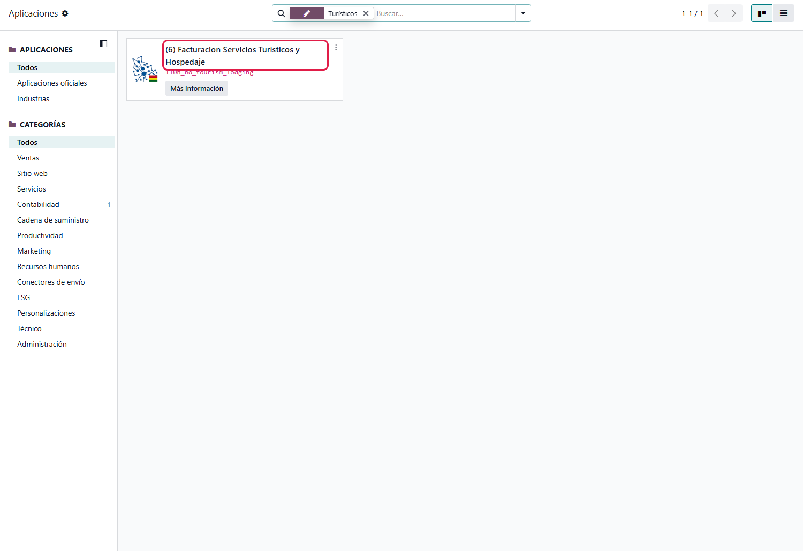
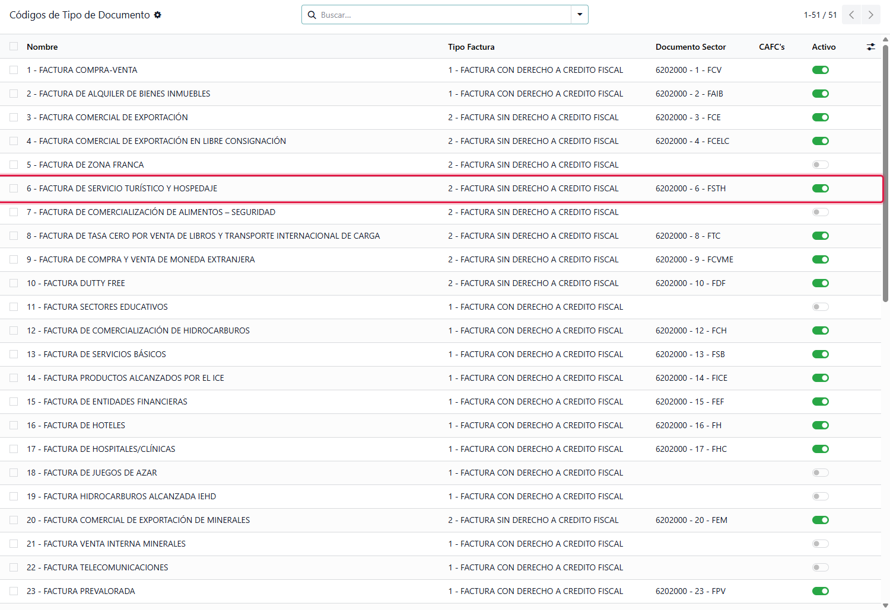
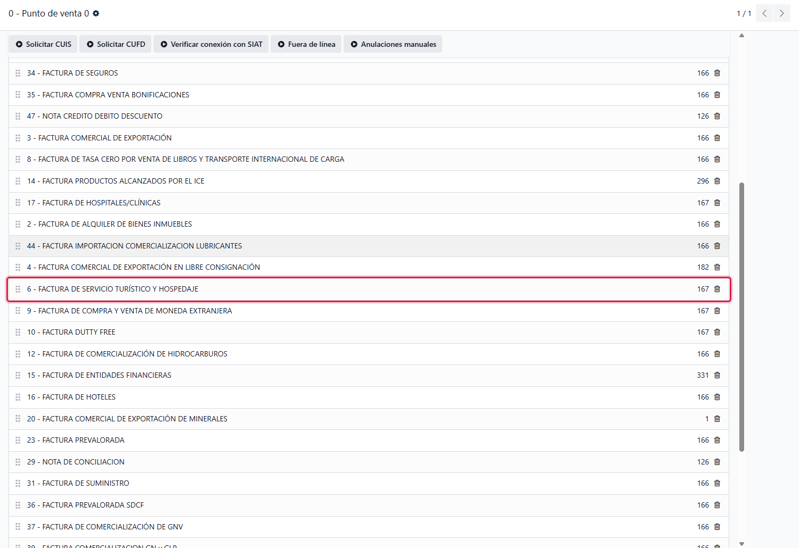
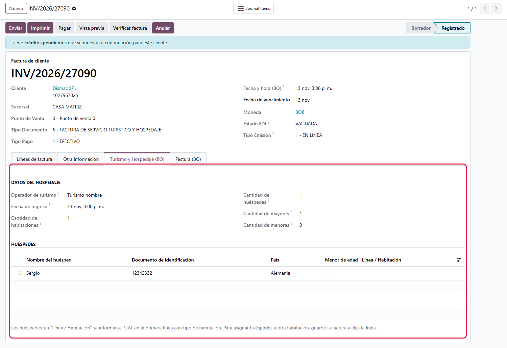
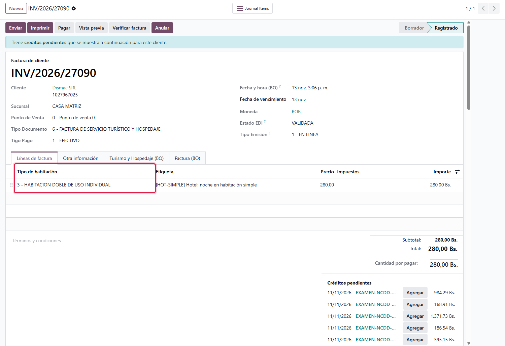
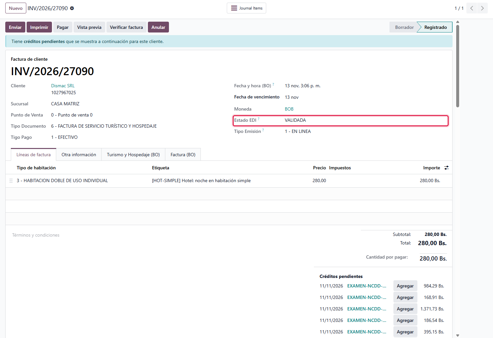
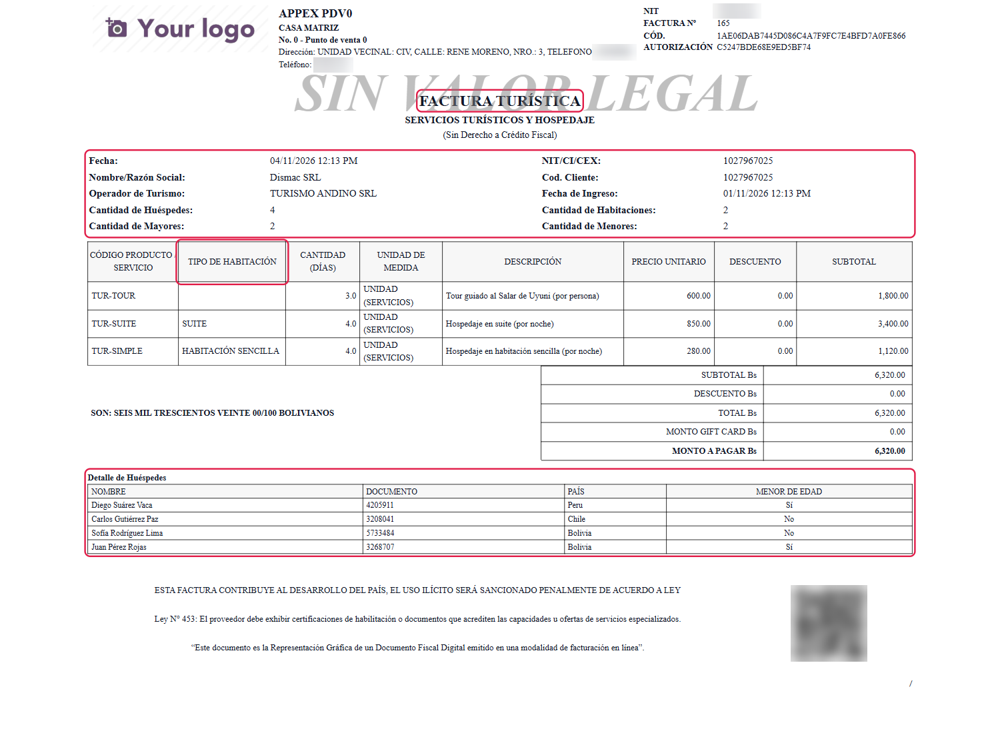

# Factura de servicios turísticos y hospedaje

Es la factura de los servicios turísticos y de hospedaje, que el módulo trata como exportación de servicios (artículo 30 de la Ley N° 292). En Odoo aparece como tipo de documento **6 - FACTURA DE SERVICIO TURÍSTICO Y HOSPEDAJE**; ante el SIAT es el documento sector 6 y **no da derecho a crédito fiscal**: el SIN la recibe con el monto sujeto a IVA en cero. Lo que la distingue son los datos del hospedaje: el operador de turismo, la fecha de ingreso, los huéspedes y el tipo de habitación de cada línea. Queda emitida cuando el SIN la devuelve como **VALIDADA (código 908)**.

## Qué debe estar configurado

Además de la configuración general de la Parte I, la factura turística necesita estos cuatro puntos:

- **Módulo de turismo y hospedaje activado.** Aplicaciones → buscar «Turísticos» → «(6) Facturacion Servicios Turísticos y Hospedaje» → Activar.

    { width="624" height="428" loading="lazy" }

- **Tipo de documento 6 activo y con su documento sector.** Ajustes → Facturación (BO) → Catálogos SIAT → Códigos de Tipo Documento, fila «6 - FACTURA DE SERVICIO TURÍSTICO Y HOSPEDAJE»: el interruptor Activo debe estar encendido y el campo Documento Sector completo (por ejemplo, «6202000 - 6 - FSTH»; depende de la actividad económica registrada en el SIN).

    { width="624" height="428" loading="lazy" }

- **Secuencia en el punto de venta.** En la pestaña Secuencias Documentos del punto de venta (sección 3.5 de la Parte I) debe figurar el tipo 6. Si falta, se agrega una línea a mano, como se explica en la sección [Nota de crédito-débito › Qué debe saber antes de emitirla](nota-de-credito-debito.md#que-debe-saber-antes-de-emitirla).

    { width="624" height="428" loading="lazy" }

- **Servicios con Código SIAT y unidad de medida válida.** En la pestaña Facturación (BO) del producto, con el Código SIAT del catálogo que corresponda a la actividad de la empresa (sección 4.2 de la Parte I). La unidad de medida homologada debe tener un código de 69 o menos (sección 5.1 de la Parte I). Se crea un servicio por cada tipo de hospedaje o tour que se vende (por ejemplo, habitación sencilla, doble o suite por noche).

## La pestaña Turismo y Hospedaje (BO)

Al elegir el tipo de documento 6, la factura muestra la pestaña **Turismo y Hospedaje (BO)**, antes de la pestaña Factura (BO). Odoo no exige ninguno de sus datos, pero conviene completarlos: se informan al SIN y salen en la factura impresa.

- **Operador de turismo:** la razón social del operador, por ejemplo «TURISMO KOLLA».

- **Fecha de ingreso:** la fecha y hora en que el huésped ingresó al hospedaje.

- **Cantidades:** de habitaciones, de huéspedes, de mayores y de menores. Se calculan solas a partir de las líneas y de la tabla de huéspedes, y se pueden modificar; la cantidad de huéspedes debe ser igual a la suma de mayores y menores.

- **Tabla de huéspedes:** nombre, documento de identificación, país, si es menor de edad y, opcionalmente, la línea (habitación) en la que se informa. El país debe tener su País (SIAT) (sección 5.2 de la Parte I). Los huéspedes sin línea se informan en la primera línea que tenga tipo de habitación; para asignarlos a otra, primero se guarda la factura y después se elige la línea.

    { width="624" height="428" loading="lazy" }

## El tipo de habitación en cada línea

Con el tipo de documento 6, las líneas de la factura muestran la columna **Tipo de habitación**, junto al producto. Se elige del catálogo del SIAT, que tiene 16 tipos: de habitación sencilla y doble hasta suite, cabaña, departamento y dormitorios. La cantidad de la línea se imprime como cantidad de días.

Una línea sin tipo de habitación también es válida, por ejemplo un tour. La cantidad de habitaciones de la pestaña es la cantidad de líneas que tienen tipo de habitación.

{ width="624" height="428" loading="lazy" }

## Paso a paso: crear y emitir la factura

1. **Abrir una factura nueva:** Contabilidad → Clientes → Facturas → botón Nuevo, y elegir el cliente en el campo Contacto.

1. **Completar la cabecera:** Sucursal, Punto de Venta, Tigo Pago y, en Tipo Documento, **6 - FACTURA DE SERVICIO TURÍSTICO Y HOSPEDAJE**.

1. **Cargar las líneas** en la pestaña Líneas de factura: el servicio, el tipo de habitación si corresponde, la cantidad de noches y el precio (sección [El tipo de habitación en cada línea](#el-tipo-de-habitacion-en-cada-linea)).

1. **Completar la pestaña Turismo y Hospedaje (BO):** operador de turismo, fecha de ingreso y huéspedes (sección [La pestaña Turismo y Hospedaje (BO)](#la-pestana-turismo-y-hospedaje-bo)).

1. **Revisar la pestaña Factura (BO):** la casilla Factura (BO) debe estar marcada y la Leyenda asignada, igual que en la factura de compra-venta (sección [Factura de compra-venta › Paso a paso: crear y emitir la factura](factura-de-compra-venta.md#paso-a-paso-crear-y-emitir-la-factura), paso 7).

1. **Pulsar Confirmar.** Odoo envía la factura al SIN; suele tardar unos segundos, y hasta un minuto si el SIN está lento. Debe quedar en Registrado, con Estado EDI **VALIDADA**.

    { width="624" height="428" loading="lazy" }

## Cómo se ve la factura impresa y cómo saber si llegó al SIN

La factura impresa tiene el mismo encabezado que la de compra-venta (sección [Factura de compra-venta › Cómo se ve la factura impresa](factura-de-compra-venta.md#como-se-ve-la-factura-impresa)) y el título **FACTURA TURÍSTICA**, con el subtítulo SERVICIOS TURÍSTICOS Y HOSPEDAJE y la leyenda (Sin Derecho a Crédito Fiscal). Debajo de los datos del cliente salen el operador de turismo, la fecha de ingreso y las cantidades de huéspedes, habitaciones, mayores y menores. El detalle agrega la columna TIPO DE HABITACIÓN, y la cantidad se titula CANTIDAD (DÍAS). Al pie salen el subtotal, el descuento, el total, el monto gift card y el monto a pagar, y debajo la tabla Detalle de Huéspedes con el nombre, el documento, el país y si es menor de edad.

Igual que en la compra-venta (sección [Factura de compra-venta › Cómo saber si la factura llegó al SIN](factura-de-compra-venta.md#como-saber-si-la-factura-llego-al-sin)), la factura está emitida solo si **Estado EDI** dice **VALIDADA**. La factura turística tiene su propia numeración por punto de venta (la secuencia 6), separada de la de compra-venta. Por ejemplo, una factura que suma 2.960,00 Bs, con el operador TURISMO ANDINO SRL, una habitación sencilla y 3 huéspedes (2 mayores y 1 menor, de Bolivia, Argentina y Brasil). El SIN la recibió con monto sujeto a IVA 0.

Se anula y se revierte igual que las demás facturas (sección 1 de la Parte III), y también se puede emitir fuera de línea (sección 2 de la Parte III).

{ width="624" height="458" loading="lazy" }

## Errores frecuentes

Los errores de la sección [Factura de compra-venta › Errores frecuentes y cómo resolverlos](factura-de-compra-venta.md#errores-frecuentes-y-como-resolverlos) también se aplican a la factura turística. Además, estos son propios de este documento:

| Lo que ve el usuario | Por qué pasa | Cómo se resuelve |
|---|---|---|
| «Nota: La cantidad de huéspedes debe ser igual a la suma de mayores y menores.» | Se modificaron a mano las cantidades de la pestaña Turismo y Hospedaje (BO) y no cuadran. | Corregir las cantidades o volver a cargar la tabla de huéspedes para que se calculen solas. |
| «Nota: La unidad de medida del producto \[producto\] (código …) no es válida para este sector (máximo 69).» | La unidad de medida del servicio está homologada con un código mayor a 69. | Usar una unidad con código de 69 o menos (sección 5.1 de la Parte I) y volver a confirmar. |
| «Nota: El detalle de huéspedes de \[producto\] supera los 5000 caracteres permitidos por el SIAT. Distribuya los huéspedes en más líneas.» | Hay demasiados huéspedes informados en una sola línea. | Asignar parte de los huéspedes a otras líneas con la columna Línea / Habitación (sección [La pestaña Turismo y Hospedaje (BO)](#la-pestana-turismo-y-hospedaje-bo)). |
| El país del huésped no aparece en la tabla de huéspedes | Ese país no tiene cargado su País (SIAT). | Homologar el país (sección 5.2 de la Parte I) y volver a elegirlo. |
| En Tipo Documento no aparece 6 - FACTURA DE SERVICIO TURÍSTICO Y HOSPEDAJE | Falta el módulo, el tipo 6 no está activo o el punto de venta no tiene la secuencia. | Revisar los puntos de la sección [Qué debe estar configurado](#que-debe-estar-configurado). |
