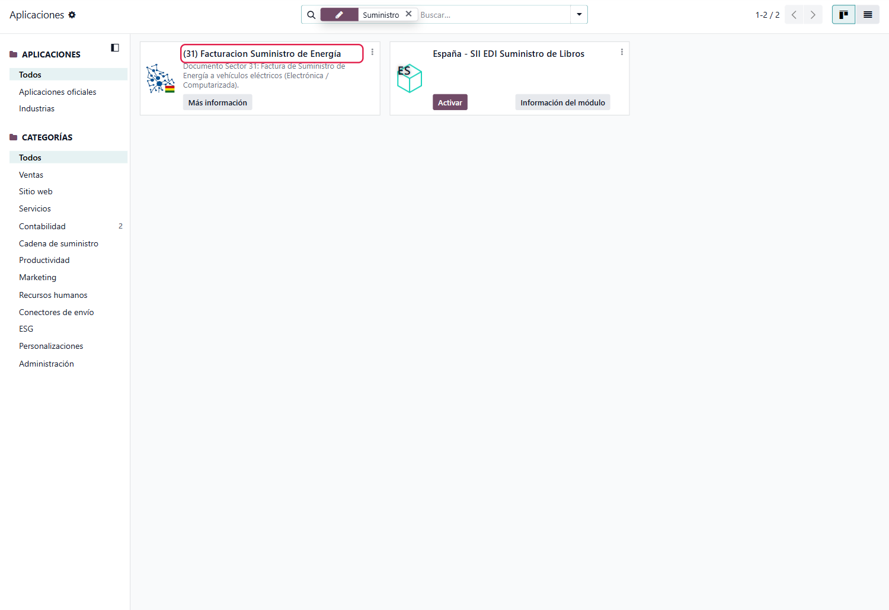
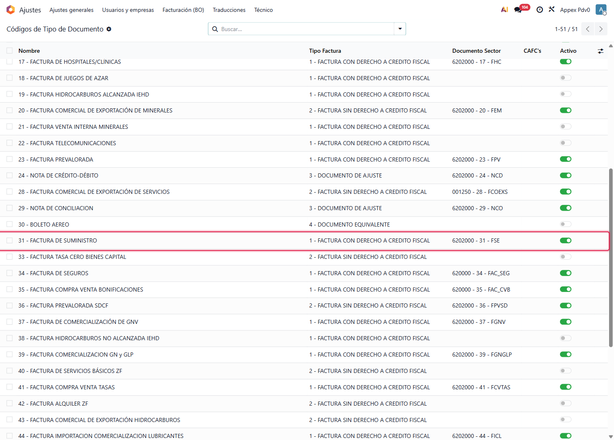
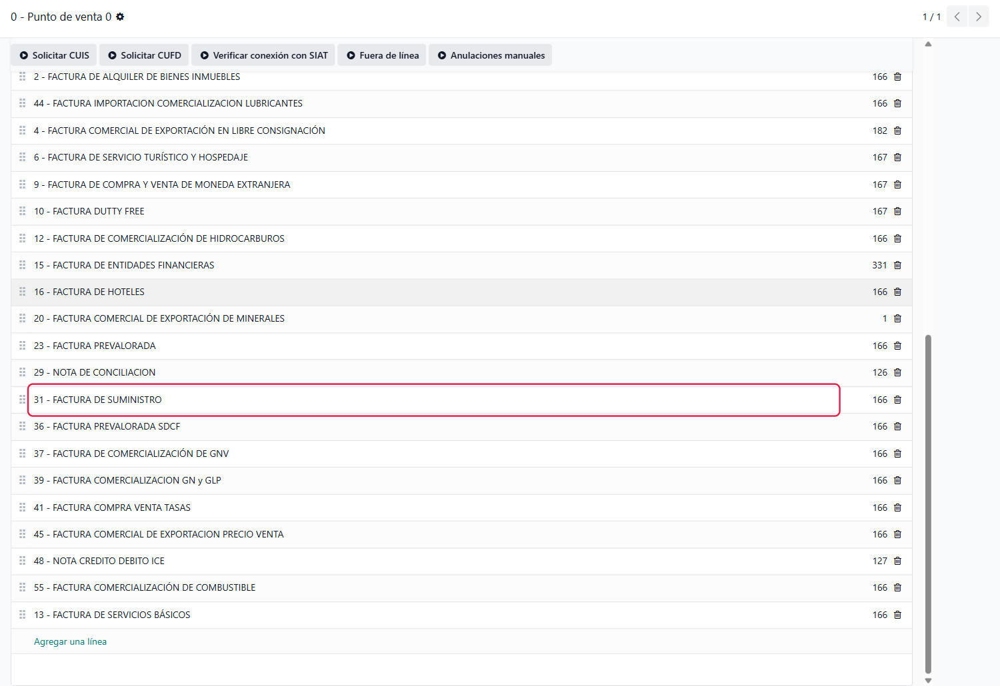
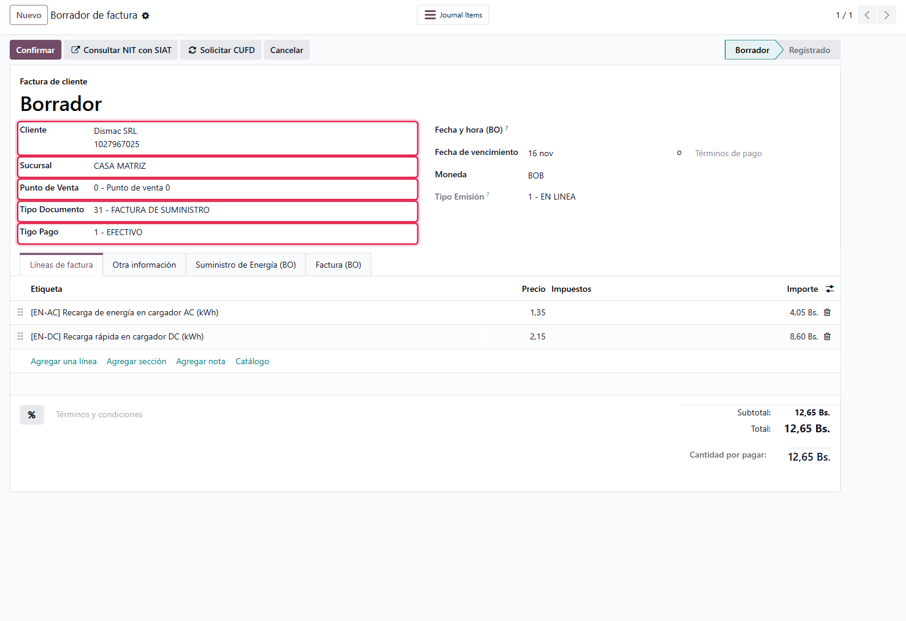
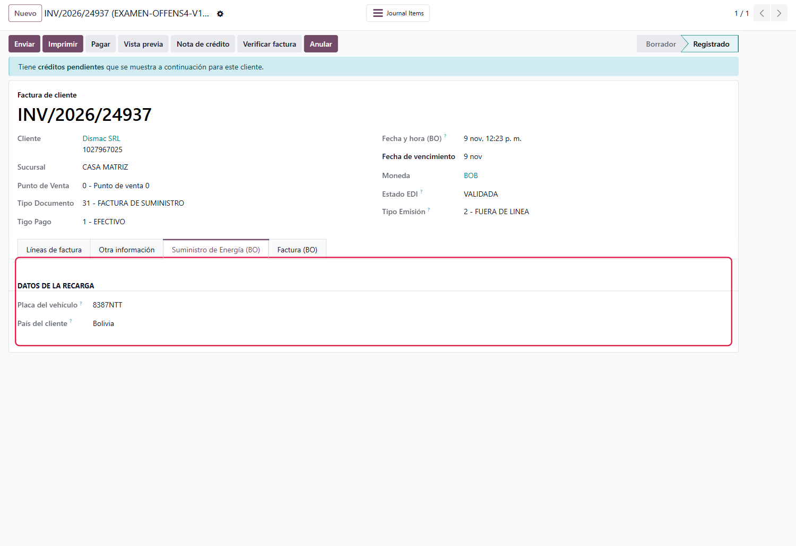
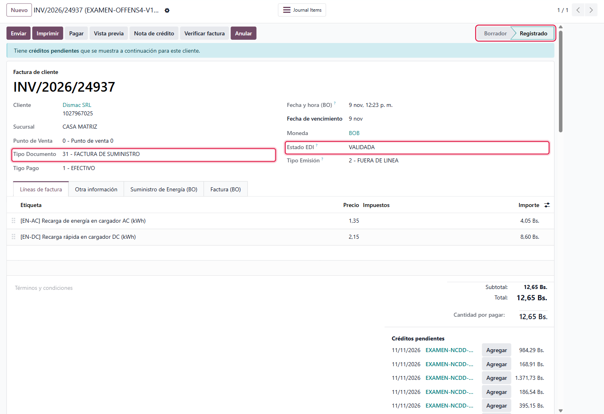
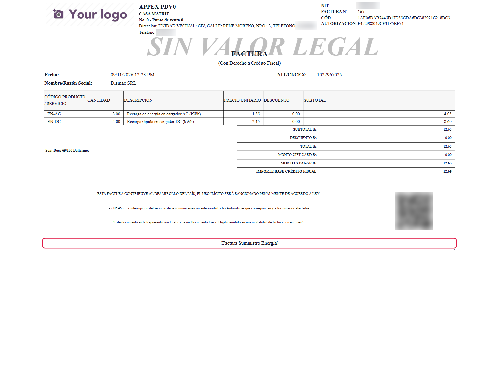

# Factura de suministro de energía

Es la factura de la recarga de energía eléctrica a vehículos eléctricos en electrolineras. En Odoo aparece como tipo de documento **31 - FACTURA DE SUMINISTRO**; ante el SIAT es el documento sector 31. Se parece a la factura de hidrocarburos (sección [Factura de comercialización de hidrocarburos](factura-de-comercializacion-de-hidrocarburos.md)): **la placa del vehículo es obligatoria** y el país del cliente es opcional. A diferencia de aquella, el crédito fiscal es sobre el total (menos la gift card, si la hay) y **el detalle admite hasta 4 decimales** en la cantidad, el precio y el subtotal, porque la energía se cobra por kWh. Queda emitida cuando el SIN la devuelve como **VALIDADA (código 908)**.

## Qué debe estar configurado

Además de la configuración general de la Parte I, la factura de suministro de energía necesita estos cuatro puntos:

- **Módulo de suministro de energía activado.** Aplicaciones → buscar «Suministro» → «(31) Facturacion Suministro de Energía» → Activar. Si el módulo no aparece aunque esté en el código, primero hay que pulsar Actualizar lista de aplicaciones (en el menú de Aplicaciones, con el modo desarrollador activo).

    { width="624" loading="lazy" }

- **Tipo de documento 31 activo y con su documento sector.** Ajustes → Facturación (BO) → Catálogos SIAT → Códigos de Tipo Documento, fila «31 - FACTURA DE SUMINISTRO»: el interruptor Activo debe estar encendido y el campo Documento Sector completo (por ejemplo, «6202000 - 31 - FSE»; depende de la actividad económica registrada en el SIN).

    { width="624" loading="lazy" }

- **Secuencia en el punto de venta.** En la pestaña Secuencias Documentos del punto de venta (sección 3.5 de la Parte I) debe figurar el tipo 31. Si falta, se agrega una línea a mano, como se explica en la sección [Nota de crédito-débito › Qué debe saber antes de emitirla](nota-de-credito-debito.md#que-debe-saber-antes-de-emitirla).

    { width="624" loading="lazy" }

- **Productos con Código SIAT.** En la pestaña Facturación (BO) del producto, con el Código SIAT del catálogo que corresponda a la actividad de la empresa (sección 4.2 de la Parte I). El precio por kWh admite hasta 4 decimales (por ejemplo, 0,9875 Bs).

## Paso a paso: crear y emitir la factura

1. **Abrir una factura nueva:** Contabilidad → Clientes → Facturas → botón Nuevo, y elegir el cliente en el campo Contacto.

1. **Completar la cabecera:** Sucursal, Punto de Venta, Tigo Pago y, en Tipo Documento, **31 - FACTURA DE SUMINISTRO**. Este documento admite pago con gift card y descuento adicional.

    { width="624" loading="lazy" }

1. **Cargar las líneas** en la pestaña Líneas de factura: la recarga, la cantidad de kWh y el precio por kWh (hasta 4 decimales).

1. **Completar la pestaña Suministro de Energía (BO),** grupo Datos de la Recarga: la **Placa del vehículo** (obligatoria, hasta 12 caracteres; Odoo la pasa a mayúsculas) y, si se quiere, el País del cliente (se propone desde el cliente).

    { width="624" loading="lazy" }

1. **Revisar la pestaña Factura (BO):** la casilla Factura (BO) debe estar marcada y la Leyenda asignada, igual que en la factura de compra-venta (sección [Factura de compra-venta › Paso a paso: crear y emitir la factura](factura-de-compra-venta.md#paso-a-paso-crear-y-emitir-la-factura), paso 7).

1. **Pulsar Confirmar.** Odoo envía la factura al SIN; suele tardar unos segundos, y hasta un minuto si el SIN está lento. Debe quedar en Registrado, con Estado EDI **VALIDADA**.

    { width="624" loading="lazy" }

## Cómo se ve la factura impresa y cómo saber si llegó al SIN

La factura impresa lleva el título **FACTURA** con la leyenda (Con Derecho a Crédito Fiscal) y la aclaración (Factura Suministro Energía). Al pie salen el subtotal, el descuento, el total, el monto gift card, el monto a pagar y el importe base de crédito fiscal. **La placa no se imprime**: viaja solo en el XML que recibe el SIN.

Igual que en la compra-venta (sección [Factura de compra-venta › Cómo saber si la factura llegó al SIN](factura-de-compra-venta.md#como-saber-si-la-factura-llego-al-sin)), la factura está emitida solo si **Estado EDI** dice **VALIDADA**. La factura de suministro de energía tiene su propia numeración por punto de venta (la secuencia 31), separada de la de compra-venta. Por ejemplo, una factura con 17 kWh de recarga nocturna a 0,9875 Bs, para el vehículo de placa 3674MYW. El SIN la recibió con subtotal 16,7875 (4 decimales), monto total 16,79 Bs y monto sujeto a IVA 16,79 Bs.

Se anula y se revierte igual que las demás facturas (sección 1 de la Parte III), y también se puede emitir fuera de línea (sección 2 de la Parte III).

{ width="624" loading="lazy" }

## Errores frecuentes

Los errores de la sección [Factura de compra-venta › Errores frecuentes y cómo resolverlos](factura-de-compra-venta.md#errores-frecuentes-y-como-resolverlos) también se aplican a la factura de suministro de energía. Además, estos son propios de este documento:

| Lo que ve el usuario | Por qué pasa | Cómo se resuelve |
|---|---|---|
| En Tipo Documento no aparece 31 - FACTURA DE SUMINISTRO | Falta el módulo, el tipo 31 no está activo o el punto de venta no tiene la secuencia. | Revisar los puntos de la sección [Qué debe estar configurado](#que-debe-estar-configurado). |
| El módulo «(31) Facturacion Suministro de Energía» no aparece en Aplicaciones | La lista de aplicaciones no se actualizó después de subir el módulo. | Pulsar Actualizar lista de aplicaciones y volver a buscarlo. |
| «Nota: Debe registrar la Placa del vehículo para la Factura de Suministro de Energía.» | La pestaña Suministro de Energía (BO) quedó sin placa. | Completar la Placa del vehículo y volver a confirmar. |
| «Nota: La Placa del vehículo no puede superar los 12 caracteres.» | La placa tiene más de 12 caracteres (a veces por espacios o guiones de más). | Escribir la placa sin espacios ni guiones. |
| «Nota: El monto GiftCard no puede ser mayor al monto total de la factura.» | La gift card cubre más que el total de la factura. | Ajustar el monto de la gift card al total o menos. |
| «Nota: El subtotal de \[producto\] debe ser mayor a cero.» | Una línea tiene precio cero o un descuento igual a su importe. | Corregir el precio o el descuento de esa línea, o quitarla. |
