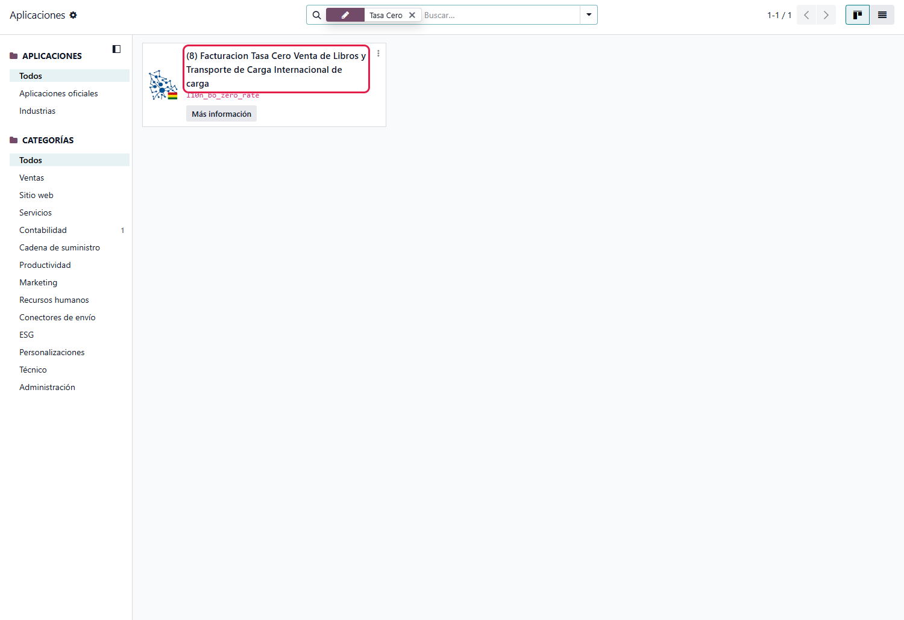
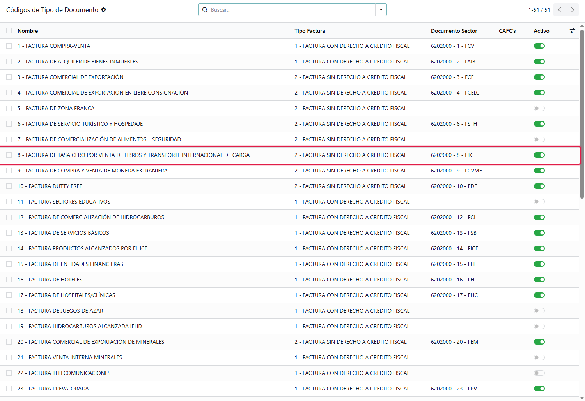
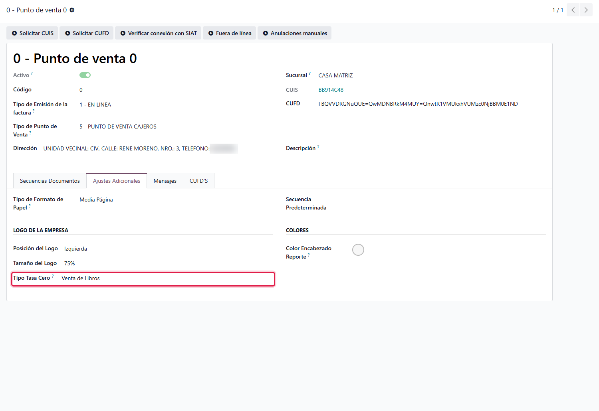
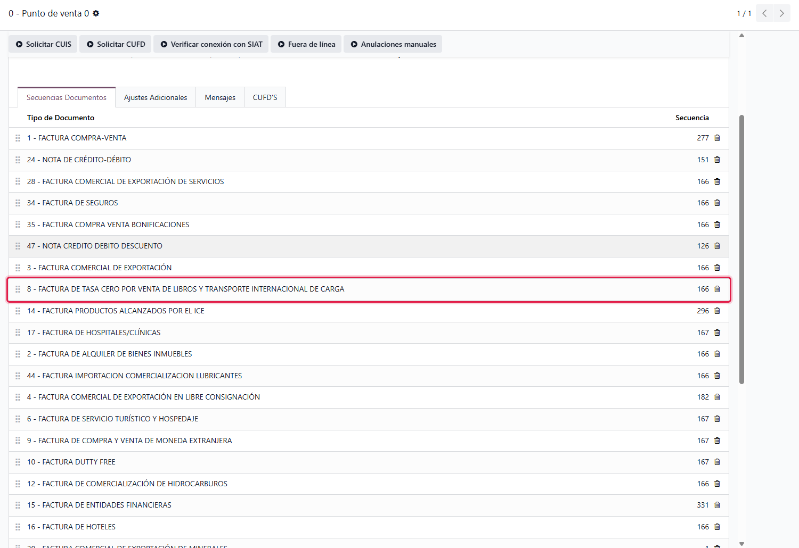
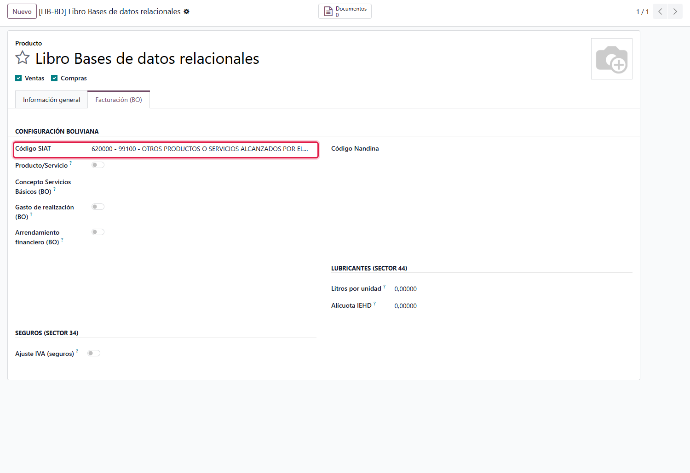
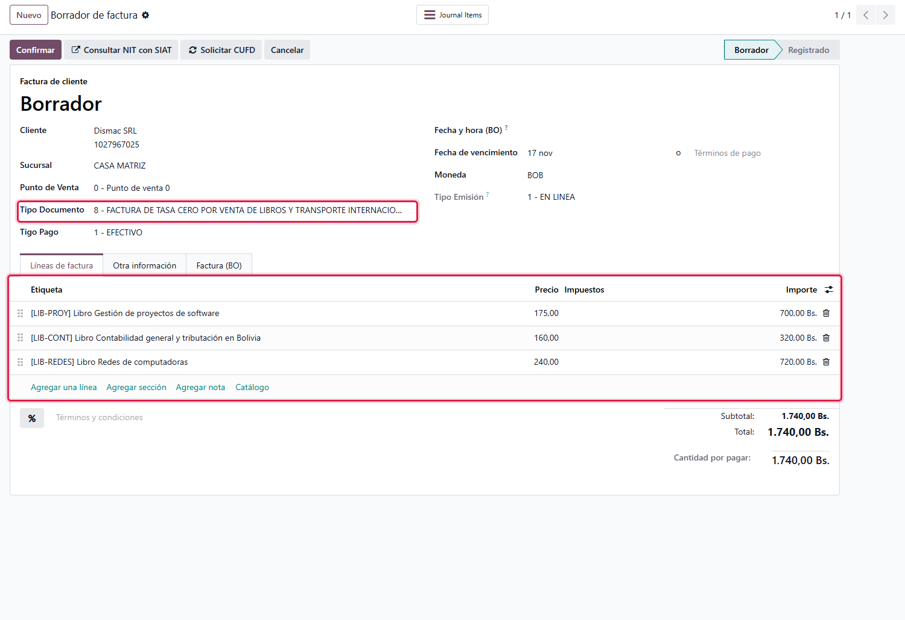
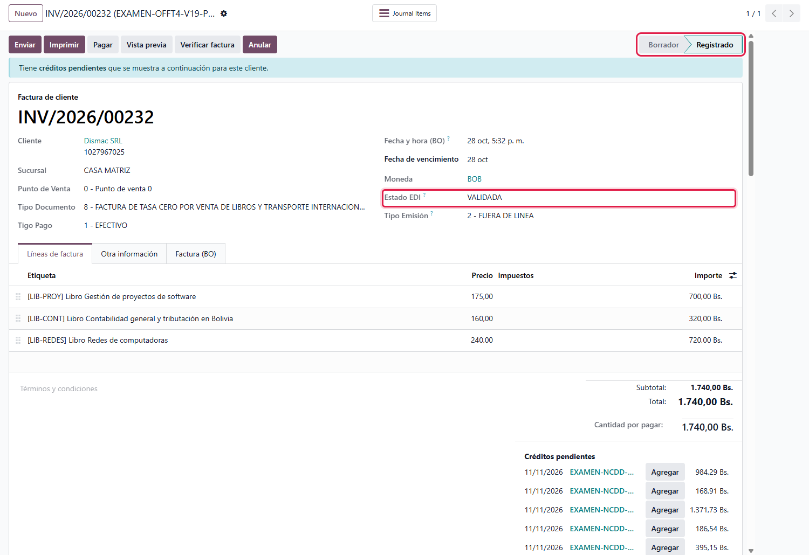
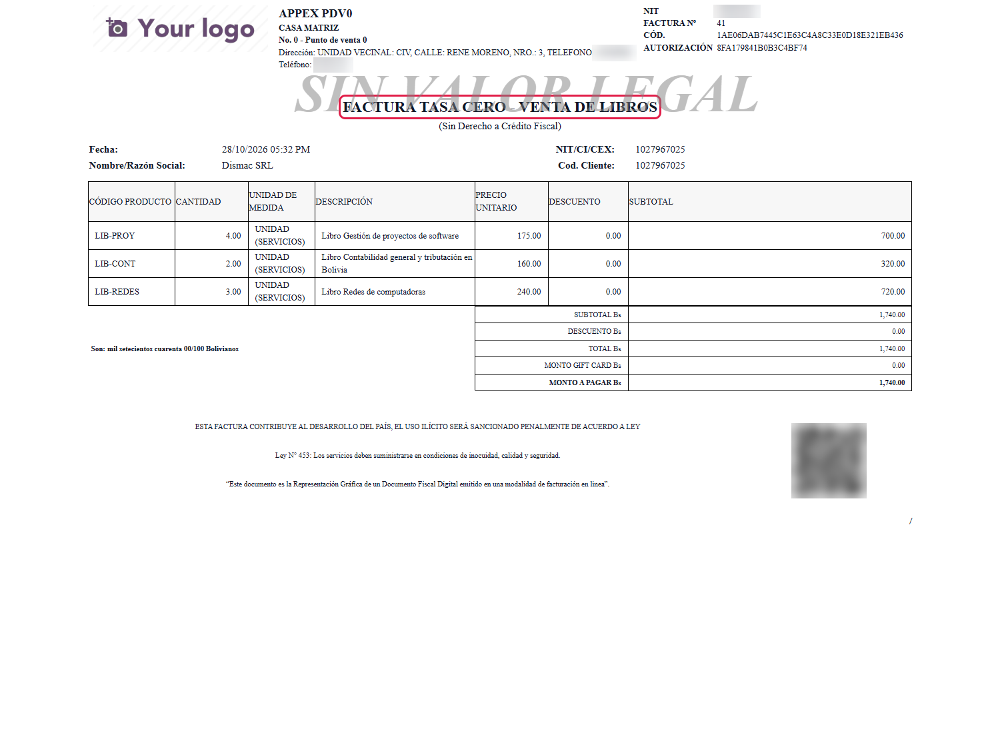

# Factura de tasa cero (libros y transporte internacional de carga)

Es la factura que se emite por las ventas con tasa cero de IVA: la venta de libros y el servicio de transporte internacional de carga. En Odoo aparece como tipo de documento `8 - FACTURA DE TASA CERO POR VENTA DE LIBROS Y TRANSPORTE INTERNACIONAL DE CARGA`; ante el SIAT es el documento sector 8 y **no da derecho a crédito fiscal**. No lleva IVA: el SIN la recibe con el monto sujeto a IVA en cero. Queda emitida cuando el SIN la devuelve como **`VALIDADA` (código `908`)**.

## Qué debe estar configurado

Además de la configuración general de la Parte I, la factura de tasa cero necesita estos cinco puntos:

- **Módulo de tasa cero activado.** Aplicaciones → buscar «Tasa Cero» → «(8) Facturacion Tasa Cero Venta de Libros y Transporte de Carga Internacional de carga» → Activar.

    { width="624" height="428" loading="lazy" }

- **Tipo de documento 8 activo y con su documento sector.** Ajustes → Facturación (BO) → Catálogos SIAT → Códigos de Tipo Documento, fila `8 - FACTURA DE TASA CERO POR VENTA DE LIBROS Y TRANSPORTE INTERNACIONAL DE CARGA`: el interruptor Activo debe estar encendido y el campo Documento Sector completo (por ejemplo, `6202000 - 8 - FTC`; depende de la actividad económica registrada en el SIN).

    { width="624" height="428" loading="lazy" }

- **Secuencia en el punto de venta.** En la pestaña Secuencias Documentos del punto de venta (sección 3.5 de la Parte I) debe figurar el tipo 8. Si falta, se agrega una línea a mano, como se explica en la sección [Nota de crédito-débito › Qué debe saber antes de emitirla](nota-de-credito-debito.md#que-debe-saber-antes-de-emitirla).

    { width="624" height="428" loading="lazy" }

- **Tipo Tasa Cero en el punto de venta.** Ajustes → Facturación (BO) → Compañia → Puntos de Venta → abrir el punto de venta → pestaña Ajustes Adicionales → campo Tipo Tasa Cero: «Venta de Libros» para bienes o «Transporte de Carga Internacional» para servicios. Es el único campo que agrega el módulo y define el título de la factura impresa (sección [Cómo se ve la factura impresa](#como-se-ve-la-factura-impresa)).

    { width="624" height="428" loading="lazy" }

- **Productos con Código SIAT y sin IVA. En la pestaña Facturación (BO) del producto, con el Código SIAT del catálogo que corresponda a la actividad de la empresa (sección 4.2 de la Parte I). El campo Impuestos de venta debe quedar** vacío, porque la tasa cero no lleva IVA.

    { width="624" height="428" loading="lazy" }

## Paso a paso: crear y emitir la factura

1. **Abrir una factura nueva:** Contabilidad → Clientes → Facturas → botón Nuevo, y elegir el cliente en el campo Contacto.

1. **Completar la cabecera:** Sucursal, Punto de Venta (uno que tenga cargado el Tipo Tasa Cero), Tigo Pago y, en Tipo Documento, `8 - FACTURA DE TASA CERO POR VENTA DE LIBROS Y TRANSPORTE INTERNACIONAL DE CARGA`.

1. **Cargar las líneas** en la pestaña Líneas de factura: los libros o el servicio de transporte, con su cantidad y precio, sin impuestos.

    { width="624" height="428" loading="lazy" }

1. **Revisar la pestaña Factura (BO):** la casilla Factura (BO) debe estar marcada y la Leyenda asignada, igual que en la factura de compra-venta (sección [Factura de compra-venta › Paso a paso: crear y emitir la factura](factura-de-compra-venta.md#paso-a-paso-crear-y-emitir-la-factura), paso 7).

1. **Pulsar Confirmar.** Odoo envía la factura al SIN; suele tardar unos segundos, y hasta un minuto si el SIN está lento. Debe quedar en Registrado, con Estado EDI `VALIDADA`.

    { width="624" height="428" loading="lazy" }

## Cómo se ve la factura impresa

Tiene el mismo encabezado y el mismo detalle que la de compra-venta (sección [Factura de compra-venta › Cómo se ve la factura impresa](factura-de-compra-venta.md#como-se-ve-la-factura-impresa)). Lo que cambia es el título: dice **FACTURA TASA CERO - VENTA DE LIBROS** y, debajo, **(Sin Derecho a Crédito Fiscal)**. La segunda parte del título sale del campo Tipo Tasa Cero del punto de venta; si el campo está vacío, el título queda incompleto: `FACTURA TASA CERO -`.

{ width="624" height="458" loading="lazy" }

## Cómo saber si llegó al SIN

Igual que en la compra-venta (sección [Factura de compra-venta › Cómo saber si la factura llegó al SIN](factura-de-compra-venta.md#como-saber-si-la-factura-llego-al-sin)), la factura está emitida solo si **Estado EDI** dice `VALIDADA`. La factura de tasa cero tiene su propia numeración por punto de venta (la secuencia 8), separada de la de compra-venta.

**El monto sujeto a IVA es cero.** El total es el mismo en Odoo y en el SIN, pero el SIN lo registra sin IVA. Por ejemplo, una factura con 13 libros a 220 Bs y 3 a 160 Bs suma 3.340,00 Bs, con monto sujeto a IVA de 0.

## Errores frecuentes

Los errores de la sección [Factura de compra-venta › Errores frecuentes y cómo resolverlos](factura-de-compra-venta.md#errores-frecuentes-y-como-resolverlos) también se aplican a la factura de tasa cero. Además, estos son propios de este documento:

| Lo que ve el usuario | Por qué pasa | Cómo se resuelve |
|---|---|---|
| En Tipo Documento no aparece `8 - FACTURA DE TASA CERO` … | Falta el módulo de tasa cero, el tipo 8 no está activo o el punto de venta no tiene la secuencia. | Revisar los puntos de la sección [Qué debe estar configurado](#que-debe-estar-configurado). |
| La factura impresa dice solo `FACTURA TASA CERO -`, sin VENTA DE LIBROS ni TRANSPORTE | El punto de venta no tiene cargado el Tipo Tasa Cero. | Completar el campo Tipo Tasa Cero en la pestaña Ajustes Adicionales del punto de venta (sección [Qué debe estar configurado](#que-debe-estar-configurado)). |
