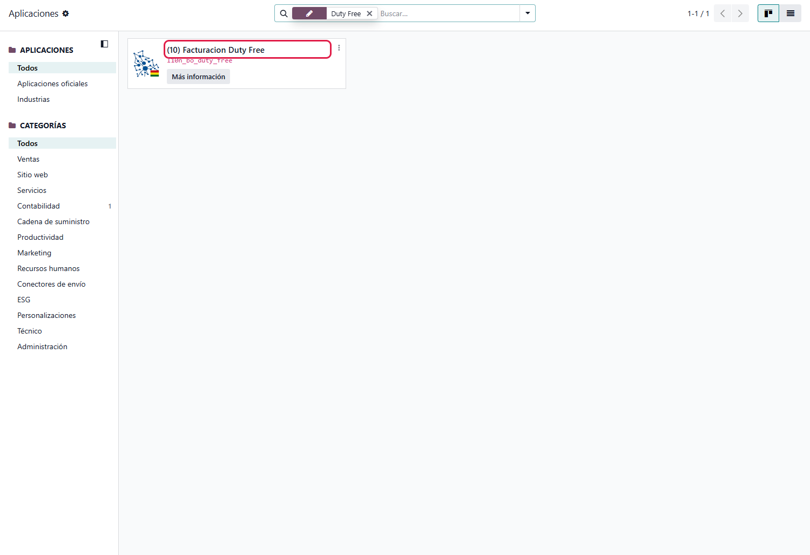
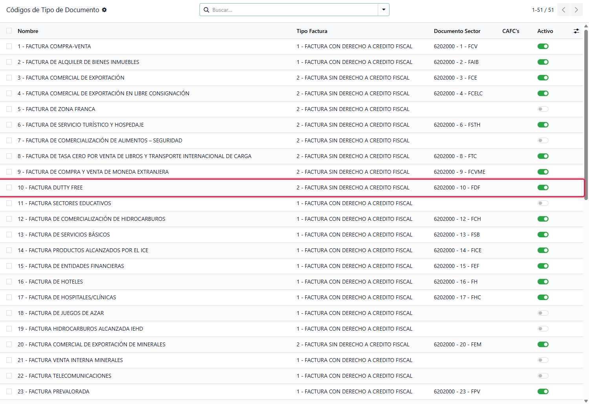
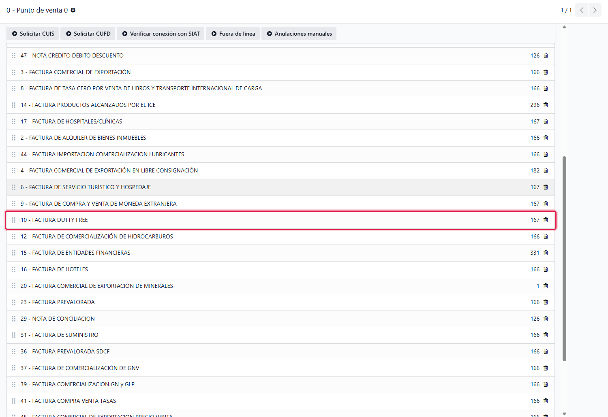
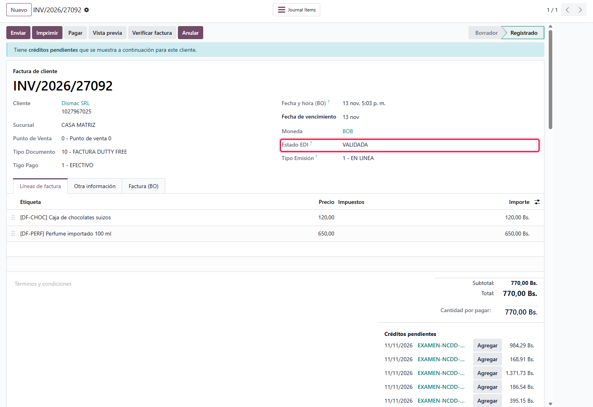
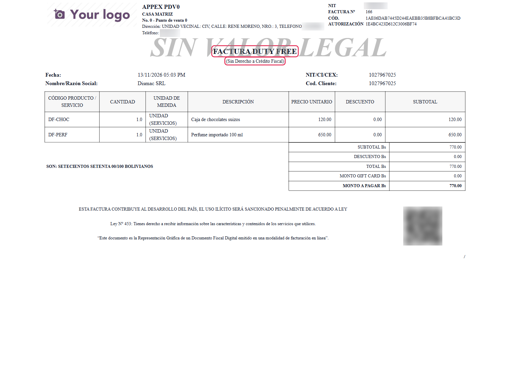

# Factura duty free

Es la factura de los bienes y servicios que se venden en tiendas duty free. En Odoo aparece como tipo de documento `10 - FACTURA DUTTY FREE` (el catálogo del SIN lo escribe con doble t); ante el SIAT es el documento sector 10 y **no da derecho a crédito fiscal**: el SIN la recibe con el monto sujeto a IVA en cero. No agrega campos propios: se carga igual que una factura de compra-venta. Queda emitida cuando el SIN la devuelve como **`VALIDADA` (código `908`)**.

## Qué debe estar configurado

Además de la configuración general de la Parte I, la factura duty free necesita estos cuatro puntos:

- **Módulo duty free activado.** Aplicaciones → buscar «Duty Free» → «(10) Facturacion Duty Free» → Activar.

    { width="624" height="428" loading="lazy" }

- **Tipo de documento 10 activo y con su documento sector.** Ajustes → Facturación (BO) → Catálogos SIAT → Códigos de Tipo Documento, fila `10 - FACTURA DUTTY FREE`: el interruptor Activo debe estar encendido y el campo Documento Sector completo (por ejemplo, `6202000 - 10 - FDF`; depende de la actividad económica registrada en el SIN).

    { width="624" height="428" loading="lazy" }

- **Secuencia en el punto de venta.** En la pestaña Secuencias Documentos del punto de venta (sección 3.5 de la Parte I) debe figurar el tipo 10. Si falta, se agrega una línea a mano, como se explica en la sección [Nota de crédito-débito › Qué debe saber antes de emitirla](nota-de-credito-debito.md#que-debe-saber-antes-de-emitirla).

    { width="624" height="428" loading="lazy" }

- **Productos con Código SIAT.** En la pestaña Facturación (BO) del producto, con el Código SIAT del catálogo que corresponda a la actividad de la empresa (sección 4.2 de la Parte I).

## Paso a paso: crear y emitir la factura

1. **Abrir una factura nueva:** Contabilidad → Clientes → Facturas → botón Nuevo, y elegir el cliente en el campo Contacto.

1. **Completar la cabecera:** Sucursal, Punto de Venta, Tigo Pago y, en Tipo Documento, `10 - FACTURA DUTTY FREE`. Este documento admite pago con gift card, descuento por línea y descuento adicional.

1. **Cargar las líneas** en la pestaña Líneas de factura: el producto, la cantidad y el precio.

1. **Revisar la pestaña Factura (BO):** la casilla Factura (BO) debe estar marcada y la Leyenda asignada, igual que en la factura de compra-venta (sección [Factura de compra-venta › Paso a paso: crear y emitir la factura](factura-de-compra-venta.md#paso-a-paso-crear-y-emitir-la-factura), paso 7).

1. **Pulsar Confirmar.** Odoo envía la factura al SIN; suele tardar unos segundos, y hasta un minuto si el SIN está lento. Debe quedar en Registrado, con Estado EDI `VALIDADA`.

    { width="624" height="428" loading="lazy" }

## Cómo se ve la factura impresa y cómo saber si llegó al SIN

La factura impresa tiene el mismo encabezado y el mismo detalle que la de compra-venta (sección [Factura de compra-venta › Cómo se ve la factura impresa](factura-de-compra-venta.md#como-se-ve-la-factura-impresa)); cambia el título, **FACTURA DUTY FREE**, con la leyenda (Sin Derecho a Crédito Fiscal). Al pie salen el subtotal, el descuento, el total, el monto gift card y el monto a pagar.

Igual que en la compra-venta (sección [Factura de compra-venta › Cómo saber si la factura llegó al SIN](factura-de-compra-venta.md#como-saber-si-la-factura-llego-al-sin)), la factura está emitida solo si **Estado EDI** dice `VALIDADA`. La factura duty free tiene su propia numeración por punto de venta (la secuencia 10), separada de la de compra-venta. Por ejemplo, una factura con 4 whiskies escoceses de 1 L a 480 Bs y 3 cajas de chocolates suizos a 120 Bs. Suma 2.280,00 Bs, el SIN la recibió con monto sujeto a IVA 0.

Se anula y se revierte igual que las demás facturas (sección 1 de la Parte III), y también se puede emitir fuera de línea (sección 2 de la Parte III).

{ width="624" height="458" loading="lazy" }

## Errores frecuentes

Los errores de la sección [Factura de compra-venta › Errores frecuentes y cómo resolverlos](factura-de-compra-venta.md#errores-frecuentes-y-como-resolverlos) también se aplican a la factura duty free. Además, este es propio de este documento:

| Lo que ve el usuario | Por qué pasa | Cómo se resuelve |
|---|---|---|
| En Tipo Documento no aparece `10 - FACTURA DUTTY FREE` | Falta el módulo, el tipo 10 no está activo o el punto de venta no tiene la secuencia. | Revisar los puntos de la sección [Qué debe estar configurado](#que-debe-estar-configurado). |
