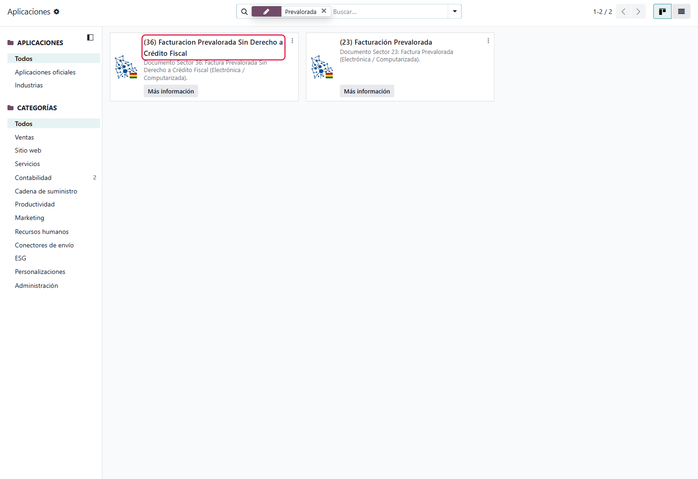
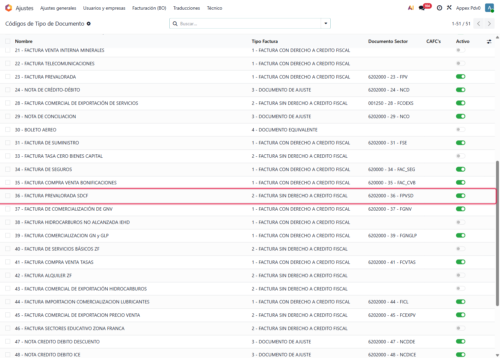
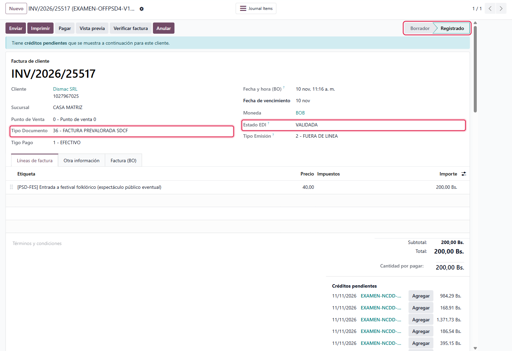
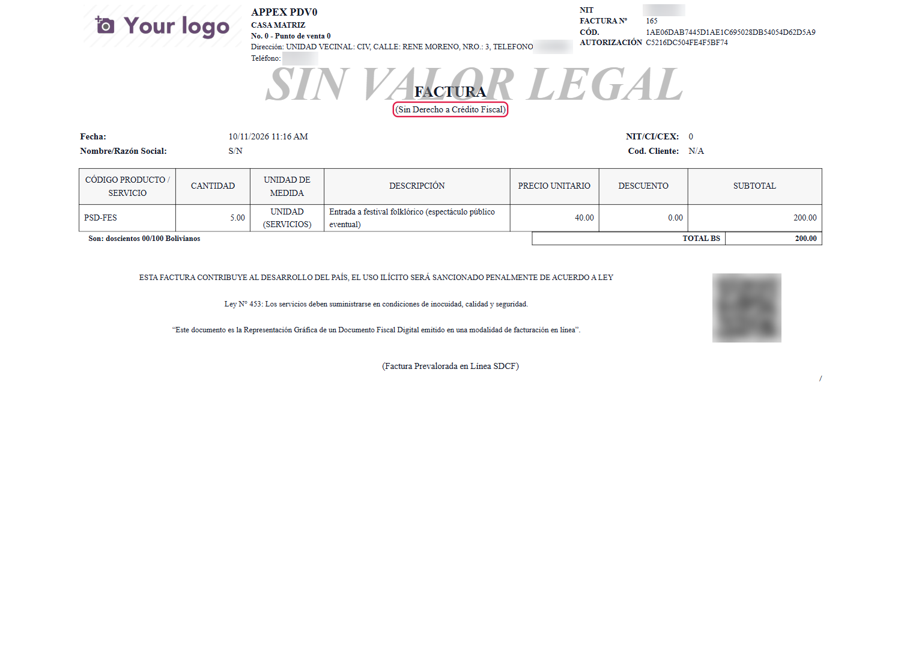

# Factura prevalorada sin derecho a crédito fiscal

Es la variante de la factura prevalorada (sección [Factura prevalorada](factura-prevalorada.md)) que **no da derecho a crédito fiscal**. Se usa en espectáculos públicos eventuales, en zona franca y en la importación y venta de libros. En Odoo aparece como tipo de documento **36 - FACTURA PREVALORADA SDCF**; ante el SIAT es el documento sector 36. Comparte las reglas de la prevalorada: el comprador va siempre como «S/N» (documento 0, código de cliente N/A) y **la factura tiene una sola línea**. La diferencia es que el SIN la recibe con el **monto sujeto a IVA en cero**. Queda emitida cuando el SIN la devuelve como **VALIDADA (código 908)**.

## Qué debe estar configurado

Además de la configuración general de la Parte I, la factura prevalorada sin derecho a crédito fiscal necesita estos cuatro puntos:

- **Módulo activado.** Aplicaciones → buscar «Prevalorada» → «(36) Facturacion Prevalorada Sin Derecho a Crédito Fiscal» → Activar. Si no aparece, primero hay que pulsar Actualizar lista de aplicaciones (sección [Factura de suministro de energía › Qué debe estar configurado](factura-de-suministro-de-energia.md#que-debe-estar-configurado)).

    { width="624" loading="lazy" }

- **Tipo de documento 36 activo y con su documento sector.** Ajustes → Facturación (BO) → Catálogos SIAT → Códigos de Tipo Documento, fila «36 - FACTURA PREVALORADA SDCF»: el interruptor Activo debe estar encendido y el campo Documento Sector completo (por ejemplo, «6202000 - 36 - FPVSD»; depende de la actividad económica registrada en el SIN).

    { width="624" loading="lazy" }

- **Secuencia en el punto de venta.** En la pestaña Secuencias Documentos del punto de venta (sección 3.5 de la Parte I) debe figurar el tipo 36. Si falta, se agrega una línea a mano, como se explica en la sección [Nota de crédito-débito › Qué debe saber antes de emitirla](nota-de-credito-debito.md#que-debe-saber-antes-de-emitirla).

- **Productos con Código SIAT.** En la pestaña Facturación (BO) del producto, con el Código SIAT del catálogo que corresponda a la actividad de la empresa (sección 4.2 de la Parte I). Se crea un producto por cada entrada o valor que se vende (por ejemplo, entrada a concierto o a obra de teatro).

## Paso a paso: crear y emitir la factura

Es el mismo procedimiento de la factura prevalorada (sección [Factura prevalorada › Paso a paso: crear y emitir la factura](factura-prevalorada.md#paso-a-paso-crear-y-emitir-la-factura)). Solo cambia el tipo de documento:

1. **Abrir una factura nueva:** Contabilidad → Clientes → Facturas → botón Nuevo, y elegir un cliente en el campo Contacto. Odoo lo pide, pero no viaja al SIN: la factura sale a nombre de «S/N».

1. **Completar la cabecera:** Sucursal, Punto de Venta, Tigo Pago y, en Tipo Documento, **36 - FACTURA PREVALORADA SDCF**. No admite pago con gift card ni descuento adicional.

1. **Cargar una sola línea** en la pestaña Líneas de factura: la entrada o el producto, la cantidad y el precio.

1. **Revisar la pestaña Factura (BO)** (sección [Factura de compra-venta › Paso a paso: crear y emitir la factura](factura-de-compra-venta.md#paso-a-paso-crear-y-emitir-la-factura), paso 7) y **pulsar Confirmar.** Debe quedar en Registrado, con Estado EDI **VALIDADA**.

    { width="624" loading="lazy" }

## Cómo se ve la factura impresa y cómo saber si llegó al SIN

La factura impresa lleva el título **FACTURA** con la leyenda **(Sin Derecho a Crédito Fiscal)** y la aclaración (Factura Prevalorada en Línea SDCF). En Nombre/Razón Social sale S/N y en Cod. Cliente N/A. Al pie salen el total en bolivianos y el total en la moneda de la factura; a diferencia de la prevalorada, no hay importe base de crédito fiscal.

Igual que en la compra-venta (sección [Factura de compra-venta › Cómo saber si la factura llegó al SIN](factura-de-compra-venta.md#como-saber-si-la-factura-llego-al-sin)), la factura está emitida solo si **Estado EDI** dice **VALIDADA**. Tiene su propia numeración por punto de venta (la secuencia 36). Por ejemplo, una factura con 2 entradas a concierto a 150 Bs. Suma 300,00 Bs; el SIN la recibió a nombre de S/N, con monto sujeto a IVA 0.

Se anula y se revierte igual que las demás facturas (sección 1 de la Parte III), y también se puede emitir fuera de línea (sección 2 de la Parte III). No admite la emisión con CAFC.

{ width="624" loading="lazy" }

## Errores frecuentes

Son los mismos de la factura prevalorada (sección [Factura prevalorada › Errores frecuentes](factura-prevalorada.md#errores-frecuentes)), con el nombre de este documento en el mensaje:

| Lo que ve el usuario | Por qué pasa | Cómo se resuelve |
|---|---|---|
| En Tipo Documento no aparece 36 - FACTURA PREVALORADA SDCF | Falta el módulo, el tipo 36 no está activo o el punto de venta no tiene la secuencia. | Revisar los puntos de la sección [Qué debe estar configurado](#que-debe-estar-configurado). |
| «Nota: La Factura Prevalorada Sin Derecho a Crédito Fiscal debe tener exactamente una línea de detalle \[...\]» | La factura tiene más de una línea, o ninguna. | Dejar una sola línea; si se venden dos conceptos, emitir una factura por cada uno. |
| «Nota: La Factura Prevalorada Sin Derecho a Crédito Fiscal no admite descuento adicional (solo descuento por línea).» | Se cargó un descuento global en la factura. | Quitar el descuento global y, si corresponde, aplicarlo en la línea. |
| «Nota: La Factura Prevalorada Sin Derecho a Crédito Fiscal no admite emisión con CAFC \[...\]» | Se intentó emitir la factura con un CAFC (factura manual de contingencia). | Emitirla en línea o fuera de línea por evento significativo, sin CAFC. |
| «Nota: El pago con GiftCard no es válido para el documento: \[...\]» | En Tigo Pago se eligió un método con gift card. | Elegir otro Tigo Pago, por ejemplo 1 - EFECTIVO. |
