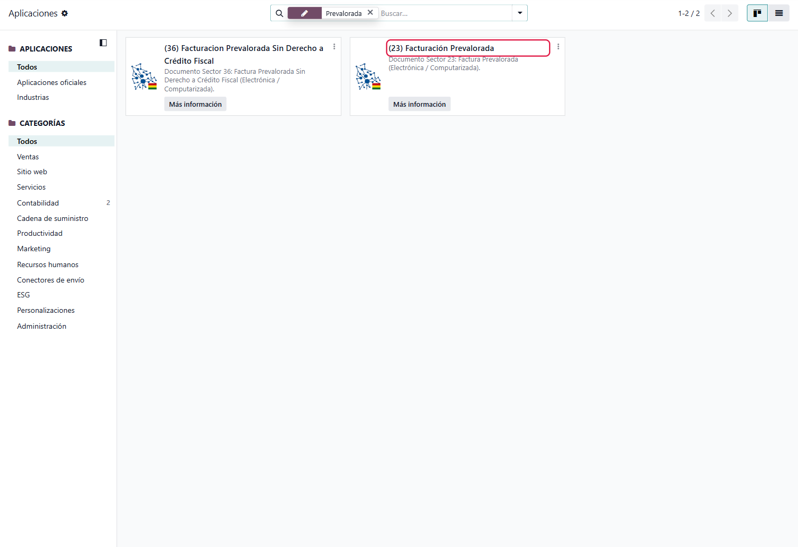
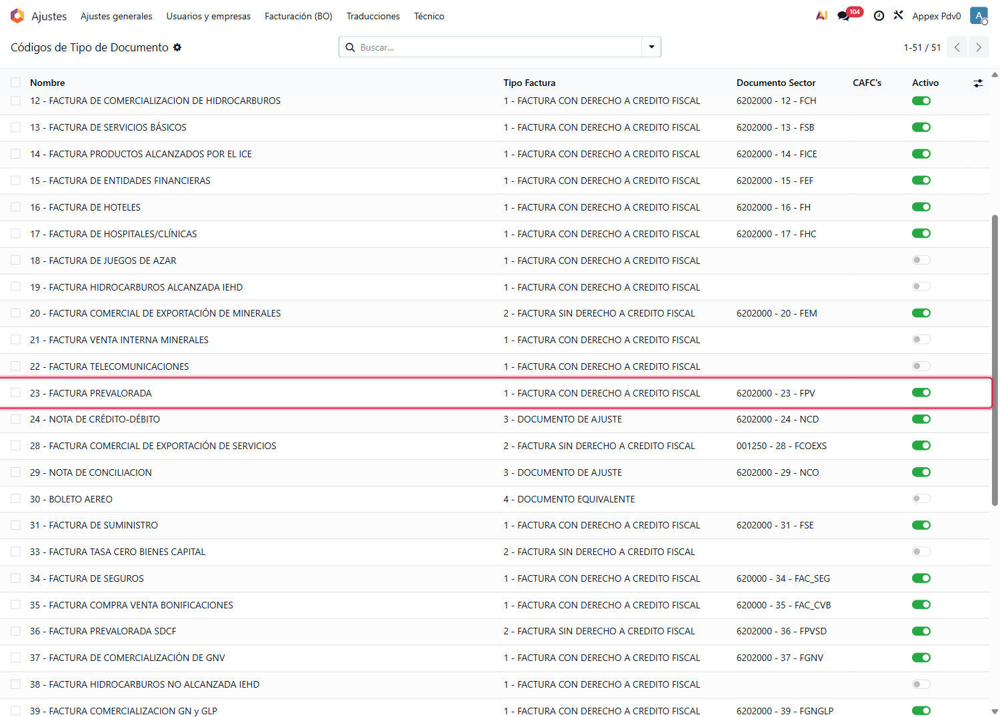
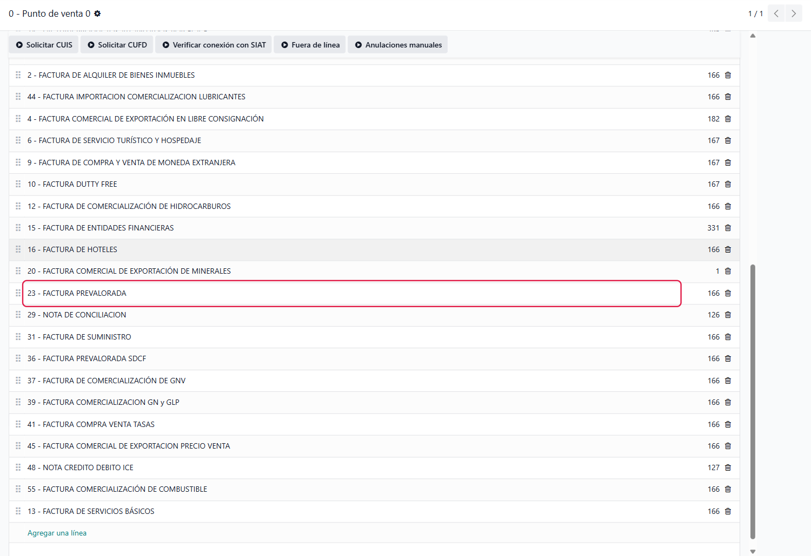
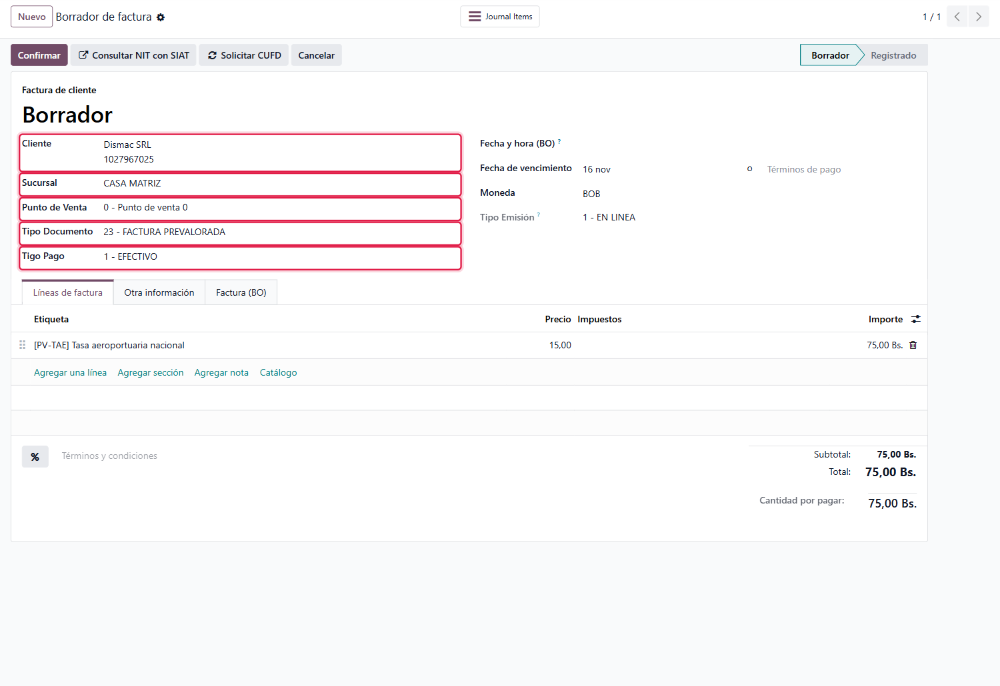
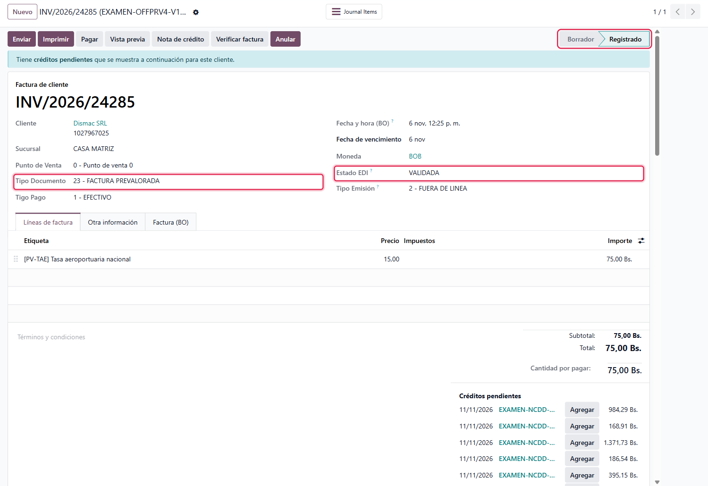
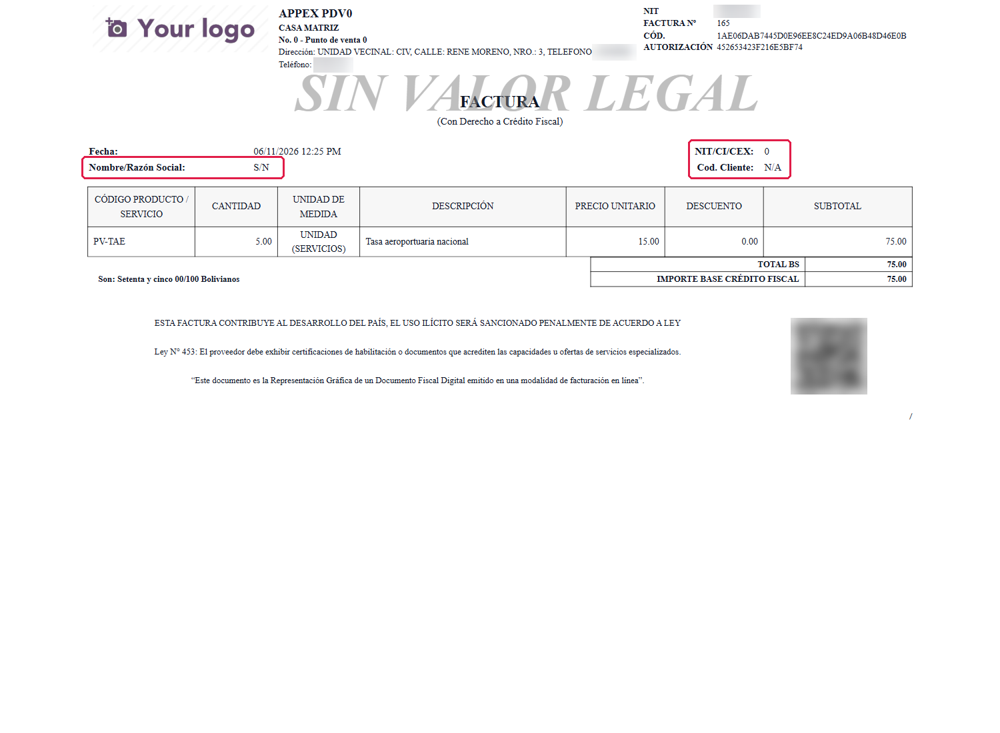

# Factura prevalorada

Es la factura que se emite con el monto ya fijado de antemano, sin identificar al comprador: el cobro de tasas aeroportuarias y de terminales terrestres, y las entradas a ferias. En Odoo aparece como tipo de documento **23 - FACTURA PREVALORADA**; ante el SIAT es el documento sector 23. Sus particularidades: **el comprador va siempre como «S/N»** (sin nombre, documento 0, código de cliente N/A), aunque en Odoo se elija un cliente, y **la factura tiene una sola línea**. No agrega campos propios. Queda emitida cuando el SIN la devuelve como **VALIDADA (código 908)**.

## Qué debe estar configurado

Además de la configuración general de la Parte I, la factura prevalorada necesita estos cuatro puntos:

- **Módulo prevalorada activado.** Aplicaciones → buscar «Prevalorada» → «(23) Facturación Prevalorada» → Activar.

    { width="624" height="428" loading="lazy" }

- **Tipo de documento 23 activo y con su documento sector.** Ajustes → Facturación (BO) → Catálogos SIAT → Códigos de Tipo Documento, fila «23 - FACTURA PREVALORADA»: el interruptor Activo debe estar encendido y el campo Documento Sector completo (por ejemplo, «6202000 - 23 - FPV»; depende de la actividad económica registrada en el SIN).

    { width="624" height="448" loading="lazy" }

- **Secuencia en el punto de venta.** En la pestaña Secuencias Documentos del punto de venta (sección 3.5 de la Parte I) debe figurar el tipo 23. Si falta, se agrega una línea a mano, como se explica en la sección [Nota de crédito-débito › Qué debe saber antes de emitirla](nota-de-credito-debito.md#que-debe-saber-antes-de-emitirla).

    { width="624" height="428" loading="lazy" }

- **Productos con Código SIAT.** En la pestaña Facturación (BO) del producto, con el Código SIAT del catálogo que corresponda a la actividad de la empresa (sección 4.2 de la Parte I). Se crea un producto por cada valor prevalorado que se vende (por ejemplo, una tasa o una entrada de precio fijo).

## Paso a paso: crear y emitir la factura

1. **Abrir una factura nueva:** Contabilidad → Clientes → Facturas → botón Nuevo, y elegir un cliente en el campo Contacto. Odoo lo pide, pero no viaja al SIN: la factura sale a nombre de «S/N».

1. **Completar la cabecera:** Sucursal, Punto de Venta, Tigo Pago y, en Tipo Documento, **23 - FACTURA PREVALORADA**. Este documento **no admite pago con gift card** ni descuento adicional.

    { width="624" height="428" loading="lazy" }

1. **Cargar una sola línea** en la pestaña Líneas de factura: la tasa o entrada, la cantidad y el precio. Admite descuento en la línea.

1. **Revisar la pestaña Factura (BO):** la casilla Factura (BO) debe estar marcada y la Leyenda asignada, igual que en la factura de compra-venta (sección [Factura de compra-venta › Paso a paso: crear y emitir la factura](factura-de-compra-venta.md#paso-a-paso-crear-y-emitir-la-factura), paso 7).

1. **Pulsar Confirmar.** Odoo envía la factura al SIN; suele tardar unos segundos, y hasta un minuto si el SIN está lento. Debe quedar en Registrado, con Estado EDI **VALIDADA**.

    { width="624" height="428" loading="lazy" }

## Cómo se ve la factura impresa y cómo saber si llegó al SIN

La factura impresa lleva el título **FACTURA** con la leyenda (Con Derecho a Crédito Fiscal). En Nombre/Razón Social sale **S/N** y en Cod. Cliente **N/A**, sea cual sea el cliente elegido en Odoo. Al pie salen el total en bolivianos, el total en la moneda de la factura y el importe base de crédito fiscal, que es igual al total.

Igual que en la compra-venta (sección [Factura de compra-venta › Cómo saber si la factura llegó al SIN](factura-de-compra-venta.md#como-saber-si-la-factura-llego-al-sin)), la factura está emitida solo si **Estado EDI** dice **VALIDADA**. La factura prevalorada tiene su propia numeración por punto de venta (la secuencia 23), separada de la de compra-venta. Por ejemplo, una factura con 9 tasas de uso de terminal terrestre a 3 Bs. Suma 27,00 Bs; el SIN la recibió a nombre de S/N, con documento 0 y monto sujeto a IVA 27 Bs.

Se anula y se revierte igual que las demás facturas (sección 1 de la Parte III), y también se puede emitir fuera de línea (sección 2 de la Parte III). Lo que no admite es la emisión con CAFC (facturas manuales de contingencia), porque el formato del SIAT para este documento no la contempla.

{ width="624" height="458" loading="lazy" }

## Errores frecuentes

Los errores de la sección [Factura de compra-venta › Errores frecuentes y cómo resolverlos](factura-de-compra-venta.md#errores-frecuentes-y-como-resolverlos) también se aplican a la factura prevalorada. Además, estos son propios de este documento:

| Lo que ve el usuario | Por qué pasa | Cómo se resuelve |
|---|---|---|
| En Tipo Documento no aparece 23 - FACTURA PREVALORADA | Falta el módulo, el tipo 23 no está activo o el punto de venta no tiene la secuencia. | Revisar los puntos de la sección [Qué debe estar configurado](#que-debe-estar-configurado). |
| «Nota: La Factura Prevalorada debe tener exactamente una línea de detalle (el XSD del SIAT sólo admite un detalle por factura).» | La factura tiene más de una línea, o ninguna. | Dejar una sola línea; si se venden dos conceptos, emitir una factura por cada uno. |
| «Nota: La Factura Prevalorada no admite descuento adicional (sólo descuento por línea).» | Se cargó un descuento global en la factura. | Quitar el descuento global y, si corresponde, aplicarlo en la línea. |
| «Nota: La Factura Prevalorada no admite emisión con CAFC (el XSD del SIAT no contempla el campo cafc).» | Se intentó emitir la factura con un CAFC (factura manual de contingencia). | Emitirla en línea o fuera de línea por evento significativo, sin CAFC. |
| «Nota: El pago con GiftCard no es válido para el documento: \[...\]» | En Tigo Pago se eligió un método con gift card. | Elegir otro Tigo Pago, por ejemplo 1 - EFECTIVO. |
