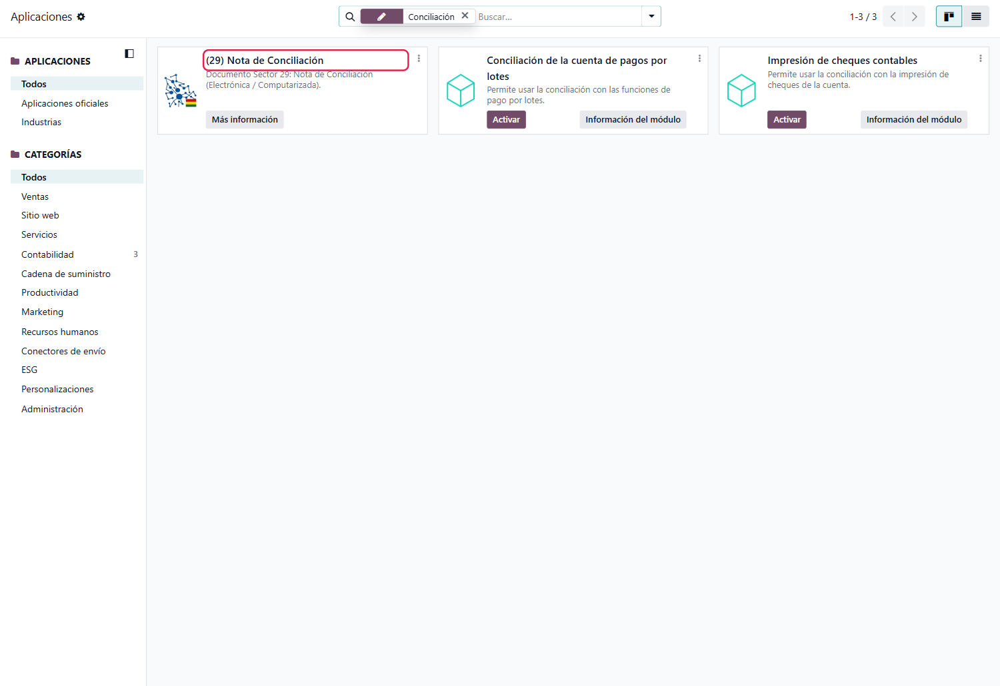
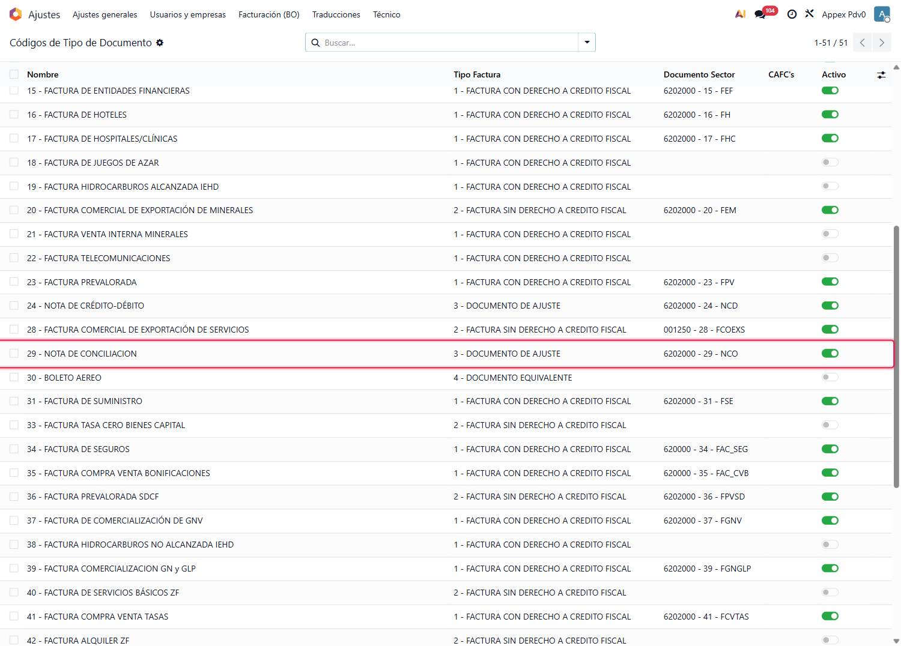
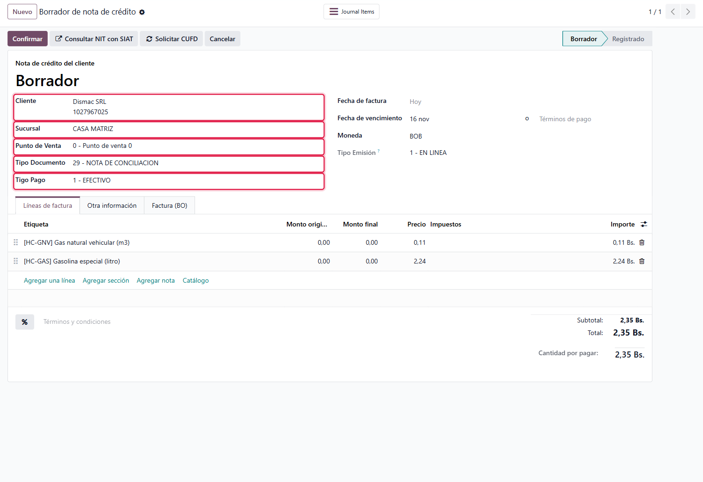
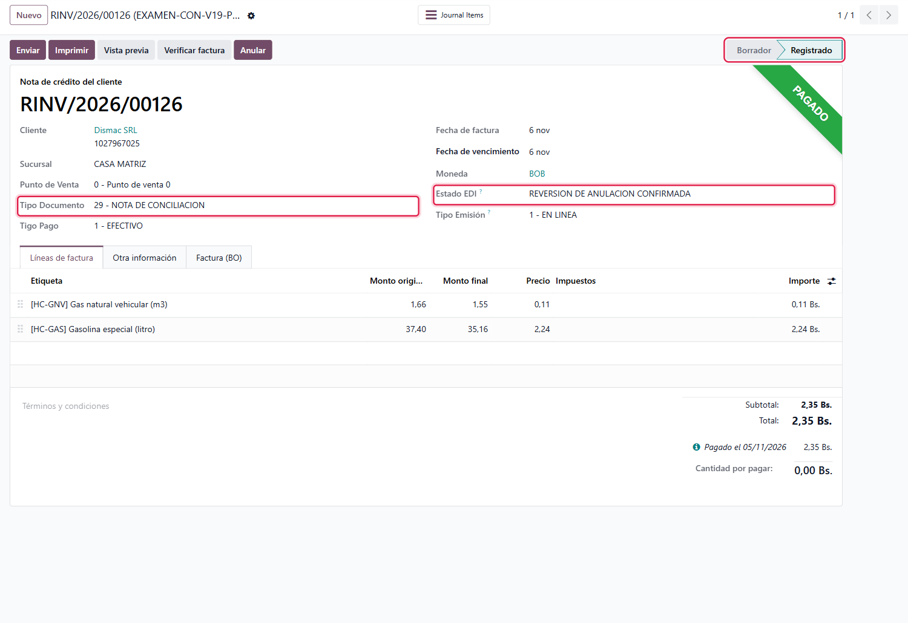
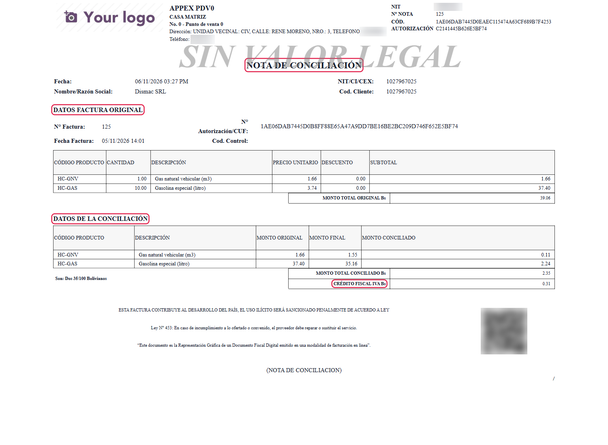

# Nota de conciliación

Es el documento que corrige el crédito fiscal de una factura ya emitida en la que se cobró de más. Según la norma del SIN se usa en facturas de energía eléctrica, telecomunicaciones, agua potable e hidrocarburos de hasta 12 meses atrás; en este sistema solo se puede emitir sobre la **factura de comercialización de hidrocarburos** (sección [Factura de comercialización de hidrocarburos](factura-de-comercializacion-de-hidrocarburos.md)). En Odoo aparece como tipo de documento `29 - NOTA DE CONCILIACION`; ante el SIAT es el documento sector 29 y viaja por el servicio de documentos de ajuste, igual que la nota de crédito-débito (sección [Nota de crédito-débito](nota-de-credito-debito.md)). Para cada línea de la factura original se indica el **monto final** (lo que correspondía cobrar); la nota es por la diferencia y el **crédito fiscal IVA es el 13 %** de esa diferencia. Queda emitida cuando el SIN la devuelve como **`VALIDADA` (código `908`)**.

## Qué debe estar configurado

Además de la configuración general de la Parte I, la nota de conciliación necesita estos tres puntos:

- **Módulo de nota de conciliación activado.** Aplicaciones → buscar «Conciliación» → «(29) Nota de Conciliación» → Activar.

    { width="624" height="428" loading="lazy" }

- **Tipo de documento 29 activo y con su documento sector.** Ajustes → Facturación (BO) → Catálogos SIAT → Códigos de Tipo Documento, fila `29 - NOTA DE CONCILIACION`: el interruptor Activo debe estar encendido y el campo Documento Sector completo (por ejemplo, `6202000 - 29 - NCO`; depende de la actividad económica registrada en el SIN).

    { width="624" height="448" loading="lazy" }

- **Secuencia en el punto de venta.** En la pestaña Secuencias Documentos del punto de venta (sección 3.5 de la Parte I) debe figurar el tipo 29. Si falta, se agrega una línea a mano, como se explica en la sección [Nota de crédito-débito › Qué debe saber antes de emitirla](nota-de-credito-debito.md#que-debe-saber-antes-de-emitirla).

No hacen falta productos nuevos: la nota usa los de la factura original.

## Paso a paso: crear y emitir la nota

1. **Abrir la factura original:** Contabilidad → Clientes → Facturas → abrir la factura de hidrocarburos que se quiere conciliar. Tiene que estar emitida al SIN (`VALIDADA`, o revertida después de una anulación) y no tener más de 12 meses.

1. **Pulsar Nota de crédito,** escribir el motivo y confirmar el asistente. Odoo crea la nota en borrador con las mismas líneas de la factura.

1. **Cambiar el tipo de documento:** en la nota, en Tipo Documento, elegir `29 - NOTA DE CONCILIACION`. Aparecen en las líneas las columnas **Monto original** (el subtotal de esa línea en la factura) y **Monto final**.

    { width="624" height="428" loading="lazy" }

1. **Cargar el Monto final de cada línea:** lo que correspondía cobrar. Al cargarlo, Odoo deja la línea con cantidad 1 y precio igual a la diferencia (monto original − monto final). El monto final tiene que ser menor que el original: el sistema solo emite la nota por crédito fiscal, cuando se cobró de más. Una línea sin diferencia se quita de la nota.

1. **Revisar la pestaña Factura (BO):** la casilla Factura (BO) debe estar marcada y la Leyenda asignada, igual que en la factura de compra-venta (sección [Factura de compra-venta › Paso a paso: crear y emitir la factura](factura-de-compra-venta.md#paso-a-paso-crear-y-emitir-la-factura), paso 7).

1. **Pulsar Confirmar.** Odoo envía la nota al SIN; debe quedar en Registrado, con Estado EDI `VALIDADA`.

    { width="624" height="428" loading="lazy" }

## Cómo se ve la nota impresa y cómo saber si llegó al SIN

La nota impresa lleva el título **NOTA DE CONCILIACIÓN**. Tiene dos bloques: **DATOS FACTURA ORIGINAL** (N° Factura, N° Autorización/CUF, fecha y el detalle original) y **DATOS DE LA CONCILIACIÓN** (monto original, monto final y monto conciliado por línea). Al pie salen el MONTO TOTAL ORIGINAL Bs, el MONTO TOTAL CONCILIADO Bs y el **CRÉDITO FISCAL IVA Bs**.

Igual que en la compra-venta (sección [Factura de compra-venta › Cómo saber si la factura llegó al SIN](factura-de-compra-venta.md#como-saber-si-la-factura-llego-al-sin)), la nota está emitida solo si **Estado EDI** dice `VALIDADA`. Tiene su propia numeración por punto de venta (la secuencia 29). Por ejemplo, si una factura de hidrocarburos de 126,16 Bs (76 m³ de gas natural vehicular) se concilia con un monto final de 108,18 Bs, el monto conciliado es 17,98 Bs y el crédito fiscal IVA 2,34 Bs.

Se anula y se revierte igual que las facturas (sección 1 de la Parte III), pero el motivo de anulación es el de notas: `2 - NOTA DE CREDITO-DEBITO MAL EMITIDA`. En cambio, **no se puede emitir fuera de línea**: el módulo bloquea los documentos de ajuste mientras el punto de venta está fuera de línea y responde `SERVICIO NO DISPONIBLE`.

{ width="624" height="458" loading="lazy" }

## Errores frecuentes

Los errores de la sección [Factura de compra-venta › Errores frecuentes y cómo resolverlos](factura-de-compra-venta.md#errores-frecuentes-y-como-resolverlos) también se aplican a la nota de conciliación. Además, estos son propios de este documento:

| Lo que ve el usuario | Por qué pasa | Cómo se resuelve |
|---|---|---|
| En Tipo Documento no aparece `29 - NOTA DE CONCILIACION` | Falta el módulo, el tipo 29 no está activo o el punto de venta no tiene la secuencia. | Revisar los puntos de la sección [Qué debe estar configurado](#que-debe-estar-configurado). |
| «Nota: La Nota de Conciliación no aplica al documento de origen: \[...\]» | La factura original no es de comercialización de hidrocarburos. | Usar la nota solo sobre facturas del tipo 12. |
| «Nota: La factura original tiene más de 12 meses; no se puede conciliar.» | La factura original es de hace más de un año. | No se puede conciliar; corresponde otro tratamiento contable. |
| «Nota: En \[...\] el monto final es mayor al original (débito fiscal). \[...\]» | Se cargó un monto final mayor al facturado. | El sistema solo emite la nota por crédito fiscal; cargar un monto final menor al original. |
| «Nota: La línea \[...\] no tiene diferencia que conciliar; quítela de la nota.» | El monto final es igual al original. | Quitar esa línea de la nota. |
| «Nota: El importe de la línea \[...\] debe ser igual al monto conciliado (...). Vuelva a ingresar el monto final.» | Se cambió a mano la cantidad o el precio de la línea después de cargar el monto final. | Volver a escribir el Monto final para que Odoo recalcule la línea. |
| `SERVICIO NO DISPONIBLE` al confirmar | El punto de venta está fuera de línea; el módulo no emite documentos de ajuste fuera de línea. | Volver a poner el punto de venta en línea y confirmar la nota. |
