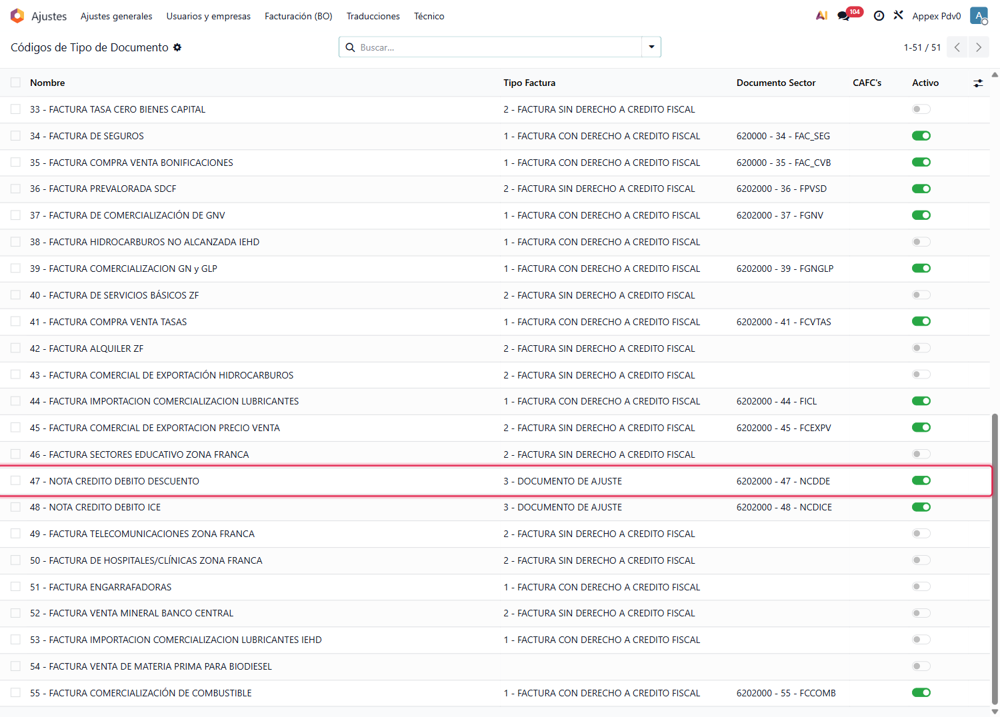
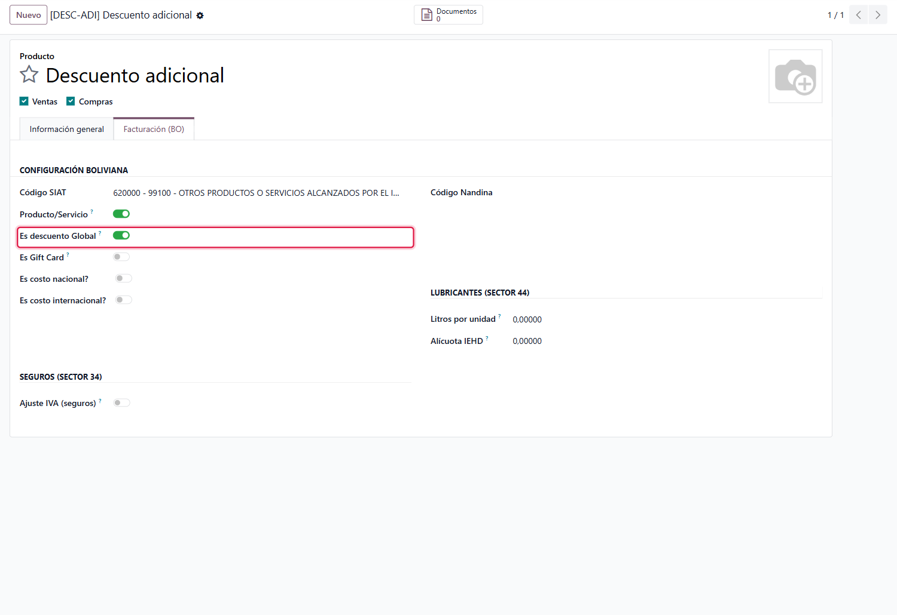
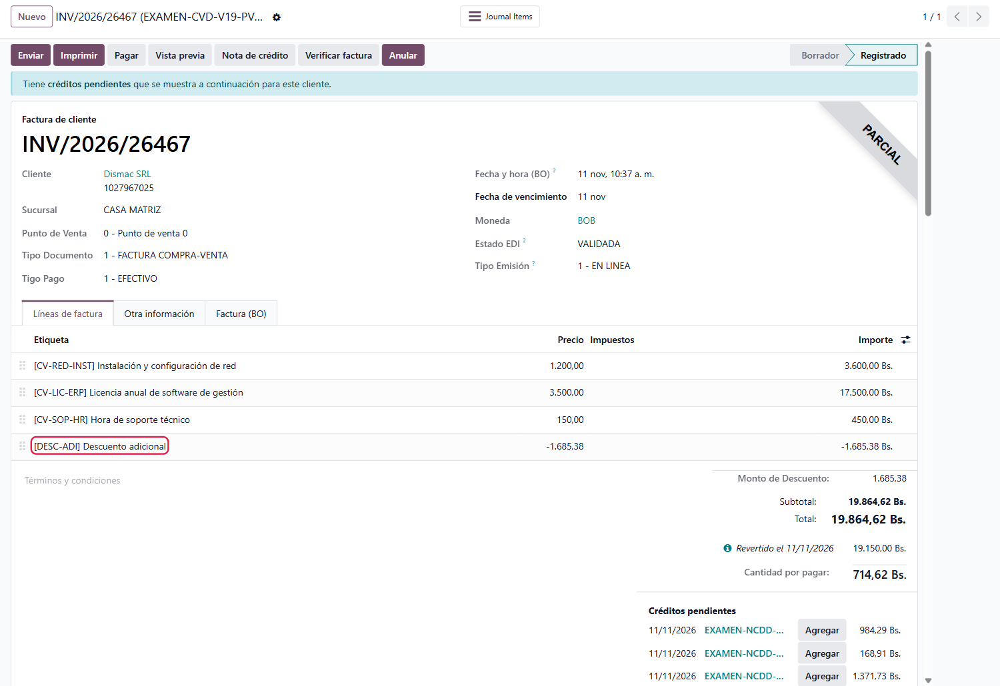
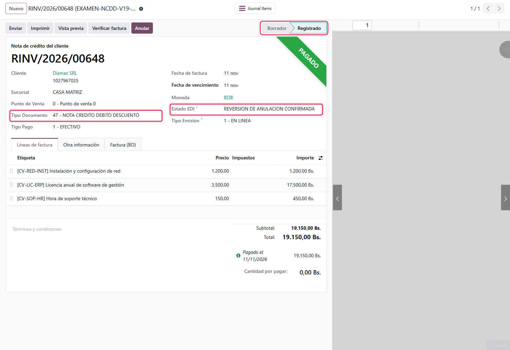
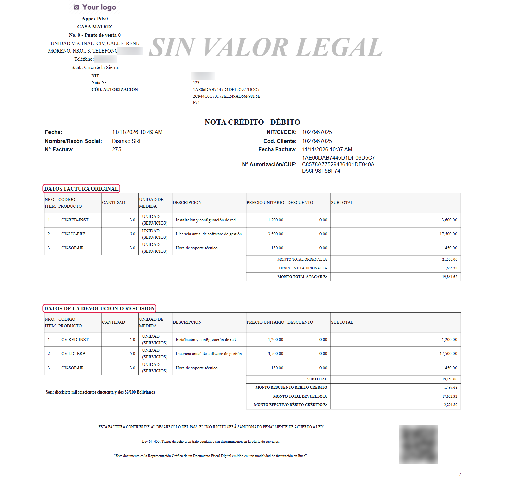

# Nota de crédito-débito con descuento

Es la nota de crédito-débito para devoluciones o rescisiones de una factura de compra-venta (tipo 1) que tuvo **Descuento Adicional**. En Odoo aparece como tipo de documento **47 - NOTA CREDITO DEBITO DESCUENTO**; ante el SIAT es el documento sector 47. Se emite igual que la nota de crédito-débito de la sección [Nota de crédito-débito](nota-de-credito-debito.md), pero el SIN exige que el descuento de la factura original se reparta entre lo devuelto: la nota informa el **monto total original**, el **descuento adicional** de la factura, el **monto total devuelto**, el **monto de descuento crédito-débito** (la parte del descuento que corresponde a lo devuelto) y el **monto efectivo crédito-débito** (el 13 % de lo devuelto). El detalle lleva dos bloques: las líneas de la factura original y las líneas devueltas. Si la factura de origen no tiene descuento adicional, corresponde la nota del tipo 24, no esta. Queda emitida cuando el SIN la devuelve como **VALIDADA (código 908)**.

## Qué debe estar configurado

No necesita un módulo aparte: viene con la facturación boliviana. Además de la configuración general de la Parte I, necesita estos tres puntos:

- **Tipos de documento 1 y 47 activos y con su documento sector.** Ajustes → Facturación (BO) → Catálogos SIAT → Códigos de Tipo Documento: «1 - FACTURA COMPRA-VENTA» con Documento Sector «6202000 - 1 - FCV», y «47 - NOTA CREDITO DEBITO DESCUENTO» con Documento Sector «6202000 - 47 - NCDDE» y Tipo de factura «3 - DOCUMENTO DE AJUSTE». Los dos con el interruptor Activo encendido.

    { width="624" height="448" loading="lazy" }

- **Secuencias en el punto de venta.** En la pestaña Secuencias Documentos del punto de venta (sección 3.5 de la Parte I) deben figurar los tipos 1 y 47. Si falta alguno, se agrega una línea a mano, como se explica en la sección [Nota de crédito-débito › Qué debe saber antes de emitirla](nota-de-credito-debito.md#que-debe-saber-antes-de-emitirla).

- **Producto de descuento adicional.** Un producto de tipo servicio con la casilla **Es descuento Global** marcada (pestaña Facturación (BO) del producto), sin impuestos y con Código SIAT (por ejemplo, «Descuento adicional»). Es el que se usa en la factura de origen para cargar el descuento.

    { width="624" height="428" loading="lazy" }

## Paso a paso: emitir la factura de origen y la nota

1. **Emitir la factura de compra-venta con descuento adicional:** se crea como en la sección [Factura de compra-venta](factura-de-compra-venta.md) y, además de los productos, se agrega una línea con el producto «Descuento adicional», cantidad 1 y **precio negativo** (por ejemplo, −853,10). Al confirmarla debe quedar VALIDADA.

    { width="624" height="428" loading="lazy" }

1. **Abrir la factura de origen** ya validada, pulsar **Nota de crédito** y elegir **Revertir**, como en las secciones [Nota de crédito-débito › Abrir la factura original](nota-de-credito-debito.md#abrir-la-factura-original) y [Nota de crédito-débito › Crear la nota de crédito](nota-de-credito-debito.md#crear-la-nota-de-credito). Odoo crea la nota en borrador con las mismas líneas.

1. **Elegir el tipo de documento:** en Tipo Documento de la nota, **47 - NOTA CREDITO DEBITO DESCUENTO**.

1. **Dejar solo lo que se devuelve:** para una devolución total, se dejan todas las líneas; para una parcial, se bajan las cantidades o se quitan líneas. No se agregan productos que no estén en la factura de origen. La línea del descuento adicional no hace falta tocarla: Odoo reparte el descuento entre lo devuelto.

1. **Revisar la pestaña Factura (BO)** y **pulsar Confirmar.** La nota debe quedar en Registrado, con Estado EDI **VALIDADA**.

    { width="624" height="428" loading="lazy" }

## Cómo se ve la nota impresa y cómo saber si llegó al SIN

La nota impresa lleva el título **NOTA CRÉDITO - DÉBITO** y dos tablas: **DATOS FACTURA ORIGINAL**, con las líneas de la factura, el monto total original y el descuento adicional, y **DATOS DE LA DEVOLUCIÓN O RESCISIÓN**, con las líneas devueltas, el monto total devuelto, el monto descuento débito-crédito, el monto total a pagar y el monto efectivo débito-crédito. También muestra el número y el código de autorización (CUF) de la factura original.

Igual que la nota de la sección [Nota de crédito-débito](nota-de-credito-debito.md), está emitida solo si **Estado EDI** dice **VALIDADA**. Tiene su propia numeración por punto de venta (la secuencia 47). Por ejemplo, si una factura sumaba 7.150 con un descuento adicional de 853,10 (se pagaron 6.296,90), una devolución parcial puede salir con monto total devuelto 5.636,39, monto de descuento crédito-débito 763,61 y monto efectivo crédito-débito 732,73.

Se anula y se revierte igual que la nota de crédito-débito (sección [Nota de crédito-débito](nota-de-credito-debito.md)). Como las demás notas, no se emite fuera de línea: el sistema no permite documentos de ajuste en modo fuera de línea.

{ width="624" height="591" loading="lazy" }

## Errores frecuentes

Los errores de la sección [Nota de crédito-débito](nota-de-credito-debito.md) también se aplican a esta nota. Además, estos son propios de este documento:

| Lo que ve el usuario | Por qué pasa | Cómo se resuelve |
|---|---|---|
| «Nota: La factura de origen no tiene Descuento Adicional. Utilice la Nota de Crédito-Débito (Sector 24).» | La factura de origen no tiene la línea de descuento adicional. | Usar la nota del tipo 24 (sección [Nota de crédito-débito](nota-de-credito-debito.md)). |
| «Nota: La Nota de Crédito-Débito con Descuento no aplica al documento de origen: \[...\]» | La factura de origen no es de compra-venta (tipo 1). | El tipo 47 solo sirve para facturas de compra-venta; para otros documentos, usar la nota que les corresponde. |
| «Nota: El producto \[...\] no existe en la factura de origen.» | Se agregó a la nota un producto que no estaba en la factura. | Quitar esa línea: solo se devuelven productos de la factura original. |
| «Nota: El monto devuelto no puede ser mayor al monto total de la factura original.» | Se subió una cantidad o un precio por encima de lo facturado. | Dejar cantidades y precios iguales o menores a los de la factura. |
| «Nota: La cantidad devuelta del producto \[...\] debe ser mayor a cero» o «Nota: El monto total devuelto debe ser mayor a cero.» | Una línea quedó en cero, o la nota no devuelve nada. | Quitar la línea en cero o cargar lo que se devuelve. |
