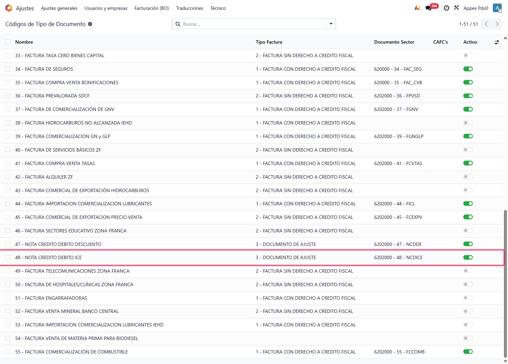
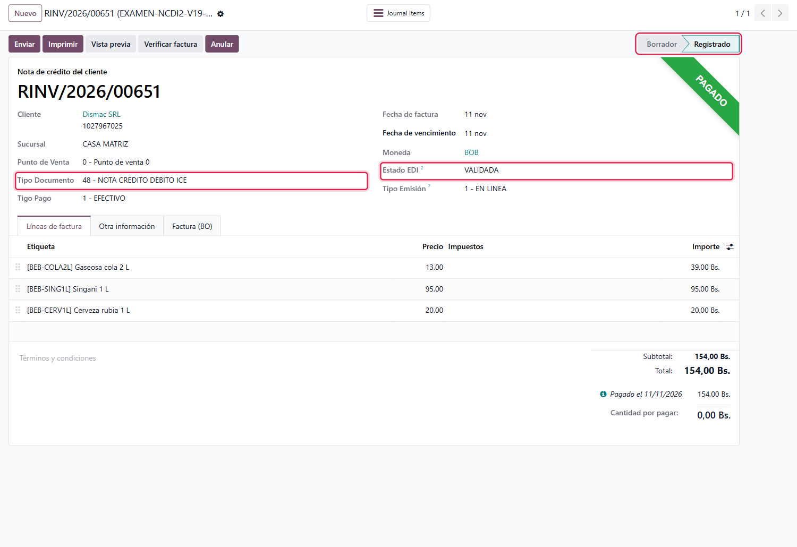
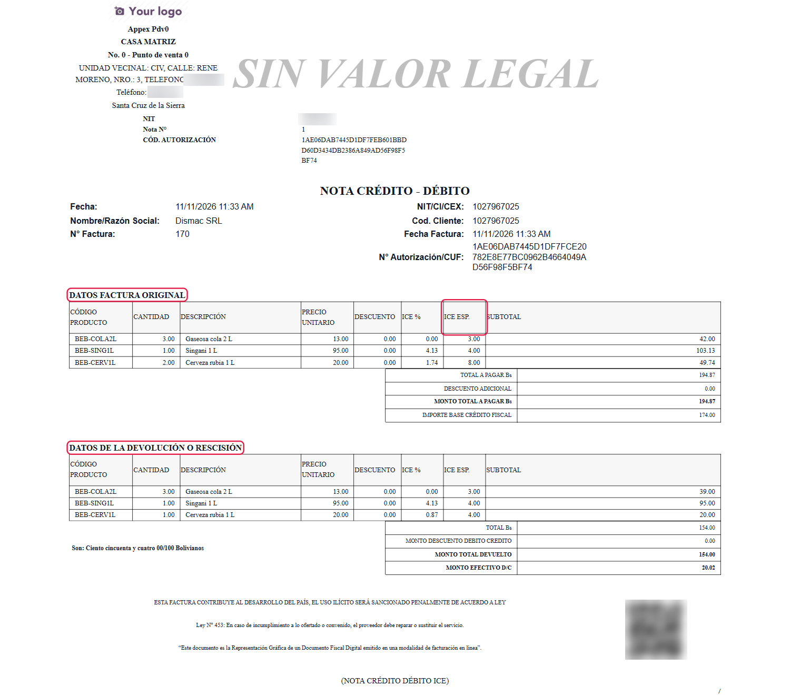

# Nota de crédito-débito ICE

Es la nota de crédito-débito para devoluciones o rescisiones de una factura de productos alcanzados por el ICE (tipo 14, sección [Factura de productos alcanzados por el ICE](factura-de-productos-alcanzados-por-el-ice.md)). En Odoo aparece como tipo de documento `48 - NOTA CREDITO DEBITO ICE`; ante el SIAT es el documento sector 48. Se emite igual que la nota de crédito-débito de la sección [Nota de crédito-débito](nota-de-credito-debito.md), pero el detalle lleva dos bloques: las líneas de la factura original, con el mismo ICE con que se enviaron, y las líneas devueltas. La nota informa el **monto total original** (lo facturado con ICE), el **monto total devuelto** (lo devuelto **sin ICE**) y el **monto efectivo crédito-débito** (el 13 % de lo devuelto). Si la factura de origen tenía descuento adicional, la nota también informa la parte del descuento que corresponde a lo devuelto. Si la factura de origen no es del tipo 14, corresponde otra nota (la del tipo 24, o la del 47 si tiene descuento adicional). Queda emitida cuando el SIN la devuelve como **`VALIDADA` (código `908`)**.

## Qué debe estar configurado

La nota viene en el mismo módulo que la factura ICE. Además de la configuración general de la Parte I y de la factura ICE (sección [Factura de productos alcanzados por el ICE › Qué debe estar configurado](factura-de-productos-alcanzados-por-el-ice.md#que-debe-estar-configurado)), necesita estos tres puntos:

- **Módulo ICE activado.** «(14) Facturacion Productos Alcanzados por el ICE», como en la sección [Factura de productos alcanzados por el ICE › Qué debe estar configurado](factura-de-productos-alcanzados-por-el-ice.md#que-debe-estar-configurado). Es el que trae el formato de esta nota y su representación impresa.

- **Tipos de documento 14 y 48 activos y con su documento sector.** Ajustes → Facturación (BO) → Catálogos SIAT → Códigos de Tipo Documento: `48 - NOTA CREDITO DEBITO ICE` con Documento Sector `6202000 - 48 - NCDICE` y Tipo de factura `3 - DOCUMENTO DE AJUSTE`, con el interruptor Activo encendido. El 14 se configura como en la sección [Factura de productos alcanzados por el ICE › Qué debe estar configurado](factura-de-productos-alcanzados-por-el-ice.md#que-debe-estar-configurado).

    { width="624" height="448" loading="lazy" }

- **Secuencias en el punto de venta.** En la pestaña Secuencias Documentos del punto de venta (sección 3.5 de la Parte I) deben figurar los tipos 14 y 48. Si falta alguno, se agrega una línea a mano, como se explica en la sección [Nota de crédito-débito › Qué debe saber antes de emitirla](nota-de-credito-debito.md#que-debe-saber-antes-de-emitirla).

Las tasas ICE de la Nandina de cada producto deben estar cargadas desde antes de emitir la factura de origen (sección [Factura de productos alcanzados por el ICE › Cómo se calcula el ICE](factura-de-productos-alcanzados-por-el-ice.md#como-se-calcula-el-ice)). La nota repite el ICE que se envió en la factura; si la factura salió sin ICE porque las tasas estaban en cero, la nota también lo informa así.

## Paso a paso: emitir la nota

1. **Tener la factura ICE de origen validada:** se emite como en la sección [Factura de productos alcanzados por el ICE › Paso a paso: crear y emitir la factura](factura-de-productos-alcanzados-por-el-ice.md#paso-a-paso-crear-y-emitir-la-factura) y debe quedar con Estado EDI `VALIDADA` (con CUF).

1. **Abrir la factura de origen**, pulsar **Nota de crédito** y elegir **Revertir**, como en las secciones [Nota de crédito-débito › Abrir la factura original](nota-de-credito-debito.md#abrir-la-factura-original) y [Nota de crédito-débito › Crear la nota de crédito](nota-de-credito-debito.md#crear-la-nota-de-credito). Odoo crea la nota en borrador con las mismas líneas.

1. **Elegir el tipo de documento:** en Tipo Documento de la nota, `48 - NOTA CREDITO DEBITO ICE`.

1. **Dejar solo lo que se devuelve:** para una devolución total, se dejan todas las líneas; para una parcial, se bajan las cantidades o se quitan líneas. No se cambian los precios unitarios ni se agregan productos que no estén en la factura de origen. El ICE de lo devuelto no se carga a mano: Odoo lo calcula en proporción a la cantidad devuelta.

1. **Revisar la pestaña Factura (BO)** y **pulsar Confirmar.** La nota debe quedar en Registrado, con Estado EDI `VALIDADA`.

    { width="624" height="428" loading="lazy" }

## Cómo se ve la nota impresa y cómo saber si llegó al SIN

La nota impresa lleva el título **NOTA CRÉDITO - DÉBITO**, la leyenda **(NOTA CRÉDITO DÉBITO ICE)** al pie y dos tablas con columnas ICE % e ICE ESP.: **DATOS FACTURA ORIGINAL**, con las líneas de la factura, el monto total original y el monto total a pagar, y **DATOS DE LA DEVOLUCIÓN O RESCISIÓN**, con las líneas devueltas, el monto descuento débito-crédito, el monto total devuelto y el monto efectivo D/C. También muestra el número y el código de autorización (CUF) de la factura original.

Igual que la nota de la sección [Nota de crédito-débito](nota-de-credito-debito.md), está emitida solo si **Estado EDI** dice `VALIDADA`. Tiene su propia numeración por punto de venta (la secuencia 48). Por ejemplo, si una factura vendió 2 litros de cerveza a 20 y una gaseosa de 2 litros a 13 y con el ICE sumó 63,74 (monto total original), una nota que devuelve 1 cerveza y la gaseosa sale con monto total devuelto 33,00 (20 + 13, sin ICE) y monto efectivo crédito-débito 4,29 (el 13 %).

Se anula y se revierte igual que la nota de crédito-débito (sección [Nota de crédito-débito](nota-de-credito-debito.md)). Como las demás notas, no se emite fuera de línea: el sistema no permite documentos de ajuste en modo fuera de línea.

{ width="624" height="550" loading="lazy" }

## Errores frecuentes

Los errores de la sección [Nota de crédito-débito](nota-de-credito-debito.md) también se aplican a esta nota. Además, estos son propios de este documento:

| Lo que ve el usuario | Por qué pasa | Cómo se resuelve |
|---|---|---|
| «Nota: La Nota de Crédito-Débito ICE solo aplica a facturas del sector 14 (Alcanzada por el ICE). \[...\]» | La factura de origen no es una factura ICE. | Usar la nota que corresponde al documento de origen (tipo 24 o 47). |
| «Nota: La factura de origen \[...\] no tiene CUF: debe estar emitida y validada por el SIN.» | La factura de origen no llegó al SIN (borrador, rechazada o fuera de línea sin validar). | Emitir y validar primero la factura ICE; después crear la nota desde ella. |
| «Nota: El producto \[...\] no existe en la factura de origen \[...\].» | Se agregó a la nota un producto que no estaba en la factura. | Quitar esa línea: solo se devuelven productos de la factura original. |
| «Nota: La cantidad devuelta del producto \[...\] debe ser mayor a cero y no mayor a la cantidad facturada \[...\].» | Una línea quedó en cero o con más cantidad de la facturada. | Dejar una cantidad entre 0 y la facturada, o quitar la línea. |
| «Nota: El precio unitario del producto \[...\] debe ser igual al de la factura de origen \[...\].» | Se cambió el precio en la nota. | Volver al precio de la factura: lo que se ajusta es la cantidad. |
| «Nota: El monto total devuelto \[...\] no puede ser mayor al monto total de la factura original \[...\].» | Lo devuelto supera lo que se pagó. | Revisar cantidades: no se puede devolver más de lo facturado. |
| El SIN rechaza con `DETALLE DE LA NOTA DIFERENTE AL DETALLE DE LA FACTURA ORIGINAL`. | La factura de origen se emitió con otra versión del módulo o con otras tasas ICE, y el bloque «factura original» de la nota ya no coincide con lo que recibió el SIN. | Hacer la nota sobre una factura ICE emitida con la configuración actual. |
