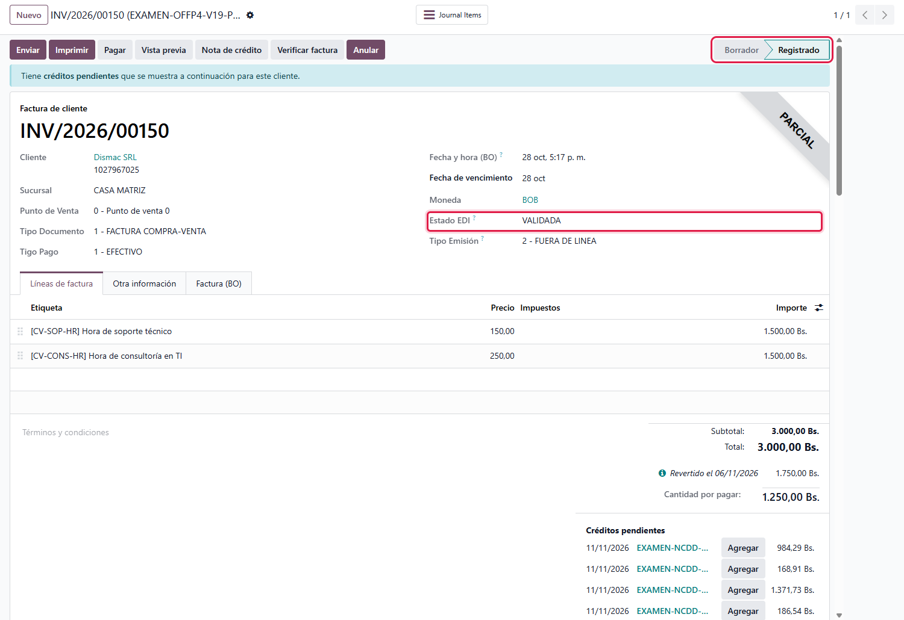
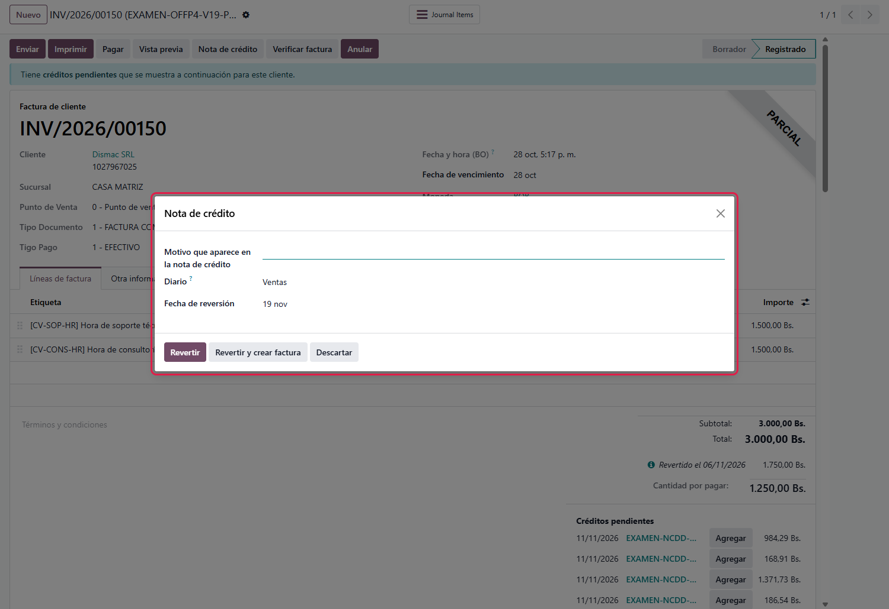
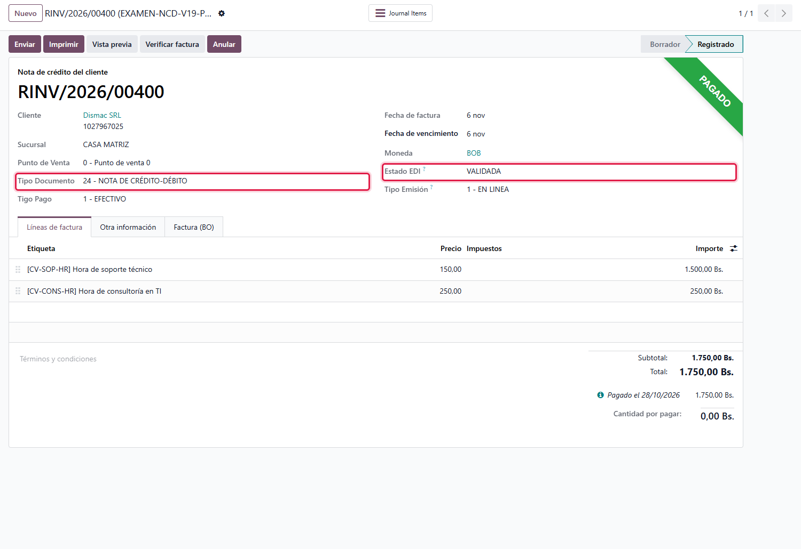

# Nota de crédito-débito

La nota de crédito-débito es el documento con el que se corrige una factura ya emitida cuando el cliente devuelve el bien o servicio, o la venta se rescinde, ya sea en forma total o parcial. En Odoo funciona como una devolución o reembolso: se genera a partir de la factura original y queda vinculada a ella. Ante el SIAT es el documento sector **24 - NOTA DE CRÉDITO-DÉBITO**.

## Qué debe saber antes de emitirla

- Quien la emite es el vendedor, es decir, su empresa. En la facturación en línea se emite desde su propio sistema de facturación; en este caso, desde Odoo.

- Siempre hace referencia a la factura original. Si la devolución es total, indica el importe total de la factura. Si es parcial, indica el importe devuelto y qué se devolvió efectivamente.

- Tiene un plazo: no puede emitirse después de 18 meses desde la emisión de la factura original. Para los productos con una normativa nacional específica que regula todo su proceso, el plazo es de 60 meses y requiere una solicitud justificada ante Impuestos Nacionales.

- Efecto en el IVA: el vendedor que emite la nota registra un crédito fiscal y el comprador registra un débito fiscal, ambos en el periodo en que ocurrió la devolución.

- En las modalidades en línea, si el comprador no es sujeto pasivo del IVA, no es necesario que devuelva la factura original.

- **La factura original debe estar registrada y con Estado EDI VALIDADA.**

- **El punto de venta debe tener la secuencia 24 - NOTA DE CRÉDITO-DÉBITO** (sección 3.5 de la Parte I). Si no la tiene, la nota no se puede emitir desde ese punto de venta. El botón Crear Secuencia no la agrega si el punto de venta ya tiene otra secuencia; en ese caso se agrega una línea a mano en la pestaña Secuencias Documentos, con Tipo de Documento 24 - NOTA DE CRÉDITO-DÉBITO y Secuencia 1.

## Abrir la factura original

Entre a Contabilidad → Clientes → Facturas y abra la factura sobre la que se hace la devolución. Debe estar en estado Registrado y con Estado EDI VALIDADA.

{ width="624" height="428" loading="lazy" }

En la ficha se ven los datos de facturación de esa venta: Cliente, Sucursal, Punto de Venta, Tipo Documento (1 - FACTURA COMPRA-VENTA) y Tigo Pago (la etiqueta tiene un error de escritura del módulo; significa «Tipo de pago»). El campo Estado EDI indica el estado de la factura ante el SIAT; en el ejemplo dice VALIDADA. Si la factura se anula con el botón Anular, este campo pasa a ANULACION CONFIRMADA (se explica en la sección 1 de la Parte III). Abajo, la pestaña Líneas de factura muestra los productos, y la pestaña Factura (BO) guarda los datos del SIAT. A la derecha se ve la vista previa de la factura impresa.

## Crear la nota de crédito

Pulse **Nota de crédito**. Se abre una ventana para registrar la devolución.

{ width="624" height="428" loading="lazy" }

Complete tres datos:

- **Motivo que aparece en la nota de crédito:** escriba la razón de la devolución, por ejemplo Equipo dañado. Este texto saldrá en la nota.

- **Diario:** deje Facturas de cliente.

- **Fecha de reversión:** la fecha en que se hace la devolución. Por omisión es la fecha de hoy.

Luego elija cómo continuar con uno de los tres botones:

- **Revertir:** crea la nota de crédito **en borrador**, para ajustarla antes de emitirla (sección [Ajustar y confirmar la nota](#ajustar-y-confirmar-la-nota)). Es la opción para las devoluciones **parciales**, y también sirve para las totales.

- **Revertir y crear factura:** revierte la factura **completa** y además crea una factura nueva, para volver a emitir la venta corregida (sección [Si eligió Revertir y crear factura](#si-eligio-revertir-y-crear-factura)). No sirve para devoluciones parciales.

- **Descartar:** cierra la ventana sin crear nada.

## Ajustar y confirmar la nota

Al pulsar Revertir, Odoo abre la nota de crédito del cliente en estado **Borrador**, con la referencia a la factura de la que viene. Todavía no se envió al SIN: se emite recién al confirmarla, y a partir de ese momento ya no se puede modificar.

1. **Revisar la cabecera.** La nota conserva el cliente, la sucursal y el punto de venta de la factura original. El campo **Tipo Documento** debe decir **24 - NOTA DE CRÉDITO-DÉBITO**; la factura original era 1 - FACTURA COMPRA-VENTA.

1. **Ajustar las cantidades a lo devuelto**, en la pestaña Líneas de factura. La nota muestra **lo que el cliente devuelve, no lo que queda de la venta**. Por ejemplo, si la factura original tenía 10 unidades del Producto 2 y el cliente devolvió 1, la nota debe mostrar **1** unidad. En una devolución total no se cambia nada.

1. **Revisar la pestaña Factura (BO):** la casilla Factura (BO) debe estar marcada y la Leyenda asignada, igual que en la factura (sección [Factura de compra-venta › Paso a paso: crear y emitir la factura](factura-de-compra-venta.md#paso-a-paso-crear-y-emitir-la-factura), paso 7).

1. **Pulsar Confirmar.** Odoo envía la nota al SIN; suele tardar unos segundos, y hasta un minuto si el SIN está lento. La nota pasa a Registrado, toma su número (por ejemplo RINV/2026/00001) y **Estado EDI** debe decir **VALIDADA**.

    { width="624" height="428" loading="lazy" }

**Numeración.** La nota tiene su propia numeración por punto de venta (la secuencia 24), separada de la de las facturas. Por eso una nota puede salir con el Nro. Factura 1 aunque su factura de origen tenga otro número.

## Si eligió Revertir y crear factura

Con Revertir y crear factura, Odoo revierte la factura **completa**: la nota es total y se confirma sola. Además crea una factura nueva en borrador, con los mismos datos, para volver a emitir la venta corregida. Con Revertir solo se genera la nota de crédito.

En la factura nueva se corrigen los datos y se pulsa **Confirmar**; se emite como cualquier factura (sección [Factura de compra-venta › Paso a paso: crear y emitir la factura](factura-de-compra-venta.md#paso-a-paso-crear-y-emitir-la-factura)), con un número de factura nuevo. La ruta de navegación de arriba mantiene el enlace a la factura original, y el campo Estado EDI debe indicar VALIDADA.

Odoo muestra el aviso "Tiene créditos pendientes para este cliente. Puede asignarlos para marcar la factura como pagada". Significa que el crédito de la nota de crédito se puede asignar a esta factura nueva. La factura conserva los botones Registrar pago, Nota de crédito y Anular.

## Cómo saber si llegó al SIN y errores frecuentes

La nota está emitida solo si **Estado EDI** dice **VALIDADA**. Los estados son los mismos que los de la factura (sección [Factura de compra-venta › Cómo saber si la factura llegó al SIN](factura-de-compra-venta.md#como-saber-si-la-factura-llego-al-sin)), y los errores de la sección [Factura de compra-venta › Errores frecuentes y cómo resolverlos](factura-de-compra-venta.md#errores-frecuentes-y-como-resolverlos) también se aplican a las notas: CUFD inválido, casilla Factura (BO) desmarcada, SIN no disponible. Además, estos son propios de la nota:

| Lo que ve el usuario | Por qué pasa | Cómo se resuelve |
|---|---|---|
| En Tipo Documento no aparece 24 - NOTA DE CRÉDITO-DÉBITO | El punto de venta no tiene esa secuencia. | Agregar la secuencia en el punto de venta (sección [Qué debe saber antes de emitirla](#que-debe-saber-antes-de-emitirla)) y volver a confirmar. |
| La nota muestra el importe total aunque la devolución era parcial | Se usó Revertir y crear factura, o no se ajustaron las cantidades antes de confirmar. | Anular la nota (sección 1 de la Parte III, motivo 2 - NOTA DE CREDITO-DEBITO MAL EMITIDA) y emitir otra con Revertir. |
| La nota no deja cambiar las cantidades | Ya está confirmada. | Si tiene un error, anularla (sección 1 de la Parte III) y emitir otra. |
