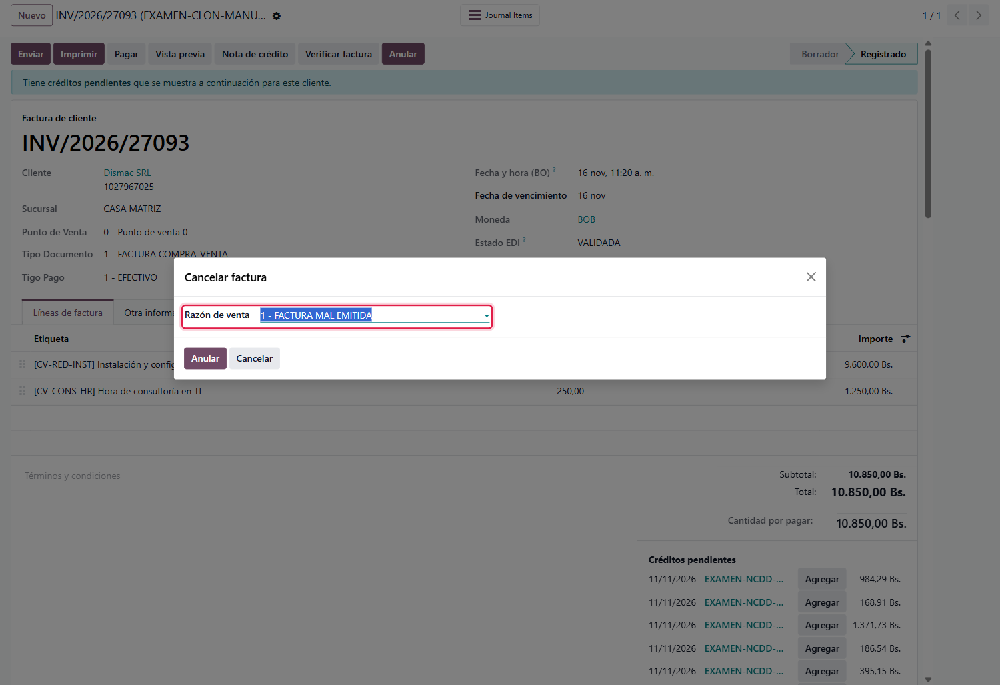
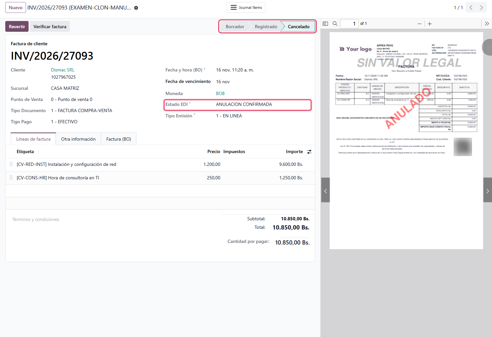
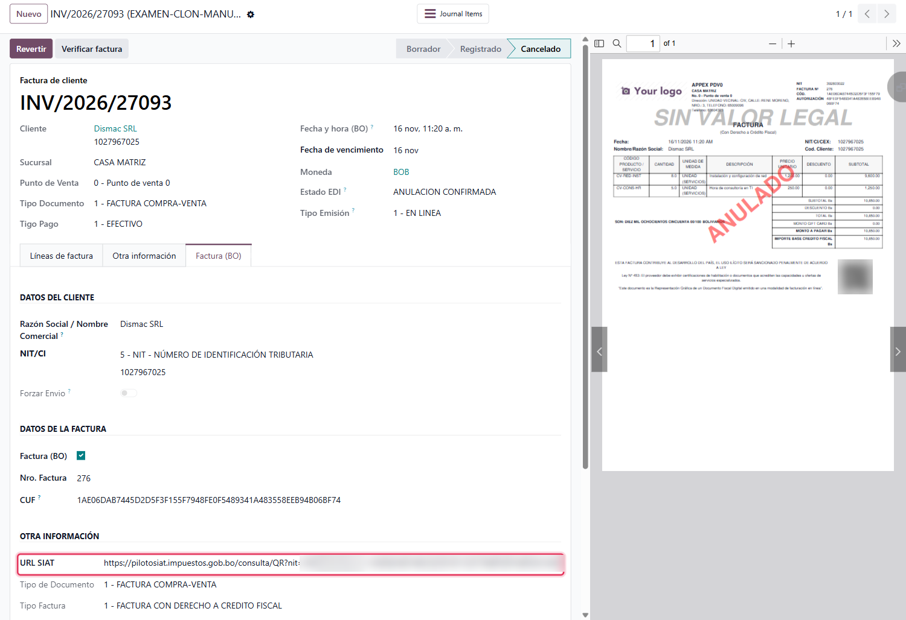
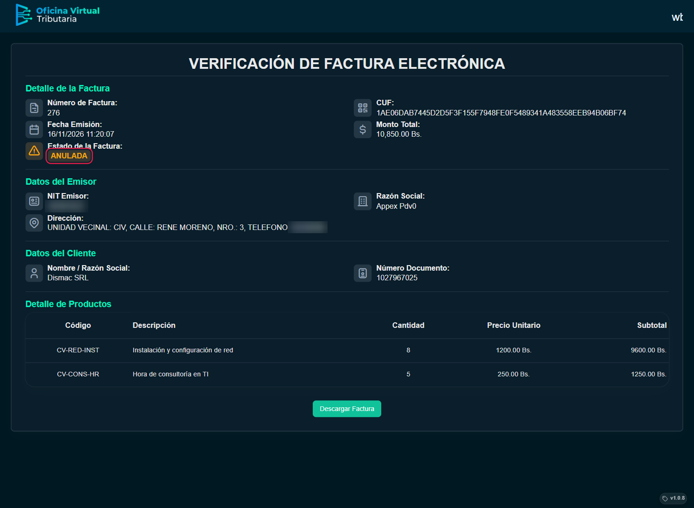
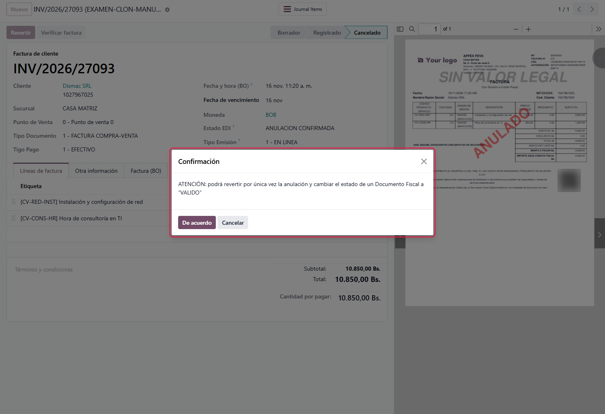
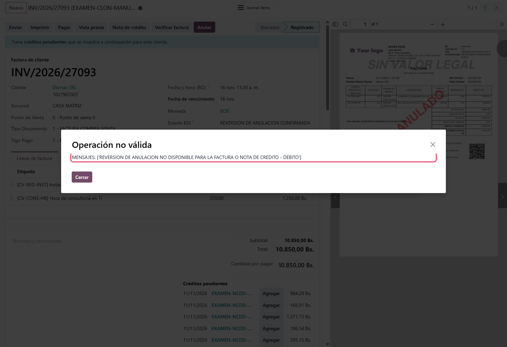

# 1. Anulación y reversión

Anular una factura es la forma de dejarla sin efecto cuando se detecta un error en su emisión. Una factura anulada deja de ser un documento válido ante Impuestos Nacionales. Esta sección explica cómo anularla, cómo comprobar en el SIAT que la anulación se registró y cómo deshacerla si fue un error.

## 1.1 ¿Anular o emitir una nota de crédito?

Las dos opciones sirven para corregir una venta, pero se usan en situaciones distintas. La anulación se usa cuando la factura se emitió mal: por ejemplo, los datos de emisión son incorrectos o la factura fue mal emitida. Estos son los motivos que ofrece el catálogo de códigos de cancelación del SIAT. La nota de crédito (sección [Nota de crédito-débito](../parte-2/nota-de-credito-debito.md) de la Parte II), en cambio, se usa cuando la venta fue correcta pero hubo una devolución o una rescisión del servicio, total o parcial.

## 1.2 Anular la factura

Abra la factura validada y pulse el botón Anular. Se abre el asistente Cancelar factura, donde debe elegir la razón de la anulación en el campo Razón de venta. Si el motivo que necesita no aparece en la lista, use Buscar más… para ver todas las razones disponibles. Luego pulse Anular para confirmar, o Cancelar para salir sin hacer cambios.

{ width="624" height="428" loading="lazy" }

Una vez confirmada la anulación, la factura pasa al estado Cancelado y el campo Estado EDI cambia a ANULACION CONFIRMADA. En este estado el único botón disponible es Revertir.

{ width="624" height="428" loading="lazy" }

## 1.3 Verificar el estado en el SIAT

Puede comprobar en cualquier momento el estado real de la factura ante Impuestos Nacionales. Abra la pestaña Factura (BO) de la factura. Allí encontrará la leyenda, el número de factura, el Cuf y un enlace (url) que lleva a la página de consulta del SIAT. En el entorno de prueba, el enlace apunta al portal piloto.

{ width="624" height="428" loading="lazy" }

Al abrir el enlace, el SIAT muestra la página Verificación de factura electrónica con el CUF, el monto, los datos del emisor y del cliente, y el estado de la factura. Si la anulación se registró correctamente, el estado es ANULADA.

{ width="624" height="458" loading="lazy" }

En la misma pestaña, el campo Observaciones (BO) muestra los mensajes que devolvió el SIAT. Por ejemplo, el código 2.005 indica que se envió un NIT de cliente inválido junto con un código de excepción. Si es su caso, revise también la opción Forzar envío.

## 1.4 Revertir la anulación

Si anuló la factura por error, pulse el botón Revertir. El sistema muestra un mensaje de confirmación que explica que la factura vuelve a ser un documento válido y que la anulación solo puede revertirse una sola vez. Pulse De acuerdo para continuar.

{ width="624" height="428" loading="lazy" }

Al terminar, el Estado EDI pasa a REVERSION DE ANULACION CONFIRMADA y la factura vuelve al estado Registrado, es decir, otra vez como documento válido. Puede comprobarlo en el SIAT con el enlace de la pestaña Factura (BO).

## 1.5 Límite: solo una anulación y una reversión

!!! warning "Importante"

    Una factura se puede anular una vez y esa anulación se puede revertir una sola vez. Después de revertirla, si intenta anularla de nuevo, el sistema muestra el error Operación no válida: REVERSIÓN DE ANULACIÓN NO DISPONIBLE PARA LA FACTURA O NOTA DE CREDITO - DEBITO. Por eso, antes de anular, asegúrese de que realmente es lo que necesita. Si luego hay que corregir la venta, use una nota de crédito.

{ width="624" height="428" loading="lazy" }
