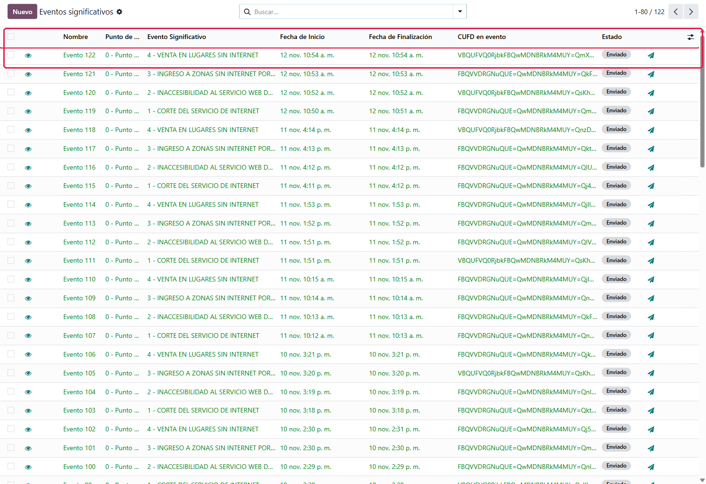

# 2. Facturación fuera de línea y eventos significativos

La facturación en línea depende de la conexión con el SIAT: cada factura se autoriza en el momento de emitirla. Cuando esa conexión se interrumpe, la normativa permite seguir facturando sin conexión y regularizar las facturas después. Para eso existe el botón Fuera de línea del punto de venta y el menú Eventos significativos.

## 2.1 Qué es un evento significativo

Un evento significativo es un hecho propio del sistema de facturación que impide seguir emitiendo documentos fiscales en línea. La RND 102100000011 reconoce siete, que son los mismos que ofrece Odoo al registrar el evento: corte del servicio de internet (1), inaccesibilidad al servicio web de la Administración Tributaria (2), ingreso a zonas sin internet por despliegue de punto de venta (3), venta en lugares sin internet (4), virus informático o falla de software (5), cambio de infraestructura de sistema o falla de hardware (6) y corte de suministro de energía eléctrica (7).

La norma no trata a los siete de la misma manera. En los eventos 1 a 4 se siguen emitiendo facturas digitales, pero fuera de línea: son facturas normales que se generan sin conexión y se envían al SIAT cuando esta vuelve. En los eventos 5 a 7, en cambio, el sistema mismo está caído, así que corresponde emitir facturas por contingencia, que son talonarios impresos con un CAFC (Código de Autorización de Factura de Contingencia) solicitado con anticipación al SIN. El botón Fuera de línea de Odoo cubre el primer caso: la emisión sin conexión desde el propio sistema.

Los eventos 3 y 4, que son ventas en zonas sin internet, requieren además una autorización previa del SIN, en la que se describe la operativa, su frecuencia, el periodo y el alcance geográfico.

## 2.2 Vigencia del CUFD y plazos para regularizar

El CUFD dura 24 horas, pero durante una contingencia esa vigencia se extiende: hasta 72 horas en los eventos 1 y 2, y hasta 15 días en los eventos 3 y 4, siempre que el evento esté registrado y la firma digital no esté revocada.

Los plazos que debe tener presentes son tres. El inicio y el fin del evento se registran hasta 48 horas después de concluida la contingencia. Las facturas emitidas fuera de línea se registran dentro de las 48 horas siguientes al restablecimiento de la comunicación con el SIN. Las facturas por contingencia, las del talonario impreso, tienen un plazo mayor: 72 horas desde el restablecimiento. En los eventos 3 y 4 hay un límite adicional: las transacciones de un periodo fiscal no deben registrarse después del día 10 del mes siguiente.

Una factura emitida fuera de línea tiene validez jurídica y probatoria desde que se emite. Al comprador se le entrega el XML y la representación gráfica, que lleva una leyenda indicando que es la representación gráfica de un documento fiscal digital emitido fuera de línea. Si el evento no permite enviarla por correo, se imprime y se entrega sin que el comprador la pida. Una vez terminada la contingencia, el comprador puede verificar la factura en las opciones de consulta del SIAT.

La normativa también exige tener al menos una medida de seguridad prevista para estos casos: generación eléctrica alternativa, equipos o software de respaldo, o un stock de facturas por contingencia. Ese stock no puede superar el 10% de las facturas emitidas en el último periodo reportado; si no existe ese dato, se asigna un talonario por casa matriz o sucursal.

## 2.3 Cómo se maneja en Odoo

El botón Fuera de línea está entre los botones del punto de venta y hace exactamente lo que indica: pone ese punto de venta fuera de línea. Al activarlo se elige cuál de los siete eventos corresponde.

El registro de los eventos se consulta en Facturación (BO), opción Eventos significativos. La lista muestra el nombre del evento, el punto de venta, el tipo de evento elegido, la fecha de inicio, la fecha de finalización, el CUFD con el que se abrió y el estado.

{ width="624" loading="lazy" }

Las fechas de inicio y finalización se registran automáticamente: no hay que escribirlas. La fecha de inicio queda al poner el punto de venta fuera de línea y la de finalización al volver a ponerlo en línea.

Mientras el punto de venta está fuera de línea, las facturas se emiten con normalidad pero no se envían al SIAT. Quedan guardadas y se envían después, en paquetes. Cuando el punto de venta vuelve a estar en línea, esas facturas se regularizan solas: no hay que enviarlas una por una.

En la lista de eventos, el estado indica en qué situación está cada uno. Un evento en Borrador es un evento todavía no comunicado al SIAT; uno en Enviado ya fue comunicado. Tenga en cuenta los plazos de la sección anterior: el evento debe quedar registrado dentro de las 48 horas posteriores al fin de la contingencia.

## 2.4 Facturas por contingencia con CAFC (eventos 5 a 7)

En los eventos 5, 6 y 7 el que falla es el propio sistema de facturación, así que no se puede emitir ni siquiera fuera de línea. En ese caso se usan **facturas por contingencia**: un talonario impreso, preimpreso con un **CAFC** (Código de Autorización de Facturas de Contingencia) que entrega el SIN, y con un rango de números propio. Durante la contingencia las facturas se llenan a mano; cuando el sistema vuelve, se cargan en Odoo y se envían al SIAT.

**Antes de la contingencia: registrar el CAFC.** Cada talonario autorizado por el SIN se carga una sola vez en Ajustes → Facturación (BO) → Compañia → Códigos CAFC → Nuevo:

- **Código**: el CAFC tal como figura en la autorización del SIN.

- **Sucursal**, **Documento Sector** y **Actividad Económica**: a qué sucursal, tipo de documento y actividad corresponde el talonario. Debe haber un solo CAFC por documento sector y actividad.

- **Rangos** (Desde – Hasta): la numeración impresa del talonario, por ejemplo 1 – 50. La **Secuencia Actual** empieza en el valor Desde y avanza sola con cada factura cargada.

**Durante la contingencia: emitir en papel.** Se llenan las facturas del talonario en orden correlativo y se entrega el original al comprador. No hace falta Odoo para esto.

**Al volver el sistema: cargar las facturas en Odoo.** Con el punto de venta todavía fuera de línea y el evento 5, 6 o 7 elegido (sección 2.3):

1. **Crear una factura por cada factura del talonario**, en el mismo orden en que se emitieron, con el mismo cliente, las mismas líneas y el mismo importe.

1. **Poner la fecha y hora de emisión real** en el campo Fecha y Hora EDI. No puede ser anterior al inicio del evento.

1. **Confirmar.** Odoo marca la factura como **Factura Manual - CAFC**, le asigna el número siguiente del rango del CAFC (no el de la secuencia del punto de venta) y muestra el código en el campo CAFC de la pestaña Factura (BO).

1. **Volver a poner el punto de venta en línea.** Las facturas se envían al SIAT en paquetes, con su CAFC, igual que las de los eventos 1 a 4.

!!! warning "Importante"

    El número que Odoo asigna sale de la Secuencia Actual del CAFC, no del papel. Si las facturas se cargan en otro orden, o se salta una, los números de Odoo dejan de coincidir con los del talonario. Antes de confirmar, compare la Secuencia Actual con el número de la factura en papel. El plazo para regularizar las facturas por contingencia es de 72 horas desde que se restablece el sistema (sección 2.2).

Si al confirmar aparece «No se encontró CAFC's vinculados al documento» o «No se encontró un código CAFC para la Actividad Económica asociada», falta cargar el CAFC de ese tipo de documento y actividad. Si aparece «Ha llegado al final de la secuencia para el CAFC», el talonario se agotó y hay que registrar el siguiente. Las facturas prevaloradas (tipos 23 y 36) no admiten emisión con CAFC.
