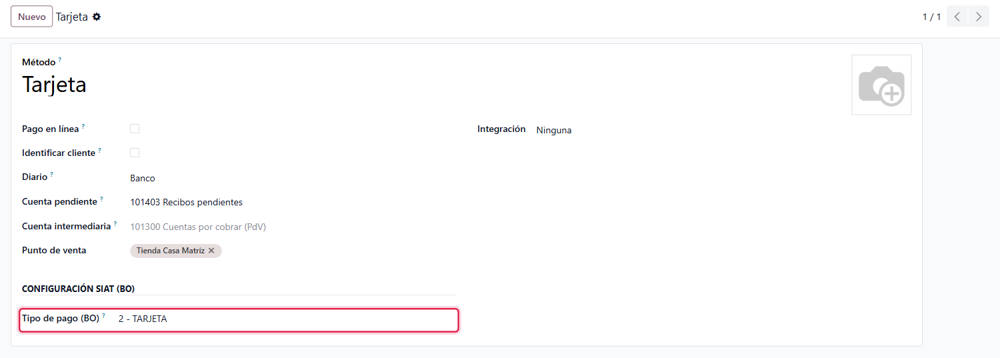
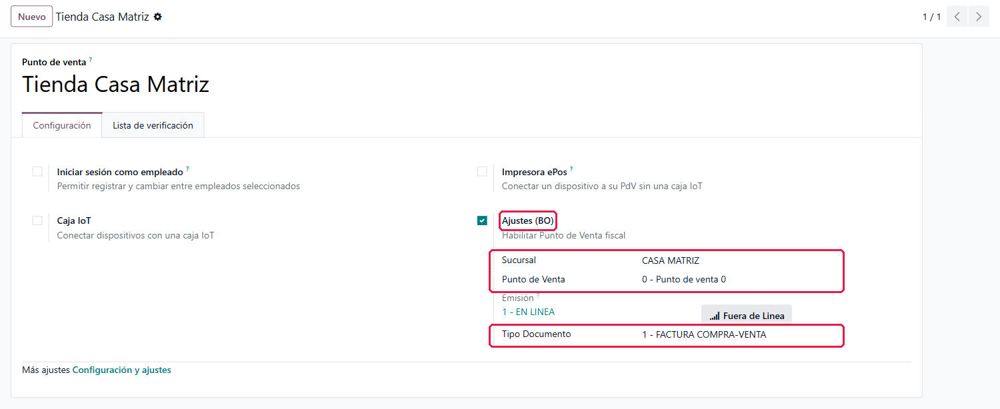
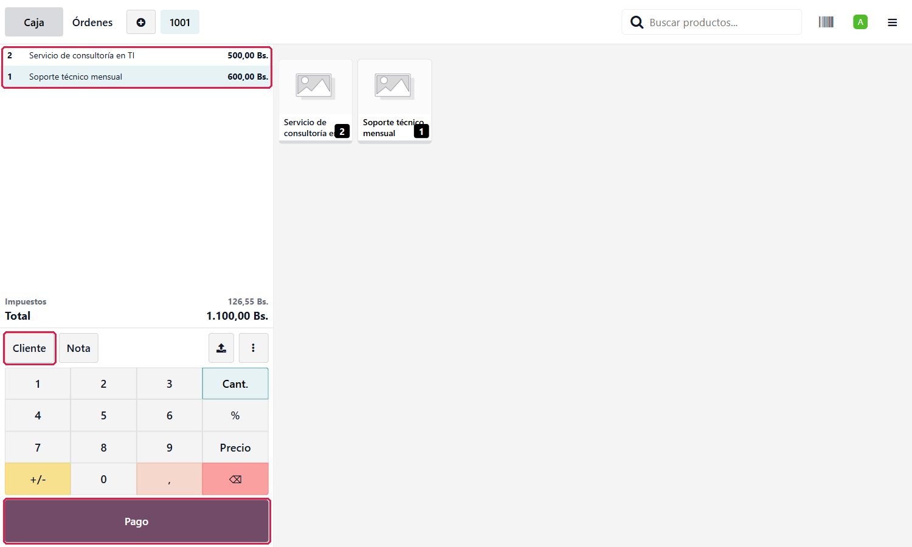
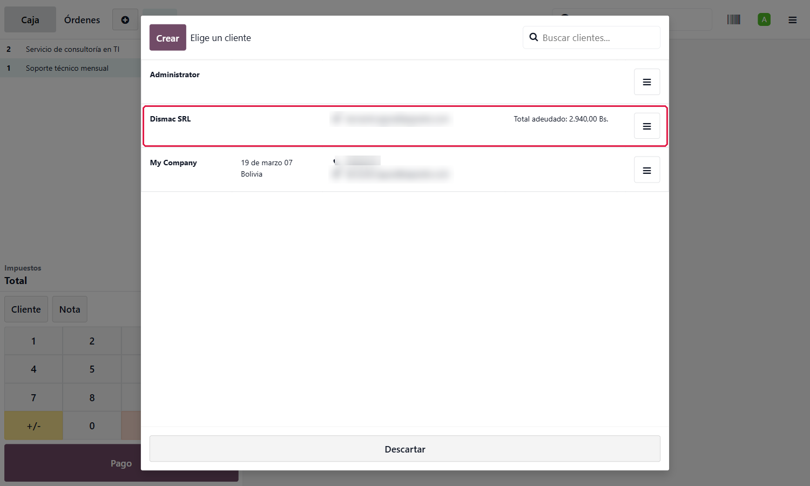
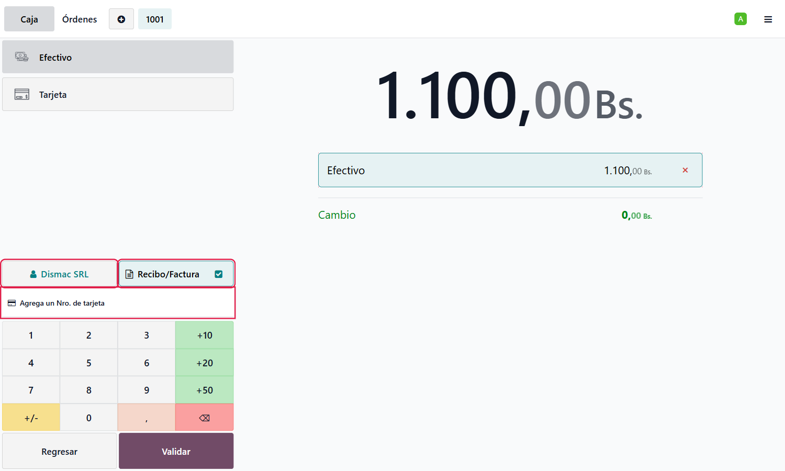
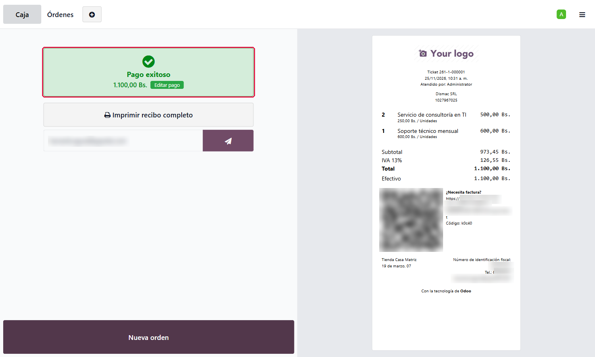
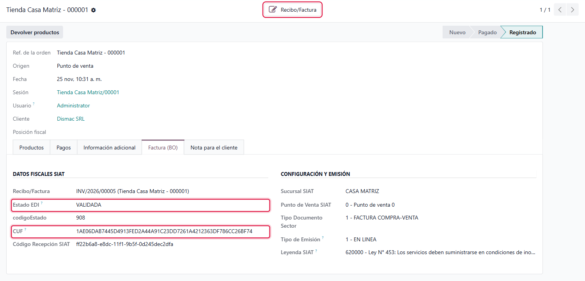
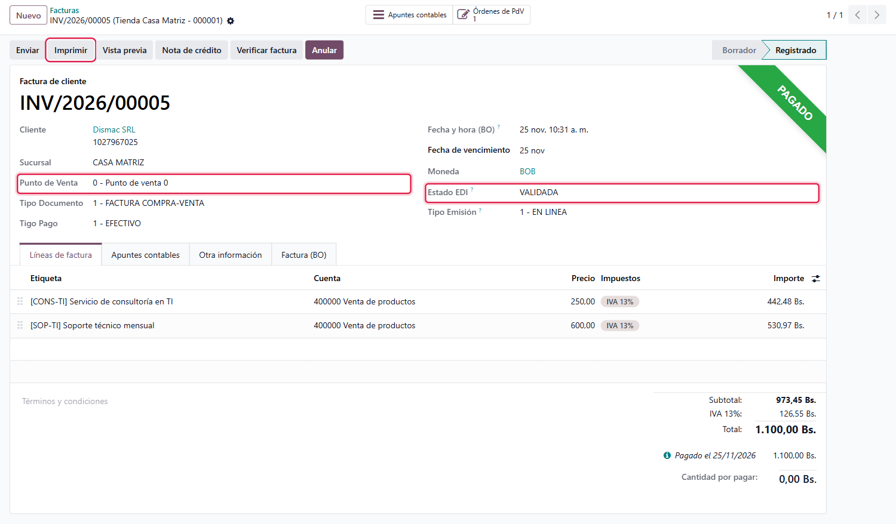
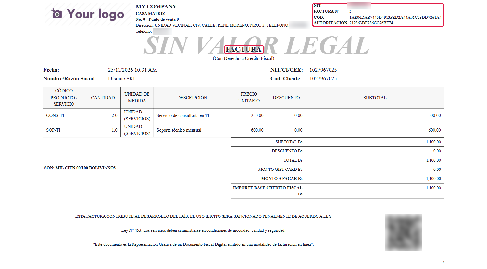
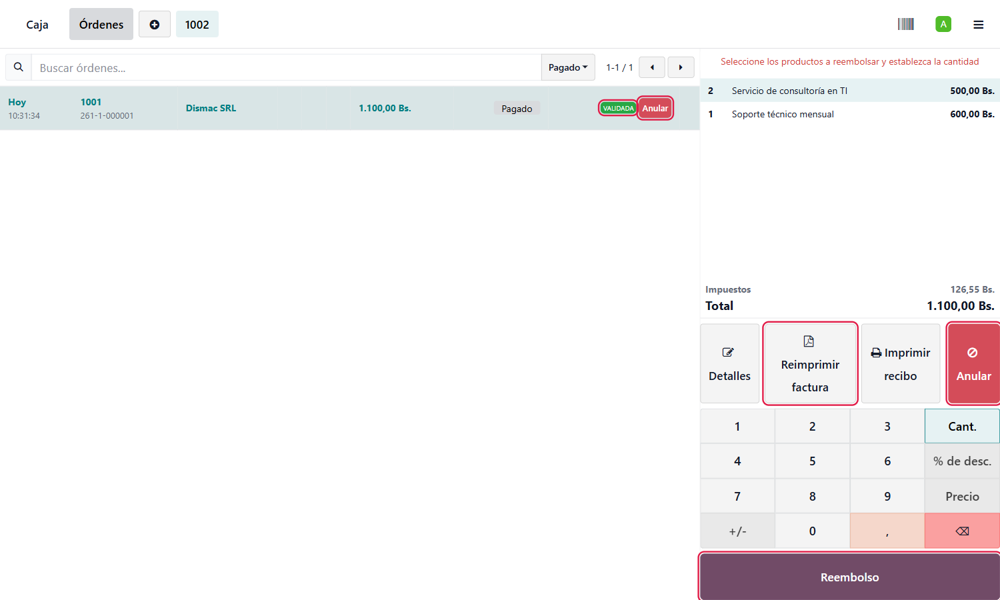

# 1. Facturación desde el Punto de Venta (PdV)

Además de la factura que se carga en Facturación, Odoo tiene la aplicación **Punto de venta**: la caja con la que se cobra en el mostrador. Con el módulo **Punto de venta (BO)**, cada venta cobrada en la caja se emite como **factura de compra-venta** ante el SIN en el momento de validar el pago, sin pasar por el menú de facturas.

!!! note "Nota"

    En este manual hay dos cosas que se llaman «punto de venta». La **caja de Odoo** (aplicación Punto de venta) es donde se cobra. El **punto de venta del SIAT** (sección 3 de la Parte I) es el que tiene CUIS y CUFD. Cada caja de Odoo se enlaza a un punto de venta del SIAT, y las facturas de esa caja salen con sus códigos.

## 1.1 Qué hace el módulo

- **Factura al cobrar:** al validar el pago de una orden marcada como **Recibo/Factura**, Odoo emite la factura `1 - FACTURA COMPRA-VENTA` y la envía al SIN. Es el único tipo de documento disponible desde la caja.
- **Pago con tarjeta:** pide los primeros 4 y los últimos 4 dígitos de la tarjeta, que el SIN exige en la factura.
- **Devoluciones:** el botón **Reembolso** de una venta facturada genera una **nota de crédito-débito** (`24 - NOTA DE CRÉDITO-DÉBITO`) vinculada a la factura original.
- **Anulación:** la factura de una venta se puede anular desde la propia caja, eligiendo el motivo del SIAT.
- **Fuera de línea:** si el SIN no responde, la caja usa el mismo procedimiento de la sección 2 de la Parte III: su configuración tiene los botones **En línea** y **Fuera de línea**.

## 1.2 Configurar la caja (una sola vez)

1. **Instalar el módulo** Punto de venta (BO) desde Aplicaciones, si no está instalado. Instala también la aplicación Punto de venta de Odoo.

1. **Asignar el tipo de pago del SIAT a cada método de pago.** Punto de venta → Configuración → **Métodos de pago** → abrir cada método → **Tipo de pago (BO)**: por ejemplo `1 - EFECTIVO` para Efectivo y `2 - TARJETA` para Tarjeta.

    { width="624" height="223" loading="lazy" }

    Si un método no tiene tipo de pago, la caja no abre y muestra `Este PdV tiene activada la facturación electrónica (BO). Por tanto, todos los métodos de pago para este PdV deben tener asignado un 'Tipo de Pago (BO)'`, con el nombre del método afectado.

1. **Revisar el diario de facturas.** La caja emite las facturas en el diario de ventas, que debe tener activado el interruptor Factura (BO) (sección 3.6 de la Parte I). Si no lo tiene, al abrir la caja aparece `Diario de facturas para punto de venta inválido.`

1. **Enlazar la caja con el SIAT.** Punto de venta → Configuración → **Puntos de venta** → abrir la caja → activar **Ajustes (BO)** y completar:

    - **Sucursal:** la sucursal del SIAT donde está la caja.
    - **Punto de Venta:** el punto de venta del SIAT. Solo se listan los que ya tienen tipo de emisión (sección 3 de la Parte I).
    - **Tipo Documento:** `1 - FACTURA COMPRA-VENTA`. Si se elige otro, Odoo responde que la implementación del punto de venta no está disponible para ese documento.

    { width="624" height="255" loading="lazy" }

1. **Habilitar los productos en la caja.** En cada producto que se vende en el mostrador, marcar **Disponible en PdV**. El producto necesita su código del SIAT, igual que en cualquier factura (sección 4 de la Parte I).

## 1.3 Vender y facturar

1. **Abrir la caja.** Punto de venta → **Tablero** → **Abrir caja registradora**. En **Control de apertura** se indica el efectivo inicial y se pulsa otra vez **Abrir caja registradora**.

1. **Cargar los productos** de la venta tocando cada uno; para cambiar la cantidad se usa **Cant.** del teclado.

    { width="624" height="374" loading="lazy" }

1. **Elegir el cliente** con el botón **Cliente**: buscarlo y tocarlo, o crearlo con **Crear**. El cliente necesita su tipo de identificación y su NIT o CI, igual que en una factura común.

    { width="624" height="374" loading="lazy" }

1. **Cobrar.** Pulsar **Pago** y elegir el método de pago. Comprobar que **Recibo/Factura** esté marcado: sin esa marca la venta no se factura ante el SIN. Si el pago es con tarjeta, pulsar **Agrega un Nro. de tarjeta** y escribir los primeros 4 y los últimos 4 dígitos.

    { width="624" height="374" loading="lazy" }

1. **Pulsar Validar.** Odoo emite la factura y la envía al SIN; puede tardar unos segundos. Al terminar aparece **Pago exitoso** con el ticket de la venta, y la factura queda disponible para imprimir o enviar al cliente.

    { width="624" height="374" loading="lazy" }

## 1.4 Ver la factura de una venta

Cada venta facturada desde la caja tiene su factura en Odoo, igual que una factura cargada a mano. Para verla o imprimirla:

1. **Abrir la venta.** Punto de venta → Órdenes → **Órdenes** → abrir la venta. En la pestaña **Factura (BO)** está su estado ante el SIN: el **Estado EDI** debe decir `VALIDADA`, junto con el **CUF** y la sucursal y el punto de venta del SIAT con que se emitió.

    { width="624" height="300" loading="lazy" }

1. **Abrir la factura** con el botón **Recibo/Factura** de la parte superior de la venta. Se abre la factura de cliente, con su número, el punto de venta y el **Estado EDI**.

    { width="624" height="365" loading="lazy" }

1. **Imprimirla o enviarla** con los botones **Imprimir** o **Enviar** de la factura, como cualquier otra factura (sección [Factura de compra-venta › Cómo se ve la factura impresa](../parte-2/factura-de-compra-venta.md#como-se-ve-la-factura-impresa)). Desde la caja también se puede volver a generar con **Reimprimir factura** (sección 1.5).

    { width="624" height="345" loading="lazy" }

## 1.5 Anular, reimprimir y devolver desde la caja

En la caja, pulse **Órdenes**, cambie el filtro **Activo** por **Pagado** y elija la venta. Las ventas facturadas muestran su estado ante el SIN (por ejemplo `VALIDADA`) y estos botones:

- **Anular:** anula la factura ante el SIN. Pide el motivo de anulación del SIAT y confirma antes de enviar. Rigen las mismas reglas de la sección 1 de la Parte III: una factura se anula una sola vez.
- **Reimprimir factura:** vuelve a generar el PDF de la factura.
- **Reembolso:** se eligen los productos y las cantidades devueltas. Si la venta original fue facturada ante el SIN, Odoo emite una nota de crédito-débito vinculada a esa factura; si no lo fue, registra la devolución solo en la contabilidad.

{ width="624" height="374" loading="lazy" }
